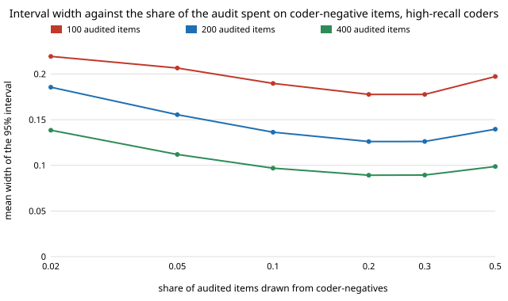

# qual-highrecall: does a low audit rate for coder-negatives pay when the coder has high recall?

**Only barely, and not against a plain random audit: on 3,188 real GoEmotions comments, coders with recall 0.72, 0.90 and 1.00 gave 95% intervals for prevalence of 0.115, 0.116 and 0.119 wide at 200 audited items (best share each), against 0.1195 for auditing 200 random items with no coder at all.** With recall 0.90 the best share of the audit among coder-negatives is 10–20% (width 0.116–0.119, against 0.136 at half), so the answer to `qual-lowrate`'s open question is yes, a low rate helps, but a lower rate than 10% still under-covers (worst-coder coverage 0.77 at 5%, 0.48 at 2%, 200 items). The coders are **not LLMs**: a naive-Bayes classifier whose cut-off codes 2, 3 and 4 times the human positive share. Produced with AI assistance (Claude).

**Live page:** https://duncan-haywood.github.io/oss-monorepo/research/qual-highrecall/

Track 19 (`qual`, [`PROJECTS.md`](../PROJECTS.md)). It takes the first "Next steps" item of [`qual-lowrate`](../qual-lowrate): whether a low negative-audit rate pays when the coder's recall is high. Same corpus, split, seed, estimator and design; only the coders change. No lab tag: this builds on none of the listed groups.



## Method

As [`qual-lowrate`](../qual-lowrate): 5,313 GoEmotions examples, 2,125 train the naive-Bayes coder, 3,188 are evaluated, human code = a majority of raters marked a negative emotion (prevalence 0.2469). The cut-off is moved to code 2.0, 3.0 and 4.0 times that share. An audit of 100, 200 or 400 items puts a share s (0 to 0.5) among coder-negatives; stratified estimate, Wald interval, 1,000 draws per cell. Added baseline: the Wald width of a simple random audit of n items with no coder.

## Results

From [`results.txt`](experiments/results.txt).

| coder | coded positive | precision | recall | Neyman negative share |
|---|---:|---:|---:|---:|
| nb x2.0 | 0.494 | 0.358 | 0.717 | 0.425 |
| nb x3.0 | 0.741 | 0.300 | 0.900 | 0.184 |
| nb x4.0 | 0.987 | 0.250 | 1.000 | 0.000 |

Width of the 95% interval, 200 audited items:

| negative share | 0.02 | 0.05 | 0.1 | 0.2 | 0.3 | 0.5 |
|---|---:|---:|---:|---:|---:|---:|
| nb x2.0 (recall 0.72) | 0.280 | 0.212 | 0.165 | 0.130 | 0.118 | 0.115 |
| nb x3.0 (recall 0.90) | 0.156 | 0.133 | 0.119 | 0.116 | 0.119 | 0.136 |
| nb x4.0 (recall 1.00) | 0.120 | 0.121 | 0.125 | 0.132 | 0.141 | 0.167 |

1. **The best share tracks recall.** The oracle (Neyman) negative share falls from 0.43 to 0.18 to 0 as recall rises, and the empirical optimum follows: 50%, 20%, 2% or lower. This is the direction `qual-lowrate` could not test.
2. **No gain over a plain random audit.** Random audit of 200 items: width 0.1195 (100: 0.169, 400: 0.0845). The best coder-assisted cell is 0.115 to 0.119 in every case, a difference of at most 4%. A coder with 0.30 precision tells the audit little about which items hold positives.
3. **Coverage still fails at low shares unless recall is near-perfect.** Worst-coder coverage at 200 items: 0.48 (2%), 0.77 (5%), 0.91 (10%), 0.94 (20%). The recall 1.00 coder is fine (0.95–0.97) because its negative stratum holds no positives at all, but it codes 98.7% of items positive, so it is a coder in name only.
4. **Bias is gone in every cell with at least one audited negative** (within ±0.005), as in `qual-lowrate`; only the positives-only audit is biased (−0.070, −0.025, 0.000 by coder).

## Limitations

- Real high recall here is bought with low precision by moving the cut-off of a weak classifier; an LLM with both high recall and high precision would shrink the positive stratum's variance as well, which this does not test. No LLM was called.
- One code, one corpus, one split; Wald intervals only (the Wilson stratum interval is still open); finite-population correction ignored.
- Three coders, so "the best share" is read off a coarse grid.

## Next steps

A real LLM coder (behind `ANTHROPIC_API_KEY` with a deterministic stub) with both recall and precision high; a Wilson stratum interval for 2–10 audited negatives; the same design for a group gap.

## Reproduce

```
python3 research/qual-highrecall/experiments/run.py      # ~1 min after the shared download (cache shared with qual-real), writes results.txt
python3 research/qual-highrecall/experiments/figure.py   # writes the SVG
cd research/qual-highrecall && python3 -m unittest test_highrecall
```

## References

- Demszky et al. (2020). GoEmotions: A Dataset of Fine-Grained Emotions. ACL 2020; arXiv:2005.00547. Data under Apache 2.0, as checked in [`qual-real`](../qual-real).
- Cochran (1977), *Sampling Techniques*, 3rd ed., Wiley: stratified estimation and optimum allocation.
- [`qual-lowrate`](../qual-lowrate), [`qual-labelaudit`](../qual-labelaudit), [`qual-correction`](../qual-correction): estimators and design.

## Outside dependencies

The GoEmotions download (public bucket). No model API was called.
