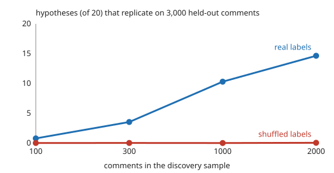

# qual-hypothesis: do hypotheses about what separates two sets of documents survive a held-out check?

**On 5,313 real Reddit comments (GoEmotions), a counting proposer that picks the 20 words most associated with negative emotion in a small discovery sample overstates every effect it finds, and the overstatement shrinks only as the discovery sample grows: at 100 discovery comments the mean absolute effect is 0.095 in discovery and 0.013 on 3,000 held-out comments (7.6 times too large), at 2,000 it is 0.021 against 0.014 (1.5 times).** A Benjamini-Hochberg check on the held-out comments (5%) confirms 0.8 of the 20 hypotheses at 100 discovery comments and 14.7 at 2,000, and with the labels shuffled it confirms almost none (0.03 to 0.07 per split, at most 5.5% of splits with any), so the check controls false discoveries. But 36–59% of the confirmed hypotheses are the label's own vocabulary ("sorry", "hate", "worst"), which restates the label rather than explaining it. **The proposer is not an LLM**: the session had no API key, so a word-counting baseline stands in for the hypothesis generator, and the project measures the *validation step* an LLM proposer would need. Produced with AI assistance (Claude).

**Live page:** https://duncan-haywood.github.io/monorepo-projects/research/qual-hypothesis/

Track 19 (`qual`, [`PROJECTS.md`](../PROJECTS.md)), milestone 6. Ludwig and Mullainathan (2024) use machine learning to generate human-readable hypotheses and test them on held-out data; this project is a small stylised version of the test, on text, with a baseline proposer. The question of the milestone, "does the check catch hypotheses that merely restate the label", is answered only crudely (below).



## Data

GoEmotions (Demszky et al. 2020), as loaded in [`qual-real`](../qual-real): 5,313 comments with at least three raters and none marked "very unclear". Set 1 is the 24.7% whose human code is negative emotion (a majority of raters marked one of 11 negative emotions), set 0 the rest. The first raw file is downloaded from the authors' public bucket into a cache outside the repository; **no comment text is committed**. Apache 2.0 data; usernames are never read.

## Method

- **Hypothesis**: "the comment contains the word *w*". Its effect is the rate in set 1 minus the rate in set 0.
- **Proposer** (`propose`): from a random discovery sample, the 20 words (at least 5 discovery comments) with the largest absolute pooled two-proportion z.
- **Held-out check** (`test_hypotheses`): on 3,000 other random comments, a two-sided z test for each of the 20, Benjamini-Hochberg at 5% over the 20; a hypothesis *replicates* if it passes and has the same sign as in discovery.
- **Label restatement** (`restates_label`): a crude flag, true if the word is in the negative word list of `qual-real` or is an emotion name. It misses many restatements ("fucking") and the list was written for another purpose, so read the shares as lower bounds on restatement.
- **Controls**: the same procedure with the labels shuffled in both samples (no true effect).
- 200 seeded random splits per row; discovery sizes 100, 300, 1,000, 2,000.

## Reproduce

```
python3 research/qual-hypothesis/experiments/run.py      # ~1.5 min after a ~14 MB download (shared cache with qual-real), writes results.txt
python3 research/qual-hypothesis/experiments/figure.py   # writes the SVG
cd research/qual-hypothesis && python3 -m unittest test_qualhyp
```

## Results

From [`results.txt`](experiments/results.txt). Effects are mean absolute differences in rate across the 20 hypotheses.

| discovery comments | effect in discovery | effect held-out | replicating (of 20) | of those, label vocabulary |
|---:|---:|---:|---:|---:|
| 100 | 0.0948 | 0.0125 | 0.80 | 6.9% |
| 300 | 0.0550 | 0.0119 | 3.55 | 36.3% |
| 1,000 | 0.0283 | 0.0132 | 10.31 | 57.8% |
| 2,000 | 0.0211 | 0.0141 | 14.65 | 59.0% |

Shuffled labels (nothing to find):

| discovery comments | effect in discovery | effect held-out | replicating (of 20) | splits with any replicating |
|---:|---:|---:|---:|---:|
| 100 | 0.0920 | 0.0092 | 0.030 | 2.5% |
| 300 | 0.0500 | 0.0064 | 0.035 | 3.0% |
| 1,000 | 0.0224 | 0.0045 | 0.025 | 2.5% |
| 2,000 | 0.0133 | 0.0034 | 0.065 | 5.5% |

1. **Discovery effects are inflated by selection.** With shuffled labels, picking the most extreme of thousands of words gives a discovery effect of 0.09 at 100 comments that is really 0.01: the winner's curse, as in [`explanation-twin`](../explanation-twin). With real labels the same inflation holds at small samples (7.6 times at 100 comments).
2. **The held-out check does its job.** Across 800 shuffled-label splits, at most 5.5% (11 of 200) of splits at any size produced a confirmed hypothesis, consistent with a 5% error rate over the family. With real labels it confirms real structure once the discovery sample is large enough to find it.
3. **Most confirmed hypotheses are about the label's own words.** One split (E3) shows the pattern: confirmed are "sorry", "sad", "hate", "stupid", "worst", "shit", "fuck", "damn" (label vocabulary), plus "fucking", "m" and "lol" (the last, negative: *lol* is a mark of non-negative comments). A reader wanting hypotheses that *explain* the label has to filter these out; replication does not.
4. **Replication is not novelty.** The check says a hypothesis is true of the data, not that it is interesting. An LLM proposer would write fluent hypotheses ("the comment apologises"), but needs the same held-out step and the same filter.

## Limitations

- The proposer is a word counter, not an LLM, and the hypotheses are single words. An LLM proposer's hypotheses are more varied and may restate the label less, or more; this project does not measure that.
- The restatement flag is a hand-written word list and is incomplete; the shares in the tables are lower bounds, and no human judged whether a hypothesis "explains" the label.
- One corpus, one label, one family size (20); the false-discovery check is run only on the family the proposer chose, and held-out comments are drawn from the same file (same subreddits, same time), so it says nothing about transfer.
- The effects are small (mean held-out difference about 1 point of rate); several confirmed words are significant mainly because 3,000 held-out comments are enough to confirm a 1-point difference.

## Next steps

Replace the counting proposer with an LLM behind `ANTHROPIC_API_KEY` (with a deterministic stub), and compare the two on replication rate and label restatement judged by a stricter filter (hypotheses that stay significant after conditioning on a negative-word indicator); try multi-word and conceptual hypotheses; report held-out sample sizes needed to confirm effects of 1 point.

## References

- Ludwig, J. and Mullainathan, S. (2024). Machine Learning as a Tool for Hypothesis Generation. *Quarterly Journal of Economics* 139(2), 751–827.
- Demszky, D. et al. (2020). GoEmotions: A Dataset of Fine-Grained Emotions. ACL 2020; arXiv:2005.00547. Data under Apache 2.0, as checked in [`qual-real`](../qual-real).
- Benjamini, Y. and Hochberg, Y. (1995). Controlling the false discovery rate. *Journal of the Royal Statistical Society B* 57(1), 289–300.

I could not open these from the session; the authors, venues and years are from memory of the standard citations and the QJE page numbers should be confirmed before the paper is cited elsewhere.

## Outside dependencies

The GoEmotions download (public bucket). No model API was called.
