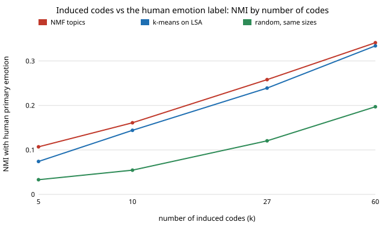

# qual-induce: how much of a human emotion codebook does a codebook induced from the text alone recover?

**Weakly. On 5,313 real Reddit comments (GoEmotions), a codebook induced from half the text with no labels agreed with the 27-emotion human codebook only a little above chance, and the best single induced code per emotion reached a held-out AUC of about 0.6.** With 27 NMF topics the normalised mutual information (NMI) with the human primary emotion was 0.258 against 0.120 for a random assignment of the same sizes; with 60 topics 0.341 against 0.195. The excess over chance is 0.10 to 0.15 at every size, and chance itself climbs with the number of codes, so a raw NMI table flatters bigger codebooks. NMF topics were almost uncorrelated with each other (mean |r| 0.016 to 0.039); k-means with 5 or 10 codes was redundant (10–12% of code pairs above |r| 0.3). **The induced codebooks are topic models, not an LLM's (TopicGPT or LLooM style) codebook**: the session has no API key, so this is the no-model baseline that an LLM-induced codebook has to beat, not a statement about LLMs. Produced with AI assistance (Claude).

**Live page:** https://duncan-haywood.github.io/oss-monorepo/research/qual-induce/

Track 19 (`qual`, [`PROJECTS.md`](../PROJECTS.md)), milestone 4 (`qual-induce`), in the form the container allows: inductive coding compared with a human codebook on the same corpus, with a classical induction method standing in for the model. It reuses the corpus, the download cache and the rater-majority convention of [`qual-real`](../qual-real).



## Method

- Corpus: GoEmotions (Demszky et al. 2020), examples with at least 3 raters and none flagged very unclear: 5,313. The comment text is read from a cached download and never committed. Human codebook = the 27 emotions (neutral excluded); an emotion is on for a comment when a majority of its raters marked it. The *primary emotion* is the one a majority marked, when exactly one reached the top: 1,906 comments.
- Five random 50/50 splits (seeds 0 to 4). Each induced codebook is fitted on one half and applied to the other, so every number is on held-out comments.
- Induction methods, with k = 5, 10, 27 and 60 codes: **NMF** on tf-idf (each topic is a code; a comment's code is its largest activation) and **k-means** on a 100-d LSA of tf-idf (a comment's code is its nearest centroid). Both stand in for model-proposed codes only in the sense of being label-free; neither writes a definition.
- **Agreement:** NMI between the induced assignment and the human primary emotion. Chance: the same assignment randomly permuted against the labels, which keeps code sizes.
- **Coverage:** for each emotion with at least 30 positives in both halves (15 of 27), pick the induced code whose score has the best AUC on the fitting half, and report that code's AUC on the held-out half. Choosing on one half and scoring on the other avoids rewarding a lucky pick.
- **Redundancy:** mean absolute pairwise Pearson correlation of code scores on held-out comments, and the share of code pairs above 0.3. The human row uses the 0/1 emotion labels.
- **Stability:** NMI between two codebooks induced on disjoint halves and applied to the same held-out comments. This number is not chance-corrected, and chance NMI also rises with k, so read it as a ranking within a k, not as a level.

## Results

Copied from [`results.txt`](experiments/results.txt) (mean over 5 splits).

| method | k | NMI with human | NMI at chance | stability NMI | effective codes used |
|---|---:|---:|---:|---:|---:|
| NMF | 5 | 0.107 | 0.035 | 0.231 | 3.7 |
| NMF | 10 | 0.161 | 0.058 | 0.271 | 7.4 |
| NMF | 27 | 0.258 | 0.120 | 0.380 | 24.8 |
| NMF | 60 | 0.341 | 0.195 | 0.509 | 52.3 |
| k-means | 5 | 0.074 | 0.031 | 0.471 | 2.8 |
| k-means | 10 | 0.144 | 0.051 | 0.380 | 5.6 |
| k-means | 27 | 0.239 | 0.121 | 0.383 | 12.5 |
| k-means | 60 | 0.334 | 0.199 | 0.525 | 39.4 |

| method | k | mean best-code AUC (15 emotions) | share with AUC ≥ 0.6 | share with AUC ≥ 0.7 | mean abs corr between codes | pairs above 0.3 |
|---|---:|---:|---:|---:|---:|---:|
| NMF | 5 | 0.596 | 0.36 | 0.14 | 0.039 | 0.000 |
| NMF | 10 | 0.603 | 0.38 | 0.21 | 0.029 | 0.000 |
| NMF | 27 | 0.616 | 0.47 | 0.22 | 0.019 | 0.000 |
| NMF | 60 | 0.610 | 0.44 | 0.23 | 0.016 | 0.000 |
| k-means | 5 | 0.548 | 0.20 | 0.05 | 0.146 | 0.100 |
| k-means | 10 | 0.585 | 0.35 | 0.10 | 0.121 | 0.116 |
| k-means | 27 | 0.598 | 0.42 | 0.20 | 0.047 | 0.015 |
| k-means | 60 | 0.619 | 0.46 | 0.25 | 0.050 | 0.007 |
| human (27 emotions) | 27 | 1 by definition | | | 0.014 | 0.000 |

What the codes look like (seed 0, k = 10, top words): NMF found "love haha sure life buy", "thank great true sharing hope" and "people ve actually hate got" next to function-word topics such as "just feel want say ve". Most topics read as everyday wording rather than as an emotion, which fits the low AUCs (a reading of eight to ten word lists, not a measured claim).

## Reading the numbers

- Agreement is real but small. The NMI sd over splits is 0.006 to 0.02, far smaller than the 0.10 to 0.15 gap to chance, so the above-chance result is not split noise. Its size is a statement about these two methods on short Reddit comments.
- More codes raise NMI mostly because a finer partition has more ways to line up with a label; the excess over chance is roughly flat. Choosing k by raw NMI would always pick the largest k.
- Coverage is low and uneven: on average a single induced code ranks an emotion's positives above negatives about 60% of the time, and at most a quarter of evaluable emotions reach AUC 0.7. The 15 evaluated (seed 0) are admiration, amusement, anger, annoyance, approval, caring, confusion, curiosity, disappointment, disapproval, gratitude, joy, love, optimism and sadness. The other 12 (for example grief with 4 positives in the whole corpus, relief 8, nervousness 8, pride 11) lack 30 positives per half, so their coverage is unmeasured here, not zero.
- Low redundancy for NMF is a property of the method (nonnegative parts) as much as of the data. The human emotions are nearly uncorrelated as 0/1 columns mostly because each is rare.

## Limitations

- **Not an LLM.** TopicGPT and LLooM propose named, defined codes; these topics are unnamed word lists. Whether an LLM-induced codebook does better, or merely sounds better, is the open question this baseline sets up.
- Agreement uses only comments with a unique majority primary emotion (1,906 of 5,313, about 950 per held-out half), a subset that is probably easier than the rest.
- One corpus and one human codebook; emotions are a task where words are weak signals, so topic-style induction is expected to do poorly. A corpus whose human codes are topics would give a different level.
- NMI and a best-single-code AUC are two views of "recovery"; neither measures whether a human reader would accept the induced code.

## Next steps

Run the same four measures with an LLM-proposed codebook behind `ANTHROPIC_API_KEY` (and a deterministic stub), applied by the same model, on the same splits, and compare excess NMI over the NMF baseline here. Add a human-vs-human ceiling (agreement between two rater halves) so "weak" has a reference, and a corpus whose human codebook is topical.

## Reproduce

```
python3 research/qual-induce/experiments/run.py      # about 1.5 minutes after the shared ~14 MB download; needs numpy, scikit-learn
python3 research/qual-induce/experiments/figure.py   # writes the SVG
cd research/qual-induce && python3 -m unittest test_qualinduce
```

## References

- Demszky et al. (2020). GoEmotions: A Dataset of Fine-Grained Emotions. ACL 2020; arXiv:2005.00547. Data under Apache 2.0, as checked in [`qual-real`](../qual-real).
- Pham et al. (2024). TopicGPT: A Prompt-based Topic Modeling Framework. NAACL 2024; arXiv:2311.01449 (the LLM method this baseline stands in for; not run here).
- Lam et al. (2024). Concept Induction: Analyzing Unstructured Text with High-Level Concepts using LLooM. CHI 2024; arXiv:2404.12259 (same).
- Lee and Seung (1999). Learning the parts of objects by non-negative matrix factorization. *Nature* 401, 788–791 (NMF).

## Outside dependencies

The GoEmotions download (public bucket); scikit-learn, numpy. No model API was called.
