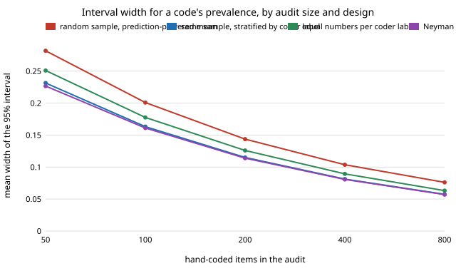

# qual-labelaudit: should you hand-code the items the coder called positive, or sample by the coder's label?

**Sampling the audit by the coder's own label barely helped, and auditing only the coder's positives was badly wrong. On 3,188 real Reddit comments (GoEmotions), a prediction-powered prevalence interval from a random audit was about 23% wider than the same random audit read as stratified by coder label (0.163 against 0.201 at 100 items, mean of four coders); equal numbers per coder label were no better than that, and Neyman allocation (an oracle) only 1% narrower.** The "sensitivity audit", hand-coding only items the coder labelled positive and assuming the rest hold no positives, produced intervals a quarter of the width and a 95% interval that covered the truth in 0 of 1,000 draws for every coder and audit size, because the coder missed 12–16% of the corpus's positives (bias −0.117 to −0.160 on a true prevalence of 0.247). **The coders are not LLMs** (no API key in the session): a naive-Bayes classifier at three cut-offs and a word list. Produced with AI assistance (Claude).

**Live page:** https://duncan-haywood.github.io/oss-monorepo/research/qual-labelaudit/

Track 19 (`qual`, [`PROJECTS.md`](../PROJECTS.md)). It takes the "sensitivity-based audit (hand-code only items the coder labels positive)" item from [`qual-gate`](../qual-gate)'s and [`qual-equivalence`](../qual-equivalence)'s "Next steps", and asks the design question for a single code's prevalence that [`qual-stratified`](../qual-stratified) asked for a group gap. Estimators from [`qual-correction`](../qual-correction).



## Method

Same corpus, split, seed (aside from the audit seed) and coders as [`qual-stratified`](../qual-stratified): 5,313 GoEmotions examples with at least three raters; 2,125 train the naive-Bayes coder, 3,188 are evaluated; human code = a majority of raters marked a negative emotion (prevalence 0.2469). Coders: naive Bayes with its cut-off moved to code 0.8, 1.0 and 1.25 times the human positive share, and a word list. The coder's label is known for every item, so it can define two strata at no cost. Five designs for an audit of n items (1,000 draws per cell, n from 50 to 800):

- **random**: one random sample, `qual-correction`'s prediction-powered mean (the coder's mean over the corpus plus the mean human-minus-coder correction).
- **poststrat**: the same kind of random sample, but the estimate is the stratum shares (exact) times the audit's mean human code in each coder-label stratum. Unbiased; the variance has no term for the coder's own spread.
- **equal**: n/2 coder-positive and n/2 coder-negative items.
- **neyman**: positive-stratum share of the audit proportional to stratum share times the standard deviation of the human code in it (Cochran 1977). An oracle: it uses the full evaluated data.
- **positives**: all n among coder-positive items; the coder-negative stratum is assumed to hold no positives. This is the sensitivity-style audit; it estimates precision, not recall, and the estimate is biased by the coder's misses.

Standard errors ignore the finite-population correction (the truth is the evaluated corpus), so coverage runs above 95% at large n, as in the other `qual-*` audit projects.

## Results

From [`results.txt`](experiments/results.txt). The coders on the evaluated items: precision 0.42–0.62, recall 0.35–0.53.

| mean 95% width, four coders | audit items | random | poststrat | equal | neyman | positives |
|---|---:|---:|---:|---:|---:|---:|
| | 50 | 0.282 | 0.231 | 0.251 | 0.227 | 0.062 |
| | 100 | 0.201 | 0.163 | 0.178 | 0.161 | 0.044 |
| | 400 | 0.104 | 0.081 | 0.089 | 0.081 | 0.022 |
| | 800 | 0.076 | 0.057 | 0.063 | 0.057 | 0.017 |

1. **Most of the gain is the estimator, not the draw.** The random design's interval is wider than poststrat's from the same kind of sample by 22–33%. The prediction-powered standard error includes the coder's spread over the corpus divided by N, which a stratified estimator by the coder's own label does not need. This is a property of the interval formula in `qual-correction`, which is valid but conservative when the coder's label is itself the stratifier; it is not a sampling-design effect.
2. **Choosing the draw adds almost nothing.** Neyman allocation beat poststrat by 1–2% in width (0.161 against 0.163 at 100 items); its audit shares were 18–37% to the coder-positive stratum, near each coder's own positive share (0.15–0.31). Equal numbers per label were 9% wider than poststrat at 100 items and matched it only for the coder that labels the most positives (`nb x1.25`), which is the one whose positive share is nearest half.
3. **Coverage held, with small shortfalls at small n.** Worst coverage over the four coders at 50 items: 0.943 random, 0.921 poststrat, 0.912 equal, 0.928 neyman; at 200 items 0.942–0.954; above 0.95 from 400 items on. Stratified designs drew fewer than 2 items in a stratum in 4 of 1,000 draws (lexicon, 50 items, poststrat) and dropped them.
4. **The positives-only audit fails.** Mean bias was −0.160, −0.140, −0.117 (`nb x0.8`, `x1.0`, `x1.25`) and −0.155 (word list) at every audit size, equal to each coder's miss rate (the share of the corpus that humans coded positive and the coder coded negative), and coverage was 0.000 in all 20 coder-and-size cells. Its narrow interval is a precise estimate of the wrong quantity. What the positives-only audit can give honestly is the coder's precision (0.42–0.62 here), not prevalence.

## Limitations

- No LLM coder: three cut-offs of one naive-Bayes classifier and a word list. A better coder has a smaller miss rate and so a smaller positives-only bias, but the bias is still the miss rate and the audit cannot see it.
- One code (negative emotion, 24.7% prevalence), one corpus, one split; the Neyman allocation is an oracle that a pilot sample could only approximate.
- Point 1 depends on the interval formula in `qual-correction` (the variance of the coder's labels over the corpus is included). Against an exact finite-population variance the random design's penalty may be smaller; this project does not test that.

## Next steps

A pilot-sized estimate of the Neyman share (how many pilot items before it beats equal); the same designs for a group gap and a regression coefficient; an LLM coder behind `ANTHROPIC_API_KEY` with a deterministic stub; a design that audits coder-negatives at a lower rate and weights them back in (importance sampling by coder label), which recovers recall that the positives-only audit cannot.

## Reproduce

```
python3 research/qual-labelaudit/experiments/run.py      # about a minute after the shared ~14 MB download (cache shared with qual-real), writes results.txt
python3 research/qual-labelaudit/experiments/figure.py   # writes the SVG
cd research/qual-labelaudit && python3 -m unittest test_qualaudit
```

## References

- Demszky et al. (2020). GoEmotions: A Dataset of Fine-Grained Emotions. ACL 2020; arXiv:2005.00547. Data under Apache 2.0, as checked in [`qual-real`](../qual-real).
- Angelopoulos et al. (2023), prediction-powered inference, *Science* 382; estimators from [`qual-correction`](../qual-correction).
- Cochran (1977), *Sampling Techniques*, 3rd ed., Wiley: stratified estimation and optimum (Neyman) allocation.

## Outside dependencies

The GoEmotions download (public bucket). No model API was called.
