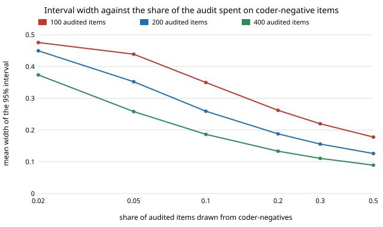

# qual-lowrate: can you audit the coder's negatives at a lower rate and weight them back?

**No: on 3,188 real Reddit comments (GoEmotions), auditing coder-negative items at a lower rate and weighting them back by stratum size removed the positives-only audit's bias (from −0.117…−0.160 to within ±0.01) but made the interval wider, not narrower, and below about 10% of the audit it stopped covering.** For 200 audited items the mean 95% width over four automated coders was 0.126 with half the audit among coder-negatives, 0.188 at 20%, 0.259 at 10%, 0.352 at 5%; coverage of the truth (0.247) was at best 0.85 at 5% and 0.51 at 2% (worst coder). The reason is that the coder-negative stratum is 69–85% of the corpus and holds 12–16% of it as human positives, so most of the variance sits there. **The coders are not LLMs** (no API key in the session): a naive-Bayes classifier at three cut-offs and a word list. Produced with AI assistance (Claude).

**Live page:** https://duncan-haywood.github.io/oss-monorepo/research/qual-lowrate/

Track 19 (`qual`, [`PROJECTS.md`](../PROJECTS.md)). It takes the last "Next steps" item of [`qual-labelaudit`](../qual-labelaudit): a design that audits coder-negatives at a lower rate and weights them back in, which recovers the recall the positives-only audit cannot see. Same corpus, split, seed and coders; estimators from [`qual-labelaudit`](../qual-labelaudit) and [`qual-correction`](../qual-correction).



## Method

5,313 GoEmotions examples with at least three raters; 2,125 train the naive-Bayes coder, 3,188 are evaluated; human code = a majority of raters marked a negative emotion (prevalence 0.2469). Coders: naive Bayes with its cut-off moved to code 0.8, 1.0 and 1.25 times the human positive share, and a word list (precision 0.42–0.62, recall 0.35–0.53). An audit of n items (100, 200, 400) puts a share s of them among coder-negative items and the rest among coder-positives, s from 0 (positives only, negatives assumed to hold no positives) to 0.5 (equal numbers). The estimate weights each audited item by its stratum size over the number audited in it (inclusion-probability weights; identical to the stratified mean, with a test). 1,000 draws per cell. Standard errors ignore the finite-population correction (conservative). The design also gives an estimate of the coder's recall (estimated true positives over estimated positives).

## Results

From [`results.txt`](experiments/results.txt), mean over the four coders.

| negative share of audit | 0 | 0.02 | 0.05 | 0.1 | 0.2 | 0.3 | 0.5 |
|---|---:|---:|---:|---:|---:|---:|---:|
| width, 100 items | 0.044 | 0.476 | 0.439 | 0.350 | 0.262 | 0.220 | 0.178 |
| width, 200 items | 0.031 | 0.450 | 0.352 | 0.259 | 0.188 | 0.156 | 0.126 |
| width, 400 items | 0.022 | 0.374 | 0.258 | 0.186 | 0.133 | 0.111 | 0.089 |
| worst coverage, 200 items | 0.000 | 0.508 | 0.850 | 0.881 | 0.914 | 0.935 | 0.945 |

1. **Weighting fixes the bias.** At share 0 the mean bias is the coder's miss rate (−0.117 to −0.160, coverage 0.000). With 2% of the audit among coder-negatives it is within ±0.012 in every cell, and within ±0.008 from 5% up.
2. **It does not pay.** Width falls steadily as the negative share rises to 0.5, the largest share tried, at every audit size; no lower rate beat equal numbers. The Neyman (oracle) negative share for these coders is 0.63–0.82 (section 1), so the optimum lies above half, the opposite direction to a low rate.
3. **A low rate breaks the interval.** At 2–5% of 100–200 items the audit holds 2–10 coder-negatives; the Wald interval from so few under-covers (worst coder 0.26 at 100 items and 2%, 0.58 at 5%). Coverage reaches 0.93 or more from a 30% share at 100 items, and about 0.91 at 10% with 400 items. A minimum of roughly 20–40 audited negatives is a safer rule than a low share.
4. **The recall estimate is biased up unless the negative sample is large.** It is a ratio of estimates: for `nb x0.8` (true recall 0.353) the mean estimate was 0.715 with 2% of 100 items, 0.421 at 10%, 0.365 at 50%.

## Limitations

- These coders miss 47–65% of positives, so the negative stratum is far from clean. A coder with recall near 0.95 leaves little variance there, and a low audit rate might then help; this was not tested (no LLM or stronger coder here) and the result should not be extended to one.
- One code, one corpus, one split; Wald intervals only (a Wilson or Bayesian stratum interval might hold coverage at small negative counts, an open item in `qual-negaudit`).
- Standard errors ignore the finite-population correction, so coverage runs high at large n.

## Next steps

A stronger coder (a real LLM behind `ANTHROPIC_API_KEY` with a deterministic stub) to see whether a low rate pays when recall is high; a Wilson-style stratum interval at 2–10 audited negatives; the same design for a group gap and a regression coefficient.

## Reproduce

```
python3 research/qual-lowrate/experiments/run.py      # ~10 s after the shared ~14 MB download (cache shared with qual-real), writes results.txt
python3 research/qual-lowrate/experiments/figure.py   # writes the SVG
cd research/qual-lowrate && python3 -m unittest test_qualrate
```

## References

- Demszky et al. (2020). GoEmotions: A Dataset of Fine-Grained Emotions. ACL 2020; arXiv:2005.00547. Data under Apache 2.0, as checked in [`qual-real`](../qual-real).
- Angelopoulos et al. (2023), prediction-powered inference, *Science* 382; estimators from [`qual-correction`](../qual-correction).
- Cochran (1977), *Sampling Techniques*, 3rd ed., Wiley: stratified estimation and optimum allocation.
- Horvitz and Thompson (1952), A generalization of sampling without replacement from a finite universe, *JASA* 47(260): inclusion-probability weighting.

## Outside dependencies

The GoEmotions download (public bucket). No model API was called.
