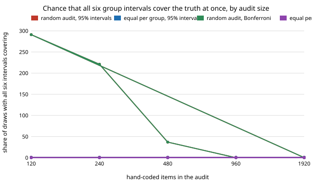

# qual-manygroups: with six groups, how many hand-coded items does it take for every group's prevalence to be right?

**With six groups, a 95% interval per group is not 95% for the set: on 3,188 real Reddit comments (GoEmotions), only 71–77% of equal-allocation audits of 120–240 items covered all six true group prevalences at once, against 85–88% with three groups. Equal numbers per group, and a Bonferroni widening, bring the set back to 89–94% at 120–240 items; a random audit cannot even produce six estimates when one group is 1.5% of the corpus (97% of 120-item random draws had fewer than 5 audited items in it).** The coders are naive-Bayes classifiers with a moved cut-off and a word list, not LLMs. Produced with AI assistance (Claude).

**Live page:** https://duncan-haywood.github.io/oss-monorepo/research/qual-manygroups/

Track 19 (`qual`, [`PROJECTS.md`](../PROJECTS.md)). It takes the "more than two groups" item in [`qual-stratified`](../qual-stratified)'s "Next steps", which stratified a two-group gap. The new question is the one a report with a table of groups has: every row is an interval, and the reader trusts the whole table. Same corpus, split and coders as that project.



## Method

5,313 GoEmotions examples with at least three raters; 2,125 train the naive-Bayes coder, 3,188 are evaluated; human code = a majority of raters marked a negative emotion. The evaluated items are binned by word count two ways (truth = the human prevalence in each bin of the evaluated items):

- **K=3**: ≤7, 8–17, 18+ words: 755, 1,531, 902 items (smallest 24%).
- **K=6**: ≤4, 5–7, 8–11, 12–17, 18–26, 27+ words: 306, 449, 613, 918, 855, 47 items (smallest 1.5%).

Four coders as in `qual-stratified`: the naive-Bayes score thresholded to code 0.8, 1.0 and 1.25 times the true prevalence, and the word list. Per group, a prediction-powered interval from that group's audited items. Two audit designs: **random** (one sample of the corpus) and **equal** (n/K per group; a group smaller than its share gives the rest to the others). Two interval rules: the usual 95% (z = 1.96) and **Bonferroni** (z = 2.64 for K=6, 2.39 for K=3, so the K intervals are jointly 95% if each is 1−0.05/K). Audit sizes 120 to 1,920, 300 draws per cell, seed 20261023. A draw with fewer than 5 audited items in any group is dropped and counted.

## Results

From [`results.txt`](experiments/results.txt) (mean over the four coders).

| share of draws with all K intervals covering | audit items | random, 95% | equal, 95% | random, Bonferroni | equal, Bonferroni |
|---|---:|---:|---:|---:|---:|
| K=3 | 120 | 0.855 | 0.845 | 0.944 | 0.940 |
| K=3 | 480 | 0.904 | 0.930 | 0.977 | 0.980 |
| K=6 | 120 | 0.640* | 0.706 | 0.792* | 0.889 |
| K=6 | 240 | 0.686* | 0.771 | 0.886* | 0.941 |
| K=6 | 480 | 0.792 | 0.873 | 0.945 | 0.983 |
| K=6 | 960 | 0.912 | 0.934 | 0.987 | 0.994 |

\* Computed only on the draws that survived: 9 of 300 at 120 items and 79 of 300 at 240 (mean over coders; see below).

1. **Six intervals at 95% are not a 95% table.** Per-group coverage was fine (0.94–0.95 at 120 items, K=6, equal), but the chance that none of the six rows is wrong was 0.71 at 120 items and 0.77 at 240, and it takes about 960 items to pass 0.93. With three groups the shortfall is smaller (0.85 at 120 items).
2. **A rare group breaks a random audit before it breaks coverage.** With a 47-item group (1.5%), 291 of 300 random draws of 120 items, 221 of 240 and 37 of 480 had under 5 audited items in it and could not give an estimate for the table at all; equal allocation never failed. The starred random figures above therefore describe the lucky draws and flatter the design.
3. **Equal allocation is narrower for the set as well.** Mean interval width at 480 items, K=6: 0.246 (equal) against 0.325 (random), 24% narrower, and with Bonferroni 0.332 against 0.438. With K=3 the designs differ by 2–3%, as for the two-group gap in `qual-stratified`.
4. **Bonferroni buys joint coverage for width.** At K=6 and 240 equal items, 95% intervals were 0.326 wide and covered all six 77% of the time; Bonferroni intervals were 0.438 wide (34% wider) and covered all six 94% of the time. Plain intervals did not reach 0.95 jointly until somewhere between 960 (0.934) and 1,920 items; Bonferroni passed 0.94 at 240 and 0.98 at 480, at a third more width per row.
5. **The worst coder is worse.** At K=6, 120 items, equal, 95% intervals: the worst of the four coders covered all six in 65% of draws (the mean is 71%); with random draws, 55% (on surviving draws).

**Practical reading:** if a report shows K group prevalences, set the audit for the smallest group (equal numbers per group, at least a few dozen items each), and either widen the intervals for K or say that the table is "each row 95%", not "the table 95%".

## Limitations

- The coders are not LLMs; the errors come from bag-of-words models and a moved threshold. The finding is about the audit and the multiplicity, which do not depend on the coder, but the coders' error is not differential here, so each group's interval is close to its nominal level before any adjustment.
- One corpus, one split, one seed; all groups are length bins, with close prevalences (0.19–0.30).
- Truth is the human prevalence over the 3,188 evaluated items, and audits are drawn without replacement. At 960 and 1,920 items (30% and 60% of the corpus) the intervals ignore the finite-population correction, so coverage rises above 0.95 (per-group 0.999–1.000 at 1,920); read the large-audit rows as conservative, not as a result.
- Bonferroni is the simplest adjustment and conservative; Holm, or a joint interval for the vector, would be narrower. They are not tried here.
- The random-audit rows at K=6 for 120 and 240 items are conditioned on surviving draws (above).
- 300 draws per cell: a joint-coverage figure has a standard error of about 0.025 near 0.85. Differences under 0.03 are noise.

## Next steps

Holm or a max-t joint interval for the K groups; groups that are not length bins (several rare cells from crossing two attributes); a coder with group-dependent error and the gap-bias test across K groups; an LLM coder behind `ANTHROPIC_API_KEY` with a deterministic stub.

## Reproduce

```
python3 research/qual-manygroups/experiments/run.py      # a few minutes after the shared ~14 MB download (cache shared with qual-real), writes results.txt
python3 research/qual-manygroups/experiments/figure.py   # writes the SVG
cd research/qual-manygroups && python3 -m unittest test_qualmany
```

## References

- Demszky et al. (2020). GoEmotions: A Dataset of Fine-Grained Emotions. ACL 2020; arXiv:2005.00547. Data under Apache 2.0, as checked in [`qual-real`](../qual-real).
- Angelopoulos et al. (2023), prediction-powered inference, *Science* 382; estimators from [`qual-correction`](../qual-correction).
- Bonferroni (1936), Teoria statistica delle classi e calcolo delle probabilità, *Pubbl. R. Ist. Sup. Sci. Econ. Comm. Firenze* 8: the union bound behind the adjustment.
- Cochran (1977), *Sampling Techniques*, 3rd ed., Wiley: allocation to strata.

## Outside dependencies

The GoEmotions download (public bucket). No model API was called.
