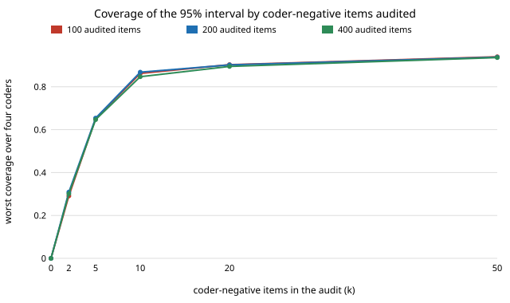

# qual-negaudit: how many of the coder's negatives must you hand-code to recover its missed positives?

**Auditing only the coder's positives gives a prevalence estimate that is wrong by the coder's miss rate (−0.13 to −0.17 on a true 0.252) and never covers the truth; weighting a few hand-coded coder-negatives back in removes the bias at once, but the interval only reaches its nominal 95% at about 50 coder-negative items, and that count, not the total audit size, sets the width.** On 3,188 real Reddit comments (GoEmotions), with the audit's total size at 100, 200 or 400 items, 2 coder-negatives gave worst-of-four-coders coverage 0.29–0.31, 10 gave 0.85–0.87, 50 gave 0.94, and mean interval width at 50 negatives was 0.15–0.19 whether the audit had 100 or 400 items. Spending the rest of a bigger audit on coder-positives bought nothing. **The coders are not LLMs** (no API key in the session): three cut-offs of a naive-Bayes classifier and a word list. Produced with AI assistance (Claude).

**Live page:** https://duncan-haywood.github.io/oss-monorepo/research/qual-negaudit/

Track 19 (`qual`, [`PROJECTS.md`](../PROJECTS.md)). It takes the last "Next steps" item of [`qual-labelaudit`](../qual-labelaudit): audit coder-negatives at a lower rate and weight them back in. That project showed the positives-only audit fails (coverage 0.000); this one asks how much negative auditing repairs it. Estimators from [`qual-correction`](../qual-correction) and `qual-labelaudit`.



## Method

Same corpus, shuffle seed family, naive-Bayes training split and four coders as `qual-labelaudit` (2,125 train, 3,188 evaluated; human code = a majority of raters marked a negative emotion). The shuffle seed differs (20261024), so the evaluated split is not identical: true prevalence is 0.2522 here against 0.2469 there. An audit of n items puts k on a random sample of coder-negative items and n−k on coder-positive items; the estimate is the exact stratum shares times the audit's mean human code in each stratum (equivalently, each audited item carries the importance weight N_s/n_s, the inverse of its inclusion probability). k = 0 is the positives-only audit, with the negative stratum assumed to hold no positives. n ∈ {100, 200, 400}, k ∈ {0, 2, 5, 10, 20, 50}, 1,000 draws per cell. Standard errors ignore the finite-population correction.

## Results

From [`results.txt`](experiments/results.txt). Coder-negatives held human-coded positives at a rate of 0.19–0.21 (the share of negatives a hand-coder would call positive), which is the quantity the audit of negatives has to measure.

| mean over four coders | k = 0 | 2 | 5 | 10 | 20 | 50 |
|---|---:|---:|---:|---:|---:|---:|
| RMSE, 200 items | 0.152 | 0.216 | 0.137 | 0.097 | 0.069 | 0.043 |
| worst coverage, 200 items | 0.000 | 0.309 | 0.654 | 0.868 | 0.902 | 0.938 |

1. **One negative stratum, one cost.** Bias vanished as soon as any negatives were audited (|bias| ≤ 0.014 at every k ≥ 2, against −0.128 to −0.169 at k = 0). Variance is what remains, and it comes almost entirely from the negative stratum, which is 68–86% of the corpus and where about one item in five is positive.
2. **The audit's size does not matter, the count of negatives does.** At k = 50 the mean width was 0.15–0.19 at n = 100, 200 and 400; adding 300 coder-positive items moved RMSE from 0.045 to 0.042. A positives-heavy audit is cheap to read (positives are the items the coder already flagged) but pays for nothing the estimate needs after the first ~100.
3. **Two negatives is worse than none, by RMSE.** RMSE at k = 2 (0.216) exceeds the positives-only audit's (0.152): the bias is gone but a two-item sample of a stratum with 20% positives is mostly all-zero or all-one, giving noisy estimates and intervals of zero width when both items agree (worst coverage 0.29–0.31). The positives-only estimate is wrong but stable. A negative audit has to be big enough for the stratum's own spread to show.
4. **Coverage needs about 50.** Worst coverage across coders was 0.85–0.87 at k = 10, 0.90 at k = 20 and 0.936–0.940 at k = 50: the normal interval for a proportion near 0.2 is short of nominal until the stratum sample is in the dozens.

## Limitations

- No LLM coder; one code (24.7–25.2% prevalence), one corpus, one split, and the stratum positive rate (~0.2) drives the k needed. A coder with a lower miss rate has fewer positives hiding in its negatives, so fewer negatives suffice for a given absolute precision, but this project did not test a better coder.
- The designs fix k rather than choosing it from a pilot; Neyman allocation (an oracle in `qual-labelaudit`) would put more of the audit on negatives for these coders only if their spread there were larger than in the positives.
- The Wald interval's undercoverage at small k is partly a property of the interval; a Wilson or exact stratum interval was not tried.

## Next steps

A Wilson or Bayesian stratum interval that holds nominal coverage at k = 10–20; choosing k from a 20-item pilot; the same audit for a group gap and a regression coefficient; a real LLM coder behind `ANTHROPIC_API_KEY` with a deterministic stub.

## Reproduce

```
python3 research/qual-negaudit/experiments/run.py      # seconds after the shared ~14 MB download (cache shared with qual-real), writes results.txt
python3 research/qual-negaudit/experiments/figure.py   # writes the SVG
cd research/qual-negaudit && python3 -m unittest test_qualneg
```

## References

- Demszky et al. (2020). GoEmotions: A Dataset of Fine-Grained Emotions. ACL 2020; arXiv:2005.00547. Data under Apache 2.0, as checked in [`qual-real`](../qual-real).
- Angelopoulos et al. (2023), prediction-powered inference, *Science* 382; Cochran (1977), *Sampling Techniques*, 3rd ed., Wiley (stratified estimators).

## Outside dependencies

The GoEmotions download (public bucket). No model API was called.
