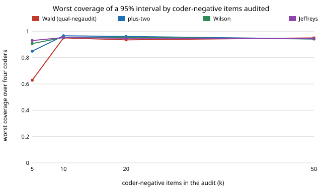

# qual-negint: which confidence interval is right when you hand-code only 5 to 20 of the coder's negatives?

**With 5 coder-negative items audited, the Wald interval of `qual-negaudit` covers the truth 63% of the time at worst (nominal 95%); a Wilson, Jeffreys or add-one ("plus-two") interval covers 94–95%, so the "about 50 negatives" rule of that project was largely an artefact of the interval.** On 3,188 real Reddit comments (GoEmotions), audit size 200, four automated coders, 1,000 draws per cell, worst coverage over the coders was, for Wald / plus-two / Wilson / Jeffreys: k = 5: 0.628 / 0.950 / 0.935 / 0.950; k = 10: 0.849 / 0.966 / 0.961 / 0.942; k = 20: 0.907 / 0.953 / 0.954 / 0.942; k = 50: 0.930 / 0.952 / 0.947 / 0.945. The price is width: at k = 5 the Wilson interval is 0.43 wide (Wald's 0.40 was too narrow, not efficient), converging to 0.17 at k = 50. **The coders are not LLMs** (no API key in the session). Produced with AI assistance (Claude).

**Live page:** https://duncan-haywood.github.io/oss-monorepo/research/qual-negint/

Track 19 (`qual`, [`PROJECTS.md`](../PROJECTS.md)). It takes the first "Next steps" item of [`qual-negaudit`](../qual-negaudit): a Wilson or Bayesian stratum interval that holds nominal coverage at k = 10–20. Lab tags: none; this builds on no group in `prompt.md`.



## Method

Identical corpus, split, seed (20261024) and four coders as `qual-negaudit` (three cut-offs of a naive-Bayes classifier, and a word list; true prevalence 0.2522). An audit of 200 items puts k random items on coder-negatives and 200−k on coder-positives; the prevalence estimate is the stratum-share-weighted sum of per-stratum proportions. Four 95% intervals are built from the same draws (so differences are not sampling noise):

- **Wald** (`qual-negaudit`): sample variances; zero width when a small stratum sample is all one value.
- **plus-two**: add one success and one failure to each stratum, then Wald (Agresti and Coull 1998 style).
- **Wilson**: each stratum's Wilson centre and Wilson-score variance, combined by the shares, read off a normal. A combination of the single-proportion Wilson interval, not an exact stratified Wilson.
- **Jeffreys**: Beta(x+½, n−x+½) posterior per stratum; equal-tailed 95% interval of the weighted sum from 1,000 posterior draws.

Single-stratum implementations are checked in [`test_qualnegint.py`](test_qualnegint.py) against the Wilson interval for 3/10 and the exact Beta(3.5, 7.5) quantiles (scipy), not against numbers chosen by me.

## Results

From [`experiments/results.txt`](experiments/results.txt) (per-coder tables there).

1. **Most of the undercoverage was the interval.** Wald's 0.63 at k = 5 becomes 0.94–0.95 with Wilson or Jeffreys; at k = 10 the gap is 0.85 against 0.94–0.96.
2. **Wald is narrow, not efficient.** Mean width over coders at k = 5: Wald 0.397, Wilson 0.427, Jeffreys 0.429, plus-two 0.490. Beyond k = 20 the four intervals are within about 0.01 of each other in width and Wald is still 2–4 points short.
3. **Plus-two overcovers at small k** (0.97–0.98 for some coders at k = 5–10) and is the widest; Wilson is the tightest interval that stays near nominal. Jeffreys is the most even across coders (0.94–0.96).
4. **Width, not coverage, is the cost that remains.** With k = 5 the interval is ±0.21 on a prevalence of 0.25, honest but of little use; the negatives' count still sets the precision, as in `qual-negaudit`.

## Limitations

- No LLM coder; one code, one corpus, one split; the negatives' positive rate (~0.2) drives everything. Coders with fewer misses leave fewer positives hiding in their negatives.
- Audit size fixed at 200 (qual-negaudit found size does not matter after the first ~100); 1,000 draws, so a coverage figure has a Monte Carlo error of about ±0.007.
- Coverage is for the prevalence; a group gap or regression coefficient was not tried. The Wilson combination is approximate and the Jeffreys posterior treats strata as independent Beta posteriors with no finite-population correction.
- Worst coverage selects the minimum of four coders, which is biased low by selection; per-coder rows are in `results.txt`.

## Next steps

Choosing k from a 20-item pilot; the same intervals for a group gap and a regression coefficient; a real LLM coder behind `ANTHROPIC_API_KEY` with a deterministic stub.

## Reproduce

```
python3 research/qual-negint/experiments/run.py      # about 70 s after the shared ~14 MB download (cache shared with qual-real)
python3 research/qual-negint/experiments/figure.py   # writes the SVG
cd research/qual-negint && python3 -m unittest test_qualnegint
```

## References

- Demszky et al. (2020). GoEmotions. ACL 2020; arXiv:2005.00547. Apache 2.0, as checked in [`qual-real`](../qual-real).
- Brown, Cai and DasGupta (2001), Interval estimation for a binomial proportion, *Statistical Science* 16(2). Agresti and Coull (1998), Approximate is better than "exact" for interval estimation of binomial proportions, *The American Statistician* 52(2). Wilson (1927), *JASA* 22.

## Outside dependencies

The GoEmotions download (public bucket). No model API was called.
