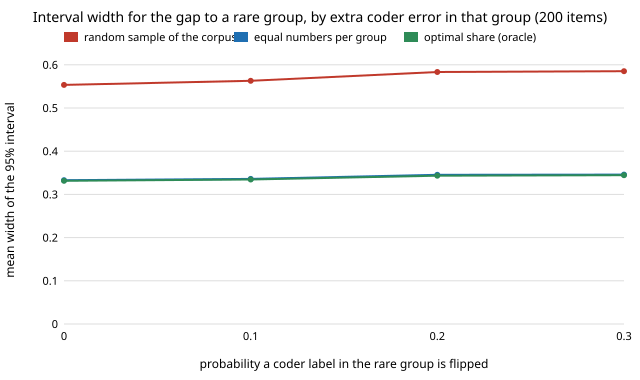

# qual-rareerror: does equal-numbers stratified auditing still match the optimal split when the coder errs more in the rare group?

**Yes, in this test. On 3,188 real Reddit comments (GoEmotions), injecting extra coder errors into the rare group (the longest 10.8% of comments) barely moved the best audit split: the oracle share of the audit for the rare group stayed at 0.53 to 0.56, and an audit with equal numbers per group gave a 95% interval for the group gap within 0.7% of the optimal split at every injected error rate (200 items: 0.333 against 0.331 with no injection; 0.346 against 0.344 at the highest). A random audit stayed 1.66 to 1.69 times as wide as equal numbers.** The coders are naive-Bayes classifiers with a moved cut-off, not LLMs. Produced with AI assistance (Claude).

**Live page:** https://duncan-haywood.github.io/oss-monorepo/research/qual-rareerror/

Track 19 (`qual`, [`PROJECTS.md`](../PROJECTS.md)). It takes the first "Next steps" item of [`qual-stratified`](../qual-stratified): a coder that errs more in the rare group. No lab tag: this builds on none of the listed groups.



## Method

Same corpus, split (2,125 train, 3,188 evaluated), seed scheme, coders and estimator as `qual-stratified` (group-wise prediction-powered gap, [`qual-gapaudit`](../qual-gapaudit)). Rare group A = comments of 23 or more words (344 items, 0.108 of the corpus). Estimand: human prevalence of a negative emotion in A minus the rest = 0.3110 − 0.2391 = +0.0719. Two coders (naive Bayes at cut-off ×1.0 and ×1.25 of the human share). Extra error is injected only in A: each coder label there is flipped with probability 0, 0.1, 0.2 or 0.3. Designs: random sample of the corpus, equal numbers per group, and the oracle variance-minimising share (`qualstrat.allocation`). Audit sizes 100 to 800, 400 draws per cell.

## Results

From [`results.txt`](experiments/results.txt).

| injected flip | coder error in A | coder error in B | oracle share for A |
|---:|---:|---:|---:|
| 0.0 | 0.416 / 0.433 | 0.264 / 0.278 | 0.545 / 0.534 |
| 0.1 | 0.424 / 0.424 | same | 0.550 / 0.537 |
| 0.2 | 0.500 / 0.494 | same | 0.565 / 0.550 |
| 0.3 | 0.459 / 0.488 | same | 0.558 / 0.558 |

(Pairs are the ×1.0 / ×1.25 coders.) Mean 95% interval width over both coders at 200 audited items:

| injected flip | random | equal | optimal |
|---:|---:|---:|---:|
| 0.0 | 0.5535 | 0.3329 | 0.3314 |
| 0.1 | 0.5629 | 0.3358 | 0.3345 |
| 0.2 | 0.5833 | 0.3453 | 0.3432 |
| 0.3 | 0.5853 | 0.3459 | 0.3444 |

1. **Equal numbers per group is still the rule.** Equal over optimal width is 1.004 to 1.006 at 200 items for every flip rate; random over equal is 1.66 to 1.69.
2. **The optimal share moves little.** It rises by 0.01 to 0.02 with injection, because the coder is already wrong on 42–43% of rare-group items, so extra flips add little spread (the error rate peaks near 0.50 and flipping a further share lowers it again).
3. **Coverage.** 0.95 to 1.00 across cells for the stratified designs (the random audit at 100 to 200 items dips to 0.90–0.95); with 400 draws a cell's coverage is known to about ±0.02.

## Limitations

- Random flips are a weak test of "errs more": the base coder is already near coin-flip in the rare group, so the injection has little room to raise the error spread. A coder whose errors are systematic (for example a model that misses a dialect or register) was not tested.
- One corpus, one grouping, one seed, one estimand; the extra error is synthetic, injected, not measured from a real second coder. No LLM was called.
- The oracle share uses the full data; a pilot would estimate it with noise.

## Next steps

A real LLM coder behind `ANTHROPIC_API_KEY` with a deterministic stub, whose group error is measured not injected; more than two groups (several rare cells); a coder much better than chance in the rare group, where the optimal share could fall below 0.5.

## Reproduce

```
python3 research/qual-rareerror/experiments/run.py      # a few minutes after the shared ~14 MB download (cache shared with qual-real), writes results.txt
python3 research/qual-rareerror/experiments/figure.py   # writes the SVG
cd research/qual-rareerror && python3 -m unittest test_rareerror
```

## References

- Demszky et al. (2020). GoEmotions: A Dataset of Fine-Grained Emotions. ACL 2020; arXiv:2005.00547. Data under Apache 2.0, as checked in [`qual-real`](../qual-real).
- Angelopoulos et al. (2023), prediction-powered inference, *Science* 382; estimators from [`qual-correction`](../qual-correction).
- Cochran (1977), *Sampling Techniques*, 3rd ed., Wiley: optimum allocation to strata.

## Outside dependencies

The GoEmotions download (public bucket). No model API was called.
