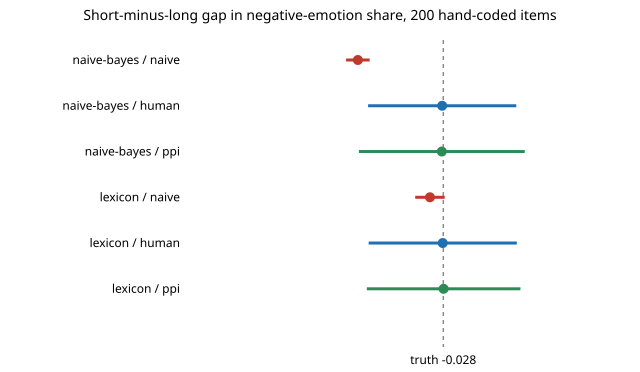

# qual-real: does the prediction-powered correction work on real hand-coded text?

**On 3,188 real Reddit comments with human emotion labels, counting an automated coder's codes gives a confidently wrong answer, and the correction repairs it only as far as the coder is any good.** A naive-Bayes coder (accuracy 0.73, kappa 0.14) reports 13.3% of comments as negative-emotion against a human 25.3% (interval coverage 0 of 500 draws), and reports a short-versus-long comment gap of −0.170 where the human gap is −0.028, a six-fold overstatement caused by the coder missing 94% of negative emotion in short comments but only 70% in long ones. Prediction-powered inference (PPI) with 200 hand-coded items recovers both (coverage 0.94–0.97), but its interval is wider than simply using the 200 hand-coded items alone (0.143 against 0.120 for prevalence), because the coders are weak. **These coders are not LLMs**: the session had no API key, so a trained classifier and a word list stand in. Produced with AI assistance (Claude).

**Live page:** https://duncan-haywood.github.io/monorepo-projects/research/qual-real/

Track 19 (`qual`, [`PROJECTS.md`](../PROJECTS.md)), milestone 2. Takes the estimators of [`qual-correction`](../qual-correction), validated there only against simulated coders, to real labels.



## Data

GoEmotions (Demszky et al. 2020): Reddit comments labelled by several raters for 27 emotions or neutral. The project downloads the first of its three raw files from the dataset authors' public bucket (`experiments/run.py`) into a cache outside the repository, and **commits no comment text**. The authors release the code and data under Apache 2.0; the comments are public Reddit posts, and the file carries usernames, which this project never reads or outputs.

- Items: 5,313 examples with at least 3 raters and none marked "very unclear".
- Human code: a majority of the raters marked any of 11 negative emotions (anger, annoyance, disappointment, disapproval, disgust, sadness, fear, embarrassment, grief, remorse, nervousness).
- Group: comment length, short (≤ 10 words, n = 1,186) or long (n = 2,002), a crude stand-in for writing style.
- Split (seeded): 40% (2,125) trains the naive-Bayes coder; the other 3,188 are the "corpus". Because every corpus item has a human code, the **true** prevalence and gap are known, and each study hides all but a random hand-coded sample.

## Coders (stand-ins for an LLM)

- `naive-bayes`: multinomial naive Bayes on word presence, trained on the 2,125 human-coded training items; threshold set so its positive rate matches the training share (no evaluation label used).
- `lexicon`: 38 negative words chosen by me before looking at results; any hit codes 1. A zero-shot, codebook-style coder.

## Results

Copied from [`results.txt`](experiments/results.txt). 500 random hand-coded samples per row; coverage is of the 95% interval.

| coder | sensitivity | specificity | accuracy | kappa | sensitivity short / long |
|---|---:|---:|---:|---:|---:|
| naive-bayes | 0.221 | 0.897 | 0.726 | 0.139 | 0.065 / 0.304 |
| lexicon | 0.375 | 0.928 | 0.788 | 0.350 | 0.348 / 0.389 |

**Prevalence of negative emotion (true 0.2528), 200 hand-coded items.**

| coder | estimator | mean estimate | coverage | width |
|---|---|---:|---:|---:|
| naive-bayes | naive | 0.133 | 0.000 | 0.024 |
| naive-bayes | human-only | 0.253 | 0.944 | 0.120 |
| naive-bayes | PPI | 0.253 | 0.968 | 0.143 |
| lexicon | naive | 0.149 | 0.000 | 0.025 |
| lexicon | human-only | 0.252 | 0.944 | 0.120 |
| lexicon | PPI | 0.251 | 0.948 | 0.127 |

**Gap, short minus long (true −0.028), 200 hand-coded items.**

| coder | estimator | mean estimate | coverage | width |
|---|---|---:|---:|---:|
| naive-bayes | naive | −0.170 | 0.000 | 0.039 |
| naive-bayes | human-only | −0.030 | 0.954 | 0.247 |
| naive-bayes | PPI | −0.030 | 0.960 | 0.276 |
| lexicon | naive | −0.050 | 1.000 | 0.049 |
| lexicon | human-only | −0.029 | 0.944 | 0.247 |
| lexicon | PPI | −0.027 | 0.958 | 0.256 |

Findings:

1. **Naive counts fail on real labels as in simulation.** Both coders undercount negative emotion by 10–12 points, with zero coverage.
2. **Differential error is real, not only simulated.** The naive-Bayes coder's sensitivity is 0.065 on short comments and 0.304 on long ones (short comments carry fewer of the words it learned), so the naive gap is 0.170 where the true gap is 0.028. The lexicon coder is more even across lengths, and its naive gap interval happens to cover the truth because it is wide enough relative to a small bias (a lucky case, not a licence to skip validation).
3. **PPI stays valid but did not pay here.** At kappa 0.14 it is 19% wider than human-only; at kappa 0.35 it is 6% wider. This matches `qual-correction`'s finding that PPI stops paying below roughly 80% coder accuracy, with the difference that this task's accuracy is 73–79% only because the code is a quarter-prevalence class a weak coder mostly misses; accuracy alone does not tell you.
4. Results at 100 and 400 hand-coded items show the same pattern (see `results.txt`).

## Limitations

- **Not an LLM.** The point of the milestone, an LLM behind `ANTHROPIC_API_KEY`, is not done: a stronger coder would shift finding 3 and perhaps finding 2. The estimators take any 0/1 coder, so swapping one in is a change to `experiments/run.py`'s `coders` dict.
- One binary code, one corpus (English Reddit, annotated by raters in one country per the dataset authors), one crude group. A rater majority is a noisy truth; I treat it as the gold standard, which the correction needs.
- The coder was trained on the same corpus, so errors are less text-clustered than an out-of-the-box LLM's might be, or more; unmeasured.
- Only the first of three raw files is used.

## Next steps

Run an LLM coder on the same 3,188 items and compare; extend to the 27 emotions (multi-class PPI from `qual-regression`); `qual-dialect` on a corpus with a real dialect or language label.

## Reproduce

```
python3 research/qual-real/experiments/run.py      # ~10 s after a ~14 MB download, writes results.txt
python3 research/qual-real/experiments/figure.py   # writes the SVG
cd research/qual-real && python3 -m unittest test_qualreal
```

## References

- Demszky, Movshovitz-Attias, Ko, Cowen, Nemade and Ravi (2020). GoEmotions: A Dataset of Fine-Grained Emotions. ACL 2020; arXiv:2005.00547. Data and README: <https://github.com/google-research/google-research/tree/master/goemotions>. The dataset's existence, size and labels were checked against its README; author list and venue are from memory because arXiv was unreachable from the run environment.
- Angelopoulos et al. (2023), prediction-powered inference, *Science* 382; the estimators come from [`qual-correction`](../qual-correction).

## Outside dependencies

The GoEmotions download (public bucket). No model API was called.
