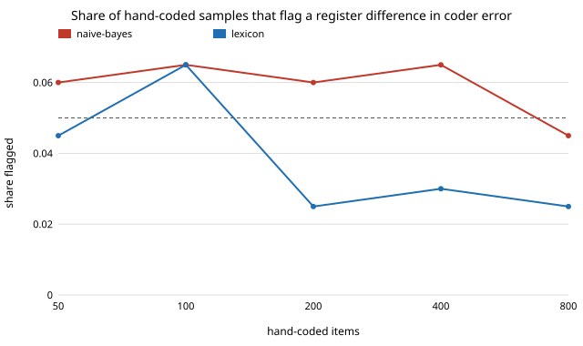

# qual-register: does a coder's error depend on writing register, and can a hand-coded sample tell?

**On 3,188 real Reddit comments (GoEmotions), splitting by writing register (formal: capitalised and ends in . ! ?; informal: otherwise) barely changed two automated coders' error, and a random hand-coded sample of up to 800 items could not detect the small difference that was there.** The naive-Bayes coder's error rate was 0.282 on formal and 0.263 on informal comments (difference −0.019); the lexicon coder's was 0.212 and 0.212. A z test for "error differs by register" flagged 4.5–6.5% of random hand-coded samples from 50 to 800 items for naive-Bayes, which is the 5% false-positive rate, not power. The register comparison itself is still wrong when counted naively (naive-Bayes: −0.043 against a true −0.0145, coverage 0 of 500 draws), and the prediction-powered estimate repairs it (coverage 0.956). **The coders are not LLMs** (no API key in the session), and register is a proxy for writing fluency, not a dialect label: this is a null result on a weak proxy, not evidence that LLMs are register-neutral. Produced with AI assistance (Claude).

**Live page:** https://duncan-haywood.github.io/oss-monorepo/research/qual-register/

Track 19 (`qual`, [`PROJECTS.md`](../PROJECTS.md)), milestone 3 in spirit (`qual-dialect`): milestone 3 needs a corpus with a real dialect or language label, and none is available offline here, so this takes the nearest real axis in the data already used by [`qual-real`](../qual-real), and adds a question that project did not ask: how many hand-coded items does it take to *notice* differential error? Builds on the estimators of [`qual-correction`](../qual-correction).



## Method

Same corpus, split, coders and seed as `qual-real` (5,313 examples with at least 3 raters; 2,125 train the naive-Bayes coder; 3,188 evaluated; human code = a majority of raters marked a negative emotion). The comment text is read from a cached download and never committed.

- Register (fixed before looking at results): `formal` if the trimmed text starts with an uppercase letter and ends with `.`, `!` or `?` (optionally followed by a closing quote or bracket); else `informal`. Formal n = 1,886, informal n = 1,302. Human negative-emotion share: 0.2587 and 0.2442, true gap informal−formal −0.0145.
- E1: each coder's sensitivity, specificity and error rate per register.
- E2: naive, human-only and prediction-powered (PPI) estimates of the gap from 200 hand-coded items, 500 draws.
- E3: for each hand-coded sample size, 200 random samples; the audit is a pooled two-proportion z test (5%) of whether the coder's error rate differs between registers among the sampled items.

## Results

Copied from [`results.txt`](experiments/results.txt).

| coder | register | sensitivity | specificity | error rate |
|---|---|---:|---:|---:|
| naive-bayes | formal | 0.246 | 0.883 | 0.282 |
| naive-bayes | informal | 0.182 | 0.917 | 0.263 |
| lexicon | formal | 0.381 | 0.930 | 0.212 |
| lexicon | informal | 0.365 | 0.925 | 0.212 |

| coder | estimator | mean gap estimate (true −0.0145) | coverage | width |
|---|---|---:|---:|---:|
| naive-bayes | naive | −0.0431 | 0.000 | 0.047 |
| naive-bayes | human-only | −0.0142 | 0.958 | 0.244 |
| naive-bayes | PPI | −0.0124 | 0.956 | 0.288 |
| lexicon | naive | −0.0047 | 1.000 | 0.050 |
| lexicon | human-only | −0.0156 | 0.956 | 0.245 |
| lexicon | PPI | −0.0161 | 0.968 | 0.258 |

| coder | 50 | 100 | 200 | 400 | 800 hand-coded items |
|---|---:|---:|---:|---:|---:|
| naive-bayes | 0.060 | 0.065 | 0.060 | 0.065 | 0.045 |
| lexicon | 0.045 | 0.065 | 0.025 | 0.030 | 0.025 |

Findings:

1. **Register is not where these coders go wrong.** The lexicon coder has the same error rate in both registers; naive-Bayes differs by 1.9 points, with lower sensitivity on informal text (0.182 against 0.246) offset by higher specificity.
2. **A small bias in a group gap still breaks naive counting.** Naive-Bayes triples the size of the gap (−0.043 against −0.0145) and its naive interval never covers the truth, even though its error rate differs by only 1.9 points between groups. The lexicon coder's naive interval covers (1.000) only because its bias (+0.010) is small against a width of 0.050; as in `qual-real`, that is luck, not a licence to skip validation.
3. **An audit of error rates is low-powered.** The flag rates in the third table sit at or below 5%, so even 800 hand-coded items said nothing about a real 1.9-point difference. A normal-approximation calculation (not run as an experiment: pooled error 0.27, 80% power, 5% test) puts the need at roughly 8,000 hand-coded items per register for a 1.9-point difference. Practical reading: a clean audit at ordinary sample sizes does not show a coder is equally accurate across groups, and the PPI correction, whose validity does not depend on the audit, is the safer default.
4. **PPI stayed valid** (coverage 0.956 and 0.968) and was 5–18% wider than human-only, as in `qual-real`: these coders are too weak for the correction to pay.

## Limitations

- Register is a typography proxy (capitalisation and terminal punctuation), not a dialect or language label and not fluency as a linguist would measure it. Most of the register effect on a real LLM's accuracy is untested here.
- The coders are a trained naive-Bayes and a 38-word list, not LLMs. An LLM's error may depend on register very differently.
- One corpus, one seed, one split; the 200 detection samples per cell give a standard error near 0.015, so values from 0.025 to 0.065 are all consistent with the 5% false-positive rate.
- The 8,000-item figure is an approximation, not a result.

## Next steps

Run the same audit on a corpus with a real dialect or language label and an LLM coder behind `ANTHROPIC_API_KEY` (with a deterministic stub); test a sensitivity-based audit (hand-code only items the coder labels positive); compare the audit with simply always applying PPI.

## Reproduce

```
python3 research/qual-register/experiments/run.py      # ~1 min after a ~14 MB download (shared cache with qual-real), writes results.txt
python3 research/qual-register/experiments/figure.py   # writes the SVG
cd research/qual-register && python3 -m unittest test_qualregister
```

## References

- Demszky et al. (2020). GoEmotions: A Dataset of Fine-Grained Emotions. ACL 2020; arXiv:2005.00547. Data under Apache 2.0, as checked in [`qual-real`](../qual-real).
- Angelopoulos et al. (2023), prediction-powered inference, *Science* 382; estimators from [`qual-correction`](../qual-correction).

## Outside dependencies

The GoEmotions download (public bucket). No model API was called.
