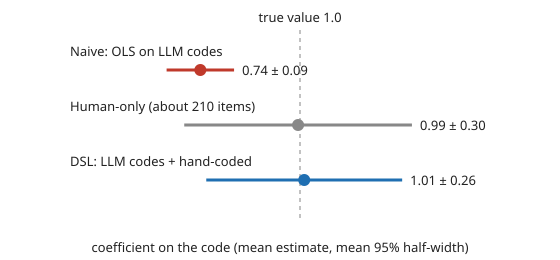

# qual-regression: what happens to a regression coefficient when the regressor is an LLM's code?

**A regression on an LLM's codes gives a confidently wrong coefficient; a design-based correction with about 210 hand-coded items fixes it, but it narrows the interval by only about 14% for the coded variable.** In a seeded simulation, an LLM coder with sensitivity 0.70 and specificity 0.95 turns a true coefficient of 1.00 into **0.74**, and its interval covers the truth in **0 of 300 studies**. DSL (design-based supervised learning, Egami et al. 2023) with hand-coded items drawn at a known 7% rate recovers 1.01 with 94% coverage. When the coder's error depends on another covariate, the naive coefficient on *that* covariate is biased too (0.467 against 0.50, coverage 60%) although the covariate was measured perfectly; DSL removes it. For a 3-class code, naive class shares are off by up to 8 points with 0% coverage, and per-class PPI covers 95.5–97%. Produced with AI assistance (Claude). **Every result is from simulated coders with known error, not a real LLM or corpus.**

**Live page:** https://duncan-haywood.github.io/oss-monorepo/research/qual-regression/

Track 19 (`qual`, [`PROJECTS.md`](../PROJECTS.md)), milestone 7. Extends [`qual-correction`](../qual-correction), which corrected a code's mean and a two-group gap.



## Method

`qualreg.py` (stdlib only):

- `ols`: least squares with robust (HC0) standard errors, used for the naive and human-only estimators.
- `dsl`: the OLS estimating equation `x(y − x'b)` computed with the LLM's code on every item, plus the correction `(1/π)[x_true(y − x_true'b) − x_llm(y − x_llm'b)]` on hand-coded items, where π is the known hand-coding probability. Solved in closed form; sandwich standard errors from the influence rows.
- `class_shares_naive` / `class_shares_ppi`: shares of a K-class code, one-vs-rest prediction-powered inference per class.

Model: `y = 0 + 1·code + 0.5·z + N(0,1)`, N = 3,000, true code share 0.30, z ~ N(0,1); hand-coded items drawn with probability 0.07. `experiments/run.py` writes [`results.txt`](experiments/results.txt).

## Results

Copied from `results.txt`. Coverage is of the 95% interval; width is its mean width.

**E1. Coder error independent of z** (sens 0.70, spec 0.95; 300 studies, about 210 hand-coded).

| coefficient | estimator | mean estimate | coverage | width |
|---|---|---:|---:|---:|
| code (1.00) | naive | 0.740 | 0.000 | 0.176 |
| code (1.00) | human-only | 0.995 | 0.940 | 0.594 |
| code (1.00) | DSL | 1.011 | 0.937 | 0.511 |
| z (0.50) | naive | 0.499 | 0.940 | 0.075 |
| z (0.50) | human-only | 0.498 | 0.917 | 0.271 |
| z (0.50) | DSL | 0.501 | 0.967 | 0.118 |

The error attenuates the coded variable's coefficient toward zero (classical measurement error, 26%). Independent error leaves the coefficient on z alone. DSL's gain is small for the coded variable (14% narrower than human-only) and large for z (56% narrower), because z is observed on every item.

**E2. Error correlated with z** (sensitivity 0.70 + 0.15·z).

| coefficient | estimator | mean estimate | coverage | width |
|---|---|---:|---:|---:|
| code (1.00) | naive | 0.747 | 0.000 | 0.177 |
| code (1.00) | DSL | 0.997 | 0.960 | 0.503 |
| z (0.50) | naive | 0.467 | 0.597 | 0.076 |
| z (0.50) | DSL | 0.502 | 0.957 | 0.119 |

A mismeasured regressor contaminates a perfectly measured one when the error is related to it. A study that reports "after controlling for the code, z has effect 0.47" has a biased control coefficient.

**E3. Three-class code** (5,000 items, shares 0.30/0.40/0.30, accuracy 0.755, 200 hand-coded, 1,000 studies).

| class | naive bias | naive coverage | PPI bias | PPI coverage | PPI width | human-only width |
|---|---:|---:|---:|---:|---:|---:|
| 0 | +0.085 | 0.000 | +0.000 | 0.956 | 0.116 | 0.127 |
| 1 | −0.020 | 0.112 | +0.000 | 0.970 | 0.107 | 0.136 |
| 2 | −0.065 | 0.000 | −0.001 | 0.955 | 0.117 | 0.127 |

A coder that confuses class 2 with class 0 inflates the share of class 0 and deflates class 2 while the middle class looks nearly right, so a naive check on one class can pass.

## Limitations

- Simulated coder, independent errors given the true code (and z in E2). A real LLM's errors cluster by text.
- DSL here uses a known, constant hand-coding probability. Stratified or adaptive sampling needs per-item π.
- One binary regressor, one covariate, linear model, Gaussian noise. No logistic regression, no multi-class regressor, no PPI++ power tuning.
- With 3,000 items and 210 hand-coded, DSL for the coded variable barely beats the human-only fit; a larger corpus or better coder would help it more. Not swept here.
- Nothing here benchmarks any model.

## Next steps

Sweep corpus size and coder quality for the coded coefficient; add a K-class regressor and logistic outcomes; run the pipeline on a public hand-coded corpus (`qual-real`).

## Reproduce

```
python3 research/qual-regression/experiments/run.py      # ~15 s, writes results.txt
python3 research/qual-regression/experiments/figure.py   # writes the SVG
cd research/qual-regression && python3 -m unittest test_qualreg
```

## Outside dependencies

None: standard library only. No real LLM was run (no API key in the environment).

## References

- Egami, Hinck, Stewart, Wei (2023). Using imperfect surrogates for downstream inference: design-based supervised learning for social science applications of large language models. *NeurIPS 36*. arXiv:2306.04746.
- Angelopoulos, Bates, Fannjiang, Jordan, Zrnic (2023). Prediction-powered inference. *Science* 382:669–674.
- Angelopoulos, Duchi, Zrnic (2024). PPI++: Efficient prediction-powered inference. arXiv:2311.01453.
