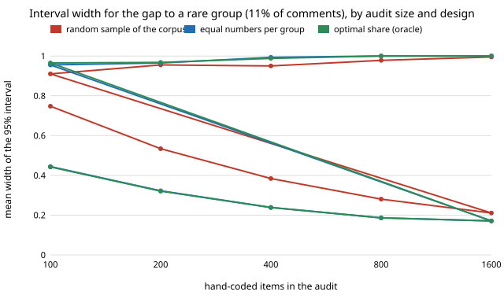

# qual-stratified: should the hand-coded audit for a group gap be stratified by group?

**It depends on how rare the smaller group is. On 3,188 real Reddit comments (GoEmotions), splitting the hand-coded audit evenly between the two groups made no measurable difference when the smaller group was 36% of the corpus (interval widths within 1–2% of a random audit), and made a large one when it was 11%: a random audit of 100 items gave a 95% interval for the gap 1.7 times as wide as an even split (0.75 against 0.44), 1.2 times as wide at 1,600 items, and worst-case coverage of 0.91 against 0.96.** The variance-minimising split (about 55% of the audit to the 11% group, computed from the full data as an oracle) was indistinguishable from an even split, so a simple "half each" rule gets all of the gain. The coders are naive-Bayes classifiers with a moved cut-off and a word list, not LLMs. Produced with AI assistance (Claude).

**Live page:** https://duncan-haywood.github.io/oss-monorepo/research/qual-stratified/

Track 19 (`qual`, [`PROJECTS.md`](../PROJECTS.md)). It takes the "audit stratified by group" item in [`qual-gapaudit`](../qual-gapaudit)'s "Next steps". Same corpus, split, seed and coders as that project (three of its eight: `nb x0.8`, `x1.0`, `x1.25`, and the word list), the same group-wise prediction-powered gap and the same gap-bias z test.



## Method

5,313 GoEmotions examples with at least three raters; 2,125 train the naive-Bayes coder, 3,188 are evaluated; human code = a majority of raters marked a negative emotion. Two groupings of the evaluated items (the estimand is human prevalence in group A minus group B):

- **G1**: ≤10 words against longer: 1,165 against 2,023 (A is 36.5%); gap −0.053. The grouping of `qual-gapaudit`.
- **G2**: the longest 11% of comments (23 words or more; 352 items) against the rest; gap +0.038. Chosen to make the smaller group rare; its cut-off is the 90th percentile of the word count and the 23-word tie takes it to 11%.

Three ways to draw an audit of n items: **random** (one sample of the corpus, so the group sizes are random), **equal** (n/2 per group; if a group has fewer items, the unused budget goes to the other), and **optimal** (the share for group A proportional to the standard deviation of human-minus-coder disagreement in each group, which minimises the rectifier variance of a difference of two group means; unlike a population mean, the gap does not weight a group by its size). The optimal share uses the full evaluated data, an oracle that a real pilot sample could only approximate. All three feed the same group-wise prediction-powered gap, so no weights are needed. 400 draws per cell, audit sizes 100 to 1,600, draws with fewer than 5 audited items in a group dropped and counted.

## Results

From [`results.txt`](experiments/results.txt) (G1.x and G2.x are the two groupings).

| mean 95% width, four coders | audit items | random | equal | optimal |
|---|---:|---:|---:|---:|
| G1 (36% group) | 100 | 0.392 | 0.389 | 0.386 |
| G1 | 1,600 | 0.110 | 0.109 | 0.109 |
| G2 (11% group) | 100 | 0.747 | 0.444 | 0.442 |
| G2 | 400 | 0.384 | 0.239 | 0.238 |
| G2 | 1,600 | 0.211 | 0.171 | 0.171 |

1. **For a common group, don't bother.** The optimal share was 44–46% to the 36% group, near the 36.5% a random draw gives, so there is little to move. Widths differed by 1–2% and coverage by no more than sampling noise.
2. **For a rare group, stratify.** The widths above, plus: random audits of 100 items left 2% (`nb x1.0`) and 1% (`nb x1.25`) of draws with under 5 audited items in the rare group (none dropped otherwise), and their worst coverage over the four coders was 0.910 at 100 items against 0.955 and 0.965 for equal and optimal (G2.6). Coverage above 0.95 at larger sizes (up to 1.00) is the finite-population effect noted in `qual-gapaudit`, which is stronger for stratified audits because the rare group is audited almost fully.
3. **Equal is as good as optimal.** The optimal share was 54–55% to the rare group. Widths agreed to the third decimal.
4. **The gap-bias test gains power too** (G2.4, the share of draws where the test trusts a coder whose gap is wrong). For `nb x1.0` at 400 items a random audit trusted it in 24.7% of draws and stratified audits in 0%; at 200 items 54% against 7–8%. At 100 items all designs trusted it often (69% random, 37–38% stratified). The word list, whose gap error is small, was trusted in 92–100% of draws in both designs.

**Practical reading:** when you report a comparison with a small group, spend half the hand-coded budget on each group, and read the audit size needed to detect a coder's gap error off the smaller group's share, not the total. When both groups are large, a random audit is fine.

## Limitations

- The coders are not LLMs, and the gap errors come from a bag-of-words length effect (see `qual-gapaudit`). The finding is about the audit design, which does not depend on the coder. It does depend on the corpus: if a group's coder error were far more variable than the other's, the optimal split would move away from half.
- One corpus, one split, one seed; the two groupings are both defined by comment length. The "rare" group is built by a percentile cut, not a naturally occurring subgroup.
- The optimal split is an oracle. A real pilot would estimate the error spread with noise, which would make it no better than equal. The README therefore does not claim a gain over equal.
- 400 draws per cell: coverage has a standard error of about 0.01 near 0.95 and 0.02 near 0.5; differences in coverage under 0.02 are noise.
- Group membership (comment length) is known for every item before the audit. A group defined by the human code or by something only visible after hand-coding could not be stratified on this way.

## Next steps

Group-dependent error in the opposite direction (a coder that errs more in the rare group); more than two groups (a sub-group intersection with several rare cells); an LLM coder behind `ANTHROPIC_API_KEY` with a deterministic stub.

## Reproduce

```
python3 research/qual-stratified/experiments/run.py      # about a minute after the shared ~14 MB download (cache shared with qual-real), writes results.txt
python3 research/qual-stratified/experiments/figure.py   # writes the SVG
cd research/qual-stratified && python3 -m unittest test_qualstrat
```

## References

- Demszky et al. (2020). GoEmotions: A Dataset of Fine-Grained Emotions. ACL 2020; arXiv:2005.00547. Data under Apache 2.0, as checked in [`qual-real`](../qual-real).
- Angelopoulos et al. (2023), prediction-powered inference, *Science* 382; estimators from [`qual-correction`](../qual-correction).
- Cochran (1977), *Sampling Techniques*, 3rd ed., Wiley: optimum allocation to strata, the rule the "optimal" design applies to a difference of two means.

## Outside dependencies

The GoEmotions download (public bucket). No model API was called.
