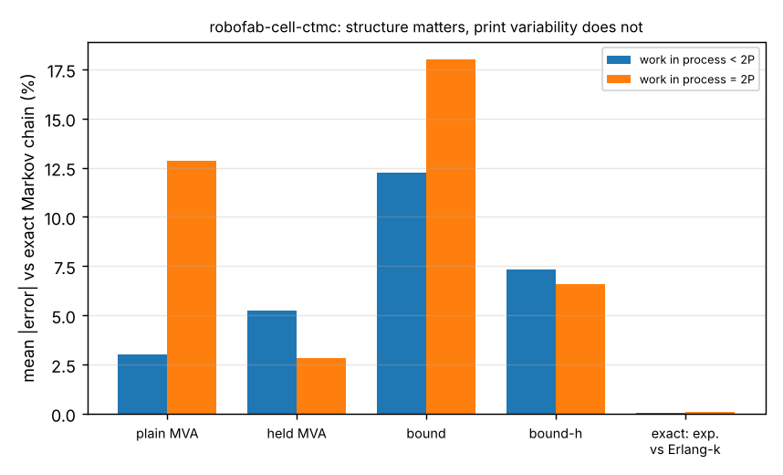

# Is the error of queueing analysis of a robot-printer cell from print-time variability or from the cell's structure? An exact Markov-chain answer

A stylised, simulation-only follow-up to `research/robofab-cell-held` and `research/robofab-cell-blocking` (track `robofab`, milestone 4's next steps). Those projects judged approximate models of a cell (one arm, P printers held through load and unload, one inspection station) by comparing them with a discrete-event simulation, so every comparison carried simulation noise and mixed two possible causes of error: non-exponential times and the cell's structure. Here I solve the cell **exactly** as a continuous-time Markov chain (print time Erlang-k, so cv = 1/√k; other steps exponential), check the solution against a simulation, and use it as noise-free ground truth to split the error. A different question from the neighbouring projects: it replaces more simulation with an exact reference instead of adding another approximation. All numbers are from `experiments/results.txt`; one job class, times illustrative and not measured (load 2 min, unload 2 min, inspect 3 min, print 20 or 60 min, 15% of parts fail and re-enter the loop, so failure only scales the good-part rate).

**Live page:** https://duncan-haywood.github.io/monorepo-projects/research/robofab-cell-ctmc/

- **The exact chain agrees with the simulation.** In 10 settings (2 to 6 printers, up to 5,711 states) the simulated rate is within 1.73 standard errors of the chain (mean z +0.17, none beyond 2); a lognormal print time with the same mean and cv matches the Erlang chain in 4 further settings (|z| ≤ 0.98).
- **Print-time variability is not what breaks MVA here.** Moving the print time from exponential (cv 1) to Erlang-4 (cv 0.5) or Erlang-9 (cv 0.33) changes the exact throughput by at most 0.71% over 42 settings (mean 0.08%). Most of the earlier error attributed to non-exponential service is therefore structure, not shape. (Only the print time varies in this model; load, unload and inspect stay exponential.)
- **Plain MVA is right where printers never queue and wrong beyond it.** At work in process N = P it is within 0.6% of the exact rate in every row; when work in process exceeds the printer count it overshoots, by up to +20.3% (print 20 min, 4 printers, N = 8). Mean absolute error 3.0% on the 26 rows with N < 2P and 12.8% on the 16 rows with N = 2P.
- **Held-demand MVA is the mirror image.** Mean absolute error 2.8% at N = 2P but 5.3% below it, and −5.2% to −12.2% at N = P, where it counts the load and unload time twice (they are already in the arm's delay). This matches what `robofab-cell-blocking` inferred from simulation; here it is shown without simulation noise.
- **Cheap bounds are worse than either.** The plain utilisation bound errs by 14.4% on average (up to +35%); the held bound by 7.0%.

```bash
pip install numpy matplotlib
cd research/robofab-cell-ctmc
PYTHONPATH=src python3 -m unittest discover -s tests -v   # 6 tests, < 1 s
python3 experiments/run.py                                # about 15 s; writes experiments/results.{txt,json}
python3 experiments/figure.py                             # draws experiments/error.png from results.json
```
Produced with numpy 2.x and Python 3.13.



## Motivation

A cheap analytic model of a workcell is only useful if one knows why it fails. With an exact reference the failure can be attributed instead of guessed, which is the fidelity question of a digital twin: which departure from the model matters.

## Builds on

The workcell-twin direction of the HIRO Group (Alessandro Roncone, <https://hiro-group.ronc.one/>), and `research/robofab-cell-mva`, `research/robofab-cell-held` and `research/robofab-cell-blocking` in this repository, whose model, MVA code (copied unchanged from `robofab-cell-held`) and predictors I reuse. No paper from the group is reproduced; nothing here is affiliated with or endorsed by them. Methods: mean value analysis, Reiser and Lavenberg (1980), Bolch et al. (2006); CTMC stationary distributions by uniformisation (Jensen's method), Bolch et al. (2006); Erlang phase-type service. Entries in `paper/refs.bib`. This run had no web access, so I could not re-check them online: verify before citing.

## Method

`src/robofab_cell_ctmc/ctmc.py` enumerates the reachable states (waiting to load, arm loading, jobs in each print phase, waiting to unload, arm unloading, at inspection), applies the arm's dispatch rule instantly (unload first, otherwise load if a printer is free), and finds the stationary distribution by power iteration on the uniformised chain. The good-part rate is (1 − q) times the inspection completion rate. A unit test checks the balance equations to 1e-10 and conservation of jobs. `sim.py` is an independent event-driven simulation of the same rules. `experiments/run.py` (fixed seeds, 10 per row) does the validation, then compares four predictors with the exact rate for print 20 and 60 min, 2, 4 and 6 printers, work in process P, P+2 and 2P, and k = 1, 4, 9 (k = 9 only up to 4 printers, for state-space size): plain MVA, MVA with load and unload added to the printer demand, and the asymptotic bound on each set of demands. "Not saturated" and "saturated" (N = 2P) groups follow `robofab-cell-held`, chosen before the numbers.

## Results

See the bullets above and `experiments/results.txt`.

## Limitations

Stylised and simulation-only. One job class (the earlier projects used a two-type mix, so numbers are not directly comparable), one arm, no travel, no breakdowns, exponential load, unload and inspect times, one inspector. The arm gives unloads priority over loads; the earlier simulators serve the arm first-come first-served, so this is a different cell, not the same one re-solved. Only the print time's variability was varied, so the conclusion is about that, not about all service times. Problems up to about 68,000 states were solved; larger cells are out of reach for this solver. No claim concerns a physical cell.

## Next steps

Two job classes in the chain (the earlier mix); Erlang load and unload times; an approximation that matches the exact rate without enumerating states, tested against this reference; a first-come first-served arm; measured step times from a MuJoCo arm.

## Owner steps

None; nothing was built or ordered.

## Outside dependencies

`numpy` (and `matplotlib` for the figure) only. No language model or hardware was used. Produced with AI assistance (Claude).

MIT.
