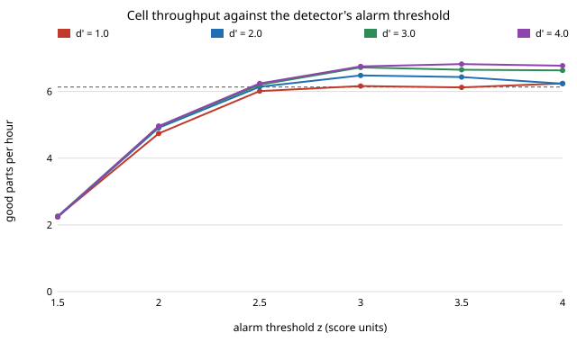

# Where should a print-failure detector's alarm threshold go in a robot-arm 3D-printer cell? Per-look false alarms against throughput, simulated

A stylised, simulation-only study in track `robofab` (the first next step of `research/robofab-cell-monitor`: replace its fixed detection delay with a detector that has its own hit and false-alarm rates). I give the camera a score that is N(0, 1) on a healthy print and N(d', 1) once the print has failed, a look every few minutes, and an alarm threshold z. Then I ask which z maximises good parts per hour, and how much a camera of a given quality is worth, using an exact analytic bound and a discrete-event simulation of the cell. I did not choose these parameters from a real farm; every number is illustrative.

**Live page:** https://duncan-haywood.github.io/monorepo-projects/research/robofab-cell-detector/



- **A threshold that sounds strict loses a lot of throughput, because a long print is looked at many times.** At 6 printers, a failure rate of 0.3 per printing hour and a look every 2 min, a threshold of z = 2 (a 2.3% false-alarm chance per look) makes the cell produce 19 to 23% *fewer* good parts than blind printing, whatever the detector's quality (4.74, 4.91, 4.95 and 4.96 parts/h for d' = 1 to 4, against 6.13 ± 0.05 blind). A 60 min print is looked at 30 times, so about half of all good long prints are aborted. At z = 1.5 the loss is 63%.
- **The best threshold is in the far tail, here z of 3 to 3.5, and the gain is modest.** Per-look false-alarm probabilities of 0.1% to 0.02% win. The simulated gain over blind printing at the best threshold on a coarse grid is +1.9% (d' = 1, at the edge of the grid, within noise), +5.8% (d' = 2), +9.7% (d' = 3) and +11.3% (d' = 4; z = 3.5), standard errors about 0.8%. An instant, perfect camera gains about 11% over blind printing in the monitor project's setup, so a d' of 4 recovers nearly all of that.
- **A weak detector is worth nothing, and there is a floor.** Choosing z by the bound for each d', the simulated gain is +1.5% at d' = 0.5 and +1.0% at d' = 1 (both within about 1.5 standard errors of zero: the best "threshold" is the one that almost never fires), +4.7% at 1.5 and +5.8% at 2, and rises to +10.9% at 5. Below a d' of about 1.5 here, a detector cannot beat just printing.
- **Higher failure rates push the threshold down and make the detector pay.** Choosing z by the bound for d' = 2.5, the best z is 3.5 at 0.05 and 0.1 failures per printing hour, 3.25 at 0.3 and 3.0 at 0.6 and 1.0; the simulated gain is +0.4%, +2.1%, +7.3%, +16.1% and +32.2% (blind 7.50, 7.22, 6.13, 4.80 and 3.43 parts/h).
- **Looking more often needs a higher threshold, and does not pay for itself much.** At d' = 2.5 per look, the best z is 3.5, 3.25, 3.0, 2.75 and 2.5 for looks every 1, 2, 5, 10 and 20 min. The bound falls steadily from 6.94 to 6.56 parts/h; the simulation (+9.5%, +7.3%, +8.7%, +6.2%, +4.0%) is not monotone between 2 and 5 min, because the bound's z is not the simulation's best z and the differences are about two standard errors. Treat the order of 1, 2 and 5 min as unresolved.
- **The analytic bound is an upper bound, 0.2 to 0.3 parts/h above the simulation at the best thresholds,** as in the monitor project (the arm and printers collide). Its best z is within 0.25 of the best z on the section 1 simulation grid for d' = 2 and 4 and between the two best grid points for d' = 3, so it finds the region but not the exact grid point.

## Reproduce

```bash
cd research/robofab-cell-detector
PYTHONPATH=src python3 -m pytest -q tests   # 9 tests, a few seconds
python3 experiments/run.py                  # about 20 s; writes experiments/results.txt
python3 experiments/figure.py               # writes experiments/rate_vs_threshold.svg
```
Needs `numpy` (and `pytest` for the test command; `python3 -m unittest discover -s tests` works too).

## Builds on

The workcell-twin direction of the HIRO Group (Alessandro Roncone, <https://hiro-group.ronc.one/>), and `research/robofab-cell-monitor` in this repository, whose cell, parameters and failure model I reuse (the cell code is copied from it and changed in the detector parts). The detector is the textbook equal-variance Gaussian signal-detection model, with sensitivity d' and a criterion; no external result is cited or reproduced.

## Method

`src/robofab_cell_detector/cell.py`. Same cell as the monitor project: an equal mix of a 20 min and a 60 min part, 2 min load and unload, 3 min inspection that never rejects, lognormal times with cv 0.3, work in process = printers + 2, 48 h with 4 h warm-up, 40 seeds, failures at an exponential rate per printing hour. The detector looks at a running print every `period` minutes. On a healthy print each look false-alarms with probability f = Q(z); once the print has failed each look raises an alarm with probability h = Q(z − d'). Looks are independent. The first alarm aborts the print; the arm still spends an unload on it and the job goes back to the queue. `attempt_stats()` gives the exact success probability, mean printing minutes and false-alarm probability per attempt by summing over the number of looks before the failure; the tests check it against a brute-force simulation of looks and scores. `bound()` turns those into arm, printer and inspection capacities as in the monitor project. The thresholds in sections 2 to 5 maximise the bound over a grid of z in steps of 0.25; the simulation is then run at that z.

## Results

See the bullets above and `experiments/results.txt`.

## Limitations

Stylised and simulation-only. The central assumption is that looks are independent. Real consecutive frames of one print are strongly correlated, so a real detector's false alarms cluster (fewer effective independent looks, but a larger penalty per false alarm) and its hits do not come as independent chances to catch a failure. A model with correlated scores would move the best threshold and might change the "far tail" finding, which I did not test. Gaussian equal-variance scores are a convenience, not a measurement. Failures are memoryless and independent of part, printer and wear; there is no salvage or restart from a layer, one arm, no travel, no breakdowns. The best z comes from a 0.25 grid chosen with the bound, not a simulation search, and a gain below about 1.5% is noise (standard errors 0.04 to 0.06 parts/h). Nothing here says how well a real camera detects or what it costs.

## Next steps

Correlated scores within a print (an AR(1) score or a latent "looks wrong" state), so that the per-print false-alarm rate, not the per-look one, is the knob; a detector whose score grows with the severity of the failure; adaptive thresholds that rise during long prints; add part-level salvage and printer wear (the monitor project's other next steps); measure real failure rates and detector scores on an owner's printers before trusting any number here.

## Owner steps

None; nothing was built or ordered. Pricing a camera and its software for a real farm would need sourced, dated prices, which are not given here.

## Outside dependencies

`numpy` only. No language model or hardware was used. Produced with AI assistance (Claude).

MIT.
