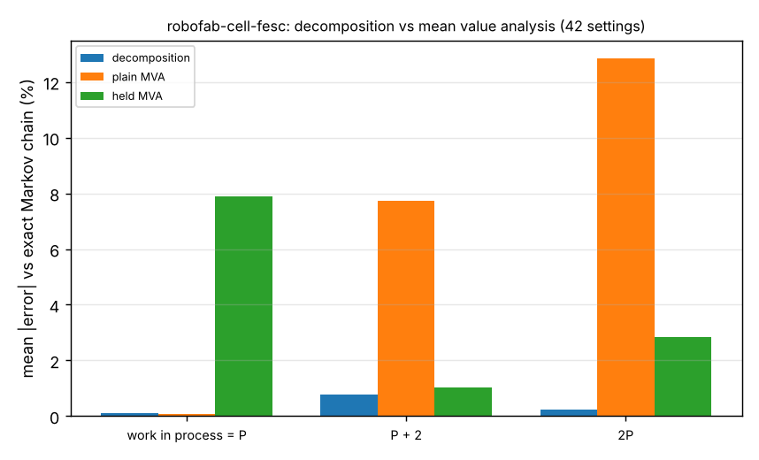

# Can a flow-equivalent-server decomposition predict a robot-printer cell's throughput without enumerating its states? Mean error 0.3% against the exact Markov chain

A stylised, simulation-only follow-up to `research/robofab-cell-ctmc` (track `robofab`, milestone 4's next steps: "an approximation that matches the exact rate without enumerating states, tested against this reference"). That project showed that mean value analysis (MVA) of a cell (one arm, P printers held through load and unload, one inspection station) errs by up to 20% because of the cell's *structure*, not print-time variability. Here I ask whether a classical repair, Norton's theorem / flow-equivalent-server (FES) decomposition, fixes it. This is a new question, not another seed or size: it tests a different approximation against the same noise-free reference. All numbers are from `experiments/results.txt`; one job class, times illustrative and not measured (load 2 min, unload 2 min, inspect 3 min, print 20 or 60 min, 15% of parts fail and re-enter the loop).

**Live page:** https://duncan-haywood.github.io/monorepo-projects/research/robofab-cell-fesc/

- **The decomposition is within 1.6% of the exact chain in all 42 settings** (mean absolute error 0.32%), against 6.8% (up to 20.3%) for plain MVA and 4.3% (up to 12.2%) for MVA with the printer held through load and unload. The same 42 settings and print-time variability levels (Erlang-1, 4, 9; cv 1 to 0.33) as `robofab-cell-ctmc`.
- **It is good where each MVA variant is bad.** Mean absolute error 0.12% at work in process N = P (where plain MVA is also fine, 0.09%, and held MVA is 7.9% off), 0.77% at N = P+2 (plain 7.7%, held 1.0%), 0.23% at N = 2P (plain 12.8%, held 2.8%).
- **It is not exact, and it errs one way.** 38 of 42 settings are underestimated (mean signed error −0.32%; the other four are exact to rounding, all with two printers and two jobs), worst at N = P+2 where the printers are just starting to queue (−1.57%). The cell is not a product-form network, so Norton's theorem does not apply exactly; I have not tried to explain the sign beyond that.
- **It holds in larger cells.** In 5 further cells of 8 to 12 printers (up to 17,919 exact states) the error is −0.09% to −0.31%.
- **The saving is in state count, not yet in time.** The largest subsystem chain is about a tenth the size of the full chain (1,749 states against 17,919), but at these sizes both solve in under a second, so I make no speed claim.

```bash
pip install numpy matplotlib
cd research/robofab-cell-fesc
PYTHONPATH=src python3 -m unittest discover -s tests -v   # 5 tests, < 1 s
python3 experiments/run.py                                # about 3 s; writes experiments/results.{txt,json}
python3 experiments/figure.py                             # draws experiments/error.png from results.json
```
Produced with numpy 2.x and Python 3.11. No random numbers: results are deterministic.



## Motivation

An exact chain of a cell grows quickly with printers and print phases; a planner wants a cheap model whose error is known. A decomposition that reuses small exact pieces is the standard middle path in queueing practice, and the digital-twin question is whether it is good enough that the cheap model can stand in.

## Builds on

The workcell-twin direction of the HIRO Group (Alessandro Roncone, <https://hiro-group.ronc.one/>), and `research/robofab-cell-ctmc` in this repository, whose exact chain (`ctmc.py`) and MVA code (`mva.py`) are copied unchanged and used as the reference. No paper from the group is reproduced; nothing here is affiliated with or endorsed by them. Methods: Norton's theorem for queueing networks (Chandy, Herzog and Woo 1975) and flow-equivalent aggregation, Bolch et al. (2006); mean value analysis, Reiser and Lavenberg (1980). Entries in `paper/refs.bib`. This run had no web access to re-check them: verify before citing.

## Method

`src/robofab_cell_fesc/fesc.py`: (1) short-circuit the inspection station, so a finished unload returns the job to the load queue at once, and solve the arm-and-printers subsystem exactly as a Markov chain at each population n = 1..N (unload-priority arm, Erlang-k print), giving its unload rate H(n); (2) replace the subsystem by one load-dependent exponential server of rate H(n) and solve the two-station closed network, a birth-death chain on the number of jobs at inspection; (3) good-part rate = (1 − q) × inspection completion rate. `experiments/run.py` compares it, plain MVA and held MVA with the exact chain on the 42 settings of `robofab-cell-ctmc` (print 20 and 60 min, 2/4/6 printers, N = P, P+2, 2P, k = 1, 4, 9; k = 9 only to 4 printers), then on 5 larger cells. Tests check the single-job rate, saturation at the arm's capacity, agreement with the exact chain at one job, closeness (not exactness) for one printer, and that it beats plain MVA where printers queue. A first test that asserted exactness for one printer failed (0.8% off), because load, print and unload in series is not product form; I replaced it with the 2% closeness test rather than the claim.

## Results

See the bullets above and `experiments/results.txt`.

## Limitations

Stylised and simulation-only. The reference is the chain of `robofab-cell-ctmc`, so every limit there applies: one job class, one arm, no travel or breakdowns, exponential load, unload and inspect times, one inspector, unload priority (not first-come first-served). Only the settings above were tried, one set of step times and one failure rate; the error may be larger elsewhere, in particular with several job classes or a slower, more variable inspector (the decomposition treats inspection as exponential, and so does the chain). The reference was solved only up to 17,919 states. No claim concerns a physical cell.

## Next steps

Two job classes; non-exponential inspection (where the decomposition and the chain may part); a sweep of the inspector's speed to find where the error peaks; an explanation of why the error is negative; measured step times from a MuJoCo arm.

## Owner steps

None; nothing was built or ordered.

## Outside dependencies

`numpy` (and `matplotlib` for the figure) only. No language model or hardware was used. Produced with AI assistance (Claude).

MIT.
