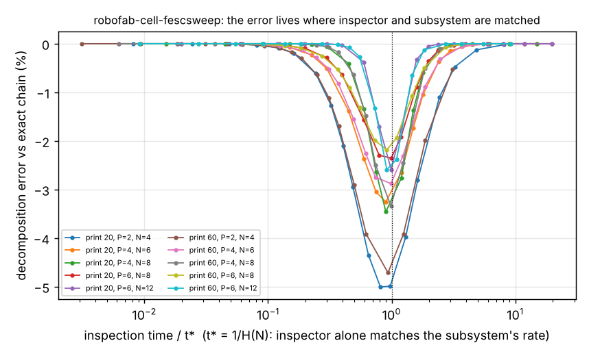

# Where does a flow-equivalent-server decomposition of a robot-printer cell go wrong as the inspector speeds up or slows down? Its error peaks at 5%, 15 times the earlier mean

A stylised, simulation-only follow-up to `research/robofab-cell-fesc` (track `robofab`, milestone 4's next steps: "a sweep of the inspector's speed to find where the error peaks"). That project reported a mean error of 0.32% for the decomposition at one inspection time (3 min). Here I vary the inspection time over three orders of magnitude to see whether that figure is typical. This is a new axis (time-scale separation between the inspector and the arm-and-printers subsystem), not another seed or size. All numbers are from `experiments/results.txt`; Erlang-4 print time (cv 0.5), load 2 min, unload 2 min, one inspector, print 20 or 60 min, 2/4/6 printers, work in process N = P+2 and 2P (10 cells, 19 inspection times each, 0.1 to 100 min); times are illustrative, not measured.

**Live page:** https://duncan-haywood.github.io/monorepo-projects/research/robofab-cell-fescsweep/

- **The earlier 0.3% was not the worst case.** Over the sweep the decomposition's error reaches −2.2% to −5.0% (mean −3.2%) in the 10 cells, an order of magnitude above the earlier mean. At 3 min inspection, the earlier setting, these cells sit on the shoulder of the peak, not at it.
- **The error is a bump around one matched point and vanishes on both sides.** At 0.1 min inspection the error is 0.000% in every cell (the inspector is never a constraint, so the subsystem is the whole cell and the decomposition is exact). At 100 min it is at most 0.52% (nine cells: 0.02% or less). The bump spans roughly a factor of 10 in inspection time.
- **Where it peaks is predictable.** Define t* = 1/H(N), the inspection time at which the inspector alone matches the subsystem's full-population rate H(N). The largest error falls at 0.81 to 0.99 t* (median 0.92) in all 10 cells, on a grid whose spacing is coarse near t*, so read this as "just below the knee", not a measured location. The peak is where neither side saturates: the inspection queue and the subsystem's state are both fluctuating and the correlation between them, which a flow-equivalent server ignores, matters most.
- **The error is never positive here.** The largest positive error anywhere is 0.000% (to rounding). The explanation above is a hypothesis; I did not test it (for example by removing the correlation).
- **Smaller cells err more.** Peak error is 5.0% and 4.7% with 2 printers, and 2.2% to 3.5% with 4 or 6.

```bash
pip install numpy matplotlib
cd research/robofab-cell-fescsweep
PYTHONPATH=src python3 -m unittest discover -s tests -v   # 4 tests, < 1 s
python3 experiments/run.py                                # about 13 s; writes experiments/results.{txt,json}
python3 experiments/figure.py                             # draws experiments/error.png from results.json
```
Produced with numpy 2.x and Python 3.11. No random numbers: results are deterministic.



## Motivation

A cheap model is only trustworthy if one knows where it fails, and a single operating point cannot say. A planner choosing an inspector for a cell wants to know whether the decomposition is reliable at the design they will actually pick, which is often near the balance point, exactly where it is worst here.

## Builds on

The workcell-twin direction of the HIRO Group (Alessandro Roncone, <https://hiro-group.ronc.one/>), and `research/robofab-cell-fesc` (decomposition, `fesc.py`) and `research/robofab-cell-ctmc` (exact chain, `ctmc.py`) in this repository, both copied unchanged so the project is self-contained. No paper from the group is reproduced; nothing here is affiliated with or endorsed by them. Methods: Norton's theorem for queueing networks (Chandy, Herzog and Woo 1975) and flow-equivalent aggregation, Bolch et al. (2006). Entries in `paper/refs.bib`, not re-checked online in this run: verify before citing.

## Method

For each cell and inspection time, the decomposition rate and the exact chain's rate are computed (no simulation), and the percent error is (decomposition − exact)/exact. The knee t* = 1/H(N) uses the subsystem's unload rate at the full population N. The sweep grid is 0.1, 0.3, 0.6, 1, 1.5, 2, 3, 4, 5, 6, 8, 10, 12, 16, 20, 30, 40, 60, 100 min. Tests check exactness at instant inspection, near-exactness at very slow inspection, a peak near t* at least five times either tail, and the negative sign at t*. The grid and the choice of t* were fixed before the final run; an exploratory run on three cells (not committed) suggested the shape.

## Results

See the bullets above and `experiments/results.txt`; `experiments/error.png` plots every cell against inspection time in units of t*.

## Limitations

Stylised and simulation-only; all limits of `robofab-cell-fesc` apply (one job class, one arm, exponential load, unload and inspect times, unload priority, illustrative times). One print variability (Erlang-4), ten cells. Peak locations are limited by the grid, and the 5% peak is itself a grid maximum; the true peak may be slightly larger. The mechanism offered is untested. A non-exponential inspector, where the decomposition and the chain may part further, is not covered. No claim concerns a physical cell.

## Next steps

Test the correlation explanation directly; two job classes; non-exponential inspection; a corrected decomposition that fixes the bump near t*.

## Owner steps

None; nothing was built or ordered.

## Outside dependencies

`numpy` (and `matplotlib` for the figure) only. No language model or hardware was used. Produced with AI assistance (Claude).

MIT.
