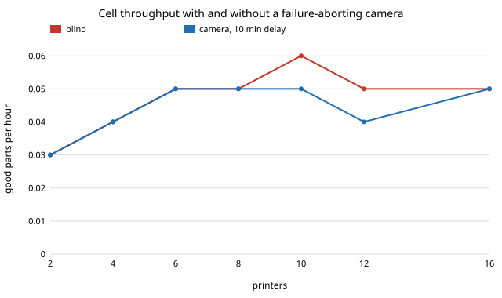

# Is a print-failure camera worth it in a robot-arm 3D-printer cell? Blind printing against abort-on-failure, simulated

A stylised, simulation-only study in track `robofab` (milestone 4's next step, "add printer failures", from `research/robofab-cell`). The earlier cell projects model rejects found at inspection but not prints that fail partway (spaghetti, a part that lifts off the bed), where a blind printer keeps printing a bad part to the end. I add a failure hazard to the arm, printers and inspection cell and compare blind printing with a camera that aborts a failing print some minutes after the failure, including false stops, against an analytic printer-time bound and a discrete-event simulation. I did not choose these parameters from a real farm; every number is illustrative.

**Live page:** https://duncan-haywood.github.io/monorepo-projects/research/robofab-cell-monitor/



- **The camera helps most when the printers set the limit, and the gain disappears once the arm does.** With failures at 0.3 per printing hour (a 20 min part fails 9.5% of the time, a 60 min part 25.9%) and a camera that aborts 10 min after a failure, the simulated gain is +10.2%, +6.7%, +8.4%, +7.7% and +6.2% at 2, 4, 6, 8 and 10 printers (standard errors 0.03 to 0.06 parts/h on rates of 2 to 10), +4.5% at 12 and +0.8% at 16, where the arm limits the cell (12.08 ± 0.05 against 12.18 ± 0.05 parts/h).
- **Detection delay costs throughput roughly in proportion.** At 6 printers the simulated rate is 6.82, 6.72, 6.64, 6.46, 6.33 and 6.16 parts/h for delays of 0, 5, 10, 20, 40 and 80 min, against 6.13 for blind printing (standard errors 0.03 to 0.06). Even an instant camera gains 11% here; a camera that reacts after 80 min gains about 0.5% (6.16 against 6.13), within noise.
- **False stops have a break-even.** With a 10 min delay the camera's gain at 6 printers is gone somewhere between 0.1 and 0.2 false aborts per printing hour: 6.29 ± 0.05 at 0.1 and 6.04 ± 0.04 at 0.2, against 6.13 ± 0.05 blind (about 0.16 by linear interpolation, which I did not refine). At 0.8 per hour the cell makes 4.39 parts/h, 28% below blind printing.
- **The gain grows with the failure rate.** At 6 printers and a 10 min delay: +0.0%, +2.8%, +8.4%, +16.0% and +28.4% at 0, 0.1, 0.3, 0.6 and 1.0 failures per printing hour (blind rates 7.84, 7.22, 6.13, 4.80, 3.43 parts/h).
- **The analytic bound is an upper bound that the simulation sits below by 0 to 12%.** It uses exact per-attempt success and printing time for exponential hazards, with arm, printer and inspection capacities. Against the 40-seed simulation it overestimates by 1.9% (2 printers), 4.1% (6), 7.2% (8), 10.8% (10) and 12.4% (12, arm-limited, blind); the gap is the arm and printer collisions that `research/robofab-cell-cv` and `robofab-cell-held` studied. It ranks the options correctly here but overstates the gain at 12 printers (it says 0%, the simulation +4.5%), because the arm limit is not sharp.

## Reproduce

```bash
cd research/robofab-cell-monitor
PYTHONPATH=src python3 -m pytest -q tests   # 8 tests, < 1 s
python3 experiments/run.py                  # about 1 min; writes experiments/results.txt
python3 experiments/figure.py               # writes experiments/gain_vs_printers.svg
```
Needs `numpy` (and `pytest` for the test command; `python3 -m unittest discover -s tests` works too).

## Builds on

The workcell-twin direction of the HIRO Group (Alessandro Roncone, <https://hiro-group.ronc.one/>), and `research/robofab-cell` and `research/robofab-cell-bound` in this repository, whose cell structure (one arm, held printers, closed loop, lognormal times) I follow. The simulator here is a fresh, shorter one, not a copy. No external result is cited or reproduced.

## Method

`src/robofab_cell_monitor/cell.py`. A job holds a printer from the start of its load to the end of its unload. A print fails if an exponential failure time (rate per printing hour) falls inside its duration. Blind printing runs every print to its end; the arm clears a bad part at unload and the job returns to the printer queue. The camera ends a failing print at failure time plus the delay (or the print's end, if earlier), and also aborts good prints at a Poisson false-stop rate; the arm still spends an unload on each abort. Good prints are inspected (3 min, never rejecting here) and replaced by a fresh job of random type. `bound()` gives printer, arm and inspection capacities from the exact success probability and expected printing time per attempt. Equal mix of a 20 min and a 60 min part, 2 min load and unload, lognormal times with cv 0.3, work in process = printers + 2, 48 h with 4 h warm-up, 40 seeds.

## Results

See the bullets above and `experiments/results.txt`.

## Limitations

Stylised and simulation-only. Failures are memoryless and independent of the part, the printer and its wear, which real failures are not. Detection delay is a fixed number, not a detector with its own hit and miss rates; false stops are a Poisson rate. A failed print is a total loss, with no salvage or restart from a layer. Inspection never rejects, so print failures are the only loss; there is one arm, no travel time, no bed-clearing failures, no filament changes and no breakdowns. The bound is an upper bound, not a prediction. Standard errors are 0.03 to 0.06 parts/h, so differences below about 1% are noise. Nothing here says what a real camera costs or how well it detects.

## Next steps

Replace the fixed delay with a detector that has its own hit and miss rates and a confidence threshold, so the break-even false-stop rate becomes a break-even operating point; add part-level salvage; add printer wear so that failure rates differ by printer; measure real failure rates and detection delays on an owner's printers before trusting any number here.

## Owner steps

None; nothing was built or ordered. Pricing a camera and its software for a real farm would need sourced, dated prices, which are not given here.

## Outside dependencies

`numpy` only. No language model or hardware was used. Produced with AI assistance (Claude).

MIT.
