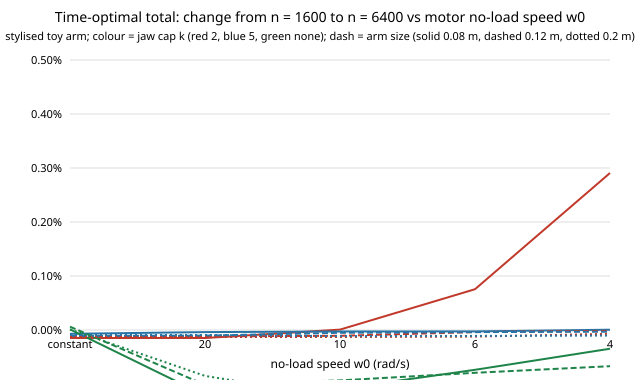

# Is the motor-line edge of the time-optimal carry converged in solver nodes? Yes to about 0.3 percentage points, with one exception (stylised, preliminary)

A follow-up to `research/robofab-motorcurve` (track `robofab`; its "repeat the node-count convergence under the motor line" and "investigate the `cover` part at w0 = 4" next steps), on the same toy arm, printed parts and limits. That project solved the time-optimal carry at n = 1600 nodes only. Here the same nine rows and five motor settings (w0 = infinity, 20, 10, 6, 4 rad/s; torque limit 5 N m x (1 - |joint speed| / w0)) are solved at n = 400, 1600 and 6400. All numbers are from `experiments/results.txt`.

**Live page:** https://duncan-haywood.github.io/monorepo-projects/research/robofab-motorconv/



- **Converged for the headline.** Going from n = 1600 to 6400 changes the six-part time-optimal total by at most 0.29% in any of the 45 cells, and the edge over the tuned trapezoid by at most 0.28 percentage points. So the 3.5 to 28.6% range of `robofab-motorcurve` stands: at n = 6400 the cells range 3.46 to 28.52% (the 0.08 m no-cap row is a five-part total, see below).
- **Exception: the small arm at the lowest w0.** The 0.08 m, k = 2 row at w0 = 4 has edge 1.34% (n = 400), 4.98% (1600), 5.26% (6400); at w0 = 6 it is 6.67, 7.27, 7.34%. Time falls monotonically with n, so the n = 1600 figure of `robofab-motorcurve` (4.98%) was about 0.3 points low. n = 400 is up to 3.9 points off in this row.
- **The motor line needs more nodes than a constant limit.** Rows with the constant limit move by 0.015% or less from n = 1600 to 6400; the no-cap rows with a motor line move 0.03 to 0.13%, and the edge always shrinks a little with n there (for example 25.73 to 25.66%, 0.12 m).
- **The `cover` part was a node-count limit, not infeasible.** In the 0.08 m rows the solver returns no profile for `cover` at n = 400 (k = 5 and no cap at w0 = 4, no cap also at w0 = 6) and at n = 1600 (no cap, w0 = 4), but returns one at n = 6400 for every w0. That answers the open question in `robofab-motorcurve`: its missing `cover` profile at w0 = 4 came from the 1600-node grid. The totals here still use the five parts feasible at every n for the 0.08 m k = 5 and no-cap rows, so those two rows stay five-part totals and are comparable with `robofab-motorcurve`, not with a six-part total. A six-part total at n = 6400 alone was not computed.
- Preliminary and stylised; the ranking (time-optimal faster than trapezoid) did not change in any cell.

```bash
cd research/robofab-motorconv
PYTHONPATH=src python3 -m unittest discover -s tests -v   # 28 tests, about 7 s
PYTHONPATH=src python3 experiments/run.py > experiments/results.txt   # about 40 min; also writes results.json
python3 experiments/figure.py                             # writes experiments/conv.svg
```
Produced with Python 3.11, standard library only.

## Motivation

A time-optimal planner's saving is only meaningful if the solver's discretisation is not what produces it. `robofab-motorcurve` ran a convergence test for the constant limit (in `robofab-toppconv` and `robofab-torquebound`) but not under the speed-dependent limit, where the feasible-acceleration bound changes with speed and the solver can need finer nodes. This closes that gap for the same nine rows.

## Builds on

`research/robofab-motorcurve` (arm model, geometry, solver and trapezoid code copied here so the project is self-contained) and, through it, the workcell-twin direction of the HIRO Group (Alessandro Roncone, <https://hiro-group.ronc.one/>) and the task-and-motion-planning interests of the CAIRO Lab (Bradley Hayes, <https://cairo-lab.com/>). The solver follows Bobrow, Dubowsky and Gibson (1985, "Time-optimal control of robotic manipulators along specified paths", *International Journal of Robotics Research* 4(3)) and Pfeiffer and Johanni (1987, "A concept for manipulator trajectory planning", *IEEE Journal of Robotics and Automation* 3(2)); the implementation is the repository's own. It does not build on, and is not endorsed by, either group. No external result is reproduced.

## Method

`experiments/run.py` runs the `robofab-motorcurve` set-up (3 arm sizes x jaw cap k = 2, 5 or none x six printed parts; trapezoid on the 14-value ramp grid with 40 extra samples per ramp, unchanged) with the solver at n = 400, 1600 and 6400. Totals are over the parts that have a profile at every n and every w0 for the row. Edge = 1 - T_opt / T_trap; the trapezoid does not depend on n. One new test file (`tests/test_convergence_motor.py`) checks convergence under the motor line on one path and that w0 = 1e9 equals the constant limit; the other tests are copied from `robofab-motorcurve`.

## Results

Edge (%) at n = 1600 (as in `robofab-motorcurve`) and n = 6400, selected rows; the full table, with n = 400, is in `experiments/results.txt`.

| row (L, k) | w0 = 6, n 1600 / 6400 | w0 = 4, n 1600 / 6400 |
|---|---|---|
| 0.08 m, 2 | 7.27 / 7.34 | 4.98 / 5.26 |
| 0.08 m, 5 (5 parts) | 7.88 / 7.88 | 6.11 / 6.11 |
| 0.08 m, none (5 parts) | 11.86 / 11.79 | 8.11 / 8.07 |
| 0.12 m, none | 10.85 / 10.78 | 6.82 / 6.76 |
| 0.2 m, none | 24.31 / 24.21 | 18.85 / 18.75 |

## Limitations

- Stylised: the arm, parts, limits and the linear motor line are assumed (see `robofab-motorcurve`). Not a claim about physical arms.
- Only three node counts; convergence beyond 6400 was not tested, and the small-arm w0 = 4 row was still moving by 0.3 points between 1600 and 6400, so it may not be fully converged at 6400.
- The trapezoid is unchanged and was not re-checked here; its own sampling error is not bounded by this project.
- Two 0.08 m rows remain five-part totals; the six-part values at n = 6400 were not computed.
- Fixed joint-space line, one planar arm, no jerk limit; profiles not checked in MuJoCo.

## Next steps

Six-part totals for the 0.08 m rows at n = 6400 and 25600, to see whether the small-arm w0 = 4 row converges; a jerk limit on both profiles; a MuJoCo check with a motor model; fit w0 and the torque limit to a catalogue servo (owner step).

## Owner steps

None; nothing was built or ordered.

## Outside dependencies

The Python standard library only; no language model, key or hardware. Produced with AI assistance (Claude).

MIT.
