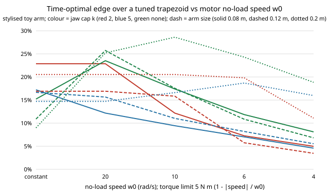

# Does the time-optimal carry's edge over a tuned trapezoid survive a motor torque-speed line? Not as one number (stylised, preliminary)

A follow-up to `research/robofab-torquebound` (track `robofab`; its "speed-dependent torque limit" next step), on the same toy arm, parts and limits. There the joint torque limit was a constant 5 N m, which lets the unconstrained time-optimal profiles reach joint speeds of 6 to 139 rad/s. Here each joint's limit follows the linear torque-speed line of a brushed DC motor, 5 N m x (1 - |joint speed| / w0), for w0 = 20, 10, 6 and 4 rad/s (w0 = infinity is the constant limit). The same nine rows are solved (3 arm sizes x jaw cap k = 2, 5 or none, six printed parts each, no other speed limit). All numbers are from `experiments/results.txt` (solver n = 1600, trapezoid on the 14-value ramp grid with 40 extra samples per ramp).

**Live page:** https://duncan-haywood.github.io/monorepo-projects/research/robofab-motorcurve/



- **The edge stays positive but moves a lot.** Over all 45 (row, w0) cells the time-optimal carry is 3.5% to 28.6% faster than the tuned trapezoid, never slower. With the constant limit the same rows give 9.0% to 22.9%.
- **Where a jaw cap binds on a small arm, the motor line shrinks the edge.** For the 0.08 m and 0.12 m arms with k = 2 or 5 the edge falls as w0 falls: for example 22.9% (constant) to 5.0% at w0 = 4 (0.08 m, k = 2) and 16.7% to 5.5% (0.12 m, k = 5).
- **Where only torque binds, the motor line raises it.** With no jaw cap the edge is 9.0% to 15.2% under the constant limit and 18.9% to 28.6% for the 0.2 m arm at w0 = 4 to 20 (25.7% for the 0.12 m arm at w0 = 20). A likely reason (not tested): the time-optimal profile can trim its speed only where torque is scarce, while the trapezoid has to lengthen the whole move; both get slower, the trapezoid more. The 0.2 m arm with k = 5 is non-monotone (14.7%, 16.6%, 18.7%, 16.0% for w0 = infinity, 10, 6, 4).
- **A constant limit hides the effect.** Rows are identical to the constant case when the profile never reaches w0 (0.2 m, k = 2, w0 >= 10). Elsewhere total carry times rise by up to a factor 8 (0.12 m, no cap, time-optimal: 0.332 s to 2.583 s at w0 = 4) so the constant-torque numbers of `robofab-scurve` are optimistic in time as well as in speed.
- **Reading.** "How much does time-optimal planning save" has no single answer in this toy: with a motor line it ranges from a few per cent to over a quarter, by arm size and by which limit binds. The ranking (time-optimal faster) did not change. Preliminary and stylised.

```bash
cd research/robofab-motorcurve
PYTHONPATH=src python3 -m unittest discover -s tests -v   # 58 tests, about 10 s
PYTHONPATH=src python3 experiments/run.py > experiments/results.txt   # about 15 min; also writes results.json
python3 experiments/figure.py                             # writes experiments/edge.svg
```
Produced with Python 3.11, standard library only.

## Motivation

A constant torque limit is the simplest model of an actuator, and the least realistic at high speed: a DC motor's available torque falls linearly to zero at its no-load speed. `robofab-torquebound` found the time-optimal carry 9 to 23% faster than a trapezoid in the torque- and jaw-bound rows; this checks whether that survives the one actuator effect that most changes which profiles are feasible. It matters for the workcell (`robofab-cell`) and the self-replicating shop (track `selfrep`) only as a calibration of what a time-optimal planner could save in this toy.

## Builds on

The workcell-twin direction of the HIRO Group (Alessandro Roncone, <https://hiro-group.ronc.one/>) and the task-and-motion-planning interests of the CAIRO Lab (Bradley Hayes, <https://cairo-lab.com/>), via `research/robofab-torquebound`, whose arm model, geometry, solver and trapezoid code are copied here so the project is self-contained. The time-optimal solver follows the numerical-integration approach of Bobrow, Dubowsky and Gibson (1985, "Time-optimal control of robotic manipulators along specified paths", *International Journal of Robotics Research* 4(3)) and Pfeiffer and Johanni (1987, "A concept for manipulator trajectory planning", *IEEE Journal of Robotics and Automation* 3(2)); the implementation is the repository's own. Speed-dependent torque limits are standard in that line of work (the torque bound at a path point depends on speed); the linear DC-motor line used here is an assumed simplification, not taken from a paper. It does not build on, and is not endorsed by, either group. No external result is reproduced.

## Method

Unchanged from `robofab-torquebound` except the joint limit: |tau_i| <= 5 N m x (1 - |qd_i| / w0), with qd_i = dq_i sqrt(u) along the joint-space line. In the solver this is one more bound on the feasible path acceleration at each node (the limit shrinks as u grows); the velocity-limit curve is found by a geometric scan rather than bisection, because feasibility need not be monotone in u. A joint at or beyond w0 has no torque, so such nodes are infeasible. In the trapezoid check each sample's torque is divided by (1 - |qd_i| / w0) and compared with 5 N m. Totals are over the parts feasible for both methods at every w0 for that row; `experiments/results.txt` lists dropped parts. Time-optimal: n = 1600. Trapezoid: best of 14 ramp fractions 0.002 to 0.5, 40 extra samples per ramp. Edge = 1 - T_opt / T_trap. Eight new tests check the constant-limit reduction, monotone slowing as w0 falls, speed below w0, the torque line along the solved profile (interior nodes, 5% slack), and the trapezoid limits.

## Results

Edge (%) of the time-optimal carry over the tuned trapezoid, six-part totals (the 0.08 m, no-cap row has five parts, see Limitations).

| row (L, k) | w0 = inf | 20 | 10 | 6 | 4 |
|---|---|---|---|---|---|
| 0.08 m, 2 | 22.86 | 22.86 | 12.18 | 7.27 | 4.98 |
| 0.08 m, 5 | 17.22 | 12.18 | 9.44 | 7.02 | 4.59 |
| 0.08 m, none | 15.22 | 23.52 | 17.40 | 11.86 | 8.11 |
| 0.12 m, 2 | 16.92 | 16.92 | 15.84 | 5.75 | 3.46 |
| 0.12 m, 5 | 16.67 | 15.65 | 11.04 | 8.20 | 5.54 |
| 0.12 m, none | 10.89 | 25.73 | 17.55 | 10.85 | 6.82 |
| 0.2 m, 2 | 20.54 | 20.54 | 20.54 | 19.82 | 11.09 |
| 0.2 m, 5 | 14.72 | 14.72 | 16.61 | 18.68 | 15.97 |
| 0.2 m, none | 8.98 | 25.23 | 28.61 | 24.31 | 18.85 |

Peak joint speed of the constant-limit time-optimal profile (largest over parts): 6.4 to 139.5 rad/s; the largest are the no-cap rows (24.7, 58.5, 139.5 rad/s), which no real motor reaches.

## Limitations

- Stylised. All parameters other than geometry are assumed, and the motor line (linear, same w0 for both joints, no gearing, no current limit, no back-EMF dynamics) is a simplification.
- The constant-limit rows differ slightly from `robofab-torquebound` (n = 1600 here, 40 ramp samples only). In the 0.08 m no-cap row the `cover` part has no profile at w0 = 4 (the solver returns none; whether it is truly infeasible or a solver limit was not investigated), so that row is a five-part total in every column and its constant-limit edge (15.2%) is not comparable with the six-part 16.2% of `robofab-torquebound`.
- Only the solver's node count (n = 1600) and 40 ramp samples are used; no convergence check was repeated under the motor line, and `sdd` near the path ends carries a first-order finite-difference error that shrinks as 1/n.
- Fixed joint-space line, one planar arm, friction-based jaw bound, no jerk limit. The profile is not checked in MuJoCo.
- Simulated results are not claims about physical arms or grippers.

## Next steps

Check the profiles in MuJoCo with a motor model; an absolute jerk limit in rad/s^3 for both profiles; repeat the node-count convergence under the motor line; bound the trapezoid's missed peaks; investigate the `cover` part at w0 = 4; fit w0 and the torque limit to a catalogue servo (owner step).

## Owner steps

None; nothing was built or ordered.

## Outside dependencies

The Python standard library only; no language model, key or hardware. Produced with AI assistance (Claude).

MIT.
