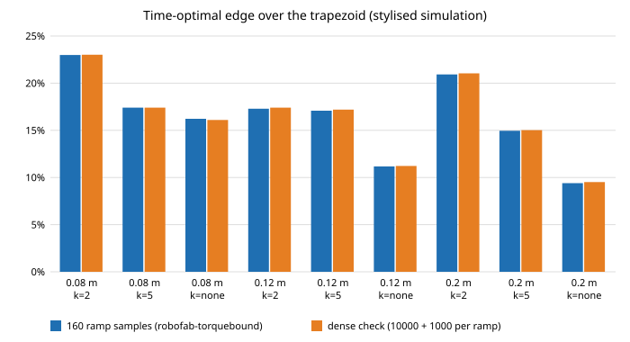

# Is the trapezoid's duration in the torque- and jaw-bound rows set by peaks a sparse check never looked at? (stylised, preliminary)

A follow-up to `research/robofab-torquebound`, whose next steps asked to "bound the trapezoid's missed peaks (denser whole-move sampling ...)". It matters because every edge reported on this track is `1 - T_opt / T_trap`, and `T_trap` is only as honest as the check that sets it: a trapezoid is declared feasible if the torque and jaw force stay under their limits at the sampled instants, so missed peaks make the trapezoid look faster than it is and the time-optimal edge look smaller. Same toy arm, parts and limits as `robofab-torquebound` (track `robofab`).

- **The dense check barely moves the trapezoid.** The nine torque- and jaw-bound rows (3 arm sizes x jaw cap k = 2, 5 or none, six printed parts each, no speed limit) are re-solved with a trapezoid check of 10,000 whole-move midpoints plus 1,000 per ramp plus both sides of the two acceleration corners, against `robofab-torquebound`'s 201 + 160 per ramp. Six-part totals change by +0.006% to +0.152% in eight rows and by -0.150% in one (0.08 m, no cap).
- **The edge is unchanged to within 0.13 points.** Dense-check edge over the time-optimal solver (n = 6400): 9.5% to 23.0%, against 9.4% to 23.0% before. Largest 0.08 m / k = 2 (23.0%), smallest 0.2 m / no cap (9.5%). The earlier "9 to 23%" finding does not rest on a sparse peak check.
- **The dense answers hold at ten times the density.** Re-checked at 100,000 + 10,000 per ramp samples, the highest utilisation of any part's torque or jaw limit is 1.00000 (to five places; worst 0.99998 to 1.00000), and an a-posteriori estimate of the peak still missed between those samples is at most 0.0025 of a limit (largest for the 0.2 m arm with k = 2).
- **One row goes the other way.** For 0.08 m with no jaw cap the dense trapezoid is 0.15% *faster* than the sparse one (edge 16.1% vs 16.2%). Both checks sample different instants, so a peak sitting between the sparse check's samples is not the only way they can differ; I did not investigate the cause. It is small next to the edge.
- **Reading:** in this toy the sparse check was close to converged, so the large torque- and jaw-bound edge is not an artefact of unseen trapezoid peaks.

```bash
cd research/robofab-peakcheck
PYTHONPATH=src python3 -m unittest discover -s tests -v   # 60 tests, < 10 s
PYTHONPATH=src python3 experiments/run.py > experiments/results.txt   # about 8 min; also writes results.json
python3 experiments/figure.py                                          # writes experiments/edge.svg
```
Produced with Python 3.11, standard library only.

## Builds on

The workcell-twin direction of the HIRO Group (Alessandro Roncone, <https://hiro-group.ronc.one/>) and the task-and-motion-planning interests of the CAIRO Lab (Bradley Hayes, <https://cairo-lab.com/>), via `research/robofab-torquebound`, whose arm model, geometry, time-optimal solver and trapezoid code are copied here so the project is self-contained. The time-optimal solver is the forward-backward path-parameterisation scheme of Bobrow, Dubowsky and Gibson (1985), "Time-optimal control of robotic manipulators along specified paths", Int. J. Robotics Research 4(3).

## Method

Rows, arm, parts and limits are unchanged from `robofab-torquebound` (planar two-link arm, joint-space line from pick to lift point, torque limit 5 N m, jaw cap k times the static hold force). For each part: the best ramp fraction from the 14-value grid under the 160-ramp-sample check (`T160`); then the three fractions with the smallest `T160` are re-solved by bisection (between 0.9 and 1.05 times `T160`) under the dense check, and the shortest is `Tdense`. The dense check (`src/robofab_peakcheck/peak.py`) evaluates utilisation, `max(|tau|/5 N m, jaw force/cap)`, at 10,000 whole-move midpoints, 1,000 midpoints inside each ramp, and 1e-9 either side of the two corners where the acceleration (so the torque) jumps. The result is re-evaluated at 100,000 + 10,000 samples; the missed-peak estimate, for each gap between neighbouring samples, is the largest slope on that gap or its two neighbours times half the gap, excluding gaps that straddle a corner. It is an estimate from the samples themselves, not a proof. The time-optimal profile is the solver at n = 6400, converged to 0.004% in `robofab-torquebound`.

## Results

| row (L, k) | T160 | Tdense | change | T_opt (n=6400) | edge, 160 | edge, dense | max utilisation at 10x density | est. missed |
|---|---|---|---|---|---|---|---|---|
| 0.08 m, 2 | 0.8678 | 0.8682 | +0.041% | 0.6683 | 22.99% | 23.02% | 0.99999 | 0.00053 |
| 0.08 m, 5 | 0.4653 | 0.4653 | +0.006% | 0.3843 | 17.40% | 17.41% | 0.99998 | 0.00036 |
| 0.08 m, none | 0.1461 | 0.1459 | -0.150% | 0.1224 | 16.22% | 16.09% | 0.99998 | 0.00003 |
| 0.12 m, 2 | 1.6105 | 1.6129 | +0.148% | 1.3321 | 17.29% | 17.41% | 0.99997 | 0.00085 |
| 0.12 m, 5 | 0.9437 | 0.9450 | +0.141% | 0.7826 | 17.08% | 17.19% | 0.99997 | 0.00045 |
| 0.12 m, none | 0.3732 | 0.3734 | +0.053% | 0.3315 | 11.17% | 11.22% | 0.99998 | 0.00003 |
| 0.2 m, 2 | 1.5923 | 1.5948 | +0.152% | 1.2592 | 20.92% | 21.04% | 0.99999 | 0.00254 |
| 0.2 m, 5 | 0.8841 | 0.8848 | +0.075% | 0.7519 | 14.95% | 15.02% | 1.00000 | 0.00119 |
| 0.2 m, none | 0.4551 | 0.4557 | +0.127% | 0.4124 | 9.39% | 9.51% | 1.00000 | 0.00003 |

All 9 rows had all six parts feasible. Totals are six-part sums in seconds; "max utilisation" and "est. missed" are the worst over the six parts. `experiments/results.txt` is the full output; `experiments/edge.svg` is the figure.



## Limitations

- Stylised. All parameters other than geometry are assumed.
- Only the trapezoid's peak check is varied. The path stays a fixed joint-space line, and the ramp-fraction grid is the same 14 values (only the three best are re-solved densely).
- The missed-peak figure is an estimate from local slopes of the sampled curve; a narrower feature than the sample spacing would escape it.
- Torque and jaw force are evaluated pointwise; no analytic peak check is done, and the dense answer's ten-times-denser check only samples more.
- The sign of the one negative change (0.08 m, no cap) is not investigated.
- Same model limits as `robofab-torquebound`: one planar arm, friction-based jaw bound, no motor dynamics, no speed-dependent torque (see `robofab-motorcurve`), no jerk limit.
- Simulated results are not claims about physical arms or grippers.

## Next steps

An analytic peak check for the trapezoid (torque is smooth within each of its three phases, so each phase's maximum can be bracketed); explaining the one row where the dense trapezoid is faster; an absolute jerk limit in rad/s^3 for both profiles; checking the profiles in MuJoCo.

## Owner steps

None; nothing was built or ordered.

## Outside dependencies

The Python standard library only; no language model, key or hardware. Produced with AI assistance (Claude).

MIT.
