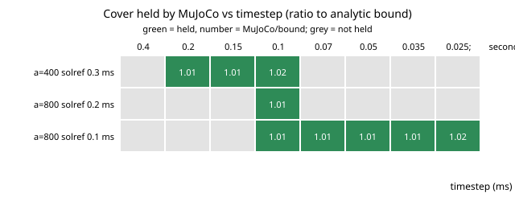

# Is it the contact time constant or the timestep that breaks a moving grasp in MuJoCo? A full grid (stylised)

A follow-up to `research/robofab-solrefmap` (track `robofab`; its "separate timestep from `solref` in a full grid" next step). `robofab-solrefmap` tied the timestep to `solref` in its main grid and fixed it in its scan. Here the same jaw test (one part, the cover) is run over a full grid of `solref` and timestep at 400 and 800 m/s^2, then over a finer timestep ladder at three (acceleration, `solref`) pairs. I do not simulate an arm, only a prescribed constant upward acceleration of the jaws. All numbers are from `experiments/results.txt`.

**Live page:** https://duncan-haywood.github.io/monorepo-projects/research/robofab-solreftimestep/

- **Neither a small `solref` nor a small timestep is enough alone; a coarse timestep always fails.** In the grid (solref 0.5, 0.3, 0.2 ms x timestep 0.4, 0.2, 0.1, 0.05 ms, two accelerations: 24 cells) the test reproduces the bound (ratio 1.01 to 1.02) in 6 cells; the other 18 return "none" (no force up to 60 N holds). No cell with timestep 0.4 ms holds, and no cell with `solref` 0.5 ms holds.
- **Timestep above `solref`/2 is clamped by MuJoCo.** With the default `refsafe` option, the effective time constant is max(`solref`, 2 x timestep) (my reading of the MuJoCo documentation; the effective values are printed in `results.txt`, but I did not test the option off). Every ladder cell whose effective constant is above 0.2 ms fails at 800 m/s^2 (6 of 6 cells in the two 800 m/s^2 ladder rows with a timestep of at least 0.15 ms), consistent with `robofab-solrefmap`'s finding that only `solref` of 0.2 ms or below holds there.
- **A finer timestep does not rescue a marginal `solref`, and can make it worse.** At 800 m/s^2 and `solref` 0.2 ms, only timestep 0.1 ms holds (1.01); 0.07, 0.05, 0.035 and 0.025 ms all fail. At 400 m/s^2 and `solref` 0.3 ms, timesteps 0.2, 0.15 and 0.1 ms hold and 0.07 ms and finer fail. I do not know why; I did not test causes (candidates: the stiffer contact at an effective constant of 0.2 to 0.3 ms interacting with the no-slip iterations, or the prescribed carrier motion being set once per step). Treat it as an open observation, not a rule.
- **With `solref` 0.1 ms at 800 m/s^2, every timestep of 0.1 ms and below holds** (ratio 1.01 to 1.02, five of five), and 0.4 to 0.15 ms fail (clamped to 0.8 to 0.3 ms).
- **Practical consequence in this set-up:** pick `solref` well below the acceleration limit found in `robofab-solrefmap` (0.1 ms held at 800 m/s^2 for all tested timesteps of 0.1 ms and below), rather than sitting on the boundary, where results depend on the timestep non-monotonically. One part, one friction value: do not extend this to other parts without running them.

```bash
pip install mujoco numpy
cd research/robofab-solreftimestep
PYTHONPATH=src python3 -m unittest discover -s tests -v   # 6 tests, < 1 s
python3 experiments/run.py                                # about 6 s; writes experiments/results.{txt,json}
```
Produced with MuJoCo 3.16.0 and Python 3.11 (`robofab-solrefmap` used 3.15.0).

## Motivation

`robofab-solrefmap` could not say whether `solref` or the timestep caused failures. The answer decides which setting to tighten in a workcell twin.

## Builds on

The workcell-twin direction of the HIRO Group (Alessandro Roncone, <https://hiro-group.ronc.one/>), `research/robofab-solrefmap` and `research/robofab-graspfast` (model and simulation copied so the project is self-contained). No paper from the group is reproduced; nothing here is affiliated with or endorsed by them. Simulator: Todorov, Erez and Tassa (2012), MuJoCo, IROS. Self-replication context: Zykov et al. (2005). `paper/refs.bib` is copied from `robofab-solrefmap` and was not independently re-verified here.

## Method

As in `robofab-solrefmap`: a free-body part held between two force-driven pad bodies under a gravity-compensated carrier that follows a prescribed upward constant acceleration for 0.05 s after 0.1 s of settling. Held if the part moves < 2 mm relative to the carrier. Minimum force by bisection on 0 to 60 N (tolerance 2%). Elliptic cones, 10 no-slip iterations, density 1240 kg/m^3 (assumed), mu = 0.5, cover part, first grasp option. The ratio is the minimum holding force over m(g+a)/(2 mu).

## Results

See the bullets above and `experiments/results.txt` (grid: 3 `solref` x 4 timesteps x 2 accelerations; ladder: 8 timesteps x 3 pairs).



Regenerate with `python experiments/figure.py` (parses `results.txt`).

## Limitations

- One part (cover), upward acceleration only, constant for 0.05 s; no sideways load, no arm, no vibration. Rigid box pads, assumed density, one friction value, a 2 mm slip criterion.
- The `refsafe` explanation is from documentation, not tested. The non-monotone timestep behaviour is unexplained and might be an artefact of this test harness rather than of MuJoCo's contact model.
- Only MuJoCo 3.16.0, default `solimp`, `solref` damping ratio 1. Single deterministic runs; no seeds are involved.
- Simulation only; no claim about a real gripper.

## Next steps

Test with `refsafe` disabled; vary `solimp`; find the cause of the non-monotone timestep behaviour (try a smooth carrier profile or substepping the prescribed motion); repeat on the other six parts.

## Owner steps

None; nothing was built or ordered. A physical test would need a priced bill of materials with sourced, dated prices, which are not given here.

## Outside dependencies

The `mujoco` and `numpy` packages (pip); no language model, key or hardware. Produced with AI assistance (Claude).

MIT.
