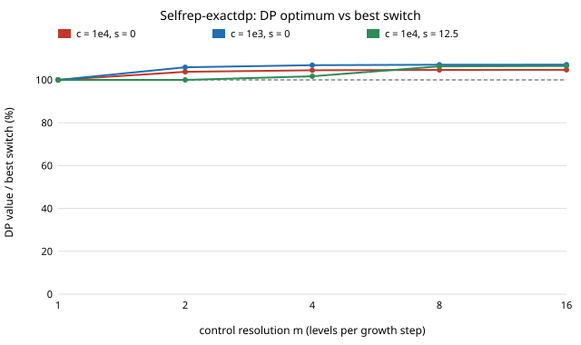

# selfrep-exactdp: how much does a smooth copy-then-sell policy beat a single switch for the replicating shop, certified without interpolation?

Follow-up to `selfrep-dpgrid` in the self-replicating manufacturing track (`PROJECTS.md`, track 1), taking its "diagnose the bias" next step by removing the interpolation that caused it. Produced with AI assistance (Claude).

**Live page:** https://duncan-haywood.github.io/monorepo-projects/research/selfrep-exactdp/

**Headline (stylised, assumed inputs).** On a control set where every step lands exactly on a grid point, the DP table equals the value of its own policy to 1e-14. When the goods market saturates and the fleet has no resale value (`s = 0`), a policy that copies, then splits time between copying and goods, then makes goods only beats the best single switch by **4.7%** (market capacity c = 1e4) and **7.1%** (c = 1e3). With a resale value `s` of 12.5 per machine and c = 1e4, the gain is 6.5%. With `s` = 50 the best switch (copy to the horizon) is optimal.

**Builds on.** `research/selfrep-dpgrid` and `research/selfrep-terminalmarket` (the problem and the comparators, imported by relative path), `research/selfrep-satmarket` (the fluid model) and `research/selfrep-growth` (`W` = 50.0 h per copy, from `research/selfrep-closure`, RepRap Prusa Mendel; Jones et al., "RepRap – the replicating rapid prototyper", *Robotica* 29(1), 2011, <https://doi.org/10.1017/S026357471000069X>). Backward dynamic programming is the method of Bellman (1957), *Dynamic Programming*, Princeton University Press. The question follows von Neumann (1966) and Freitas and Merkle (2004), as in `PROJECTS.md`. No paper's result is reproduced. This project builds on none of the CU Boulder groups in `prompt.md` and claims no connection to them.

## Method
- **Model** as in `selfrep-terminalmarket`: fleet `N`, copy share `u`, `N' = k u N`, `k = 1/W`; revenue `R(g) = a c (1 - exp(-g/c))` for `g = (1-u) N`; resale value `s` per machine at `T` = 600 h; Euler step 1 h; all inputs assumed.
- **Why the earlier tables were low.** `selfrep-dpgrid` found the DP table 2–13% below the value of its own policy and could not say why. Linear interpolation of the successor value is the suspect: each backward step blurs the value function by a fraction of a cell.
- **The fix.** Let `r = 1 + k dt` and put the fleet grid at `n_i = r^(i/m)`. Control `j = 0..m` is `u_j = (r^(j/m) - 1)/(k dt)`, so one Euler step moves the fleet by exactly `j` cells. The DP then needs no interpolation, and its table is the exact optimum over that control set (`m + 1` levels). `u = 0` and `u = 1` are always available, so every bang-bang policy is feasible, and the sets for `m` and `2m` are nested, so the value cannot fall as `m` grows. `m = 1` is bang-bang only.
- **Checks.** The table value is compared with the Euler value of the DP's own policy run through `selfrep_satmarket.run`, and with the best bang-bang switch on a 1 h grid.

## Reproduce
```bash
cd research/selfrep-exactdp
python3 -m unittest discover -s tests -v     # 5 tests, standard library only
python3 experiments/run.py                   # about 20 s; writes experiments/results.txt
python3 experiments/figure.py                # redraws experiments/gain_vs_resolution.svg from results.txt
```

## Results (from `experiments/results.txt`; T = 600 h, a = 1, W = 50 h, failure 0; all assumed)
- **The table is exact.** In all 6 cases and all resolutions, `|table - J| / J` is below 1e-13. The gaps of `selfrep-dpgrid` were interpolation error, not a property of the problem.
- **With `s` = 50 or `s` = 12.5 at c = 1e3, one switch is optimal on this control set.** The DP copies for all 600 steps at every resolution up to `m` = 8 and ties the switch exactly (100.000%). So the 14% "DP beats switch" figure that `selfrep-resalecurve` reported for a *different* problem (a falling resale price) is not a statement about these cases.
- **With `s` = 0 the single switch loses 4.7–7.1%.** At c = 1e4 the best switch is 485 h and earns 888,949; the DP at `m` = 16 earns 930,815 (104.71%). At c = 1e3 the switch is 393 h and earns 188,186; the DP earns 201,579 (107.12%). The DP policy copies at full share for about 458 (c = 1e4) and 349 (c = 1e3) steps, spends 88 and 194 steps at an intermediate share, and makes goods only for the last 54 and 57 steps. The intermediate phase eases the fleet out of copying while the market is still absorbing its output.
- **A small resale value can need fine control to show a gain.** At c = 1e4, `s` = 12.5, the table equals the switch at `m` = 1 and 2, gains 1.7% at `m` = 4 and 6.3% at `m` = 8, then 6.48% at `m` = 16. A coarse control set would have reported "bang-bang is optimal" here.
- **Resolution has converged to about 0.1% by `m` = 16** (the gain moves by 0.04–0.19 percentage points from `m` = 8 to 16). This is convergence of the control set only; the Euler step (1 h) is fixed.



## Limitations
- Every input is assumed; fluid model, cash free, homogeneous fleet, no wear-out, failure 0, resale value linear in the fleet. A real shop's cash constraint could change which policy is best.
- Exact only for the discrete control set and the 1 h Euler recursion. Whether the continuous-time optimum is a little higher is not tested: the gains here are lower bounds on that, converging in `m`.
- Six (c, s) cases at T = 600 h only. The `m` = 16 runs cover the three cases where a gain appeared; the others stop at `m` = 8.
- The comparator switch is searched on a 1 h grid, and the DP and the switch share the same 1 h Euler step.

## Next steps
Vary the Euler step to see how much of the 5–7% belongs to the discretisation; add the cash constraint of `selfrep-reinvest` as a second state; check whether the intermediate phase has a closed form (a singular arc, as in `selfrep-singulararc`).

## Owner steps
- Find the real resale value of a used RepRap-class printer (source and date for each price) and set `s` from it.
- Replace the assumed goods value `a` and market capacity `c` with prices and volumes the shop's goods actually fetch.

## Outside dependencies (vitamins)
Python standard library only, plus the sibling `selfrep-terminalmarket`, `selfrep-satmarket`, `selfrep-growth` and `selfrep-closure` source trees (relative paths). The vitamins of the printers it describes are those of `selfrep-closure`.

MIT.
