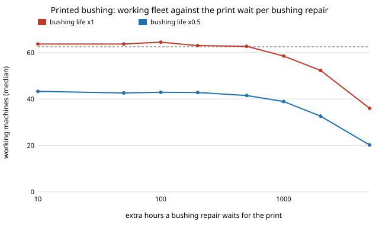

# selfrep-sparehours: does a printer shop lose its printed-bushing gain once a printed spare takes print hours? (stylised)

Follow-up to `selfrep-spares` in the self-replicating manufacturing track (`PROJECTS.md`, track 1), taking the first of that project's listed next steps: charge printed spares their print hours. Produced with AI assistance (Claude). **Stylised, assumed inputs**: nothing here measures a real printer.

**Live page:** https://duncan-haywood.github.io/monorepo-projects/research/selfrep-sparehours/

**Headline.** At the `selfrep-spares` inputs the working fleet does not notice a print wait of up to about 500 h per printed-bushing repair (about 234 h mean downtime per breakdown against 5 h before): the fleet stays at 62.7 against 64.2 with no wait. But the printed bushing never had a clear gain to lose. Even at no wait it is +1.8 machines over stock bearings, inside the run-to-run spread (5–95 percentile of about ±7). The wait starts to cost visibly at 1000 h (58.5) and hurts at 2000 h (52.3) and 5000 h (36.0).

**Builds on.** `research/selfrep-spares` (wear parts, assumed lives, spare cost share c; imported by relative path), `research/selfrep-repair` (the unchanged discrete-event repair model) and `research/selfrep-growth`. Behind them: Jones et al., "RepRap – the replicating rapid prototyper", *Robotica* 29(1), 2011, <https://doi.org/10.1017/S026357471000069X>. This project builds on none of the CU Boulder groups in `prompt.md` and claims no connection to them.

## Method
- Replace the LM8UU linear bearing by a printed bushing of life k × the LM8UU life (k = 1 and 0.5), as in `selfrep-spares`; the spare costs 0.1 vitamin units and is printed in-house.
- A breakdown that hits the bushing needs a printed spare and waits `print_h` extra hours; others wait the base 5 h. `selfrep-repair` has one fixed downtime, so the **mean** downtime is used: 5 + (share of breakdowns that hit the bushing) × `print_h`. The share is 0.457 at k = 1 and 0.628 at k = 0.5. The extra spread of downtime is not modelled.
- Everything else is as in `selfrep-spares`: s = 0.9, reserve 1.0 V, import budget 4 units/h, 100 runs per row, 20000 h, seed 0. Stock-bearing reference: 62.5 machines [55.0–68.1], 23% of runs die out.

## Reproduce
```bash
cd research/selfrep-sparehours
python3 -m unittest discover -s tests -v    # 3 tests, standard library only
python3 experiments/run.py                  # about 10 s; writes experiments/results.txt
python3 experiments/figure.py               # writes experiments/print-wait.svg
```

## Results (from `experiments/results.txt`)
- **k = 1 (bushing as durable as the bearing):** fleet 64.2 with no wait, 63.7 / 63.7 / 64.5 / 63.0 / 62.7 at 10 / 50 / 100 / 200 / 500 h, then 58.5, 52.3 and 36.0 at 1000 / 2000 / 5000 h. The dead-run share is 23% in every row. The pre-1000 h differences are noise, which is why no "break-even wait" is quoted: an early bisection on this noisy median crossed the stock fleet near 520 h, and that crossing means nothing.
- **k = 0.5:** 43.3 with no wait, 19 machines short of stock. A wait adds to that: 38.9 at 1000 h, 20.2 at 5000 h. Dead runs stay at 34%.
- **Why the wait barely matters.** The fleet is import-limited here (`selfrep-repair`'s formula), set by the vitamins spent per breakdown, not by how long a repaired machine is down. Downtime only bites once it is a large fraction of a machine's mean life (about 366 h), and that is where the fleet falls.
- The dead-run share does not move with the wait in these runs; the early-extinction risk is set before downtime matters.



## Limitations
- **Every number is assumed**: part lives, costs, repair success, downtime, import budget. A print wait of hundreds of hours is a stress value, not an estimate of a real print (a small bushing prints in under an hour on a working printer).
- Mean-downtime approximation; the printer that must print the spare is itself assumed available, and printing does not compete with building copies for machine time. A machine-limited regime would change the answer. That is the next step.
- A repair still makes the whole machine as good as new, exponential lives, one seed set; neighbouring rows differ by noise.

## Next steps
Make printing compete with building for machine hours (a machine-limited regime). Make breakdown rate depend on age. Replace the assumed lives with measured ones.

## Owner steps
- Time a real printed bushing job, including queueing on the shop's own printers, and measure how long a printed bushing runs in a bearing seat.
- Replace assumed lives and part costs with measured and dated figures, as for `selfrep-spares`.

## Outside dependencies (vitamins)
Python standard library only, plus the sibling `selfrep-spares`, `selfrep-repair`, `selfrep-growth` and `selfrep-closure` source trees (relative paths). The vitamins of the printer are those of `selfrep-closure`.
