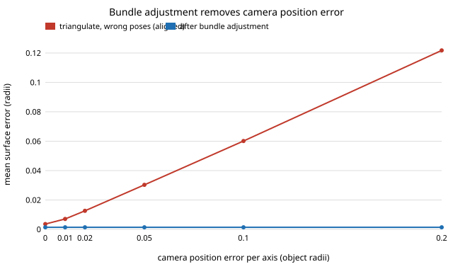

# sensing-ba: does bundle adjustment repair wrong camera poses in a multi-view reconstruction?

Does joint refinement of camera poses and 3-D points (bundle adjustment) remove the error that wrong camera poses put into a reconstruction, and what stops it? On the synthetic rig of `sensing-recon`, **with 12 views, 0.5 px noise and every pose wrong (0.5° rotation and 0.02 object radii of position per axis), triangulation gives a mean surface error of 0.0117 radii and bundle adjustment brings it back to 0.0014, the error with true poses; the gain is 8× here and 73× at 0.2 radii of position error, but falls to 1.4× at 4 px of pixel noise, and 4 views get no gain at all** (numpy and scipy; 6 tests).

This follows the first "Next step" of `sensing-recon`, which found a 1° pose error does the damage of about 2 px of image noise. It is not another micro-variant: it adds the missing stage that fixes that error.

**Live page:** https://duncan-haywood.github.io/monorepo-projects/research/sensing-ba/

**Builds on.** Triggs, McLauchlan, Hartley and Fitzgibbon (2000), "Bundle adjustment: a modern synthesis", *Vision Algorithms: Theory and Practice*, LNCS 1883, for the reprojection-error objective and its sparse structure; Schönberger and Frahm (2016), CVPR, whose pipeline ends in this step; Umeyama (1991), *IEEE TPAMI* 13(4), for the similarity alignment. Solver: SciPy `least_squares` (trust-region reflective, sparse Jacobian pattern). Track 15 (`sensing`), a follow-up of milestone 5. No lab in `prompt.md` is built on; none fits.

## Method
- **Rig.** The object, cameras, projection, visibility rule and DLT triangulation are imported from `../sensing-recon` unchanged: bumpy ellipsoid of mean radius 1, 800 px focal length, 640 × 480, 12-view full orbit by default, 300 features here.
- **Wrong poses.** Each camera gets a random rotation error (degrees per axis) and position error (object radii per axis), then features are triangulated with those poses.
- **Bundle adjustment.** Unknowns are all 6-DoF poses and all points; residuals are reprojection errors in pixels, initialised from the wrong-pose triangulation. 40 function evaluations at most. Optionally a Gaussian prior ties each pose to the supplied one with the true error sigma (MAP).
- **Scoring.** Mean distance to the exact surface, as in `sensing-recon`. A free adjustment fixes the scene only up to a similarity (scale, rotation, translation), so both the wrong-pose triangulation and the adjusted points are aligned to the true points with Umeyama's method before scoring (`tri_aligned`, `ba`); the unaligned triangulation (`tri`) is also shown. `true_pose` is triangulation with the exact poses, the floor.
- 8 seeds per cell.

## Reproduce
```bash
pip install numpy scipy matplotlib pytest
cd research/sensing-ba
PYTHONPATH=src python -m pytest -q tests   # 6 tests
python experiments/run.py                  # writes experiments/results.txt (about 1 min)
python experiments/figure.py               # writes experiments/ba_vs_position_error.svg
```

## Results (from `experiments/results.txt`)
- **Bundle adjustment reaches the true-pose floor whatever the pose error.** From 0° to 4° rotation error the adjusted error stays 0.0014, equal to the true-pose value; aligned triangulation rises from 0.0126 to 0.0295. Position error matters more than rotation: with 0.5° rotation error, 0.2 radii of position error gives 0.1052 aligned (0.1218 unaligned) and 0.0014 after adjustment (73×).
- **Position error alone is enough to hurt.** With rotation exact and position error 0.02, aligned triangulation is 0.0126 against 0.0014 after adjustment (8.7×); with position exact and 0.5° rotation error the table's row B at 0 gives 0.0034 against 0.0014 (2.3×).
- **The floor is pixel noise.** The adjusted error equals the true-pose error at every noise level (0.0003 at 0.1 px up to 0.0115 at 4 px; 0.0028 radii per px as in `sensing-recon`). So the gain from adjustment shrinks as noise grows: 40× at 0.1 px, 8× at 0.5 px, 2.2× at 2 px, 1.4× at 4 px, where pixel noise rather than the poses sets the error.
- **Views.** 6 views: 0.0118 → 0.0018; 8: 0.0151 → 0.0017; 12: 0.0117 → 0.0014; 24: 0.0094 → 0.0010. With **4 views the adjustment does not help** (0.0106 → 0.0119, ratio 0.9): too few rays per point to separate pose from structure.
- **A prior with the true sigma changed nothing** at the 4th decimal (1°, 0.05 radii: 0.0014 either way), so at these noise levels the image data alone fix the poses.



## Tests
Umeyama recovers a known similarity; zero perturbation leaves cameras unchanged and nonzero moves them; wrong poses raise error at least 5× over true poses and adjustment brings it within 1.5× of the true-pose error; adjustment with exact poses matches the true-pose error; runs are deterministic.

## Limitations
- **Synthetic, one object, no real images.** Nothing here says how COLMAP or a phone performs.
- **Matches are given and correct.** There are no outliers, no mismatches and no robust loss; real bundle adjustment fails on those first. Pixel noise is Gaussian with known sigma.
- **The initialisation is good.** Poses are a fraction of a degree to a few degrees off; a start far from the truth could land in a local minimum, which was not tested. Intrinsics are known and fixed (no focal length or distortion calibration).
- **The score aligns to the truth.** The alignment uses the true points, so it measures shape error, not how well the absolute scale is recovered, which a real capture lacks without a known length.
- **Tested only on the full orbit with 300 features;** the 4-view failure is for this rig and was not traced further (completeness at 4 views is low, 13% in `sensing-recon`).

## Next steps
Add feature matching with outliers and a robust loss, start the poses far from the truth to find the basin, add focal-length and distortion to the unknowns, and repeat on an openly licensed multi-view set.

## Owner steps
Capture a real photo set with a known scale bar and compare the adjusted result against the reference length. No hardware was bought or specified.

## Outside dependencies
Open-source Python packages only (numpy, scipy; matplotlib and pytest to plot and test).
