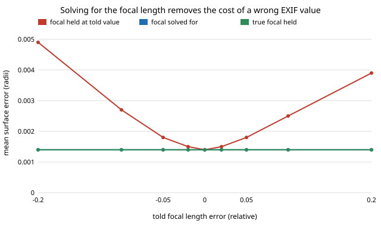

# sensing-bafocal: does bundle adjustment that solves for the focal length survive a wrong assumed focal length or unmodelled lens distortion?

Photo sets carry a focal length in EXIF that can be a few percent off, and real lenses bend straight lines. If the solver is told a wrong focal length, how much reconstruction error does that cost once bundle adjustment is running, and does adding the focal length (and one radial term) to the unknowns recover it? On the `sensing-ba` rig (12 views, 0.5 px noise, every camera pose wrong), **a focal length told 5% wrong costs a fixed-intrinsics adjustment 0.0018 object radii against 0.0014 for the true focal (1.2×), 20% wrong costs 0.0039 (2.7×), and a shared focal length solved for in the adjustment returns 0.0014 at every start with the focal recovered to 0.3%. With barrel distortion `k1 = −0.3` left unmodelled the error is 0.0034; solving for `k1` too gives 0.0015. The gain vanishes at 2 px of noise and above, and with 4 views nothing helps (0.0078 against 0.0068 for the true focal, focal off by 2.4%)** (numpy and scipy; 6 tests).

This takes the "focal-length and distortion as unknowns" item from the "Next steps" of `sensing-ba` and `sensing-baoutlier`. It is a new question (self-calibration), not another seed or dataset.

**Live page:** https://duncan-haywood.github.io/oss-monorepo/research/sensing-bafocal/

**Builds on.** `sensing-ba` and `sensing-recon` (this repository) for the rig, pose perturbation and Umeyama scoring, imported unchanged. Triggs, McLauchlan, Hartley and Fitzgibbon (2000), "Bundle adjustment: a modern synthesis", LNCS 1883, who treat calibration parameters as unknowns of the same least-squares problem; Brown (1966), "Decentering distortion of lenses", *Photogrammetric Engineering* 32(3), for the radial polynomial (only the first term, `x_d = x (1 + k1 r²)`, is used). Solver: SciPy `least_squares` (trust-region reflective, sparse Jacobian pattern). Track 15 (`sensing`). No lab in `prompt.md` is built on; none fits.

## Method
- **Images.** Rendered with the true focal length 800 px and, in section D, radial distortion `k1` on normalised coordinates. Pixel noise Gaussian.
- **What the solver is told.** A focal length `f0 = 800 (1 + err)` and no distortion. Poses are also wrong (0.5° and 0.02 radii per axis), as in `sensing-ba`. Points start from DLT triangulation with `f0`.
- **Three adjustments from the same start (60 evaluations at most).** `fixed`: poses and points, focal held at `f0`. `selfcal`: also one focal length shared by all cameras (parametrised as a ratio to `f0`), plus `k1` in section D. `oracle`: true focal held (section D has no oracle, as it would need a distortion-aware start).
- **Scoring.** Mean distance to the exact surface after a similarity alignment to the true points (as `sensing-ba`). `f_err` is |estimated − 800| / 800.
- 6 seeds per cell, 300 features.

## Reproduce
```bash
pip install numpy scipy matplotlib pytest
cd research/sensing-bafocal
PYTHONPATH=src python -m pytest -q tests   # 6 tests
python experiments/run.py                  # writes experiments/results.txt (about 2 min)
python experiments/figure.py               # writes experiments/error_vs_focal_error.svg
```

## Results (from `experiments/results.txt`)
- **Free poses absorb most of a wrong focal length.** Triangulation from wrong poses is 0.012 whatever the focal; the fixed-focal adjustment reaches 0.0015 at ±2%, 0.0018 at ±5%, 0.0025 to 0.0027 at ±10% and 0.0039 to 0.0049 at ±20%, against 0.0014 with the true focal. A wrong focal is largely traded against camera distance, which the adjustment can move.
- **Solving for the focal removes the rest.** `selfcal` is 0.0014 at every start from −20% to +20% and recovers the focal to 0.32%. Gain over `fixed`: 1.0× at ±2%, 1.2 to 1.3× at ±5%, 1.7 to 1.8× at ±10%, 2.7 to 3.4× at ±20%.
- **The gain needs low noise.** With the focal 5% off, `fixed/selfcal` is 3.6× at 0.1 px, 1.2× at 0.5 px and about 1.0× from 1 px up; the focal estimate then degrades from 0.06% to 2.7% (4 px) but the error is set by pixel noise either way.
- **Four views are too few.** At 4 views `fixed`, `selfcal` and `oracle` are 0.0078, 0.0078 and 0.0068 and the focal is 2.4% off; from 6 views the focal is within 0.4% and `selfcal` equals `oracle`. Same threshold as `sensing-ba` found for poses.
- **Unmodelled barrel distortion costs more than a wrong focal.** With the focal correct, `k1` of −0.05, −0.1, −0.2, −0.3 gives `fixed` 0.0015, 0.0018, 0.0025, 0.0034 against 0.0014; solving for `k1` returns 0.0015 throughout and estimates `k1` to within 0.005. (The focal estimate is 0.9% off in this section, so adding `k1` and `f` free costs a little at `k1 = 0`: 0.0015 against 0.0014.)



## Tests
Projection with `k1 = 0` equals the `sensing-recon` projection; negative `k1` pulls points toward the principal point; noise-free triangulation with the true focal is exact; with the focal 20% off the fixed adjustment is more than 1.5× the oracle while `selfcal` is within 1.3× of it and the focal within 3%; with the correct focal `selfcal` stays within 30% of `fixed`; runs are deterministic.

## Limitations
- **Synthetic, one object, no real images.** Nothing here says how COLMAP or a phone camera performs. The focal-error and `k1` ranges are swept, not measured from a device: no single figure applies, and they were not sourced from a lens database.
- **The fitted model is the true model.** Section D renders with the same one-term radial law the solver estimates. Real lenses need more terms and a decentring term; a model mismatch was not tested.
- **One shared focal and a shared `k1`.** No per-camera zoom (a phone changing focal between shots) and no principal-point error.
- **Good start for poses, correct matches, no outliers,** as in `sensing-ba`. The identical `f_err` in every row of section A is because every start converges to the same estimate on the same noise draws, not a reporting error.
- **Score aligns to the true points,** so absolute scale is not tested.

## Next steps
Per-camera focal lengths (a zoom lens); the principal point and a second radial term; a model mismatch (render with `k1, k2`, fit `k1`); the same on an openly licensed multi-view set with a known calibration.

## Owner steps
Photograph a checkerboard with a phone, calibrate it (OpenCV) and compare the recovered focal length and `k1` with the EXIF value to see which part of the swept range a real phone occupies. No hardware was bought or specified.

## Outside dependencies
Open-source Python packages only (numpy, scipy; matplotlib and pytest to plot and test).
