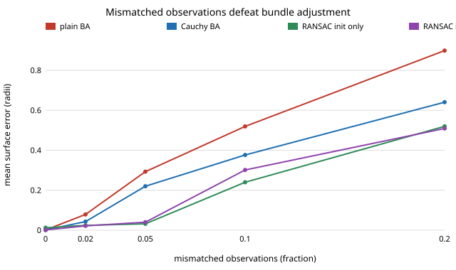

# sensing-baoutlier: how many mismatched feature observations can bundle adjustment survive, and does a robust loss help?

Real feature matches contain mismatches; `sensing-ba` assumed none. With wrong camera poses and a fraction of the observations replaced by random pixels, does bundle adjustment still repair the reconstruction, and does a robust loss or a RANSAC start rescue it? **On the `sensing-ba` rig (12 views, 0.5 px noise, every pose wrong) plain bundle adjustment goes from a mean surface error of 0.0014 object radii with clean data to 0.079 with 2% mismatches and 0.52 with 10%. Huber and Cauchy loss from the usual all-view triangulation start help only partly, trimming does not help, and a per-point RANSAC start helps at 5% (0.032) but only with 24 views does the adjusted result reach the clean floor at 10% (0.0012 against 0.0010)** (numpy and scipy; 5 tests).

This takes the first "Next step" of `sensing-ba`. It is a result about the start as much as the loss.

**Live page:** https://duncan-haywood.github.io/monorepo-projects/research/sensing-baoutlier/

**Builds on.** `sensing-ba` and `sensing-recon` (this repository) for the rig, pose perturbation, residuals and Umeyama scoring, imported unchanged. Fischler and Bolles (1981), "Random sample consensus", *Communications of the ACM* 24(6), for the per-point consensus start; Huber (1964), *Annals of Mathematical Statistics* 35(1), and the Cauchy (Lorentzian) loss as implemented in SciPy `least_squares` (`loss="huber"`, `"cauchy"`); Triggs et al. (2000), LNCS 1883, for bundle adjustment. Track 15 (`sensing`). No lab in `prompt.md` is built on; none fits.

## Method
- **Rig and errors.** As `sensing-ba`: bumpy ellipsoid, 300 features, 640 × 480 images, 12-view orbit, Gaussian pixel noise, random per-camera rotation and position errors.
- **Mismatches.** Each visible observation is replaced, with probability `frac`, by a uniform random pixel in the image.
- **Starts.** `tri`: DLT triangulation from all views of each point. `ri_init`: for each point, triangulate every pair of views, keep the pair with most views within 20 px reprojection (wide, because the supplied poses are wrong), and re-triangulate from its inliers.
- **Adjustment.** Poses and points, 300 function evaluations: plain least squares; Huber and Cauchy with scale 3 × the pixel sigma; trim (fit, drop observations above 4σ + 2 px, refit).
- **Scoring.** Mean surface error after a similarity alignment to the true points, on the points the clean data triangulate, so all methods are judged on the same points. `clean_ba` is the adjustment on the same scene without mismatches (the floor).
- 6 seeds per cell.

## Reproduce
```bash
pip install numpy scipy matplotlib pytest
cd research/sensing-baoutlier
PYTHONPATH=src python -m pytest -q tests   # 5 tests, about 1 min
python experiments/run.py                  # writes experiments/results.txt (about 8 min on 4 cores)
python experiments/figure.py               # writes experiments/error_vs_mismatch.svg
```

## Results (from `experiments/results.txt`)
- **A few percent of mismatches is enough.** At 12 views: 2% mismatches gives 0.079 for plain adjustment (clean 0.0014); 5% gives 0.293; 10% gives 0.519; 20% gives 0.899. Plain adjustment is worse than the contaminated triangulation it starts from (5%: 0.293 against 0.193) because it fits the outliers.
- **Robust loss from the all-view start helps only partly.** At 2%: Huber 0.027, Cauchy 0.043; at 5%: 0.111 and 0.220; at 10% about 0.37 for both (plain 0.52); at 20% nothing separates them from the start. Trim-and-refit matches plain adjustment to within 0.003 in every cell: the gate is applied to residuals of a fit that has already absorbed the outliers.
- **The start matters more than the loss.** The RANSAC start alone reaches 0.024 at 2% and 0.032 at 5% (against 0.077 and 0.193 for all-view triangulation); adjusting it with Cauchy loss gives 0.022 and 0.040, so the adjustment adds little there. At 10% and 12 views it is 0.24, and at 20% 0.52.
- **Views decide it.** At 10% mismatches with 24 views, RANSAC start plus Cauchy adjustment reaches 0.0012 (clean floor 0.0010), while plain adjustment gets 0.130 and Cauchy from the all-view start 0.363. With 8 views RANSAC start plus Cauchy is 0.173 (floor 0.0017). With 12 views a point is seen in about three views (about 970 observations of 300 points in the seed-0 run), so two-view pairs cannot out-vote an outlier.
- **The pose start is not the bottleneck.** At 5% mismatches, from exact poses to 2°/0.1 radii the plain-adjustment error stays near 0.29 and the RANSAC-start results do not improve with better poses (0.16 at exact poses, 0.032 at the default, 0.11 at the largest error); this one is noisy at 6 seeds, so do not read an ordering into it.
- **Cost of a robust loss on clean data is nil** (all columns 0.0014 at `frac` 0). With **40 function evaluations**, the budget used in `sensing-ba`, Huber and Cauchy stopped before converging from the wrong-pose start (seed 1, clean data: surface error 0.012, the same as no adjustment, against 0.0014 at 300); every number here uses 300.



## Tests
Contamination hits only visible observations and the requested fraction; zero contamination changes nothing; at 5% mismatches plain adjustment exceeds 10× the clean error and the RANSAC start halves the all-view start's error; robust losses cost under 2× on clean data; runs are deterministic.

## Limitations
- **Synthetic, one object, no real matcher.** Mismatches are uniform random pixels, the easiest kind to reject; real ones are near-misses on repeated texture.
- **One gate and one loss scale each, not tuned** (20 px RANSAC gate, 3σ loss scale, 4σ + 2 px trim gate). A better gate may move the middle cells.
- **Known intrinsics, good-ish pose start;** only 6 seeds per cell, so differences of a few percent or the ordering within the pose-start table are not established.
- **The RANSAC start is naive** (all pairs, one 20 px gate on wrong poses). Production pipelines use geometric verification before adjustment, which is outside this study.
- **Scoring aligns to the truth,** as in `sensing-ba`.

## Next steps
Near-miss mismatches and a ratio test; geometric verification (epipolar gate) before adjustment; an iterative reweighted start that reduces the gate as poses improve; focal length and distortion as unknowns; an openly licensed multi-view set.

## Owner steps
Run COLMAP or a phone capture of a known object and compare the matcher's inlier rate with the mismatch fractions swept here. No hardware was bought or specified.

## Outside dependencies
Open-source Python packages only (numpy, scipy; matplotlib and pytest to plot and test).
