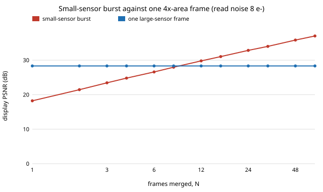

# sensing-burst: how many frames from a small sensor, merged, match one frame from a bigger one?

Can a burst of frames from a small sensor stand in for one frame from a sensor with `A` times the pixel area? On synthetic scenes with Poisson shot noise, Gaussian read noise and a full-well clip: **a burst whose frames each get the large frame's exposure time ties it after `N* = A²(s·x + r²)/(A·s·x + r²)` frames, which is `A` when shot noise dominates and approaches `A²` in the dark or at high read noise (simulation, A = 4: 4.0 frames in bright light, 14.4 in dim light with 8 e⁻ read noise); splitting the *same* total exposure into frames never ties; registration blur adds frames in bright light (about 21 for A = 4); and a bracketed burst recovers highlights that one clipped frame loses (42 dB against 22 dB).** Produced with AI assistance (Claude). Second project of track 15 (`PROJECTS.md`, milestone 4). It builds on none of the CU Boulder groups in `prompt.md`. Everything here is synthetic: no raw files, no real sensor, and no result about a particular phone.

**Live page:** https://duncan-haywood.github.io/monorepo-projects/research/sensing-burst/

**Builds on.** Hasinoff et al. (2016), "Burst photography for high dynamic range and low-light imaging on mobile cameras", *ACM TOG* 35(6), the HDR+ pipeline, whose premise (merge many short frames from a small sensor) is what is measured here against sensor area; the Poisson-Gaussian noise model is the standard one (Foi et al. 2008, *IEEE T-IP* 17:1737–1754). The alignment is plain windowed phase-style cross-correlation with sub-pixel peak refinement, not HDR+'s tile-based pyramid, and no part of HDR+ is reproduced. The closed-form variances are elementary algebra and are checked by Monte Carlo below. This feeds track 13's sensor-size limit.

## Method
A scene is a radiance image `x`. A sensor frame with `s` electrons per unit radiance records `Poisson(s·x)`, clips at the full well `fw`, and adds Gaussian read noise of `r` electrons. The large sensor has area ratio `A`: `A·s` electrons per unit radiance and `A·fw` full well at the same exposure time, on the same pixel grid (same field of view and resolution; only the pixels are bigger). The radiance estimate is the Poisson maximum-likelihood merge over unclipped samples, `Σe / (s·Στ)`.
- **Noise only.** `N` frames with no motion against one large frame; display PSNR (scene peak = 1, gamma 1/2.2, border cropped) on 48×48 procedural scenes (rectangles, discs and a sinusoidal texture), 16 scenes per cell.
- **Hand shake.** Each frame is rendered at a random quarter-pixel shift up to ±2 px (a 4× oversampled canvas, box-averaged), registered to frame 0 by a zero-padded cross-correlation peak and a Fourier phase-ramp shift, and merged. "Known" uses the true shifts, "estimated" the correlation, "unregistered" a plain mean.
- **Highlights.** A disc of radiance 6 on a sensor that clips at radiance 3; equal exposures against a bracket of exposure times 1, ½, ¼, ⅛ (twice each).

## Reproduce
```bash
pip install numpy matplotlib pytest
cd research/sensing-burst
PYTHONPATH=src python -m pytest -q tests   # 12 tests
python experiments/run.py                  # writes experiments/results.txt (~30 s)
python experiments/figure.py               # writes experiments/burst_vs_large.svg
```

## Results (from `experiments/results.txt`)
- **Break-even is between `A` and `A²` frames.** Simulated `N*` for the burst to reach one large frame's PSNR: A = 2: 2.0–3.6; A = 4: 4.0 (bright, 2 e⁻ read) to 14.4 (dim, 8 e⁻ read); A = 8: 8.4 (bright, 2 e⁻) to 54.9 (dim, 8 e⁻), where `A² = 64`. The formula at the scene's mean radiance matches the simulation to within 15% in 17 of 18 cells and 16.4% in the worst (A = 8, 2 e⁻, P = 30: 21.9 against 26.2); it is never above the simulation by more than that, because dark pixels need more frames than the mean pixel.
- **Variance formulas hold.** At x = 0.4, A = 4, r = 3, s = 50, a 4,000-draw Monte Carlo gives burst variance 2.896e-3 (N = 4) and 7.201e-4 (N = 16) against 2.900e-3 and 7.250e-4 from the formula; the large frame is 2.283e-3 against 2.225e-3.
- **Same total exposure: the burst never catches up.** Splitting the large frame's exposure into `N` short frames gives variance ratio burst/large of 4.84 (N = 1, i.e. the area ratio plus read noise), 5.95, 8.19, 12.65, 21.58 for N = 1, 2, 4, 8, 16 (A = 4, r = 3): more frames cost more read noise and add no light. PSNR falls from 23.1 to 15.0 dB against 30.3 dB for the large frame. A small sensor can only close the gap by exposing longer, which motion limits.
- **Hand shake (A = 4, read 3, N = 8).** Registration error RMS is 0.085 px at P = 3000, 0.29 px at 300, 0.79 px at 100 and 3.1 px at 30 (a failed alignment). Estimated registration equals known-shift merging to within 0.01 dB at P = 3000 and 0.26 dB at 300; an unregistered mean loses 5 dB at P = 300 and 12 dB at P = 3000. At P = 3000 both merges reach 40.0 dB against 40.7 dB for the large frame, so eight frames do not tie even with exact shifts: the Fourier-shift resampling of box-sampled frames blurs and caps PSNR near 40 dB. Matching frame counts with alignment: N* = 20.6 (estimated) or 20.9 (known) at P = 3000, against 4.0–4.8 with no resampling in the noise-only table (A = 4, bright light); 5.7 (estimated) at P = 300 and 6.8 at P = 100.
- **Highlights.** The sensor clips at radiance 3, the disc is 6. One large frame and eight equal small frames both read the disc as 3.00 (22.4 dB). An eight-frame bracket reads 5.92 (small sensor, 42.0 dB) and 5.95 (large sensor, 48.7 dB): the burst gives the small sensor HDR, but the large sensor can bracket too, and does better.



## Tests
Break-even limits (`A` and `A²`), variance equality at `N*`, the fixed-time burst never beating the large frame, formulas against Monte Carlo, render shift geometry, full-well clipping, Fourier shift round trip, shift estimation, merge equal to the mean when unclipped, bracket recovery of a clipped highlight, and the PSNR metric.

## Limitations
- Synthetic scenes and a made-up noise model: electrons per unit radiance, read noise and full well are chosen, not measured, and no real raw file was used. Foi et al. calibrate such models on real sensors; this does not.
- Global integer-quarter-pixel translation only. No rotation, rolling shutter, parallax, or moving subjects (the ghosting that dominates real burst merging), and all frames have the same exposure time except the bracket.
- Registration blur is a property of this resampler (Fourier shift of aliased box-sampled frames), not of burst photography: a super-resolution merge that places samples on a finer grid would not lose that detail and could do better than the 40 dB cap seen here.
- Equal pixel grids: the comparison holds resolution and field of view fixed. Optics, quantum efficiency, dark current, fixed-pattern noise, quantisation and the cost of a larger lens are not modelled; "cost" here is frames and time, not dollars.
- The merge is a plain mean (maximum likelihood for pure Poisson noise), not a robust or Wiener merge, and the alignment does not use a pyramid.
- PSNR in a gamma-encoded display domain weights shadows heavily; other metrics could rank the cases differently.
- Sixteen scenes per cell (eight for the frame-count table); no confidence intervals are reported.

## Next steps
Run the same pipeline on openly licensed raw bursts (owner step: choose a dataset and confirm its licence, or capture bursts on owned hardware with a known sensor) to replace the assumed noise model, add moving-subject ghosting and a robust merge, and try a sub-pixel super-resolution merge to remove the resampling cap.

## Owner steps
Capture real raw bursts from a phone and a larger camera of the same static scene at matched field of view and exposure time, to calibrate `s`, `r` and `fw` and compare against the break-even formula (hardware is the owner's; no purchase was made or recommended).

## Outside dependencies (vitamins)
Open-source Python packages only (numpy, matplotlib; pytest for tests). No hardware, no datasets.
