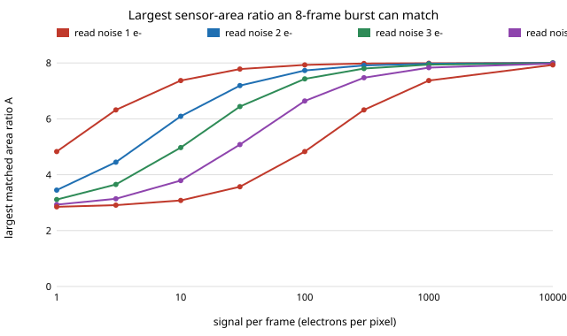

# sensing-burstcap: how big a sensor can an 8-frame burst stand in for?

Given a fixed number of burst frames `K`, what is the largest sensor-area ratio `A` whose single frame the merged burst can match, and how does it depend on light and read noise? **Inverting the `sensing-burst` break-even formula `N* = A²(e + r²)/(A·e + r²)` gives `A_max` as the positive root of `(e + r²)A² − K·e·A − K·r² = 0`, which runs from `√K` in the dark to `K` in bright light: with 8 frames and 3 e⁻ read noise a burst matches a 4×-area frame from 4.5 e⁻ per pixel per frame, a 6× frame from 21 e⁻, and never an 8× frame at any light level; 15 frames reach 12× from 14 e⁻ at 2 e⁻ read noise to 358 e⁻ at 10 e⁻.** Monte Carlo of the Poisson-Gaussian model agrees with the closed form to within 1.0% in variance at 18 settings. Produced with AI assistance (Claude). Track 15 (`PROJECTS.md`), a follow-up to `sensing-burst`. It builds on none of the CU Boulder groups in `prompt.md`. Everything here is a model: no real sensor or raw file.

**Live page:** https://duncan-haywood.github.io/monorepo-projects/research/sensing-burstcap/

**Builds on.** `research/sensing-burst` (the model and the break-even formula, itself using the standard Poisson-Gaussian noise model of Foi et al. 2008, *IEEE T-IP* 17:1737–1754, and the premise of Hasinoff et al. 2016, *ACM TOG* 35(6)). The only new content is solving that formula for `A` instead of `N` and tabulating it.

## Method
Per small-sensor frame, `e` electrons of signal and `r` electrons rms read noise; a large frame of area ratio `A` collects `A·e` at the same exposure time. Setting burst variance `(e + r²)/(K s²)` equal to large-frame variance `(A·e + r²)/(A s)²` gives the quadratic above, with limits `K` (shot-noise limited, `e ≫ r²`) and `√K` (read-noise limited). Conversely, `K` frames match area ratio `A` only above the signal `e = r²(A² − K)/(K·A − A²)`, and only for `√K < A < K`.

## Parameters (swept, not sourced)
No single value of `e` or `r` is assumed. `e` is swept from 1 to 10,000 electrons and `r` over 1, 2, 3, 5, 10 electrons; `K` over 4, 8, 15. These ranges are chosen to span dim to bright scenes and low to high read noise, and are not taken from a datasheet. Sensor-specific read-noise and full-well figures are published (for example by photonstophotos.net) but that site's data is marked all rights reserved, so it is neither copied nor used. Which row applies to a given phone is an open question for the owner step below. Full-well clipping is ignored (see `sensing-burst` for the HDR bracketing result).

## Reproduce
```bash
pip install numpy matplotlib pytest
cd research/sensing-burstcap
PYTHONPATH=src python -m pytest -q tests      # 6 tests
PYTHONPATH=src python experiments/run.py > experiments/results.txt   # a few seconds
python experiments/figure.py                  # writes experiments/amax_vs_light.svg
```

## Results (from `experiments/results.txt`)
- **Bounds.** `A_max` rises monotonically with light from `√K` to `K`; the limits are 2.00, 2.83, 3.87 for K = 4, 8, 15.
- **Section B (needed signal).** K = 8: A = 4 needs 0.5, 2.0, 4.5, 12.5, 50 e⁻ per frame at r = 1, 2, 3, 5, 10; A = 6 needs 2.3 to 233 e⁻. K = 15, A = 12: 3.6 e⁻ at r = 1 to 358 e⁻ at r = 10. A burst never matches `A ≥ K`, and always matches `A ≤ √K`.
- **Monte Carlo check.** 200,000 draws at 18 (K, r, e) settings give a burst-to-large variance ratio between 0.990 and 1.009 at `A_max`; the formula says 1. The inverse round-trips to 4e-15.
- **Reading.** The table in section A is the practical answer: with 8 frames and 2 e⁻ read noise the burst matches 7.19× at 30 e⁻ per frame and 4.45× at 3 e⁻; at 10 e⁻ read noise it matches 3.57× at 30 e⁻.


## Limitations
- This is algebra plus a Monte Carlo of the same model, not a new measurement. It repeats `sensing-burst`'s assumptions: perfect registration, a static scene, mean-of-unclipped-pixels merge, no fixed-pattern noise, no dark current, no quantisation, equal exposure per frame.
- Motion limits how many frames at full exposure a handheld burst can use; `sensing-ghost*` studied that, and it is not in `K` here.
- The signal and read-noise ranges are swept, not tied to any particular device.

## Next steps
Tie `(e, r)` to measured values for named sensors from an openly licensed source, then draw the phone-vs-camera map; add a motion-limited `K`.

## Owner steps
Capture a flat-field series on owned hardware to measure `e` and `r` per device (hardware is the owner's; no purchase made or recommended).

## Outside dependencies (vitamins)
Open-source Python packages only (numpy, matplotlib; pytest). No hardware, no datasets.
