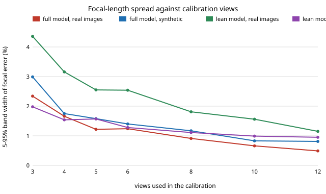

# sensing-calibviews: how many checkerboard photos does OpenCV camera calibration need before the focal length stops moving?

Zhang-style calibration with a printed checkerboard is the first thing anyone does with a new camera, and advice on how many photos to take ranges from "a handful" to "30+". On the 13 real 640×480 checkerboard photos shipped with OpenCV, **random subsets of just 3 views already put the focal length within 2% of the 13-view value in 99% of draws (5–95% band 2.3% wide), and 12 views narrow the band to 0.5%. Re-rendering the same board poses with Gaussian noise at the measured 0.41 px reprojection error and a known truth gives a similar band (3.0% at 3 views, 0.8% at 12). A "lean" model (one radial term, principal point held at the image centre) widens the real-image band to 4.4% at 3 views and leaves 0.43 px of held-out reprojection error against 0.21 px for the default five-term model.** (OpenCV 5.0, numpy; 4 tests.)

This is a new question for track 15 (`sensing`), not a seed or dataset variant of the bundle-adjustment chain: `sensing-bafocal` asked what a wrong *told* focal length costs on synthetic scenes; this asks how well a *measured* one is pinned down by real photos, and whether the noise-only picture predicts it.

**Live page:** https://duncan-haywood.github.io/oss-monorepo/research/sensing-calibviews/

**Builds on.** Zhang (2000), "A flexible new technique for camera calibration", *IEEE TPAMI* 22(11), 1330–1334, whose method `cv2.calibrateCamera` implements; Brown (1966) for the radial and decentring distortion terms; Triggs et al. (2000) for the claim that calibration is one least-squares problem (as in `sensing-bafocal`, this repository). Images: `left01.jpg` … `left14.jpg` (`left10` is not in the set) from OpenCV's `samples/data`, Apache-2.0, fetched from github.com/opencv/opencv (4.x branch) and committed under `data/`. No lab in `prompt.md` is built on; none fits.

## Method
- **Corners.** `findChessboardCorners` for a 9×6 inner-corner board, then `cornerSubPix` (11 px window). All 13 images are detected.
- **Two models.** `full`: OpenCV defaults (`fx, fy, cx, cy`, `k1 k2 p1 p2 k3`). `lean`: `k1` only, zero tangential, `k2 = k3 = 0`, principal point fixed at the image centre, aspect ratio fixed.
- **A. Real subsets.** For each k in {3, 4, 5, 6, 8, 10, 12}, 150 random subsets of the 13 images are calibrated. Reported: the focal length `fx` relative to the same model's all-13 fit (median, 5th and 95th percentile, share within ±2%) and the RMS reprojection error of the **unused** views, whose poses are re-solved with `solvePnP` under the subset's intrinsics.
- **B. Synthetic with a known truth.** The all-13 fit's intrinsics and board poses are re-projected exactly, Gaussian noise of σ = that fit's RMS reprojection error is added, and the same subsets are calibrated. Error is against the known `fx`. This separates sampling noise from model bias.

## Reproduce
```bash
pip install numpy opencv-python-headless pytest
cd research/sensing-calibviews
PYTHONPATH=src python -m pytest -q tests   # 4 tests
python experiments/run.py                  # writes experiments/results.txt (about 1.5 min)
python experiments/figure.py               # writes experiments/focal_spread.svg
```

## Results (from `experiments/results.txt`)
All-13-view fits: `full` fx = 536.1 px, principal point (342.4, 235.5), RMS 0.409 px, k1 = −0.265; `lean` fx = 537.8 px, RMS 0.508 px, k1 = −0.257.

| views k | full, real: 5–95% band of fx | full, synthetic | lean, real | lean, synthetic | full held-out px | lean held-out px |
|---|---|---|---|---|---|---|
| 3 | −1.21 … +1.13% | −1.81 … +1.18% | −2.41 … +1.95% | −1.04 … +0.94% | 0.469 | 0.553 |
| 6 | −0.61 … +0.63% | −0.65 … +0.75% | −1.36 … +1.18% | −0.62 … +0.66% | 0.368 | 0.461 |
| 12 | −0.36 … +0.13% | −0.32 … +0.49% | −0.79 … +0.36% | −0.37 … +0.58% | 0.208 | 0.430 |

- **Three good views pin the focal length to about ±1–2%.** The share of draws within ±2% of the full fit is 99% (full) and 87% (lean) at 3 views and 99–100% from 4.
- **The noise-only model predicts the full-model spread.** Real and synthetic bands agree within a factor of about 1.7 at every k (real 2.3% against synthetic 3.0% wide at 3 views; 0.49% against 0.81% at 12).
- **The lean model's real-image band is wider than its synthetic band** (4.4% against 2.0% at 3 views, 1.2% against 0.95% at 12). The synthetic images are generated from the lean model itself, so they have no model error; the extra width on real photos is what the missing terms and the forced centred principal point cost. Held-out error is about double (0.43 against 0.21 px at 12 views).
- **Held-out error keeps falling after the focal length has settled** (full: 0.47 px at 3 views to 0.21 at 12), so the views that matter after the first few are buying distortion and pose, not focal length.



## Tests
All 13 boards are found with 54 corners each; the all-view `full` fit is 500–560 px with RMS below 0.6 px; noise-free synthetic views of a known 600 px camera are recovered to 0.1% with held-out error below 0.01 px; the synthetic band at 12 views is narrower than at 3.

## Limitations
- **One camera, one board, 13 photos.** The photos were chosen by OpenCV's authors as a tutorial set and are tilted and varied. Casual photos with the board parallel to the sensor are the known bad case for planar calibration and are not tested.
- **The reference is the all-13 fit, not the true focal length.** Section A measures stability, not accuracy; section B has a known truth but only for re-rendered images. At k = 12 the 150 draws overlap heavily (there are only 13 distinct subsets), so that row understates the spread.
- **No lens ground truth.** Nothing here compares the estimate with the manufacturer's focal length or with an independent method.
- **Corner noise is isotropic Gaussian at the fit's RMS,** which absorbs model error into σ; real corner errors are correlated with position and blur.
- **No board-coverage analysis:** which parts of the image the corners reached was not varied.

## Next steps
Subsets chosen by tilt angle and image coverage instead of at random (the claim that more tilt matters more than more views is untested); the same study on a phone's photos of a printed board; compare the focal length with EXIF and with the lens maker's value.

## Owner steps
Print a checkerboard, photograph it with the phone you use for capture (track 13), and run `experiments/run.py` with your images in `data/`. No hardware was bought or specified.

## Outside dependencies
Open-source Python packages only (numpy, opencv-python-headless; pytest to test). The 13 images are from the OpenCV repository (Apache-2.0).
