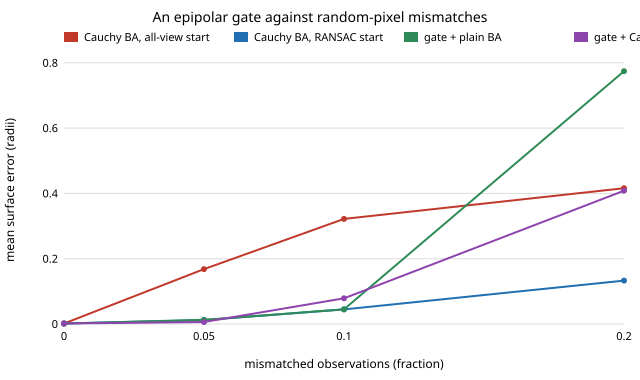

# sensing-epigate: does a fundamental-matrix gate on the matches, fitted from the matches alone, let bundle adjustment survive mismatches?

Production pipelines run geometric verification before bundle adjustment. `sensing-baoutlier` left that out; here it is added: for each pair of nearby views a fundamental matrix is fitted to the matches by RANSAC (normalised 8-point, no use of the wrong camera poses), and an observation is kept if at least half the pairs it appears in accept it (Sampson distance under 2 px). **With 12 views and wrong poses, the gate removes 94%, 93% and 89% of random-pixel mismatches at 5%, 10% and 20% contamination while discarding 2%, 5% and 16% of the good observations. At 5% it takes Cauchy-loss adjustment from 0.168 to 0.0061 object radii (clean floor 0.0015); at 10% plain adjustment after the gate reaches 0.045 against 0.32 without it, but a RANSAC pair start without any gate is as good (0.045), and at 20% the gate fails (0.41 to 0.77) while the RANSAC start gives 0.13.** Near-miss mismatches (10 to 40 px shifts) are mild for a robust loss already (0.005 at 10%), and the gate removes 79 to 84% of them. Synthetic only (numpy, scipy; 5 tests).

This takes the "geometric verification before adjustment" next step of `sensing-baoutlier`, and asks the harder question that its limitations raised: real mismatches are near-misses, not uniform random pixels.

**Live page:** https://duncan-haywood.github.io/oss-monorepo/research/sensing-epigate/

**Builds on.** `sensing-baoutlier`, `sensing-ba` and `sensing-recon` (this repository) for the rig, pose perturbation, RANSAC pair start, robust adjustment and scoring, imported unchanged. Hartley and Zisserman (2004), *Multiple View Geometry in Computer Vision*, 2nd ed., Cambridge University Press, ch. 11 (normalised 8-point algorithm, Sampson distance); Fischler and Bolles (1981), *Communications of the ACM* 24(6), for RANSAC. Track 15 (`sensing`). No lab in `prompt.md` is built on; none fits.

## Method
- **Rig.** As `sensing-baoutlier`: 300 features on a bumpy ellipsoid, 640 x 480 images, 12-view orbit, 0.5 px noise, every pose wrong (0.5 deg, 0.02 radii).
- **Mismatches.** `uniform`: a random pixel. `near`: shifted 10 to 40 px in a random direction (a neighbouring feature on repeated texture). `along`: shifted 10 to 40 px along the true epipolar line of one randomly chosen other view, which is the worst case for a single-pair test.
- **Gate.** For each view `a` and offsets 1, 2, 3 (pairs `a`, `a+k mod V`): 300-iteration RANSAC fundamental matrix on points visible in both, refit on inliers, Sampson distance under `thresh_px`. An observation is kept if at least half of the pairs it is in accept it; an observation in no fitted pair is dropped.
- **Compared.** `cauchy`: all-view DLT start plus Cauchy adjustment. `ri_cauchy`: the RANSAC pair start of `sensing-baoutlier` plus Cauchy. `g_tri`, `g_linear`, `g_cauchy`: the gate, then DLT, plain or Cauchy adjustment.
- **Scoring.** Mean surface error after similarity alignment, on points that both the clean data and the gated data still triangulate. **That set differs from `sensing-baoutlier`'s, and seeds differ, so numbers here are not comparable with that README's**; `cover` reports the share of the clean set kept.
- 6 seeds per cell.

## Reproduce
```bash
pip install numpy scipy matplotlib pytest
cd research/sensing-epigate
PYTHONPATH=src python -m pytest -q tests   # 5 tests, about 1 min
python experiments/run.py                  # writes experiments/results.txt (roughly 15 min on 4 cores)
python experiments/figure.py               # writes experiments/error_vs_mismatch.svg
```

## Results (from `experiments/results.txt`)
- **Random pixels (U).** Recall 0.94 / 0.93 / 0.89 and good observations lost 0.02 / 0.05 / 0.16 at 5 / 10 / 20%. Surface error at 5%: Cauchy from the all-view start 0.168, RANSAC start + Cauchy 0.012, gate + Cauchy 0.0061, gate + plain 0.0128. At 10%: 0.322, 0.045, 0.079, 0.045. At 20%: 0.416, 0.133, 0.408, 0.774.
- **The gate is not better than the RANSAC start.** It wins at 5%, ties at 10% and loses at 20%, where it throws away 16% of good observations (cover 0.79) and the surviving 11% of mismatches wreck plain adjustment. At 10% the gated DLT alone (0.030) beats adjusting it (0.045 to 0.079): a leftover 7% of outliers is fitted by the adjustment. Treat the 10% ordering between gate variants as unresolved at 6 seeds.
- **Near-miss mismatches are much less harmful than random ones** for a robust loss: at 10% Cauchy from the all-view start gives 0.0053 and the gate improves it to 0.0036; at 20% 0.0093 to 0.0080. The gate removes only 84% (10%) and 79% (20%) of them, because shifts of a pixel or two are inside the 2 px gate.
- **Along-epipolar mismatches** are removed at 79% (10%), about as well as `near`: voting over pairs defeats an attack that is consistent with one pair. One un-gated cell (10%, Cauchy, 0.091 against 0.0053 for `near`) is probably one bad seed in six; not interpreted.
- **Views help the gate** (10% along): recall 0.73 / 0.79 / 0.87 and cover 0.87 / 0.94 / 1.00 at 8 / 12 / 24 views; with 24 views gate + Cauchy reaches 0.0021 (floor 0.0010).
- **Threshold is a trade** (10% near): 0.5 px loses 30% of good observations (cover 0.76); 4 px leaves recall 0.69. Errors stay within 0.003 to 0.005 across 0.5 to 4 px, so the choice matters little here.



## Tests
The fundamental matrix fitted to exact matches gives Sampson error below 1e-6; each mismatch kind changes only masked visible observations within the stated shift range; the gate removes over 90% of uniform mismatches and at least as many as of `along` ones (at 1 px); at 10% uniform mismatches it removes over 80% and halves the Cauchy error; runs are deterministic.

## Limitations
- **Synthetic, one object, known intrinsics, 6 seeds per cell**, so gaps of a few tens of percent between variants are not established.
- **Mismatch models are mine**, not measured from a real matcher; the 40 px near-miss radius is arbitrary. The owner step below would replace them.
- **Gate settings untuned** (3 view offsets, 300 RANSAC iterations, vote 0.5, 2 px); only the threshold is swept.
- **Scoring set differs from `sensing-baoutlier`;** points with under two surviving views are excluded for all methods.
- The gate was not combined with the RANSAC start.

## Next steps
Combine the gate with the per-point RANSAC start; a ratio test and descriptor-level near-misses on real images; estimate the focal length too.

## Owner steps
Run COLMAP or a phone capture of a known object, count the matcher's epipolar inlier rate, and compare it with the contamination levels swept here. No hardware was bought or specified.

## Outside dependencies
Open-source Python packages only (numpy, scipy; matplotlib and pytest to plot and test).
