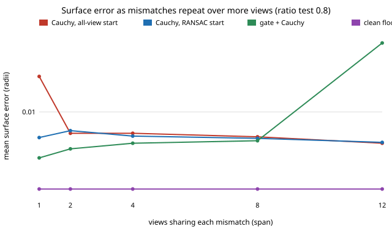

# sensing-gatecorr: does the epipolar gate survive mismatches that repeat across views?

`sensing-gatemix` drew every wrong observation independently and listed that as a limitation: "a bad feature is bad in several views. Independence flatters the gate's voting." This project removes the flattery. A bad feature is made wrong, by the same 10 to 40 px offset, in `span` consecutive views of a 12-view orbit, at the overall wrong-match rate SIFT gives after a ratio test (`sensing-matchreal`). **Headline: correlation costs the gate its recall (0.81 at span 1 to 0.59 at span 12 at a 10% rate) but little accuracy. At ratio 0.8, gate + Cauchy adjustment goes from 0.0031 to 0.0048 object radii (clean floor 0.0014) over spans 1 to 8, and its lead over the RANSAC-start adjustment shrinks from 1.7x at span 1 (0.0031 vs 0.0052) to 1.06x at span 8 (0.0048 vs 0.0051), which 12 seeds cannot tell from a tie.** One seed in twelve failed outright (0.64) for gate + Cauchy at span 12; a different one failed (0.24) for plain Cauchy at span 1.

**Live page:** https://duncan-haywood.github.io/monorepo-projects/research/sensing-gatecorr/

**Builds on.** `sensing-gatemix` (its "Limitations" first bullets), `sensing-epigate` (trial, gate), `sensing-baoutlier`, `sensing-matchreal` (the rates, parsed from its committed `results.txt`). Hartley and Zisserman (2004), *Multiple View Geometry*, ch. 11, for the fundamental-matrix gate; Lowe (2004), *IJCV* 60(2), for the ratio test. Track 15 (`sensing`). No lab in `prompt.md` is built on; none fits.

## Method
- **Trial.** Unchanged `sensing_epigate.run_trial` (12 views, 300 features, 0.5 px noise, every pose wrong by 0.5 deg / 0.02 radii, gate 2 px Sampson, vote 0.5), with its mismatch function replaced.
- **Correlated mismatch.** Each feature is bad with probability `rate * 12 / span`; a bad feature gets one random offset (10 to 40 px, random direction) added in `span` cyclically consecutive views where it is visible. The expected share of wrong observations stays at the measured rate for every span (a test checks it). `span = 1` is the independent near-miss case.
- **Rates.** Measured by `sensing-matchreal` for SIFT on the Middlebury Motorcycle pair, no mutual check: 0.102, 0.061, 0.047 at ratio tests 0.8, 0.7, 0.6.
- **Spans.** 1, 2, 4, 8, 12 views. There is no measurement of how many views a real bad feature persists in, so this is a sweep, not a chosen value.
- 12 seeds per cell; means reported.

## Reproduce
```bash
pip install numpy scipy matplotlib pytest
cd research/sensing-gatecorr
PYTHONPATH=src python -m pytest -q tests   # 4 tests, about 10 seconds
python experiments/run.py                  # writes experiments/results.txt (about 8 minutes on 4 cores)
python experiments/figure.py               # writes experiments/error_vs_span.svg
```

## Results (from `experiments/results.txt`; surface error in object radii)
Ratio test 0.8 (10.2% wrong):

| span | Cauchy, all-view start | RANSAC start + Cauchy | gate + Cauchy | gate recall | good observations lost |
|---|---|---|---|---|---|
| 1 | 0.0247* | 0.0052 | 0.0031 | 0.81 | 0.038 |
| 2 | 0.0058 | 0.0062 | 0.0039 | 0.75 | 0.058 |
| 4 | 0.0058 | 0.0054 | 0.0045 | 0.66 | 0.030 |
| 8 | 0.0053 | 0.0051 | 0.0048 | 0.62 | 0.016 |
| 12 | 0.0045 | 0.0046 | 0.0580* | 0.59 | 0.001 |

\* One seed in twelve dominates the mean. Per-seed values (a separate rerun of those two cells, same seeds): plain Cauchy at span 1 is 0.003 to 0.007 in eleven seeds and 0.2426 in the twelfth; gate + Cauchy at span 12 is 0.0025 to 0.0077 in eleven seeds and 0.6431 in one. The medians are therefore about 0.0050 and 0.0049. The `g_linear` column (gate, then plain least squares) is 0.0048 at span 12, so the failure is the adjustment from a bad start, not the gate.

- **Recall falls steadily with span, at every rate:** 0.81, 0.75, 0.66, 0.62, 0.59 at ratio 0.8, and the same pattern at 0.7 and 0.6 (0.81 to 0.60, 0.82 to 0.61). Repeated mismatches agree with each other, so the view-pair votes agree with them too. The gate also loses fewer good observations as span grows (0.038 at span 1, 0.001 at span 12, not monotone in between at 0.058 for span 2); I did not test why, and a plausible reading is that fewer scattered wrong observations pull the fitted matrices.
- **Plain Cauchy gets better, not worse, as errors repeat** (0.0058 at span 2 to 0.0045 at span 12). A plausible reason, not tested, is that a consistent offset across many views is partly absorbed as a displaced point rather than fought as an outlier.
- **The gate's lead shrinks.** Gate + Cauchy has the lowest mean at ratio 0.8 for spans 1 to 8, but its margin over the RANSAC start falls from 1.7x at span 1 to 1.06x at span 8. At ratios 0.7 and 0.6 the three adjustments agree to within 10 to 20% for spans of 4 or more (for example 0.0036, 0.0038, 0.0038 at ratio 0.7, span 8 and 0.0030, 0.0033, 0.0031 at 0.6, span 8, for gate, Cauchy and RANSAC start). With 12 seeds these gaps are not established.
- **Typical errors stay at about 2 to 3.5x the floor** (0.0014) at these rates, so for a 5 to 10% wrong rate none of the three is in trouble. The risk is the occasional start that fails.



## Tests
The overall rate is held across spans; one shared offset per bad feature, 10 to 40 px, only on visible observations; a span is a cyclic run of consecutive views; the patched mismatch function is restored and a small trial runs.

## Limitations
- **The span is a sweep, not a measurement.** I did not find a published or measured figure for how many views a SIFT mismatch persists in. Measuring it needs a real multi-view capture (see Owner steps).
- **Synthetic geometry, one offset model.** The shared offset is a 10 to 40 px displacement in image space, the same in every view; a feature that is really the wrong 3D point would shift differently in each view and be more consistent with the geometry still. Mismatches here are `near`-type only; `along` and `far` were not repeated.
- **Mean of 12 seeds with heavy-tailed failures.** Single seeds dominate two cells; I reran only those two to confirm and did not change the reported means.
- Gate settings are untuned; the gate was not combined with the RANSAC start.

## Next steps
Repeat with a persistent wrong 3D point (consistent mismatch) instead of a shared pixel offset; combine gate and RANSAC start; measure span from SIFT tracks across the views of a real or rendered multi-view set.

## Owner steps
Capture a phone turntable video of a known object and report, for COLMAP's tracks, how many views a wrong match persists in. No hardware was bought or specified.

## Outside dependencies
Open-source Python packages only (numpy, scipy; matplotlib and pytest to plot and test).

*Produced with AI assistance.*
