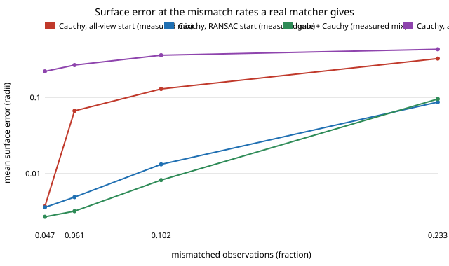

# sensing-gatemix: does the epipolar gate still help when mismatches have the mix and rate a real SIFT matcher produces?

`sensing-epigate` tested a fundamental-matrix gate before bundle adjustment against invented mismatches, and said "mismatch models are mine". `sensing-matchreal` then measured a real matcher. This project joins them (the "Next steps" of `sensing-matchreal`): the measured mismatch rate and along-epipolar / near / far mix, for each ratio-test threshold, drive the `sensing-epigate` trial. **Headline: at the rates a ratio test of 0.8 to 0.6 gives (10% to 5% wrong), gate + Cauchy adjustment reaches 0.0082, 0.0032 and 0.0027 object radii (clean floor 0.0014), better than the RANSAC pair start without a gate (0.0132, 0.0049, 0.0036); at a ratio of 0.9 (23% wrong) they tie, and with no ratio test (56% wrong) every method fails (above 0.6).** The old all-random-pixel assumption overstated the error of plain Cauchy adjustment from the all-view start by 1.3 to 59 times at ratios 0.9 to 0.6.

**Live page:** https://duncan-haywood.github.io/oss-monorepo/research/sensing-gatemix/

**Builds on.** `sensing-epigate` (trial, gate), `sensing-baoutlier`, `sensing-ba`, `sensing-recon` (rig, adjustment), and `sensing-matchreal` (the measurements, parsed from its committed `results.txt`, not retyped). Hartley and Zisserman (2004), ch. 11; Lowe (2004), *IJCV* 60(2), for the ratio test; Scharstein et al. (2014), GCPR, for the Middlebury pair behind the measured mixes. Track 15 (`sensing`). No lab in `prompt.md` is built on; none fits.

## Method
- **Measured inputs.** For SIFT on the Middlebury Motorcycle pair (`sensing-matchreal`, section A, with and without the mutual check) and on the pooled warped photographs (section B): the mismatch rate and the shares along / near / far.
- **Trial.** Unchanged `sensing_epigate.run_trial` (12 views, 300 features, 0.5 px noise, every pose wrong by 0.5 deg / 0.02 radii, gate 2 px Sampson, vote 0.5), with its mismatch function replaced by one that draws each corrupted observation's kind from the measured shares. `along` and `near` use epigate's 10 to 40 px shifts (measured medians were 14 and 17 px); `far` is a uniform random pixel.
- **Controls at the same rate.** `uniform` (all far, the earlier assumption) and `alongonly`.
- 8 seeds per cell.

## Reproduce
```bash
pip install numpy scipy matplotlib pytest
cd research/sensing-gatemix
PYTHONPATH=src python -m pytest -q tests   # 4 tests, a few seconds
python experiments/run.py                  # writes experiments/results.txt (about 10 minutes on 4 cores)
python experiments/figure.py               # writes experiments/error_vs_rate.svg
```

## Results (from `experiments/results.txt`; surface error in object radii, no mutual check)
| ratio test | wrong | Cauchy, all-view (measured / uniform) | RANSAC start + Cauchy | gate + Cauchy | gate recall (measured / uniform) |
|---|---|---|---|---|---|
| none | 0.563 | 0.857 / 0.825 | 0.678 | 0.824 | 0.69 / 0.70 |
| 0.9 | 0.233 | 0.324 / 0.430 | 0.087 | 0.095 | 0.86 / 0.88 |
| 0.8 | 0.102 | 0.129 / 0.359 | 0.013 | 0.008 | 0.86 / 0.95 |
| 0.7 | 0.061 | 0.067 / 0.266 | 0.0049 | 0.0032 | 0.83 / 0.95 |
| 0.6 | 0.047 | 0.0037 / 0.220 | 0.0036 | 0.0027 | 0.83 / 0.97 |

- **In the regime a ratio test creates, the gate helps and the RANSAC start is close behind.** Gate + Cauchy is lowest at 0.8, 0.7 and 0.6 and about 2x the floor (0.0014) at 0.7 and 0.6. The margin over the RANSAC start is small in absolute terms and 8 seeds do not establish it at 0.7 and 0.6.
- **The gate catches fewer of the real mix (83 to 86% recall) than of uniform mismatches (95 to 97%)**, as expected, since along-epipolar mismatches pass a pairwise test. It matters little: those mismatches are also the mildest for adjustment (`alongonly` rows: 0.004 to 0.044 at every rate below 0.3 even without a gate).
- **The uniform assumption was pessimistic.** Plain Cauchy from the all-view start: 0.067 measured vs 0.266 uniform at 0.7, and 0.0037 vs 0.220 at 0.6.
- **No ratio test is hopeless for all methods** (56% wrong; every error above 0.6, `lost` 0.64 of good observations by the gate); this is also where the earlier `sensing-epigate` 20% result put the breakdown. At 23% (ratio 0.9) the gate and the RANSAC start tie.
- **Mutual check (section M of the results):** same ordering. Two cells show a one-seed spike in 8 (gate + Cauchy 0.0986 at ratio 0.9 and 0.0660 at 0.6, against 0.0032 to 0.0041 for neighbouring methods); not interpreted.
- **Warped photographs (section B; no `along` class):** gate + Cauchy 0.0065 at ratio 0.8 and 0.0025 at 0.6 against 0.0117 and 0.0021 for the RANSAC start (which is lower at 0.6).



## Tests
The parser reads the committed measurements (rate, shares sum to 1); mixed mismatches touch only masked visible observations and stay in the 10 to 40 px range; the shares are respected; the patched mismatch function is restored and a pure-far mix runs the full trial.

## Limitations
- **Geometry is synthetic; only the rate and mix are measured**, from one stereo pair and one detector (SIFT) of `sensing-matchreal`, whose own limits apply (ground truth good to about a pixel, class boundaries mine).
- **The rate is applied per observation** at random, but real mismatches cluster on repetitive or textureless regions, and a bad feature is bad in several views. Independence flatters the gate's voting.
- **`near` and `along` shifts reuse epigate's 10 to 40 px**; measured medians (14 to 17 px) fit, but the distribution was not resampled.
- **8 seeds per cell**; gaps of a few tens of percent between the gate and the RANSAC start are not established.
- Gate settings are untuned and the gate was not combined with the RANSAC start.

## Next steps
Resample the measured offset vectors themselves instead of the 10 to 40 px model; run SIFT across the synthetic views' rendered images to get correlated mismatches; combine the gate with the RANSAC start.

## Owner steps
Run COLMAP on a phone capture of a known object and compare its inlier rate with the rates here. No hardware was bought or specified.

## Outside dependencies
Open-source Python packages only (numpy, scipy; matplotlib and pytest to plot and test).
