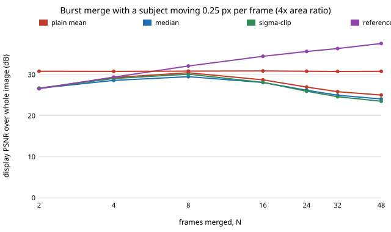

# sensing-ghost: what does a moving subject do to a burst merge, and what does robust merging cost?

When something in the frame moves, how much of a burst's noise advantage survives, and which merge keeps it? On synthetic scenes with Poisson shot noise and Gaussian read noise, a still camera and one disc moving along x: **a plain mean merge peaks and then gets worse as frames are added (30.5 dB at 8 frames, 25.0 dB at 48 for a subject moving 0.25 px per frame, against 30.8 dB for one frame of a sensor with 4× the pixel area), so it never reliably ties the large frame; median and sigma-clip merges do no better, because the subject lingers over each pixel in too many frames; a reference-guided merge that only adds frames that agree with frame 0 keeps improving (37.6 dB at 48 frames) and ties the large frame at about 6 frames, and with nothing moving it costs only 0.1 dB against the mean (the median costs 1.3 dB).** Produced with AI assistance (Claude). A follow-up in track 15 (`PROJECTS.md`, milestone 4), taking the "next step" listed in [`sensing-burst`](../sensing-burst/README.md). It builds on none of the CU Boulder groups in `prompt.md`. Everything here is synthetic: no raw files, no real sensor, and no claim about any particular phone.

**Live page:** https://duncan-haywood.github.io/monorepo-projects/research/sensing-ghost/

**Builds on.** `sensing-burst` (same scene generator and Poisson-Gaussian sensor, copied into this project so it stays self-contained) and Hasinoff et al. (2016), "Burst photography for high dynamic range and low-light imaging on mobile cameras", *ACM TOG* 35(6), whose pipeline rejects misaligned tiles rather than averaging them. The reference-guided merge here is a much simpler per-pixel test written for this experiment (a 3×3 chi-square test against frame 0), not HDR+'s tile-based pyramid merge, and none of HDR+ is reproduced. Sigma-clipped and median stacking are standard image-stacking practice. Noise model: Foi et al. (2008), *IEEE T-IP* 17:1737–1754.

## Method
Scene: a `sensing-burst` background (48×48 px, texture, rectangles, discs) plus one disc of radiance 0.95 and radius 4 px that moves `v` pixels per frame along x, drawn at 4× resolution and box-averaged, so edges are anti-aliased. The camera is still (no registration step, so ghosting is isolated from alignment error). Each small-sensor frame records `Poisson(s·x)` plus Gaussian read noise (3 e⁻), with `s` = 75 e⁻ per unit radiance; one large-sensor frame (A = 4, so 300 e⁻ per unit radiance) has the same exposure time as *one* small frame, so its subject is frozen. All merges estimate frame 0, and the truth is the noise-free frame 0.
- **mean:** plain average, the maximum-likelihood merge when nothing moves.
- **median:** per-pixel median.
- **sigclip:** mean of the frames within 3 noise sigmas of the per-pixel median, sigma from the known noise model.
- **refguided:** frame 0 plus every frame whose 3×3 sum of (e_i − e_0)² / noise variance is below 21.7 (chi-square, 9 degrees of freedom, 99% point).
PSNR is display-referred (gamma 1/2.2, scene peak 1), reported over all interior pixels, over *static* pixels (the disc never within 2 px) and over the *trail* (pixels it touches in any frame). Sixteen scenes per cell.

## Reproduce
```bash
pip install numpy matplotlib pytest
cd research/sensing-ghost
PYTHONPATH=src python -m pytest -q tests   # 7 tests
python experiments/run.py                  # writes experiments/results.txt (~20 s)
python experiments/figure.py               # writes experiments/ghost_vs_frames.svg
```

## Results (from `experiments/results.txt`)
- **The mean ghosts at every speed tested.** With 8 frames, trail PSNR is 22.3 dB (v = 0.25), 18.9 (0.5), 16.7 (1) and 17.3 (2) for the mean, against 28.0, 27.7, 27.6 and 28.9 for the reference-guided merge and 31.3–31.8 for the large frame. Whole-image PSNR for the mean falls from 32.8 dB with nothing moving to 25.7 dB at v = 1.
- **More frames make the mean worse once the subject moves.** At v = 0.25 the mean reaches 30.5 dB at 8 frames and falls to 28.7, 27.0, 25.9 and 25.0 dB at 16, 24, 32 and 48 frames: the subject's trail grows with burst length faster than noise shrinks. Median and sigma-clip fall the same way (24.1 and 23.5 dB at 48 frames). The reference-guided merge rises from 32.1 dB at 8 frames to 37.6 dB at 48 and ties the large frame (30.8 dB) at about 6 frames; the other three never tie it over the whole image at any burst length tested (their best is 30.5 dB for the mean, at 8 frames).
- **Median and sigma-clip do not fix a slow subject.** At v = 0.25–1 px per frame the disc (radius 4 px) sits over a given pixel for more than half of the 8 frames, so the median is the subject, not the background: scored against the *object-free* background (section D, v = 1) the trail PSNR is 15.5 dB (mean), 15.3 (median), 15.1 (sigclip) and 15.8 (refguided). At 4 px per frame the median partly removes the disc (24.9 dB whole-image against 24.5 for the mean), which is also why it does not return the reference frame: median-type merges give "the background", not "frame 0".
- **Robustness costs noise efficiency, and the cost differs a lot.** With nothing moving, frames to tie the large frame (30.8 dB): mean 5.2, reference-guided 5.4, sigma-clip 5.5, median 6.8. At 8 frames the PSNR is 32.8 (mean), 32.7 (refguided), 32.6 (sigclip) and 31.5 (median). The median's loss matches the known π/2 variance factor for Gaussian noise (test: 1.35–1.75 on 31 frames).
- **Static regions are untouched by the robust merges.** Over static pixels the mean, refguided and sigclip PSNR is the same at every speed (32.7–32.8, 32.6–32.7, 32.5–32.6 dB at N = 8), as it should be: the damage is local to the trail.
- **Reference-guided still leaves a trail error.** Its trail PSNR (28 dB at N = 8) is 3–4 dB below the large frame's, probably because the region where the disc was in frame 0 receives only the frames that agree with it and the 21.7 threshold lets some mild ghost through (not isolated by an experiment). It is worst at v = 0.5 to 1 (27.6 dB) and improves to 30.0 dB at v = 4, where the subject leaves each pixel quickly.



## Tests
Mean equals sum over N·s; all merges agree on identical frames; static noise efficiency (median near π/2 times the mean's MSE, sigma-clip and guided within 10%); a moving subject ghosts the mean but not the guided merge (5 dB or more on the trail); guided merge returns the reference when every other frame disagrees; mask and motion geometry; masked PSNR.

## Limitations
- Synthetic scenes and a chosen noise model; no real raw bursts, so the 21.7 threshold and 3 sigma clip were not tuned on real noise (and were not tuned here at all: single settings, no sweep).
- One rigid disc translating along x at constant speed, and a still camera. Real subjects deform, rotate, occlude and are lit differently frame to frame, and hand shake must be registered first (see `sensing-burst`), whose errors interact with the rejection test.
- The reference frame is frame 0 and its own noise drives the test: a noisy reference rejects valid frames (at N = 2, 26.6 dB against 26.7 for the mean) and in very dark scenes the test loses power. No claim is made for scenes darker than the 75 e⁻ per unit radiance used.
- The large sensor is credited with a frozen subject because its exposure matches one small frame; if the large sensor needs a longer exposure it ghosts too.
- Merges are per-pixel and the guided test is a 3×3 window; tile-based, pyramid or learned merges, motion compensation of the subject and super-resolution are not tried.
- Sixteen scenes per cell and no confidence intervals; differences under about 0.3 dB should not be read as ranked.

## Next steps
Sweep the rejection threshold and window size against false rejection in the dark, add motion-compensated merging of the subject (aligning it rather than rejecting it), and combine with the registration step from `sensing-burst` on openly licensed raw bursts (owner step: pick a dataset and confirm its licence).

## Owner steps
Capture real raw bursts of a scene with a moving subject on owned hardware with a known sensor, to calibrate the noise model and check the rejection threshold (no purchase was made or recommended).

## Outside dependencies (vitamins)
Open-source Python packages only (numpy, matplotlib; pytest for tests). No hardware, no datasets.
