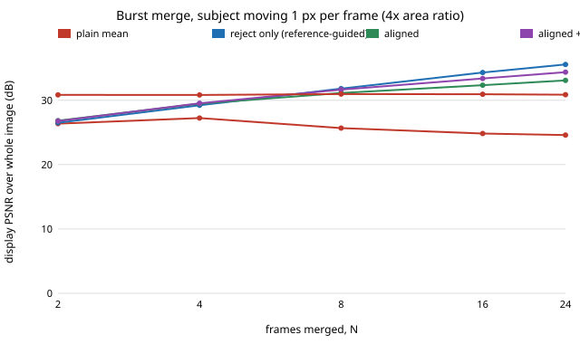

# sensing-ghostalign: can aligning a moving subject, instead of rejecting it, rescue a burst merge?

When a subject moves during a burst, is it better to align it to the reference frame and average, or to reject the frames that disagree? On synthetic scenes (Poisson shot noise, Gaussian read noise, a still camera and one disc moving along x), **aligning inside the subject works and rejecting does not: in the disc's interior at 8 frames, 1 px per frame, an aligned-and-checked merge reaches 37.0 dB against 31.5 dB for the reject-only merge and 32.8 dB for one frame of a sensor with 4× the pixel area. But over the whole image it is no better than rejecting (31.7 dB against 31.8 dB at 8 frames, 33.4 against 34.3 at 16, 34.4 against 35.6 at 24), because the rejecting merge keeps every frame in the static background for free and the aligner moves 10–30% of static pixels on noise; and at the subject's edge ring, where the background is revealed and covered, no variant gets within 4 dB of the large frame (27.8 dB against 32.1).** Produced with AI assistance (Claude). A follow-up in track 15 (`PROJECTS.md`, milestone 4) that takes the "motion-compensated merging of the subject" step from [`sensing-ghost`](../sensing-ghost/README.md). It builds on none of the CU Boulder groups in `prompt.md`. Everything here is synthetic: no raw files, no real sensor, and no claim about any particular phone.

**Live page:** https://duncan-haywood.github.io/oss-monorepo/research/sensing-ghostalign/

**Builds on.** `sensing-ghost` (scene generator, sensor model, mean and reference-guided merges, copied so this project stays self-contained) and Hasinoff et al. (2016), "Burst photography for high dynamic range and low-light imaging on mobile cameras", *ACM TOG* 35(6), whose pipeline aligns tiles to a reference and then rejects tiles that still disagree. The aligner here is a much simpler per-pixel window search written for this experiment, not HDR+'s coarse-to-fine tile alignment, and none of HDR+ is reproduced. Noise model: Foi et al. (2008), *IEEE T-IP* 17:1737–1754.

## Method
Scene and sensor as in `sensing-ghost`: 48×48 px, a textured background with a disc of radiance 0.95 and radius 4 px moving `v` px per frame along x; 75 e⁻ per unit radiance per small frame, 3 e⁻ read noise; one large-sensor frame (4× area) with the exposure time of one small frame, its subject frozen. The target is the noise-free frame 0.
- **mean** and **refguided:** as in `sensing-ghost` (refguided adds frame *i* wherever a 3×3 chi-square test against frame 0 is below 21.7).
- **aligned:** for every pixel of frame *i*, search translations (dy ∈ ±2 px, dx ∈ ±(*v*·*i* + 1) px, 0.5 px steps, bilinear sampling), score each by the sum over a 9×9 window of squared differences from frame 0 divided by the noise variance, take the best, then average. A nonzero shift replaces zero shift only if it lowers that chi-square by more than a margin of 40.
- **aligned+rej:** the aligned frames are then put through the same 3×3 chi-square test, so pixels that still disagree (revealed background) are dropped.
The horizontal search range uses the true speed (an oracle bound); section D of the diagnostics loosens it. PSNR is display-referred (gamma 1/2.2, peak 1), over the interior (*all*), pixels the disc never comes within 2 px of (*static*), pixels it touches in any frame (*trail*) and its frame-0 footprint plus a 1 px ring (*obj0*). Sixteen scenes per cell.

## Reproduce
```bash
pip install numpy matplotlib pytest
cd research/sensing-ghostalign
PYTHONPATH=src python -m pytest -q tests     # 7 tests
python experiments/run.py                    # writes experiments/results.txt (~10 min)
python experiments/diagnostics.py            # writes experiments/results_diag.txt (~5 min)
python experiments/figure.py                 # writes experiments/align_vs_frames.svg
```

## Results (from `experiments/results.txt` and `results_diag.txt`)
- **Alignment beats rejection on the subject, by about 1 dB at best, and only in some regions.** On the footprint-plus-ring region (*obj0*) at N = 8, aligned+rej beats reject-only at every speed tested: 29.1 against 27.6 dB at v = 0.25, 28.1 against 27.0 at 0.5, 27.8 against 26.8 at 1, 27.9 against 26.8 at 2 and 27.6 against 26.4 at 4. Alignment alone (no rejection) is about even with rejection there (26.1–28.7 dB), so the gain comes from combining the two.
- **In the disc interior the gain is large.** Eroding the footprint by 2 px (*disc core*, v = 1) gives, for aligned+rej against reject-only against one large frame: 34.1 / 31.3 / 32.8 dB at N = 4, 37.0 / 31.5 / 32.8 at N = 8, 39.6 / 31.5 / 32.8 at 16 and 41.0 / 31.4 / 32.8 at 24. Reject-only cannot improve there (frame 0's disc is only matched by itself) while the aligned merge keeps gaining with frames. This region is a uniform disc, so any smoothing from sub-pixel sampling also helps it; a textured subject would gain less, and this was not tested.
- **The ring is the problem, not the interior.** Over *obj0* the aligned merge stays at 27.8–28.0 dB from N = 8 to 24 and an integer-shift oracle (the exact motion, no search) falls from 29.0 dB at N = 4 to 26.0 at 24, because the ring contains background that is covered or revealed as the disc moves; no frame shows the same background there, so more frames cannot help. The large frame has no such problem (32.1 dB).
- **Over the whole image, rejecting is better at longer bursts.** Whole-image PSNR for refguided against aligned+rej at v = 1: 29.2 / 29.5 dB at N = 4, 31.8 / 31.7 at 8, 34.3 / 33.4 at 16, 35.6 / 34.4 at 24. The aligned merges win only at N ≤ 4 (and reject-only is ahead of the plain aligned average from N = 8). Past that, the difference is the static background, where rejection costs nothing and the aligner is not free: see next.
- **Alignment moves pixels it should not.** Between two frames of a still scene the aligner shifts 10–31% of pixels at the default margin of 40 (eight scenes, search ±3 px; test `test_larger_margin_moves_fewer_static_pixels` gives the ordering, and a margin of 160 moves under 5%). Static-region PSNR does not suffer (32.7–32.9 dB, as for the mean), because a noise-fitted sub-pixel move of a smooth region changes little, but sharp static edges were not specifically checked.
- **Margin and window are not tuned to one best.** At N = 8 and v = 1, 5×5 windows (win 2) give 28.8–29.3 dB on the trail and 9×9 windows 27.6–27.9; at v = 0, margin 0 with win 2 costs 1.2 dB over the whole image against rejection (31.5 against 32.7), and margins of 80 or more make the aligner collapse to rejection (identical numbers). Each setting here was tried once on the same 16 scenes, so a ranking of settings within 0.3 dB is not supported.
- **A looser search bound barely matters.** Searching ±(4·*i* + 1) px instead of ±(1·*i* + 1 + 0.5) at v = 1: whole image 31.8 against 31.7 dB, trail 28.0 against 27.6.



## Tests
Window sums match a direct sum; the aligner recovers a known integer shift on a smooth texture; a larger margin moves fewer pixels of a still scene; with nothing moving the aligned merge is within 0.8 dB of the plain mean; alignment beats the plain mean by more than 4 dB on the trail of a moving subject; the paired and single-output merge functions agree; one frame returns the reference.

## Limitations
- Synthetic scenes and a chosen noise model; no raw bursts. The chi-square threshold, margin and windows were not tuned on real noise.
- One rigid disc translating at constant speed along x with a still camera. Alignment is translation only, so rotation, scaling, deformation and lighting change are untested, as is a moving camera (which would shift the whole background and change which merge wins).
- The horizontal search bound uses the true speed except in section D. The vertical range (±2 px) is generous for this scene.
- The disc is flat, so interior numbers flatter any aligner that smooths; the edge ring is the honest test and every variant fails it by 4 dB.
- The large sensor is credited with a frozen subject because its exposure matches one small frame.
- No confidence intervals; sixteen scenes per cell; differences under about 0.3 dB should not be ranked. The spurious-motion fraction was measured on eight scenes in a test, not in the experiment script.
- Per-pixel search with a dense cost is slow (about 1 s per 8-frame scene here) and nothing was optimised or compared against optical-flow or learned aligners.

## Next steps
Handle the ring explicitly: build a background estimate from the frames where the disc has left (a temporal-median or inpainting step) and use it where neither alignment nor frame 0 applies, then score the ring against the large frame. Test a textured, rotating subject and a moving camera, and try coarse-to-fine tile alignment. Owner step below for real bursts.

## Owner steps
Capture real raw bursts of a scene with a moving subject on owned hardware with a known sensor, to calibrate the noise model and check the rejection threshold and margin (no purchase was made or recommended).

## Outside dependencies (vitamins)
Open-source Python packages only (numpy, matplotlib; pytest for tests). No hardware, no datasets.
