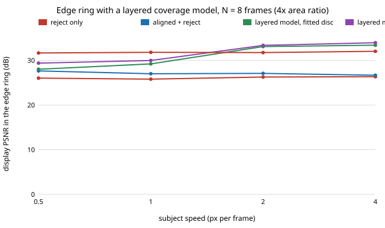

# sensing-ghostedge: does modelling the sub-pixel coverage of a moving subject fix the edge ring that burst merging leaves behind?

[`sensing-ghostring`](../sensing-ghostring/README.md) found that no merge rule or subject mask fixes the edge ring of a moving subject in a burst: the ring stayed about 4 dB below one frame of a sensor with 4× the pixel area. **This project tests its first listed remedy, an explicit model of the boundary pixels, and it works on a known shape: a layered model (pixel = coverage × disc + (1 − coverage) × background, with the disc fitted from the burst and the background solved by least squares) lifts the ring from 27.1 dB (aligned plus reject) to 33.1 dB at 8 frames and 2 px per frame, above the 31.7 dB of the large-sensor frame. The gain is smaller at slow speeds (0.4 dB at 0.5 px per frame, 2.2 dB at 1; the ring stays below the large frame) and the method is sensitive to geometry: a 0.5 px centre error in the disc drops the ring to 25 dB.** The subject here is the exact synthetic shape the model assumes (a flat disc), so read this as what a correct shape model can buy, not as a general deghosting method. Produced with AI assistance (Claude). Track 15 (`PROJECTS.md`, milestone 4). It builds on none of the CU Boulder groups in `prompt.md`. Everything is synthetic: no raw files, no real sensor, no claim about any phone.

**Live page:** https://duncan-haywood.github.io/monorepo-projects/research/sensing-ghostedge/

**Builds on.** `sensing-ghostring` and `sensing-ghostalign` (scene generator, sensor model, aligner, subject mask and merges, copied so the project stays self-contained), Hasinoff et al. (2016), "Burst photography for high dynamic range and low-light imaging on mobile cameras", *ACM TOG* 35(6), and Foi et al. (2008), *IEEE T-IP* 17:1737–1754 for the noise model.

## Method
Scene and sensor as in `sensing-ghostring`: 48×48 px, textured background, a disc of radiance 0.95 and radius 4 px (centre (24, 8) in frame 0) moving `v` px per frame along x, 75 e⁻ per unit radiance per small frame, 3 e⁻ read noise, one large-sensor frame (4× area) with the exposure of one small frame, truth = noise-free frame 0. Twelve scenes per cell.
- **Layered model.** Noise-free pixel `p` of frame `i` is `a_i(p)·S + (1 − a_i(p))·B(p)`: `a_i` is the fraction of the pixel the disc covers (8×8 sub-pixel grid; the generator uses 4×4, so the model is not an exact copy), `S` the disc radiance, `B` the background. For given geometry `B(p)` is the closed-form least-squares solution over the frames, with equal weights (the Poisson variance is not modelled); the frame-0 estimate is `a_0·S + (1 − a_0)·B`. Where fewer than one effectively uncovered frame sits behind a pixel, the aligned+reject value is kept.
- **Geometry.** *layered-oracle* uses the true centre and radius. *layered-fit* starts from the centroid and area of the `sensing-ghostring` subject mask, tries shifted starts along x, then runs coordinate descent on (centre y, centre x, radius) with step sizes 2 to 0.125 px, minimising the model's residual over a window around the subject's path. `S` is the mean of frame 0 inside the pixels the disc covers entirely. Both use the true speed `v` (an oracle, as in the sibling projects).
- The layered estimate replaces aligned+reject within 3 px of the frame-0 disc; elsewhere the aligned+reject merge is kept.
- Regions: *ring* = from 1 px outside to 2 px inside the frame-0 footprint edge; *disc* = footprint eroded by 2 px; *static* = never within 2 px of the subject; *all* = interior. PSNR is display-referred (gamma 1/2.2, peak 1).

## Reproduce
```bash
pip install numpy matplotlib pytest
cd research/sensing-ghostedge
PYTHONPATH=src python -m pytest -q tests     # 6 tests
python experiments/run.py                    # writes experiments/results.txt (~2 min)
python experiments/figure.py                 # writes experiments/ring_vs_speed.svg
```

## Results (from `experiments/results.txt`, N = 8 unless stated)
- **Ring at 2 px per frame:** reject-only 26.3, aligned+reject 27.1, layered-fit 33.1, layered-oracle 33.4, one large frame 31.7 dB. At 4 px per frame: 26.3 / 26.7 / 33.4 / 34.0 / 32.0.
- **Slow subjects gain less.** Ring at 0.5 and 1 px per frame: aligned+reject 27.6 and 27.0, layered-fit 28.0 and 29.2, layered-oracle 29.4 and 30.0, large frame 31.7 and 31.8. A slow subject covers the background behind it in most frames, so the background under frame 0's disc is observed in few frames (`B` is poorly determined).
- **The disc interior gains too** (2 px per frame: 35.8 → 44.6 dB), because the model replaces noisy pixels with a constant `S`. This is the shape prior at work, not alignment.
- **More frames:** ring at 4, 8, 16 frames (2 px per frame): layered-fit 27.8, 33.1, 34.7 dB against aligned+reject 26.8, 27.1, 26.9. Unlike the merges in `sensing-ghostring`, the ring now improves with frames.
- **The fit finds the disc.** Centre within 0.5 px in 10/12 scenes at 0.5 px per frame, 11/12 at 1 and 12/12 at 2 and 4; median centre error 0.09–0.14 px and radius error 0.03–0.06 px.
- **Geometry errors are costly** (layered-oracle with a perturbed disc, 2 px per frame, ring dB): none 33.4, centre +0.25 px 30.5, +0.5 px 25.0, +1 px 19.8, radius +0.25 px 27.2, radius −0.5 px 22.2. A sub-pixel model is only as good as the sub-pixel position it is given.
- **Static region and whole image are unchanged or marginally better** (whole image 32.3 against 31.7 dB for aligned+reject at 2 px per frame).



## Tests
Coverage of a disc has the right area and range; with no noise the background and frame-0 estimate are recovered exactly; unobserved background falls back to the supplied estimate; the oracle layered estimate beats aligned+reject in the ring by more than 1 dB; the fit finds the disc centre within 0.6 px and radius within 0.5 px; pixels far from the disc are untouched.

## Limitations
- **The model knows the shape.** The subject is a flat disc with constant radiance and a known family of shapes (circle), and the fit is given the true speed. A textured, rotating, deforming or non-circular subject would need a different shape model; the 3 dB to 6 dB ring gains above should not be expected from a generic subject. This is the main caveat. It is also an argument for the result's direction (sub-pixel boundary modelling closes the gap) and against reading it as a deployable method.
- Synthetic: still camera, translation along x, 48×48 px, twelve scenes per cell, no confidence intervals. Differences under about 0.5 dB should not be ranked. At 0.5 px per frame the fit missed the disc by more than 0.5 px in 2 of 12 scenes.
- Layered-fit slightly exceeds layered-oracle in one cell (disc region, 4 px per frame); the oracle uses the generator's nominal geometry but the model's coverage grid differs from the generator's, so "oracle" is a bound only up to that sampling mismatch.
- The aligned+reject baseline is the one from `sensing-ghostring`; no learned or non-local-means denoiser was tried.

## Next steps
Fit a less specific shape (a polygon or a signed-distance boundary with a smoothness prior) and estimate the speed instead of assuming it; add a textured, rotating subject and a moving camera; score a Poisson-weighted background solve; capture real bursts (owner step).

## Owner steps
Capture real raw bursts of a scene with a moving subject of known shape on owned hardware with a known sensor, to check the noise model and the coverage model (no purchase was made or recommended).

## Outside dependencies (vitamins)
Open-source Python packages only (numpy, matplotlib; pytest for tests). No hardware, no datasets.
