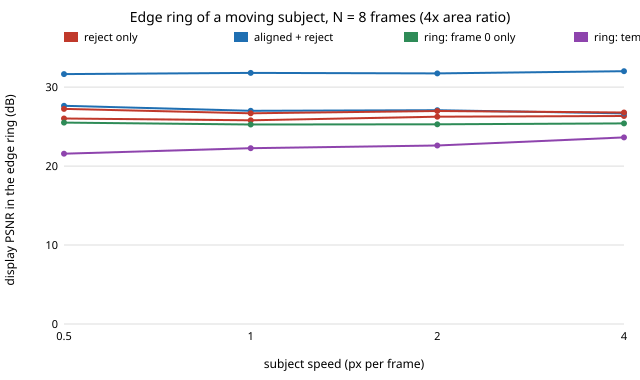

# sensing-ghostring: can a background estimate or a subject mask fix the edge ring that burst alignment leaves behind?

`sensing-ghostalign` found that aligning a moving subject works inside it but that the edge ring, where background is covered and revealed, stays about 4 dB short of a large-sensor frame whatever the merge. **This project tests the obvious fixes and they fail: estimating the subject mask from a temporal median and then using frame 0 alone, the temporal median itself, or the aligned or reject-only merge in a 1 px band around the mask all leave the ring at 21.6–27.2 dB at N = 8 against 31.6–32.0 dB for one frame of a sensor with 4× the pixel area. No explicit ring treatment beat plain aligned-plus-reject (27.0 dB at 1 px per frame) and the temporal median is the worst of them (22.3 dB) unless the subject moves 4 px per frame.** Produced with AI assistance (Claude). A follow-up in track 15 (`PROJECTS.md`, milestone 4), the "handle the ring explicitly" step from [`sensing-ghostalign`](../sensing-ghostalign/README.md). It builds on none of the CU Boulder groups in `prompt.md`. Everything here is synthetic: no raw files, no real sensor, no claim about any phone. This is a negative result, reported as such.

**Live page:** https://duncan-haywood.github.io/oss-monorepo/research/sensing-ghostring/

**Builds on.** `sensing-ghostalign` (scene generator, sensor model, aligner and the mean, reject-only and aligned merges, copied so the project stays self-contained), Hasinoff et al. (2016), "Burst photography for high dynamic range and low-light imaging on mobile cameras", *ACM TOG* 35(6), and Foi et al. (2008), *IEEE T-IP* 17:1737–1754 for the noise model.

## Method
Scene and sensor as in `sensing-ghostalign`: 48×48 px, textured background, a disc of radiance 0.95 and radius 4 px moving `v` px per frame along x, 75 e⁻ per unit radiance per small frame, 3 e⁻ read noise, one large-sensor frame (4× area) with the exposure of one small frame, truth = noise-free frame 0. Twelve scenes per cell.
- The **subject mask** is where frame 0 disagrees with the per-pixel temporal median of the burst (3×3 chi-square test, threshold 21.7).
- The merges combine `aligned+rej` and `refguided` from `sensing-ghostalign` around that mask: aligned+reject inside the mask eroded by `band` px, reject-only outside the mask dilated by `band` px, and in the band between them (the ring) one of four treatments: **band** frame 0 alone; **median** the temporal median of the frames; **ring=aligned** the aligned+reject merge; **ring=reject** the reject-only merge.
- Regions: *ring* = from 1 px outside to 2 px inside the frame-0 footprint edge; *disc* = footprint eroded by 2 px; *static* = never within 2 px of the subject; *all* = interior. PSNR is display-referred (gamma 1/2.2, peak 1).
The horizontal alignment search uses the true speed (an oracle bound), as in `sensing-ghostalign`.

## Reproduce
```bash
pip install numpy matplotlib pytest
cd research/sensing-ghostring
PYTHONPATH=src python -m pytest -q tests     # 6 tests
python experiments/run.py                    # writes experiments/results.txt (~1.5 min)
python experiments/figure.py                 # writes experiments/ring_vs_speed.svg
```

## Results (from `experiments/results.txt`, N = 8 unless stated)
- **No ring treatment closes the gap.** Ring PSNR at v = 1 px per frame: reject-only 25.8, aligned+reject 27.0, band (frame 0) 25.3, median 22.3, ring=aligned 26.7, ring=reject 26.0, one large frame 31.8 dB. At v = 2 the same order holds (26.3 / 27.1 / 25.3 / 22.6 / 27.0 / 26.3 / 31.7). Aligned+reject with no special ring step is the best or within 0.4 dB of the best at every speed from 0.5 to 4.
- **The temporal median is the worst ring estimate unless the subject is fast.** At N = 8 it needs the subject to cover a pixel in under half the frames: at 0.5 px per frame it reaches 21.6 dB in the ring and 28.4 in the disc, at 4 px per frame 23.6 and 35.5. Even at 4 px per frame it is about 3 dB below reject-only in the ring, because it is a median of noisy frames (the median of n Gaussian samples has about 1.5 times the variance of their mean) and still mixes covered pixels at the edge.
- **The subject mask is unreliable on slow subjects.** Recall inside the frame-0 footprint is 0.44 at 0.5 px per frame, 0.64 at 1, 0.85 at 2 and 0.90 at 4 (N = 8), against 0.55 / 0.85 / 0.91 at N = 4 / 8 / 16 for v = 2. A slow subject is in the median too. This is why the mask-gated variants lose 1–5 dB in the *disc* region at v ≤ 1 against plain aligned+reject (30.2 and 29.4 against 36.6 and 36.2 dB for the frame-0 ring variant).
- **Wider bands are worse.** Band 0, 1, 2 px (v = 2, N = 8): ring 26.8, 25.3, 25.1 dB; disc 35.6, 34.6, 33.5; whole image 31.9, 31.2, 30.6.
- **More frames do not help the ring.** Aligned+reject in the ring: 26.8, 27.1, 26.9 dB at N = 4, 8, 16 (v = 2), against 31.6–31.8 for the large frame, while the static region gains 6 dB over the same range.
- **Static and whole-image results are unchanged from `sensing-ghostalign`:** reject-only and the ring=reject variants are within 0.1 dB of each other over the whole image at N = 8.



## Tests
Dilate and erode round-trip on a block; the temporal median removes a fast subject; the mask finds most of a fast disc and few pixels elsewhere; the mask of a static burst is almost empty; the combined merge matches the two-step version and uses the aligned merge in the core and the reject-only merge outside; ring modes differ only inside the ring.

## Limitations
- Synthetic: one flat rigid disc, constant velocity along x, still camera, 48×48 px, twelve scenes per cell, no confidence intervals. Differences under about 0.5 dB should not be ranked.
- The ring PSNR is dominated by pixels that are partly covered by the disc in frame 0. Their truth is an anti-aliased mix and frame 0 is the only frame that contains it, so a merge can do little better than a noisy frame 0 unless it models the edge (a reading consistent with the results, not tested directly). The large sensor wins there because it has more photons for that same moment, which is what the comparison is about, not a failure of the code.
- Hard thresholds (mask test, 1 px band) were not tuned beyond the band-width sweep. A soft mask, an inpainting step or an edge-aware (sub-pixel coverage) model of the disc boundary were not tried and are the likeliest remaining fix.
- The aligner search bound uses the true speed. Fast subjects were tried only to 4 px per frame, and only with N = 8 for the speed sweep.

## Next steps
Model the boundary pixel explicitly (sub-pixel coverage of the subject from the aligned frames, then a mixed estimate), or denoise frame 0's ring with a learned or non-local-means prior instead of merging frames. Test a textured rotating subject and a moving camera. Owner step below for real bursts.

## Owner steps
Capture real raw bursts of a scene with a moving subject on owned hardware with a known sensor, to check the noise model and the mask threshold (no purchase was made or recommended).

## Outside dependencies (vitamins)
Open-source Python packages only (numpy, matplotlib; pytest for tests). No hardware, no datasets.
