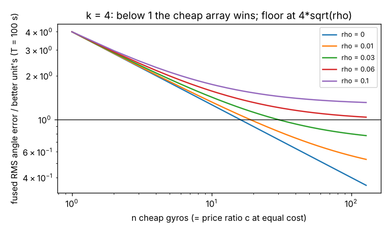

# sensing-imuarray: how many cheap gyros, fused, match one better gyro at the same cost?

Do N cheap MEMS gyroscopes, averaged, beat one better unit that costs N times as much? On a stylised single-axis model with Allan-variance noise (angle random walk plus rate random walk) and errors shared between units: **with independent errors, only if the price ratio exceeds the square of the noise ratio (a unit 10× quieter needs 100+ cheap units); a shared error fraction `ρ` above `1/k²` makes the array lose at any size; and when the better unit improves white noise more than bias walk, the answer flips with the integration time.** Produced with AI assistance (Claude). First project of track 15 (`PROJECTS.md`, milestone 1). It builds on none of the CU Boulder groups in `prompt.md`. Nothing here uses real IMU data; the grades are illustrative, not datasheets, and no prices are claimed.

**Live page:** https://duncan-haywood.github.io/monorepo-projects/research/sensing-imuarray/

**Builds on.** Allan (1966), "Statistics of atomic frequency standards", *Proc. IEEE* 54:221–230, and IEEE Std 952 for gyro noise terms; the equicorrelated-average variance `σ²(1+(n−1)ρ)/n` is the algebra of `fusion-twin` in this repository, which found shared errors in a sensor fleet; here it is applied to a two-term time-domain gyro model and a cost-matched comparison. Gyro arrays are an old idea; no specific array paper is reproduced here.

## Method
One axis. Each unit's rate error is white noise (density `N`, deg/√s) plus a bias that random-walks (`K`, deg/s/√s). Angle error after `T` s has variance `N²T + K²T³/3`. In an array of `n`, white noise shares fraction `ρ_w` of its variance and the bias walk `ρ_b` (a shared mount's vibration; common temperature drift). Equal-weight fusion has variance factor `(1+(n−1)ρ)/n` on each term. The cheap grade is `N` = 0.005 deg/√s (0.3 deg/√h), `K` chosen so the two terms are equal at 100 s. The better unit has noise densities `k` times lower and costs `c` times as much, so the equal-cost array has `n = c` units. Allan-variance fit of a simulated unit recovers `N` and `K`; a Monte Carlo of whole arrays checks the closed form.

## Reproduce
```bash
pip install numpy matplotlib pytest
cd research/sensing-imuarray
PYTHONPATH=src python -m pytest -q tests   # 8 tests
python experiments/run.py                  # writes experiments/results.txt and imuarray.png (~1 min)
```

## Results (from `experiments/results.txt`)
- **Allan fit.** One simulated cheap unit (400,000 s) gives `N` = 0.00500 (true 0.005) and `K` = 8.47e-5 (true 8.66e-5).
- **Monte Carlo agrees with the formula** (k = 4, T = 200 s, 4,000 trials): fused/better RMS ratio within 0.03 of the formula in all nine cases, e.g. n = 16, ρ = 0.1: 1.602 vs 1.581.
- **Independent errors: price ratio must beat `k²`.** For k = 3 the tie needs 9 units, for k = 10 it needs 100–101 (equal improvement on both terms makes this independent of `T`). A price ratio below that and the better unit wins.
- **Shared errors set a floor `σ√ρ`.** With k = 10, `ρ` = 0.001/0.003 needs 111–112/143 units, and `ρ` ≥ 0.01 = `1/k²` can never tie; for k = 3, `ρ` = 0.1 needs 81 units and 0.1111 is the limit.
- **Shared drift on the bias walk only (`ρ_b` = 0.3, white independent):** the array ties at short horizons (k = 10: 101 units at 1 s, 142 at 10 s) and cannot tie at all from 100 s on, because the bias term dominates there.
- **Unequal improvement (10× lower ARW, only 3× lower rate walk, independent errors):** tying needs 100 units at 1 s, 17 at 100 s and 10 at 300 s and beyond. With `ρ` = 0.05 it needs 90 at 100 s, 16 at an hour, and never at short horizons.
- Break-even in `ρ` (T = 100 s, k = 3): 0.052 at price ratio 16, 0.082 at 32, 0.102 at 100; for k = 10 no `ρ` rescues price ratios up to 100, and 300 tolerates `ρ` = 0.0067.



## Tests
Variance formulas, fusion limits, the `k²` rule, infeasibility above `1/k²`, break-even consistency, crossover time, Monte Carlo against the formula (6% tolerance), and the Allan fit.

## Limitations
- Two noise terms only. No scale-factor error, misalignment, quantisation, bias instability (flicker), or temperature coefficients; real arrays also gain from calibration, which this does not model.
- One shared factor per term and identical units. Real correlation is structured, and `ρ` here is an assumption to be swept, not a measurement: nothing in this repository says what it is for a real board.
- Equal-weight fusion only; "equal cost" ignores the board, power, mounting and calibration cost of an array.
- Single axis, gyro only; no attitude filter, no accelerometers or aiding.
- The "better" grade's noise ratio and the price ratio are free parameters, not data.

## Next steps
Measure `ρ` from real logs of several units on one board (owner step), then replace the free parameter. Add flicker noise and a temperature-drift model, then `sensing-vio` (milestone 2).

## Owner steps
Log N identical MEMS IMUs on one mount and one better IMU together, still and in vibration, to measure the Allan terms and the correlation between units (hardware is the owner's; no purchase was made or recommended).

## Outside dependencies (vitamins)
Open-source Python packages only (numpy, matplotlib; pytest for tests). No hardware, no datasets.
