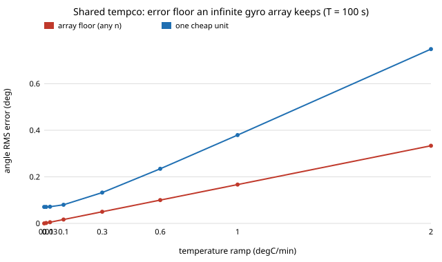

# sensing-imutemp: does a shared temperature coefficient put a floor under an array of cheap gyros?

When the temperature drifts, can enough cheap MEMS gyros, averaged, still match one better gyro? On a stylised single-axis model: **no, once the ramp is fast enough. The part of the temperature coefficient that the units share does not average out, so it sets an error floor `μ·r·T²/2` that no array size removes; in the illustrative case a 3× better unit can no longer be matched at any `n` above a 0.2 °C/min ramp over 100 s, and a 10× better one above 0.04 °C/min.** Compensation helps only if it is good: with both grades compensated to the same residual, the needed array size falls back to near `k²` only at about 2% residual tempco. Produced with AI assistance (Claude). Follow-up to `sensing-imuarray` (track 15, `PROJECTS.md`), which listed temperature drift as a limitation. It builds on none of the CU Boulder groups in `prompt.md`. Nothing here uses real IMU data; grades and tempcos are illustrative assumptions, not datasheets, and no prices are claimed.

**Live page:** https://duncan-haywood.github.io/oss-monorepo/research/sensing-imutemp/

**Builds on.** [`research/sensing-imuarray`](../sensing-imuarray) (Allan-variance white + rate-walk terms, cost-matched array comparison, shared error fraction `ρ`) and [`research/fusion-twin`](../fusion-twin) (equal-weight fusion of correlated errors). There, shared drift was a free fraction `ρ` of the bias-walk variance. Here it is derived from a mechanism: a temperature coefficient `cᵢ = μ + s·eᵢ` per unit, whose mean `μ` is shared and whose spread `s` is not. No specific array paper is reproduced.

## Method
One axis. Per unit: white noise `N`, bias random walk `K`, and a tempco `cᵢ` (deg/s per °C). A common linear ramp of `r` °C/s over `T` s integrates to angle error `cᵢ·q`, `q = rT²/2`. Equal-weight fusion of `n` units has variance

`(N²T + K²T³/3 + s²q²)/n + μ²q²`.

The first part shrinks as `1/n`; the second is a floor. The better grade has every term, tempco included, `k` times lower and costs `c` times as much, so the equal-cost array has `n = c`. Compensation (a fitted tempco applied from a temperature sensor) leaves a fraction `f` of each `cᵢ`. `μ` is treated as a fixed systematic of the grade whose square adds to the variance. A Monte Carlo of whole arrays checks the closed form.

## Reproduce
```bash
pip install numpy pytest
cd research/sensing-imutemp
PYTHONPATH=src python -m pytest -q tests   # 9 tests
python experiments/run.py                  # writes experiments/results.txt
python experiments/figure.py               # writes experiments/floor.svg
```

## Results (from `experiments/results.txt`)
Cheap grade: `N` = 0.005 deg/√s, `K` = 8.7e-5 deg/s/√s (as `sensing-imuarray`), `μ` = 0.002, `s` = 0.004 deg/s/°C; `T` = 100 s.
- **No ramp: the old `k²` rule** (9 units for k = 3, 100 for k = 10).
- **A slow ramp costs a few units, a fast one all of them.** k = 3: 10 units at 0.01–0.03 °C/min, 15 at 0.1, never at 0.3 °C/min and above. k = 10: 106 units at 0.01, 195 at 0.03, never from 0.1 °C/min.
- **The floor is linear in the ramp** and independent of `n`: 0.017° at 0.1 °C/min, 0.17° at 1 °C/min, against 0.07–0.38° for one cheap unit.
- **Price ratio buys little ramp tolerance.** Largest tying ramp for k = 3: 0.12 °C/min with 18 units, 0.17 with 45, 0.19 with 90 (limit set by `μ`). For k = 10: 0.030 with 200 units, 0.041 with 1,000.
- **Compensation only the cheap units (a one-sided comparison, shown to size the effect, not a fair one):** at 1 °C/min and k = 3, `f` = 0.5 needs 4 units and `f` ≤ 0.2 lets one cheap unit tie the uncompensated better one.
- **Compensating both grades equally** (the fair comparison) at 1 °C/min, k = 3: `f` = 1 and 0.5 never tie; `f` = 0.1 needs 15 units and `f` = 0.02 needs 10, back near `k²`. Compensation quality, not array size, decides the answer in a thermally unsettled system.
- **Monte Carlo agrees** with the formula within 1% RMS at n = 1, 4, 16 (8,000 trials), e.g. n = 4: 0.04498 vs 0.04528.



## Tests
Ramp integral, no-ramp reduction, floor independent of `n`, compensation scaling, `units_needed` minimal and sufficient, infeasibility, the `k²` limit, maximum ramp consistent with `units_needed`, and Monte Carlo against the formula.

## Limitations
- The result is a consequence of the assumption that a fixed share of the tempco is common to all units; if `μ` is zero (units' tempcos are symmetric around zero) the floor vanishes. `μ`, `s` and the ramp are assumptions, not measurements.
- Linear ramp and linear tempco only; no hysteresis, no thermal gradients between units, no self-heating. Compensation is a single residual fraction `f`, not a calibration model.
- `μ` enters as a fixed offset in a variance, not as a random draw across production lots.
- No flicker noise, scale factor or misalignment; single axis, gyro only; "equal cost" ignores board, power and calibration cost.
- The better unit is assumed to have a tempco `k` times lower, which is generous: real better units may use temperature-controlled ovens or not.

## Next steps
Measure `μ` and `s` from logs of several units cycled in a thermal chamber (owner step) and replace the assumptions; add thermal gradients between units; model calibration as a regression on a temperature log; then `sensing-vio` aiding that bounds `T`.

## Owner steps
Cycle N identical MEMS IMUs and one better IMU through a controlled temperature ramp, logging their rates, to fit `μ` and `s` (hardware is the owner's; no purchase was made or recommended).

## Outside dependencies (vitamins)
Open-source Python packages only (numpy; pytest for tests). No hardware, no datasets.
