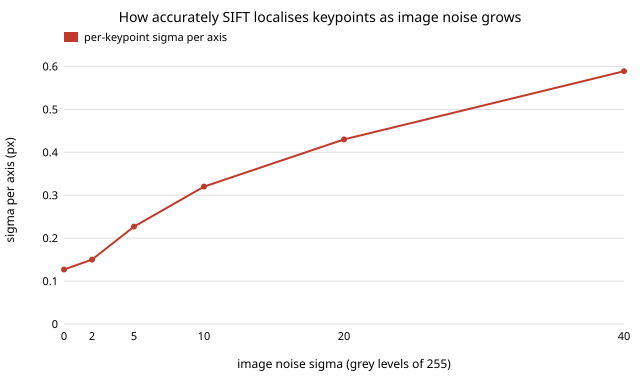

# sensing-kploc: how accurately does a real keypoint detector localise features as images get noisier and blurrier?

`sensing-recon` and `sensing-ba` fed their reconstructions 0.5 to 1 px of Gaussian pixel noise on every observation, and `sensing-ba` found that this noise is what sets the error floor. Where does that number come from for a real detector? **Headline: on ten real photographs warped by 30 known homographies, SIFT keypoints localise to 0.13 px per axis with no added noise, 0.32 px at Gaussian noise of 10 grey levels (of 255) and 0.59 px at 40; large keypoints are worse than small ones, and blur of 3 px costs only about 1.5x. The 0.5 px assumed by `sensing-ba` is therefore pessimistic for a well-exposed image and about right for a very noisy one (sigma near 28 grey levels).** Through `sensing-recon`'s 0.0028 object radii per pixel, the measured sigmas give a surface error of 0.0004 to 0.0017 radii.

**Live page:** https://duncan-haywood.github.io/oss-monorepo/research/sensing-kploc/

Lab tag: none fits. Builds on `sensing-ba` and `sensing-recon` (their assumed pixel noise) and `sensing-matchreal` (same images, same matcher).

## Method
- **Images and truth.** Ten scikit-image photographs and textures (astronaut, camera, coffee, chelsea, brick, gravel, grass, text, page, moon), converted to grey. Each is warped three times by a random homography (rotation +-10 deg, scale 0.9 to 1.1, shift up to 3%, mild perspective; fixed seed) with bilinear resampling. The truth for a keypoint at `p` in the original is `H p` in the warp.
- **Degradation.** Gaussian blur of sigma 0 to 3 px, or additive Gaussian noise of sigma 0 to 40 grey levels, applied independently to both images after warping, rounded and clipped to 8 bits.
- **Detector and matcher.** OpenCV 5.0 SIFT (2000 features), brute-force L2, Lowe ratio at most 0.8 and a mutual check. Matches whose truth lies within 20 px of the border are dropped.
- **Error.** Match position minus truth. Matches within 3 px of truth are the inliers whose error is reported (as RMS, median and 90th percentile of the magnitude). The share of kept matches that are inliers is in each table.
- **Per-keypoint sigma.** A match error combines two independent keypoint errors, so the per-keypoint sigma per axis is the per-axis RMS of the match error divided by sqrt 2.
- **Control.** An integer translation involves no resampling, so both images hold identical pixels apart from the shift.

## Reproduce
```bash
pip install numpy opencv-python-headless scikit-image matplotlib pytest
cd research/sensing-kploc
PYTHONPATH=src python -m pytest -q tests   # 5 tests, a few seconds
python experiments/run.py > experiments/results.txt   # about 35 s
python experiments/figure.py               # writes experiments/kploc_vs_noise.svg
```

## Results (from `experiments/results.txt`)
Error magnitude of inlier matches (px), 10 images x 3 warps:

| noise (grey levels) | inliers | inlier share | RMS | median | 90th pct | per-keypoint sigma per axis | surface error (radii) |
|---|---|---|---|---|---|---|---|
| 0 | 14560 | 0.984 | 0.253 | 0.106 | 0.328 | 0.127 | 0.00035 |
| 2 | 14285 | 0.978 | 0.301 | 0.131 | 0.414 | 0.150 | 0.00042 |
| 5 | 12706 | 0.962 | 0.453 | 0.200 | 0.658 | 0.227 | 0.00063 |
| 10 | 10088 | 0.933 | 0.641 | 0.312 | 0.996 | 0.320 | 0.00090 |
| 20 | 5916 | 0.879 | 0.859 | 0.494 | 1.401 | 0.430 | 0.00120 |
| 40 | 2208 | 0.770 | 1.179 | 0.806 | 2.007 | 0.589 | 0.00165 |

- **Control.** With an integer shift the median error is 0.000 px and 99.9% of matches are inliers (the RMS of 0.11 px comes from a few matches with larger errors; I did not look at which), so the detector is exactly reproducible on identical pixels. The 0.13 px at zero noise is therefore mostly bilinear resampling of the warp, which smooths one image and not the other, not detector instability. It is a floor for warped test data, not for a real camera.
- **Noise.** The sigma grows about as the square root of the noise at first (0.15 at 2, 0.32 at 10) and flattens (0.43 at 20, 0.59 at 40). The flattening is partly truncation: only 77% of kept matches are inliers at sigma 40, and the worst are cut off, so the larger values are lower bounds.
- **Blur** (sigma 0, 1, 2, 3 px): RMS 0.25, 0.24, 0.28, 0.37 px. A little blur even helps (it suppresses the resampling mismatch), but the detector loses keypoints, 14,560 inliers at 0 and 5,064 at 3 px.
- **Keypoint size** (clean): RMS 0.19 to 0.21 px for diameters under 8 px, 0.42 for 8 to 16 px, 0.87 for over 16 px (331 inliers). With noise 10 the spread narrows (0.60 to 0.98 px) because noise dominates for all sizes. I did not test why large keypoints are worse.
- **Against the assumption.** `sensing-ba`'s 0.5 px sits between sigma 20 (0.43) and 40 (0.59) grey levels, near 28 by interpolation. A well-exposed 8-bit image has sensor noise of a few grey levels, which corresponds to 0.15 to 0.25 px here. The surface-error floor measured in `sensing-ba` (0.0014 radii at 0.5 px) would shrink by about 2 to 4 times at these values, to roughly 0.0004 to 0.0006 radii, if the linear scaling of `sensing-recon` holds.



## Tests
`apply_h` is the identity for the identity matrix and a shift for a translation; random homographies are near the identity; `degrade` produces the requested noise level and a constant image survives blur; an integer shift gives zero median error on the astronaut photograph; noise raises the error.

## Limitations
- **Gaussian noise, not a camera.** Real sensors have signal-dependent shot noise, fixed-pattern noise, demosaicing and compression artefacts. Noise levels here are Gaussian in grey levels, not tied to an ISO setting or a sensor datasheet.
- **Warped single images.** The homography has no viewpoint, lighting or occlusion change, and the bilinear resampling adds its own error (see the control). A real turntable pair would likely be worse.
- **One detector.** SIFT only; learned detectors and sub-pixel refinement such as COLMAP's would differ.
- **Truncation.** Errors above 3 px are dropped, so every sigma is a lower bound, increasingly so at high noise (inlier share 0.77 at sigma 40).
- **Independence.** Dividing by sqrt 2 assumes the two keypoints' errors are independent with equal variance; not checked.
- **Not fed back.** The sigmas were not run through `sensing-ba`'s reconstruction; the surface-error column is `sensing-recon`'s linear coefficient times the measured sigma.
- Keypoints are not independent across scales or neighbours, and the match set shrinks as noise grows, so the populations at different noise levels differ.

## Next steps
Run `sensing-ba` with a per-keypoint sigma that follows keypoint size and noise (a heteroscedastic weighting) in place of one global sigma and see how much the 8x gain at 0.5 px changes; repeat with shot noise at a datasheet's ISO levels; add sub-pixel refinement or a learned detector.

## Owner steps
Photograph a flat printed pattern at a few ISO settings on owned hardware and repeat the measurement against its known geometry. No hardware was bought or specified.

## Outside dependencies
Open-source Python packages only (numpy, opencv-python-headless, scikit-image; matplotlib and pytest to plot and test). The photographs ship with scikit-image.
