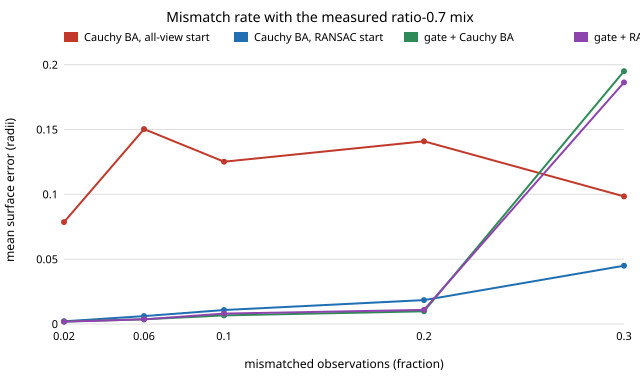

# sensing-matchmix: does a gate or a RANSAC start survive the mismatch mixes a real SIFT matcher produces?

Bundle adjustment with wrong camera poses and feature mismatches: which defence works when the mismatches have the rate and the random / near-miss / along-the-epipolar-line mix that SIFT actually produces at each ratio-test threshold? **On the `sensing-epigate` rig (12 views, 0.5 px noise, every pose wrong), at the measured Middlebury-stereo mixes with a ratio test of 0.8 or tighter (10% or fewer wrong), an epipolar gate followed by Cauchy-loss adjustment reaches 0.0126 to 0.0024 object radii (clean floor 0.0014) against 0.39 to 0.005 for the same adjustment from an all-view start; a RANSAC start is as good within noise (0.022 to 0.0034). At a 0.9 ratio (23% wrong) the RANSAC start wins (0.088 against 0.17 for the gate), and with no ratio test (56% wrong) every method fails (0.74 to 0.85).** Synthetic rig, measured mismatch statistics (numpy, scipy; 3 tests). Produced with AI assistance (Claude).

This takes the next step of `sensing-matchreal`: its measured `ratio -> (rate, along / near / far)` mixes replace the fixed fractions of `sensing-epigate`.

**Live page:** https://duncan-haywood.github.io/oss-monorepo/research/sensing-matchmix/

**Builds on.** `sensing-matchreal` (the mixes, measured with OpenCV SIFT on the Middlebury 2014 Motorcycle pair and on warped photographs), `sensing-epigate` (gate, mismatch kinds), `sensing-baoutlier`, `sensing-ba`, `sensing-recon` (rig, RANSAC start, robust adjustment, scoring), all in this repository. Hartley and Zisserman (2004), *Multiple View Geometry in Computer Vision*, 2nd ed., Cambridge University Press, ch. 11; Fischler and Bolles (1981), *Communications of the ACM* 24(6). Track 15 (`sensing`). No lab in `prompt.md` is built on; none fits.

## Method
- **Mixes.** `MIXES` in `src/sensing_matchmix/mix.py` copies rate and (along, near, far) shares from `../sensing-matchreal/experiments/results.txt`: table A2 (stereo pair, no mutual check, ratio none / 0.9 / 0.8 / 0.7 / 0.6) and the pooled homography table (ratio none / 0.8 / 0.6). In the homography rows the "along" band is not an epipolar line, so it is folded into near.
- **Injection.** Each visible observation is wrong with the mix's rate; a wrong one is "along" (10 to 40 px along the true epipolar line of another view), "near" (10 to 40 px, random direction) or "far" (uniform random pixel, standing in for the hundreds-of-pixels errors measured).
- **Methods.** Cauchy-loss adjustment from an all-view start (`cauchy`) or a per-point RANSAC start (`ri_cauchy`), and the same after the epipolar gate (`g_cauchy`, `g_ri`); `clean_ba` is the floor. Scoring and gate as in `sensing-epigate`. 6 seeds per cell.
- **Measured versus assumed.** The mixes are measured (cited above). The rig, noise and pose errors are `sensing-epigate`'s and are not tied to a real capture. "Far" is modelled as uniform on the image, which `sensing-matchreal` found close for no-ratio-test far errors.

## Reproduce
```bash
pip install numpy scipy matplotlib pytest
cd research/sensing-matchmix
PYTHONPATH=src python -m pytest -q tests   # 3 tests
python experiments/run.py                  # writes experiments/results.txt (several minutes)
python experiments/figure.py               # writes experiments/error_vs_rate.svg
```

## Results (from `experiments/results.txt`)
- **Ratio-tested matches (0.8 or tighter) are survivable.** Stereo 0.7 (6.1% wrong, 62% along): all-view Cauchy 0.052, RANSAC start 0.0060, gate 0.0038, gate + RANSAC 0.0036. Stereo 0.6 (4.7%): 0.0051, 0.0034, 0.0024, 0.0023. Homography 0.8 and 0.6: all-view start 0.23 and 0.17, the other three 0.003 to 0.008. The all-view start is the weak one; the other three are within seed noise of each other (6 seeds, no intervals computed).
- **Loose thresholds break the gate first.** Stereo 0.9 (23% wrong): RANSAC start 0.088, gate 0.17, all-view 0.29. Stereo 0.8 (10%): RANSAC 0.022, gate 0.013 and 0.015, all-view 0.39.
- **No ratio test fails everything.** Stereo (56%) 0.74 to 0.85; homography (40%) 0.43 (RANSAC start) to 0.82; the gate removes 71 to 76% of the mismatches but loses 54 to 64% of the good observations and keeps 42 to 49% of the points.
- **Rate sweep, ratio-0.7 shares (figure).** The gate (0.0019 to 0.0098) beats or matches the RANSAC start (0.0021 to 0.018) from 2% to 20%, then fails at 30% (0.195 against 0.045). With the 91%-far shares of the no-ratio homography mix, the ordering is the same up to 10% and all methods are above 0.1 at 20 to 30% apart from the gate at 20% (0.062).
- **Views.** At the 0.8 stereo mix, 24 views let the RANSAC start (0.0016) beat the gate (0.0045); 8 views favour the gate (0.0086 against 0.011).
- Combining the gate with a RANSAC start did not beat the gate alone beyond noise.



## Tests
Mix shares sum to one and match the source row; injected rate and displacement classes behave as specified; trials are deterministic and the clean floor is no worse than 1.5× the best method.

## Limitations
- **Synthetic geometry.** The mismatch statistics are measured; the scene, poses, 300 features and Gaussian noise are not. Nothing here says how COLMAP or a phone performs.
- **Mixes are rate-and-shares only.** Real mismatches cluster on repeated texture and are correlated across views; here each observation is wrong independently.
- **The along class uses the true epipolar line of a random other view,** the hardest case for the gate, applied at the stereo shares; on a real orbit the stereo pair's geometry does not apply.
- **Six seeds, no confidence intervals;** differences of a factor under about 2 are not claimed. The 0.9 and rate-sweep crossovers sit between sparse grid points.
- **Mutual-check variants and ORB** from `sensing-matchreal` were not used.

## Next steps
Run the pipeline on real matches from an openly licensed multi-view set with known poses (not reachable from this container); add confidence intervals with more seeds; correlated, texture-clustered mismatches.

## Owner steps
None. No hardware was bought or specified.

## Outside dependencies
Open-source Python packages only (numpy, scipy; matplotlib and pytest to plot and test).
