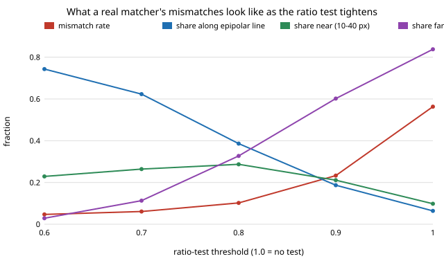

# sensing-matchreal: what do a real matcher's mismatches look like: random pixels, near misses, or along the epipolar line?

`sensing-baoutlier` and `sensing-epigate` injected mismatches of three invented kinds (uniform random pixel, a 10 to 40 px "near miss", a shift along the epipolar line) and said so: "mismatch models are mine, not measured from a real matcher". This project measures them. It runs OpenCV SIFT on a real rectified stereo pair with ground-truth disparity, and on ten real photographs warped by known homographies, and sorts every wrong match by where it landed. **Headline: the mix depends on the ratio test.** With no ratio test 56% of SIFT matches on the stereo pair are wrong and 84% of those are far (hundreds of pixels, close to the uniform model). With Lowe's ratio test at 0.7 only 6% are wrong, but 62% of those lie within 2 px of the true epipolar line, which is the case a single-pair epipolar test cannot reject. A random right keypoint would land there 1% of the time.

**Live page:** https://duncan-haywood.github.io/monorepo-projects/research/sensing-matchreal/

Lab tag: none fits (ARPG does perception, but this builds on none of its work). Builds on `sensing-epigate` (its "mismatch models are mine" limitation).

## Method
- **Pair A, real stereo.** Middlebury 2014 "Motorcycle", 741x500 rectified left/right pair and its ground-truth disparity map, as shipped in scikit-image 0.26 (`skimage.data.stereo_motorcycle`; Scharstein et al., 2014, GCPR; free for research). Truth for left keypoint (x, y) is (x - d, y). Keypoints without a finite disparity are skipped.
- **Pair B, known warps.** Ten scikit-image photographs and textures (astronaut, camera, coffee, chelsea, brick, gravel, grass, text, page, moon), each warped by a random rotation (+-15 deg), scale (0.85 to 1.15) and mild perspective, three warps each. Truth is the homography applied to the keypoint; keypoints whose truth falls outside the image are skipped.
- **Matcher.** OpenCV 5.0 SIFT (3000 features), brute-force L2, nearest and second-nearest (Lowe, 2004), and a mutual-nearest check (right keypoint's best match points back).
- **Classes.** `ok`: within 3 px of truth. `along`: wrong, but within 2 px of the true epipolar line (here the image row, since the pair is rectified). `near`: other wrong matches within 40 px. `far`: the rest. These are the three kinds `sensing-epigate` generates.
- **Control.** For pair A, replace each match by a random right keypoint and count how often chance lands in `along`.

## Reproduce
```bash
pip install numpy opencv-python-headless scikit-image matplotlib pytest
cd research/sensing-matchreal
PYTHONPATH=src python -m pytest -q tests   # 4 tests, a few seconds
python experiments/run.py                  # writes experiments/results.txt (under 2 minutes)
python experiments/figure.py               # writes experiments/mismatch_vs_ratio.svg
```
scikit-image downloads the Motorcycle files on first use.

## Results (from `experiments/results.txt`)
Pair A (stereo), no mutual check; shares are of the wrong matches:

| ratio test | kept | wrong | along | near | far |
|---|---|---|---|---|---|
| none | 2319 | 0.563 | 0.064 | 0.098 | 0.838 |
| 0.9 | 1240 | 0.233 | 0.187 | 0.211 | 0.602 |
| 0.8 | 995 | 0.102 | 0.386 | 0.287 | 0.327 |
| 0.7 | 862 | 0.061 | 0.623 | 0.264 | 0.113 |
| 0.6 | 747 | 0.047 | 0.743 | 0.229 | 0.029 |

- **The ratio test removes the random-looking mismatches first and leaves the structured ones.** The far share falls from 0.84 to 0.03 as the threshold goes from none to 0.6, while the wrong-match rate falls only from 0.56 to 0.05. What survives is mostly an `along` or `near` match at a median offset of about 14 to 17 px.
- **The mutual check does the same:** with no ratio test, 22% wrong and 19% of those along the row.
- **Chance is not the explanation.** Random right keypoints land in the along band for 1.1% of wrong matches (near: 1.9%), against 38 to 74% at ratios 0.8 to 0.6.
- **Pair B (ten warped images, 29,710 matches without a ratio test):** 40% wrong without a ratio test, 5% at 0.8, 2% at 0.6; the mismatches that survive are 12 to 19% `near` and the rest `far` (the `along` column is not meaningful for a homography pair, which has no single epipolar line). The per-image near-share without a ratio test is 2 to 3% on the repeated textures (brick, gravel, grass) and 9 to 17% on photographs. The wrong-match rate at ratio 0.8 ranges from 1% (gravel) to 10% (page).
- **So the injected mixes were partly right and partly not.** Uniform mismatches describe the raw matcher; near-miss and along-epipolar mismatches describe what survives a ratio test. For `sensing-epigate`, whose gate is designed against the first, the second is the population that reaches bundle adjustment in a real pipeline, and the case its single-pair test is weakest on (its voting across several pairs recovered most of that in the synthetic data; not tested here).



## Tests
`classify` labels ok, along, near, far and NaN correctly and respects the epipolar direction; SIFT matches an image to itself with zero error; a 7 px / 3 px translated copy gives errors under 1 px for ratio-passing matches.

## Limitations
- **One real stereo pair, one detector.** The `along` finding rests on a single scene (Motorcycle) and SIFT. Other scenes, ORB, learned matchers or a wide-baseline pair could differ; this is a measurement of one case, not a general law.
- **Ground truth is not exact.** Middlebury disparities are accurate to roughly a pixel, but occlusions, thin structures and the 3 px "ok" threshold put some correct-but-mismeasured matches into `along`. The 3 to 17 px median errors argue these are mostly not rounding, but I have not separated the two.
- **Rectified geometry only.** The pair is rectified so the epipolar line is a row. Nonrectified wide-baseline pairs are covered only by the homography warps, which have no epipolar line and warp a single image (no real viewpoint, lighting or occlusion change).
- **Class boundaries are mine** (3 px, 2 px band, 40 px). The 40 px is the radius `sensing-epigate` used, kept for comparability.
- **The skimage images are small, mostly object-centred, and synthetic warps** of the photographs; scene statistics of a real capture (a turntable of an object) would differ.
- The measured mixes were not fed back into the bundle-adjustment pipeline.

## Next steps
Feed the measured `ratio -> (rate, along/near/far)` mixes into `sensing-epigate`'s `run_trial` in place of its fixed fractions, and see whether the gate-versus-RANSAC-start ordering survives at 6% mostly-along mismatches; repeat on more Middlebury scenes and on ORB.

## Owner steps
Capture a handful of real turntable photos of a known object, run the same classification with COLMAP's matches, and compare. No hardware was bought or specified.

## Outside dependencies
Open-source Python packages only (numpy, opencv-python-headless, scikit-image; matplotlib and pytest to plot and test). The Motorcycle pair is downloaded by scikit-image from its data host.
