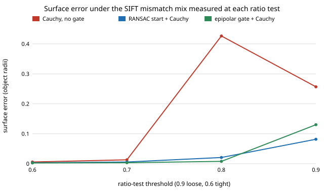

# sensing-mixgate: does the epipolar gate help bundle adjustment under the mismatch mix a real SIFT matcher produces?

`sensing-epigate` found that an epipolar gate was no better than a RANSAC start against its *invented* mismatches, and `sensing-matchreal` then measured what real SIFT mismatches look like. This project closes the loop the second one left open: it runs the epigate trial with each measured mix (mismatch rate and the share of along-epipolar, near and far errors at each ratio-test threshold). **Headline: on the measured mixes the gate plus a Cauchy loss is the best of three methods at ratio tests of 0.8 and tighter (0.0078 against 0.0207 for a RANSAC start at 0.8; 0.0026 against 0.0032 at 0.6), and worse than the RANSAC start only at a loose 0.9 ratio test (0.130 against 0.082), where every method is above 0.08 object radii.** It is the opposite of the ordering `sensing-epigate` reported at 10% uniform mismatches, and the all-uniform control here (table B) reproduces that earlier picture.

**Live page:** https://duncan-haywood.github.io/monorepo-projects/research/sensing-mixgate/

Lab tag: none fits (ARPG does perception; this builds on none of its work). Builds on `sensing-epigate` (rig, gate, trial) and `sensing-matchreal` (the measured mixes).

## Method
- **Mixes (from `sensing-matchreal/experiments/results.txt`, table A: Middlebury 2014 Motorcycle, OpenCV SIFT, no mutual check).** ratio test, mismatch rate, share along / near / far: none 0.563, 0.064/0.098/0.838; 0.9: 0.233, 0.187/0.211/0.602; 0.8: 0.102, 0.386/0.287/0.327; 0.7: 0.061, 0.623/0.264/0.113; 0.6: 0.047, 0.743/0.229/0.029.
- **Trial.** `sensing_epigate.run_trial` unchanged (12-view orbit, 300 features, 0.5 px noise, pose error 0.5 deg / 0.02 radii, gate 2 px Sampson, vote 0.5, 6 seeds). Only the mismatch generator is replaced: each corrupted observation is `along` (10 to 40 px on a random other view's epipolar line), `near` (10 to 40 px, random direction) or `far` (uniform random pixel) with the measured shares. The patch is restored after each trial.
- **Controls.** Same rates with all-uniform mismatches (B) and all-along mismatches (C).
- **Methods.** `cauchy`: Cauchy bundle adjustment from the all-view triangulation; `ri_cauchy`: RANSAC pair triangulation start then Cauchy; `g_cauchy`: epipolar gate, then Cauchy. Error is surface error in object radii on the same points; `clean_ba` is the floor (0.0014).

## Reproduce
```bash
pip install numpy scipy matplotlib pytest
cd research/sensing-mixgate
PYTHONPATH=src:../sensing-baoutlier/src python -m pytest -q tests   # 4 tests
PYTHONPATH=src python experiments/run.py                           # about 6 minutes on 4 cores, writes experiments/results.txt
python experiments/figure.py                                       # writes experiments/error_vs_ratio.svg
```

## Results (from `experiments/results.txt`; mean of 6 seeds)
A. Measured mixes:

| ratio | rate | cauchy | RANSAC start | gate + cauchy | gate recall | good lost |
|---|---|---|---|---|---|---|
| none | 0.563 | 0.857 | 0.720 | 0.813 | 0.69 | 0.66 |
| 0.9 | 0.233 | 0.257 | 0.082 | 0.130 | 0.83 | 0.21 |
| 0.8 | 0.102 | 0.427 | 0.021 | 0.0078 | 0.84 | 0.05 |
| 0.7 | 0.061 | 0.013 | 0.0058 | 0.0033 | 0.84 | 0.02 |
| 0.6 | 0.047 | 0.0057 | 0.0032 | 0.0026 | 0.83 | 0.02 |

- **At ratio tests people use (0.8 and tighter) the gate wins.** Its recall stays at 0.83 to 0.84 on the measured mixes, because the mixes are dominated by near and along errors, which it removes at 0.79 to 0.87 (`sensing-epigate`), while it fails more on a pure-uniform population at the same rates (table B, noisy, see below).
- **Plain Cauchy is the weakest** at 0.8 (0.43) even with 10% mismatches; the start matters more than the loss, as in `sensing-baoutlier`.
- **No method works with no ratio test** (56% wrong; the gate loses 66% of good observations and covers 43% of the points). The conclusion is a preprocessing one: use the ratio test; the gate then adds a modest, consistent gain.
- **At the tightest tests all three are within 0.0032 of each other** and about 2 times the floor, so little is left to gain.
- **Table B (all uniform, same rates) is erratic** (gate+cauchy 0.354, 0.126, 0.0055, 0.107 at 0.9 to 0.6): with 6 seeds a single failed seed dominates a mean, so the ordering among methods there is not established; I report it as a control, not a result. Table C (all along) has the gate at or beside the best at every ratio test except none (0.051 against 0.040), so even the "worst case" for an epipolar test is not bad for the gate-then-robust pipeline, because along-line errors of 10 to 40 px are mild for a robust loss (0.0025 to 0.0055 at ratio 0.8 and tighter).



## Tests
Mixes are distributions; the mixed generator corrupts only visible observations at the requested rate and leaves the rest bit-identical; shares select the displacement kind (10 to 40 px for near and along, beyond 60 px for far); `run_mixed` restores the epigate generator and returns finite scores.

## Limitations
- **The mixes come from one scene and one detector** (Motorcycle, SIFT). ORB, learned matchers, other scenes and wide baselines may differ (`sensing-matchreal` limitations).
- **The geometry is synthetic** (an orbit rig, my object); only the mismatch mix is measured. Applying a stereo-pair mix to a 12-view orbit assumes the same error kinds and offsets, and `near`/`along` use epigate's 10 to 40 px rather than the measured 14 to 17 px medians. Real mismatches are also correlated within tracks and clustered by texture, which independent draws ignore.
- **Mismatches are drawn independently per observation** at the pair's rate; matches that survive a ratio test in one view are not conditioned on the others.
- **6 seeds, no confidence intervals;** differences below about a factor of two (for example 0.0033 against 0.0026) are not distinguishable here. The gate settings are untuned.
- Table B means are dominated by single seeds.

## Next steps
Run 20+ seeds and report medians with intervals; draw mismatches as texture-clustered tracks; take the mix from more scenes and from ORB; tune the gate threshold per ratio test.

## Owner steps
Capture a turntable image set of a known object, run COLMAP's matcher and bundle adjustment with and without a fundamental-matrix gate, and compare against a scanned reference. No hardware was bought or specified.

## Outside dependencies
Open-source Python packages only (numpy, scipy; matplotlib and pytest to plot and test). Nothing is downloaded; the mixes are copied from `sensing-matchreal`'s committed results.
