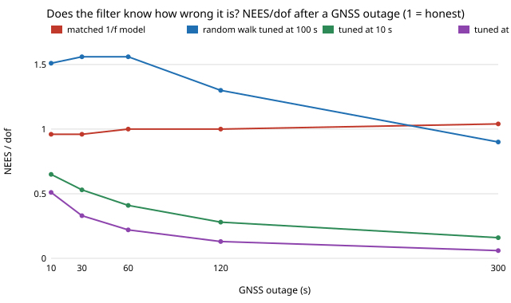

# sensing-nees: is an INS/GNSS Kalman filter honest about its drift when accelerometer bias is flicker noise?

A consumer IMU's accelerometer bias wanders like 1/f noise, but the usual filter models it as a random walk whose strength is read off the Allan-deviation plot. **Run through a 1-D INS/GNSS filter with a 300 s GNSS outage, a filter with no bias state claims a position error of 2.9 m when the true RMS is 151 m (NEES/dof 514 to 2,000 at 100 µg bias instability); a random walk tuned from the Allan curve at 1 s or 10 s claims a position error 2.4 to 3.7 times the true RMS at 100 µg (NEES/dof 0.06 to 0.16 at 300 s); tuned at 100 s it is close to honest (0.9 to 1.6) at 100 µg and optimistic at 300 µg (up to 2.3); a filter given the true 1/f model stays at 0.88 to 1.05 everywhere.** The cost of the wrong model also shows in accuracy: at 100 µg the 300 s RMS error is 66 m for the matched model, 81 m tuned at 100 s and 103 m tuned at 10 s (numpy and scipy; 6 tests).

**Live page:** https://duncan-haywood.github.io/monorepo-projects/research/sensing-nees/

**Why this was worth doing.** Track 15's `sensing-imuarray` and `sensing-imutemp` ask how many cheap IMUs match a better one, using Allan-variance grades and a white-plus-random-walk error model, and `sensing-vio` asks about drift. None checks whether a *filter* fed such a model reports its own error correctly. NEES (normalised estimation error squared; Bar-Shalom, Li and Kirubarajan 2001, *Estimation with Applications to Tracking and Navigation*, Wiley, ch. 5) is the standard test. The `sensing` chain had also gone to micro-variants of bundle adjustment (`sensing-bak2wide`'s own next steps are further camera-parameter tweaks), so this asks a new question of the same theme.

**Builds on.** `sensing-imuarray` (Allan-variance error models). Allan (1966), "Statistical analysis of oscillators", *Proc. IEEE* 54(2); IEEE Std 952-1997 (gyro/accelerometer noise terms); Kalman (1960); Groves (2013), *Principles of GNSS, Inertial, and Multisensor Integrated Navigation Systems*, 2nd ed., Artech House. Track 15 (`sensing`). No lab in `prompt.md` fits.

## Method
- **Model.** One axis, true acceleration zero, so the filter's state is its error. The accelerometer reads `m = b + w`; `w` is white with density `N`; `b` is the sum of five first-order Gauss-Markov processes (time constants 1, 10, 100, 1,000, 10,000 s, equal variance), which is 1/f over those four decades. GNSS gives a position fix at 1 Hz with 2 m noise for 600 s, then drops out for 300 s. IMU rate 10 Hz.
- **Parameters.** `N` = 70 µg/√Hz, the ICM-42688-P accelerometer noise density on [TDK's product page](https://invensense.tdk.com/products/icm-42688-p/) (the datasheet's own table was not reachable from this container; TDK's parametric table lists 65 and 70 for XY and Z). Bias instability `B` is **swept** (10, 30, 100, 300 µg) because datasheets do not give it; the flicker scale is calibrated numerically so that the minimum of the Allan curve of `b + w` equals `B` (test checks this). The 2 m GNSS noise is a typical single-frequency figure, not a measurement here.
- **Filters** (same Kalman equations, different bias model): *matched* (the five true Gauss-Markov states), *white only* (no bias state), and *random walk* with density read off the Allan curve of the simulated sensor at τ = 1, 10 or 100 s (`K² = 3(σ_A² − N²/τ)/τ`, floored at 0).
- **Score.** 400 Monte Carlo paths per case (NEES/dof has about 5% standard error). NEES of the (position, velocity) error against the filter's own 2×2 covariance, divided by 2; 1 is honest, above 1 overconfident, below 1 pessimistic. The covariance is data-independent, so it is computed once per filter.

## Reproduce
```bash
pip install numpy scipy pytest
cd research/sensing-nees
python -m pytest -q tests          # 6 tests
python experiments/run.py          # writes experiments/results.txt (about a minute)
python experiments/figure.py       # writes experiments/nees.svg
```

## Results (from `experiments/results.txt`; full tables there)


- **Sanity check.** The matched filter has NEES/dof 0.88 to 1.05 at every B and outage, as it must.
- **No bias state.** NEES/dof at 300 s: 21, 182, 2,000, 21,700 at B = 10, 30, 100, 300 µg. It claims 2.9 m every time.
- **Random walk from the Allan curve.** The answer depends on which τ is read. At 300 s, B = 100 µg: τ=1 s gives 0.06, 10 s gives 0.16, 100 s gives 0.90 (peaking at 1.56 at 30 to 60 s). At B = 300 µg τ=100 s gives 1.0 to 2.3. At B = 10 µg the 100 s read-off is 0.68 to 0.91. The short-τ reads are dominated by white noise or the rising edge of the curve, so the random-walk density is overestimated.
- **Accuracy, not just honesty.** 300 s RMS position error at 100 µg: 66 m matched, 81 m (τ=100 s), 103 m (10 s), 168 m (1 s) and 151 m (white only). Reading the curve at the wrong τ costs more than ignoring the bias state, at 1 s.

## Tests
White-only covariance growth against the analytic `N²t³/3`; white-noise Allan deviation `N/√τ`; the calibration reaches the Allan floor; the matched filter is consistent; the white-only filter is overconfident; the random-walk read-off is zero when white noise explains the curve.

## Limitations
- **Synthetic bias**: a 1/f model, calibrated to a swept `B`, not a measured IMU log. The real shape (temperature, turn-on repeatability) differs, and `B` is not sourced.
- One axis, zero acceleration, a position-only GNSS fix, no attitude or lever arm; real INS errors couple through attitude.
- Only the random-walk fit is tried; a single Gauss-Markov fit (the other common practice) is not.
- NEES is over (position, velocity) per outage sample, not a time-averaged or chi-square-tested figure; 400 paths.

## Next steps
Add a one-state Gauss-Markov fit and an inflation factor chosen by NEES; run the same check on a logged IMU from an openly licensed dataset (not reachable from this container); feed the recommended read-off τ back into `sensing-imuarray`.

## Owner steps
None needed.

## Outside dependencies
Open-source Python packages only (numpy, scipy; pytest to test).
