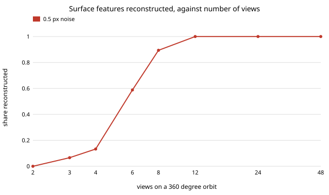

# sensing-recon: how many photos does a usable 3-D reconstruction need?

How do accuracy and completeness of a multi-view 3-D reconstruction change with the number of photos, the baseline, the image noise and the error in camera poses? On a **synthetic** bumpy-ellipsoid object, with cameras on an orbit and known intrinsics, **12 views on a full orbit reconstruct all 800 surface features, 8 views reconstruct 89%, 6 views 59%, and 4 or fewer views at most 13%; once a point is triangulated its error is set by pixel noise (about 0.0028 object radii per pixel of noise) and pose error, and barely by view count** (numpy only; 11 tests).

**Live page:** https://duncan-haywood.github.io/monorepo-projects/research/sensing-recon/

**Builds on.** Hartley and Zisserman (2004), *Multiple View Geometry in Computer Vision*, 2nd ed., Cambridge University Press, for linear (DLT) triangulation; Schönberger and Frahm (2016), "Structure-from-motion revisited", CVPR, for the structure-from-motion pipeline whose triangulation stage this isolates. This is track 15 milestone 5 (`sensing-recon`) in a reduced form: it studies the triangulation stage only, with poses and feature matches supplied, not full structure from motion, multi-view stereo or Gaussian splats. No lab in `prompt.md` is built on; none fits.

## Method
- **Object.** 800 points on a bumpy ellipsoid (axes 1.2, 0.9, 0.8, bump amplitude 0.12), with outward normals; mean radius about 1, so errors are in object radii. A new random point set per seed.
- **Cameras.** Pinhole, 800 px focal length, 640 × 480 image, 4 radii from the centre, looking at it. Azimuths are evenly spread over the stated span (360° = full orbit); elevation alternates ±30° between neighbouring cameras so the top and bottom are both seen.
- **Observations.** A point is seen by a camera if its normal faces the camera (cosine > 0.25) and it projects inside the image; no occlusion by other parts of the object. Each observation gets Gaussian pixel noise.
- **Reconstruction.** Linear DLT triangulation from all views that see the point. A point is kept if it is seen by at least two views and its widest ray pair is at least 2° apart. Matches and poses are given.
- **Scores.** *Error* is the distance from each reconstructed point to the exact surface (radial offset, first order), so there is no sampling floor from a reference cloud. *Completeness* is reconstructed points over the 800 features. 10 seeds per cell. This replaces the Chamfer distance against a reference scan in the track brief: the first version used Chamfer against a 3,000-point sampled reference, and its zero-noise floor (0.032) was just that cloud's spacing, so it was dropped.

## Reproduce
```bash
pip install numpy matplotlib pytest
cd research/sensing-recon
PYTHONPATH=src python -m pytest -q tests   # 11 tests
python experiments/run.py                  # writes experiments/results.txt (~30 s)
python experiments/figure.py               # writes experiments/completeness_vs_views.svg
```

## Results (from `experiments/results.txt`, 10 seeds per cell)
- **Views set completeness, with a sharp knee.** On a full orbit at 0.5 px noise: 2 views reconstruct nothing (opposite sides see disjoint surface), 3 views 6.6%, 4 views 13.3%, 6 views 58.8%, 8 views 89.4%, 12 views 100%. Few views fail because a point must be seen by two cameras, and with 90° spacing the visible caps barely overlap. Neighbouring cameras must be within roughly 45° of each other. This is the answer to "how few photos": about 12 for this object, 8 if 10% of it can be missing.
- **Error is flat in view count.** Mean error is 0.0014–0.0016 radii for 3 to 12 views and falls to 0.0007 at 48 views (more rays averaged).
- **Error is linear in pixel noise.** 12 views: 0.0014 at 0.5 px, 0.0028 at 1 px, 0.0113 at 4 px, 0.0454 at 16 px, 0.0923 at 32 px (0.0028 radii per px). Completeness stays 1.0 throughout; wrong points are still produced, not dropped.
- **Narrow baseline is the second failure.** 4 views over a span of only 2° keep 54 points (they pass the 2° ray test by chance of geometry) with low error, but this is selection: the survivors are the well-conditioned ones. At 5° span the 318 kept points have a mean error of 0.0193, falling to 0.0028 at 40°, 0.0018 at 80° and 0.0016 at 120°, roughly inverse in the span. Completeness is limited by overlap here (0.32–0.40), not by baseline.
- **Pose error costs about as much as pixel noise.** 12 views at 0.5 px noise: 0.0014 with exact poses, 0.0021 at 0.25° per axis, 0.0035 at 0.5° and 0.0064 at 1°. A 1° pose error therefore does the damage of roughly 2 px of image noise here (0.0064 against 0.0028 at 1 px, 0.0056 at 2 px).
- **Views for 90% completeness do not depend on pixel noise.** The count stays at 12 for 0.5, 4 and 16 px (E), because completeness is decided by visibility and the ray-angle rule, not noise.



## Tests
Points lie on the surface, normals are unit and outward, cameras look at the origin, full-orbit spacing, exact triangulation with no noise, a single view yields nothing, surface error is zero on the surface and positive off it, more views give more completeness, noise raises error, pose error raises error, and runs are deterministic.

## Limitations
- **Synthetic, one object, no real images.** Nothing here says how COLMAP, a phone or any named dataset performs. There are no textureless regions, specular surfaces, motion blur, lens distortion or moving objects.
- **Matches and poses are handed over.** Real structure from motion has to find them, loses points to mismatches and drifts; the part of reconstruction that usually fails is not tested. Pose error is a random rotation only (no position error, no bundle adjustment).
- **No occlusion, no dense surface.** Visibility is by normal and image bounds. Only 800 sparse features are triangulated, so these are not meshes, splats or multi-view stereo, and the brief's Chamfer distance against a scan is replaced by exact surface distance.
- **The ±30° alternating elevation and the 2° ray rule are choices.** They shape the completeness knee; other rigs would move it. Seeds vary the object only in feature positions, not shape.
- Gaussian splatting or NeRF on CPU were not attempted.

## Next steps
- Add the matching step: SIFT or ORB features with outlier rejection on rendered images, then bundle adjustment from noisy poses.
- Run on an openly licensed multi-view object set with a reference scan and score Chamfer distance against view count.
- Add occlusion by ray-casting against the surface.

## Owner steps
Capture a real photo set of an owned object with a phone and a reference scan to repeat the view-count curve on real data. No hardware was bought or specified; there is no bill of materials.

## Outside dependencies
None to run (numpy only). Real photo sets, a reference scanner, COLMAP and gsplat are named in the brief and not used here.
