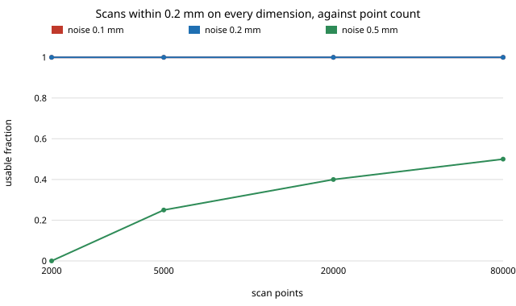

# sensing-scan2cad: how accurate must a scan be to rebuild a part as parametric CAD?

Can a point-cloud scan of a plate with two holes be turned into a dimensioned, printable parametric model, and how good must the scan be? On synthetic scans of an 80 × 40 × 10 mm plate with two 8 mm holes: **with scanner noise of 0.2 mm or less, plane and circle fits recover all five dimensions to within 0.2 mm in every one of 20 scans down to 2,000 points (worst RMS error 0.09 mm), but at 0.5 mm noise only 0–50% of scans are usable however many points are added, because the error stops being noise and becomes a bias: thickness reads 0.20 mm low, a bias that grows with the RANSAC inlier band (−0.07 mm at 1.5σ to −0.38 mm at 4σ); and a scale error of only 0.5% from a reconstruction with no scale reference already moves the 80 mm length by 0.40 mm, more than any fitting error at low noise.** Produced with AI assistance (Claude). Third project of track 15 after `sensing-timesync` and `sensing-burst` (`PROJECTS.md`, milestone 6). It builds on none of the CU Boulder groups in `prompt.md`. Everything here is synthetic: no real scan, no phone, no printed part.

**Live page:** https://duncan-haywood.github.io/monorepo-projects/research/sensing-scan2cad/

**Builds on.** Fischler and Bolles (1981), "Random sample consensus", *Communications of the ACM* 24(6):381–395, for the plane and circle hypotheses; Schnabel, Wahl and Klein (2007), "Efficient RANSAC for point-cloud shape detection", *Computer Graphics Forum* 26(2):214–226, whose idea of fitting primitives to scanned geometry this follows in a much smaller form (no cylinders in 3-D, cones or spheres, and none of their octree sampling); Gauss–Newton circle refinement is the textbook geometric fit. The pipeline is written from scratch in numpy; no code from those papers or from any library was used. CadQuery is the target CAD library named in the track brief; it is not installed here, so the generated script is text that has not been run.

## Method
- **Part.** An axis-aligned box `L × W × T = 80 × 40 × 10` mm with two through holes of diameter `D = 8` mm, centres `G = 40` mm apart along x.
- **Scan.** `n` points sampled uniformly by area from the six faces (minus the hole openings) and the two hole walls, then moved by isotropic Gaussian noise of standard deviation `σ` (mm) in 3-D. Section E adds 2% uniform outliers. The scan is assumed registered to the part axes.
- **Fit.** Sequential RANSAC finds six planes (300 hypotheses each, normals within 10° of a coordinate axis, at most two planes per axis, inlier band `3σ`, `σ` taken as the scanner's quoted noise), refitting each by SVD. Points the planes did not claim, and that lie between the top and bottom planes, are split into two clusters along x; each gets a three-point-circle RANSAC and a Gauss–Newton refinement on its inliers. Length, width and thickness are the distances between opposite planes; `D` and `G` come from the circles.
- **Usable.** The fit did not fail and every one of the five dimensions is within ±0.2 mm of truth. The 0.2 mm bar is an assumption about a press-fit allowance for FDM printing, not a measured requirement.

## Reproduce
```bash
pip install numpy matplotlib pytest
cd research/sensing-scan2cad
PYTHONPATH=src python -m pytest -q tests   # 12 tests
python experiments/run.py                  # writes experiments/results.txt (~1 min)
python experiments/figure.py               # writes experiments/usable_vs_points.svg
```

## Results (from `experiments/results.txt`, 20 scans per cell)
- **Low noise is easy.** At σ = 0.05, 0.1 and 0.2 mm every scan is usable at every point count tried (2,000 to 80,000). Worst-dimension RMS error at 2,000 points is 0.019, 0.044 and 0.093 mm; it falls roughly as `1/√n` at σ = 0.1 (0.044 at 2,000 to 0.008 at 80,000).
- **High noise is a bias, not a variance problem.** At σ = 0.5 mm the usable fraction is 0.00, 0.25, 0.40 and 0.50 for 2,000, 5,000, 20,000 and 80,000 points, and 8 of 20 fits fail outright at 2,000. At 80,000 points the thickness bias is −0.202 mm against an RMS of 0.205, so the error is almost all bias and more points do not remove it; hole diameter has +0.060 mm bias. At σ = 1.0 mm no scan was usable and 10 to 20 of 20 fits failed at every point count, because a 3σ = 3 mm inlier band is a third of the plate's thickness.
- **The bias comes from the inlier band.** Thickness bias at σ = 0.5, n = 80,000 (12 scans): −0.074 mm at a 1.5σ band (but 7 of 12 fits failed), −0.099 at 2σ, −0.204 at 3σ, −0.382 at 4σ. This is consistent with side-wall points near the top and bottom edges falling inside the band and pulling each face plane inward; it was not isolated further here.
- **Scale beats noise.** A reconstruction with no scale reference is off by a percentage of every dimension. At 0.5% the 80 mm length is 0.40 mm wrong and the 40 mm gap and width 0.20 mm: equal to or above the whole 0.2 mm budget, with zero scan noise. At 0.1% the length is still 0.08 mm out. This table is arithmetic (dimension × scale error), not a simulation.
- **Outliers are handled.** With 2% uniform outliers at σ = 0.1 and 20,000 points, 20 of 20 scans are usable (worst RMS 0.014 mm).
- **Generated CAD.** Section F of `results.txt` shows a CadQuery script written from one fit (80.042 × 40.014 × 9.996 mm, hole 8.000, gap 40.004). It was not executed: CadQuery is not installed in the container.



## Tests
Samples lie on the surface and outside the holes on faces, area weighting of faces, noise standard deviation, three-point circle, circle fit with stray points, six axis planes found, exact recovery with no noise, low-noise fit within 0.2 mm, a second part size, `None` on unstructured points, and the generated script compiling.

## Limitations
- One shape, synthetic, with an assumed noise law (isotropic Gaussian per point). Real scanners have noise that depends on range and angle, systematic distortion, holes in coverage, filled or rounded edges from meshing, and surfaces that were never flat; none is modelled. This says nothing about a phone or any named scanner.
- The scan arrives registered to the part axes and the fitter is told `σ`. Real use needs a pose estimate and a noise estimate; both would add error. The method only handles planes and one hole axis normal to the top face.
- "Broken part" repair, the question in the track brief, is not tested: the shape is complete. Scale error is arithmetic, not an estimated scale from a reference object.
- Tolerance (±0.2 mm) is an assumption, and a printed part's own error (about the same size) is not included.
- The bias mechanism at high noise is a hypothesis supported by the band sweep, not proven. A fitter that estimates band width from the data, or fits planes jointly with edges, would probably do better and was not tried.

## Next steps
- Real scan: a phone or depth scan of a printed reference plate (owner step) to replace the assumed noise law, then measure the printed copy.
- Add scale estimation from a known-size marker and report the error it leaves.
- Replace the band with a robust loss and re-run the σ = 0.5 cells.
- Run the generated script under CadQuery and compare the exported solid with the truth.

## Owner steps
Capture real scans of an owned part with a phone or depth sensor and print the fitted replacement. No hardware was bought or specified; there is no bill of materials.

## Outside dependencies
None to run (numpy only). CadQuery (Apache-2.0) is named as the CAD target and not used here; real scans and a printer are owner steps.
