# sensing-selfcal: can a robot camera calibrate itself without a checkerboard, and does it know when it is wrong?

**Live page:** https://marisstella.app/research/sensing-selfcal/

A research programme (proposal: [`PROPOSAL.md`](PROPOSAL.md); log: [`LOG.md`](LOG.md)) on
**target-free camera self-calibration**: recovering a camera's focal length, principal
point and lens distortion by bundle adjustment from the features it tracks, without a
calibration target, and testing whether the solver's own uncertainty is honest enough for a
field robot to accept or reject the update.

**Paper draft (milestone 7):** [`paper/draft.md`](paper/draft.md) pulls milestones 1–6b into one
RA-L-shaped argument, *Can a field camera trust its own self-calibration?*, with every quoted number
checked against the stored results by [`paper/check_numbers.py`](paper/check_numbers.py) (437 of 437,
revised with milestones 4e–4s and 3b–3x; on 2026-11-19 Section 4 gained the rolling-shutter, causal-prior and pooling
results on TUM video, and Recommendation 7; on 2026-11-21 it gained milestones 3u–3x, the history-floored error bar, the
stale-calibration test and the update rule with its leave-one-sequence-out check, and Recommendation 8) and a list of
what a submission still needs. The letter version carries the update rule in Section VIII and Recommendation 8.

**Letter version (paper step, 2026-11-19):** [`paper/ral.md`](paper/ral.md) cuts the 8,200-word draft to an
RA-L-length letter (3,927 words of prose, three figures, one table; about 6.2 pages by a stated rule of thumb,
under the 8-page limit) around one question: can a robot gate its own camera self-calibration update, and
what does that gate catch? It keeps the board results, the rendered-twin corner diagnosis, the update test with
its three references and the transfer to the TUM cameras, and folds the natural-feature chapter into one section.
[`paper/check_short.py`](paper/check_short.py) checks that each of its 196 distinct numbers is copied from the
checked draft, that every citation key is in `references.bib` and every figure exists. `draft.md` stays the
extended version.

**Fold check (2026-11-23):** [`src/foldcheck.py`](src/foldcheck.py) tells you whether a camera calibration's radial
distortion folds back inside the image, where every pixel past the fold is reached by no ray. Stdlib Python, OpenCV's
k<sub>1</sub>, k<sub>2</sub>, k<sub>3</sub> model: `python3 src/foldcheck.py --fx 518.28 --cx 315.75 --cy 260.06 --k1 0.2226 --k2 -0.5679 --width 640 --height 480`
reports the Kinect's board fit folding at 380.8 px against a 415.7 px corner (exit 1). Run it before trusting a two-term
calibration near the image edge; milestone 3zd found such a fit 14&ndash;17 px off there.

**Milestone 3zi headline** (which pixels does my robot's undistortion get wrong, and how do I fix it without upgrading OpenCV?):
[`src/undistcheck.py`](src/undistcheck.py), stdlib Python, reads a ROS `camera_info` YAML and runs the undamped loop that
`cv2.undistortPoints` (default criterion, and any criterion before 4.13), Kornia, ORB-SLAM2/3 and ROS `image_geometry` run. On 179 real
calibrations it predicts OpenCV 5.1.0's default corner error to 7.5 &times; 10<sup>&minus;13</sup> px (the same 164 of 169 Duckiebots over
1 px) and its grid share exactly; its Newton inverse reprojects within 10<sup>&minus;12</sup> px in at most 7 steps at every corner of the 177
that do not fold, and refuses at exactly the 6 corners past a fold. `python3 src/undistcheck.py camera_info.yaml --grid 4` (exit 1 if a
corner is off by more than 1 px). Two of four predictions held; the other two missed tolerances set tighter than OpenCV's own converged
answer, which is short of 10<sup>&minus;6</sup> px at 28 corners (LOG.md, milestone 3zi).

**Milestone 3zh headline** (does `cv2.undistortPoints` converge at wide-lens image corners in the OpenCV a robot actually runs?): **not
in any release before 4.13.0, whatever criterion you pass.** On the opencv-python-headless wheels for 4.5.5, 4.10.0 and 4.12.0 the loop has
no damping at all (output equal to an undamped port, difference 0.0 at 179 calibrations &times; 13 criteria), so milestone 3zg's fix,
`COUNT|EPS`, leaves 58 of 676 Duckiebot corners over 1 px; from 4.13.0 (opencv/opencv PR #27993) it closes all of them, but the default
criterion stays undamped in every release (164 of 169 robots over 1 px at a corner). ORB-SLAM2/3 and ROS `image_geometry` call it with the
default; Kornia's `undistort_points` is the same undamped loop (equal to 10<sup>&minus;12</sup> px except past a fold, where it lacks
OpenCV's guard). VINS-Mono's additive loop, x &larr; x<sub>d</sub> &minus; D(x), is a different map: its eight steps put a median Duckiebot
corner within 0.0085 px, failing only where &rho;&prime;(r) &gt; 2 (one corner of 169 robots). Four of seven predictions held.
[Log](LOG.md).

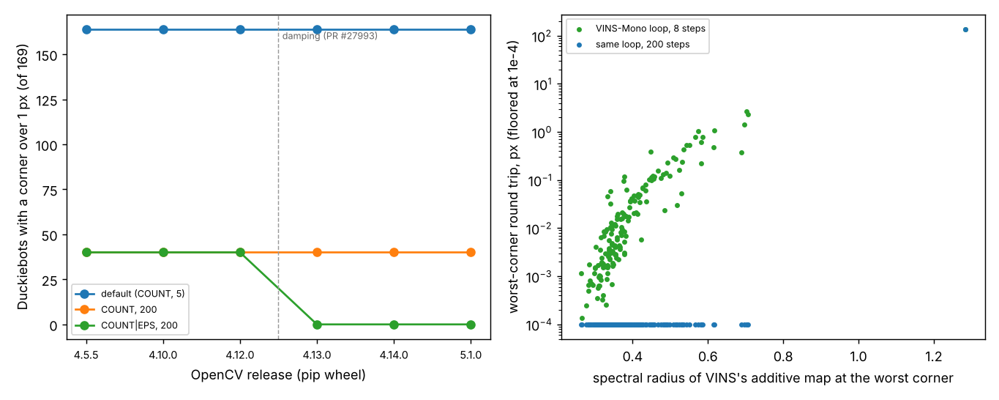

**Milestone 3zg headline** (why does OpenCV's `undistortPoints` stall at wide-lens image corners?): **because OpenCV damps its
fixed-point iteration only when the criterion carries the EPS flag, and its default criterion does not.** A NumPy port of the loop in OpenCV
5.1.0 (`modules/geometry/src/pinhole.cpp`) reproduces `cv2.undistortPoints` exactly (difference 0.0 at the corners of 179 calibrations under 13
criteria). Without the EPS flag no step is ever rejected, so the loop is plain fixed-point iteration, and it cannot converge where the spectral
radius of its 2-D map at the answer reaches 1: that happens at a corner of 35 of 169 Duckietown robots. Post hoc, that radius separates the
corners completely (all 53 with &rho; &ge; 1 stall over 1 px; all 569 with &rho; &lt; 0.9 converge within 0.01 px). Over the whole image the
default criterion is off by more than 1 px on a median 5.7% of pixels, an outer ring. Fix: pass
`criteria=(cv2.TERM_CRITERIA_COUNT | cv2.TERM_CRITERIA_EPS, n, eps)`; a bigger count alone does not help. Four of five predictions held
(the radial-only slope missed 10 corners where tangential terms matter). The port, `experiments/m3zg_loop/loop.py`, keeps OpenCV's license
(Apache-2.0, original notice in its header), not MIT. [Log](LOG.md).

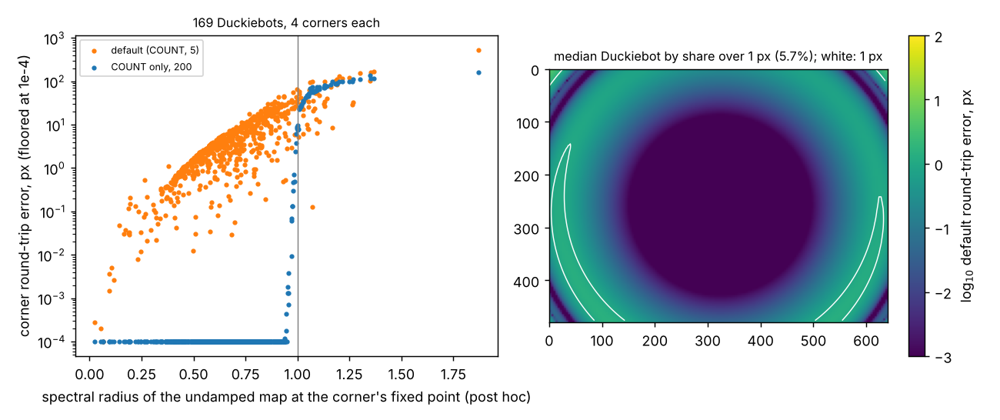

**Milestone 3zf headline** (do deployed robots' camera calibrations fold inside the image, and does OpenCV undistort their corners?):
**they do not fold, but OpenCV's default `undistortPoints` misses their corners by about 10 px.** Over 179 distinct ROS `camera_info`
calibrations (169 Duckietown robots with a 160&deg; lens and ROS's two-term fit, 9 Baidu Apollo vehicle cameras, a Duckiedrone), none of the
169 Duckiebots folds inside its image, yet `cv2.undistortPoints` &rarr; `cv2.projectPoints` at the image corners is off by a median **10.2 px**
(164 of 169 over 1 px, worst 526 px) with OpenCV's default criterion (5 iterations). Raising the count alone leaves 40 still over 1 px at 200;
passing `criteria=(cv2.TERM_CRITERIA_COUNT | cv2.TERM_CRITERIA_EPS, 200, 1e-12)` closes every non-folding model to **0.01 px**, and then
the round trip flags the two that do fold: KITTI's raw camera 3 (as shipped in Apollo, 748 px fold against a 753 px corner) and a
Duckiedrone, both **three-term** models. Corner errors are the worst case; one OpenCV version (5.1.0). Two of six predictions held. [Log](LOG.md).

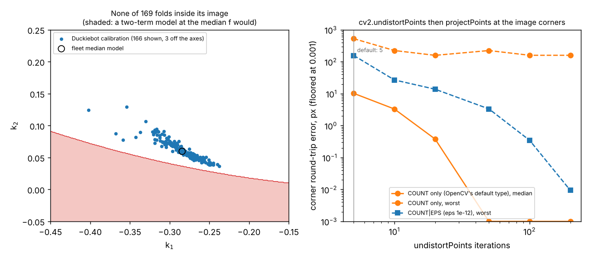

**Milestone 3ze headline** (do the camera calibrations that ship with open-source SLAM and VIO systems fold inside their own image?):
**no, none of 14.** Across 55 example configs of ORB-SLAM2/3, VINS-Mono/Fusion, OpenVINS and Kimera-VIO (70 cameras; 14 distinct non-zero
pinhole radial-tangential calibrations: TUM RGB-D, EuRoC, KAIST, RealSense and the authors' rigs), no radial model folds before its image
corner, and OpenCV's `undistortPoints` &rarr; `projectPoints` round trip at the four corners is within 0.13 px on every one. On this project's
own two-term Kinect board fit, which folds at 381 px against a 416 px corner, the same round trip is off by up to 38 px, silently. So the
fold is a guard for one's own two-term fits of strongly distorted lenses, and a corner round trip catches it with no new code. One of four
predictions held, two untestable. [Log](LOG.md).

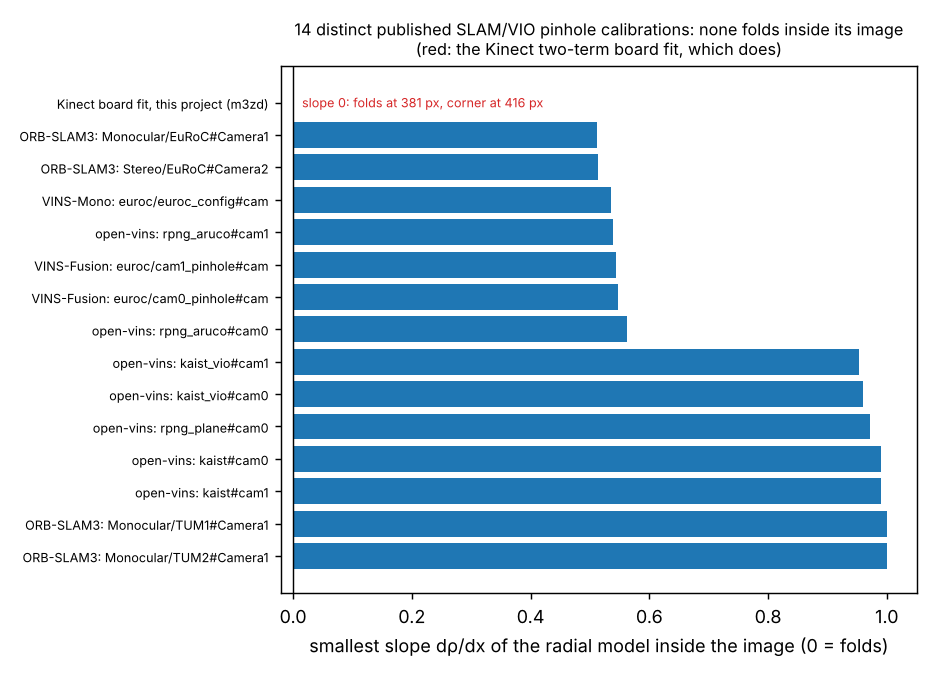

**Milestone 3zd headline** (does "update the focal length, keep the held lens distortion" survive at the image edge, 250&ndash;400 px?):
**only if the held distortion is valid out to the corner.** Against TUM's calibration, the one reference that does not fold before the
corner on either camera, the Kinect's two-term board and target-free distortions (folding at 381 and 403 px) sit 14&ndash;17 px off across
250&ndash;400 px, and adopting the self-calibrated windows' distortion with their f (it folds inside the image in none of 31 blocks) cuts that
to 5.5 px; with TUM's model held, or on the Xtion, an f-only rule still wins (f-only minimax in 7 of 9 Xtion pairs). So check the held
model's fold radius against the image corner before holding it. Two of five predictions held; analysis of saved solves only. [Log](LOG.md).

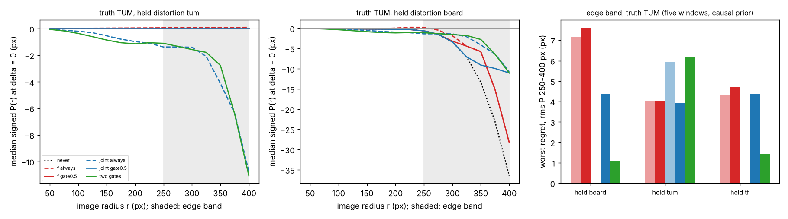

**Milestone 3zc headline** (can a self-calibrating robot camera gate its lens-distortion update once the natural-feature windows'
distortion bias is corrected?): **no; keep the held distortion and do not gate it.** The windows' distortion at 200 px is
**1.37 px** low on the Kinect and **0.71 px** low on the Xtion, so a bias learnt on another camera moves the test by the wrong amount
(the gate still fires in 24 of 31 blocks when the held distortion is right; worst regret 1.00 px against 0.48 for f-only gate(0.5)), and a
correction from the unit's own commissioning history still fires in 23 of 31, because a half-sd bar sits at the median of the noise even
with the bias removed exactly. Widened post hoc to 2 sd, the commissioning detector fires in 5 of 31 blocks and still costs 0.67 px against
0.48. One of five predictions held (the corrected gate does see a 50% distortion error: 27&ndash;29 of 31); analysis of saved solves only. [Log](LOG.md).

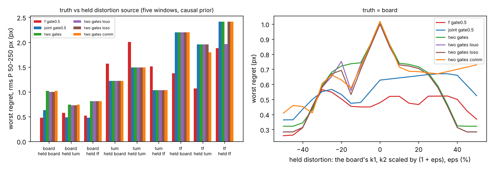

**Milestone 3zb headline** (what if the lens distortion a robot camera holds is itself wrong: does adopting the self-calibrated
distortion then pay?): **no, not inside 250 px.** Held distortions taken from the camera's other real calibrations move rays by only
**0.2&ndash;0.5 px** rms over 50&ndash;250 px, and even the board's k<sub>1</sub>, k<sub>2</sub> off by **50%** cost 1.5 px, less than the
**2.1 px** left by adopting the natural-feature windows' focal length and distortion together. "Adopt f behind the half-sd gate, keep the held distortion" stays minimax at 15
of 21 points of a &plusmn;50% distortion-error sweep (worst regret 0.26&ndash;0.56 px); which rule wins between it and the joint update is
decided by which reference is called the truth, not by the held distortion. A second gate on the distortion fires in 30 of 31 blocks even
when the held distortion is right, because of the windows' low bias. One of five predictions held; analysis of saved solves only. [Log](LOG.md).

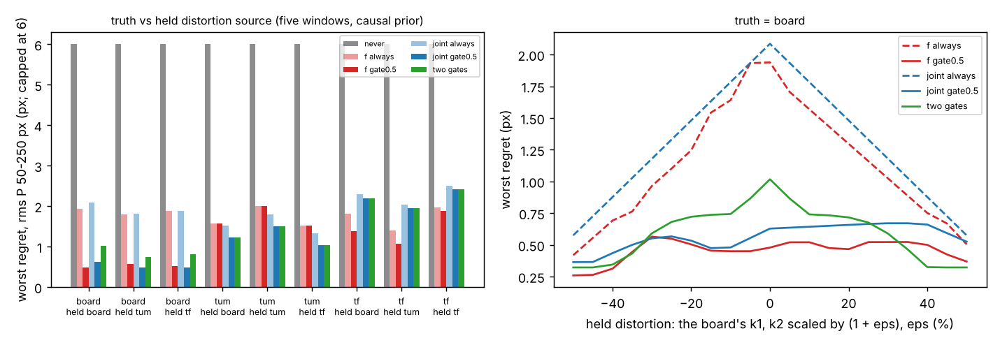

**Milestone 3za headline** (when a robot camera adopts its self-calibrated focal length, should it adopt the self-calibrated lens
distortion with it? five update rules scored by where rays land, the projected-radius error over 50&ndash;250 px): **keep the held
distortion; the choice is worth under 1 px either way.** "Adopt the windows' f when it is more than half an sd from the held value, keep
the target-calibrated distortion" is minimax at five windows (worst regret **0.48 px**, against 0.63 for adopting the distortion too, 1.94
and 2.09 for adopting without a gate, and **14.2 px** for never updating). Which of the two wins flips with the recording (fr1/desk favours
the joint update by 0.76 px, fr1/xyz the f-only one by 0.85), the reference and the window count (joint in 23 of 36 cells, by a median
0.14 px), so milestone 3z's f&ndash;distortion cancellation is not something a robot can rely on. Updating a held f pays once it is more
than **1.5%** stale. One of six predictions held; analysis of saved solves only. [Log](LOG.md).

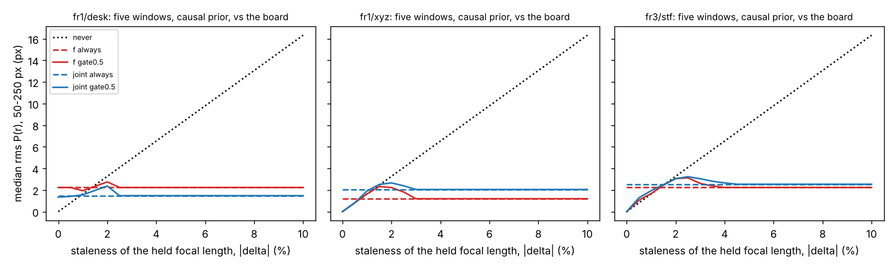

**Milestone 3z headline** (is the natural-feature windows' "distortion bias" a real error in where a ray lands, or the focal length and
the distortion trading off? a radius sweep of the projected radius P(r) against the distortion term, with the solver's 5&times;5 covariance):
**on the Kinect, mostly a model-term artefact; on the Xtion, a focal-length error.** At the median the Kinect windows put a ray within
**1 px of the board out to 250 px** from the centre (and within 0.7 px of TUM's calibration out to 300 px), though their distortion term
alone is 1.4 px low there. On the Xtion P(r)/r is a near-constant **+2.4&ndash;2.8%**: the rays land too far out because f is long, not
because of the lens. Per window, focal scatter still moves a ray 2&ndash;3 px at 200 px, and the solver's own bar is **about nine times too
narrow at every radius** (rms z 9.3&ndash;9.6). Side finding: the board's two-term fr1 model folds back at **381 px**, inside the 416 px
corner, so it is no reference at the edge. For practitioners: score self-calibration by where rays land, not by k<sub>1</sub>, k<sub>2</sub>;
check a reference distortion for monotonicity before using it at the image edge. Three of seven predictions held; analysis of saved solves
only. [Log](LOG.md).

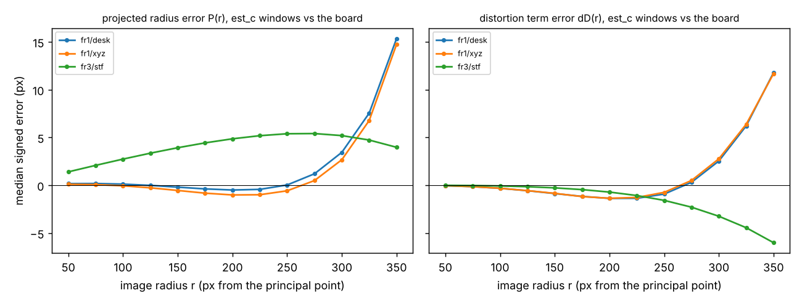

**Milestone 3y headline** (does the focal-length update rule carry over to the principal point and the lens distortion? the same
eight rules on TUM's saved windows, scored in pixels, with an error bar from window scatter): **only for c<sub>y</sub>.** "Adopt unless
within 0.5 sd" is minimax for c<sub>y</sub> against all three references (worst regret **2.04 px** at five windows, always-adopt 2.89) and is
chosen in every leave-one-sequence-out fold, because the pools sit on the board (within 1.3 px per sequence). The **radial distortion**
is biased: at 200 px from the centre every sequence, on both cameras, puts the displacement **0.6&ndash;1.7 px below every reference**
(fr1's is 4.1 px), with a bar five times too narrow (rms z 5.5), with or without the causal prior. The Xtion's **c<sub>x</sub>** pools
are 16 px from the board and TUM's value, and the references disagree by 12 px. So the best rule for both is to keep the held value
("never" is minimax up to the grid's 10 px and 2 px edges). For a field robot: self-calibrate f and c<sub>y</sub>, hold c<sub>x</sub>
and the distortion from a target calibration. The scatter-only bar reproduces 3w on f (gate(0.5), 0.38 against 0.42). Three of seven
predictions held; analysis of saved solves only. [Log](LOG.md).

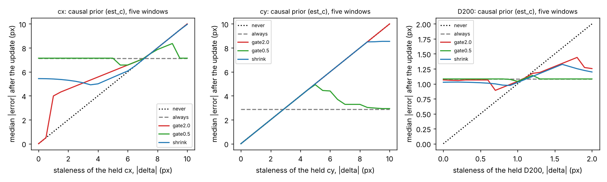

**Milestone 3x headline** (is milestone 3w's update rule an artefact of scoring it on the data that picked it? leave-one-sequence-out
on the three TUM sequences): **no; chosen without the held-out sequence, "adopt unless within 0.5 sd" is picked in all three folds**,
including a fold that tunes it on the Kinect alone and scores it on the Xtion (worst regret **0.55** points against always-adopt's
1.38 and the 2-sd gate's 4.61). Pooled out of sample it keeps 0.42 against always's 1.17. Per recording the margin is thin: it ties
always-adopt on fr1/desk, loses by 0.07 on fr1/xyz, and on fr1/desk the 2-sd gate does better. Across all 36 model, window-count and
reference cells the out-of-sample rule beats the symmetric 2-sd gate in 36 and always-adopt in 32; against the TUM and target-free
references the folds do not agree on one rule. Four of six predictions held; analysis of saved solves only. [Log](LOG.md).

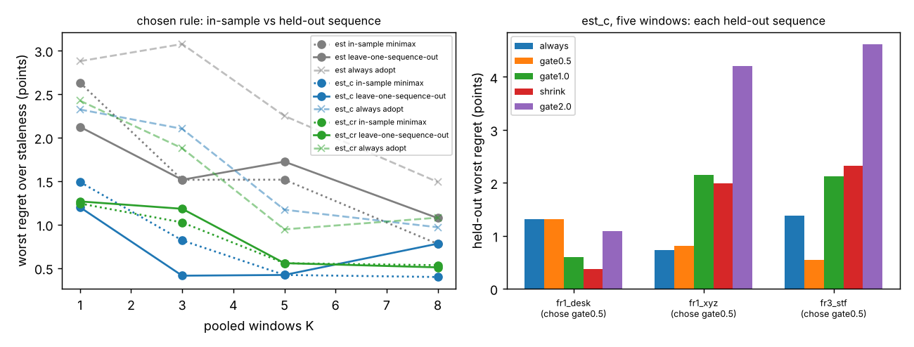

**Milestone 3w headline** (once self-calibration says the held focal length may be stale, which rule should a robot camera use to
update it? milestone 3v's blocks, eight rules scored by the error they leave over 0 to 10% staleness): **adopt the pool unless it lies
within half a standard deviation of the held value.** With five pooled windows and the causal prior that rule's worst-case regret
against the better of "always adopt" and "never adopt" is **0.42** points, against always-adopt's 1.17 and milestone 3v's 2-sd gate's
**3.33**, and it is minimax against all three references; a right calibration is kept exactly (median error 0.0%). With one to three
windows the positive-part empirical-Bayes blend is the safer rule (worst regret 0.82 at three windows, 1.49 at one). The cost is a
heavier tail (95th percentile 4.0% against 2.9%), and both rules were picked on the data they are scored on. Four of seven
predictions held; analysis of saved solves only. [Log](LOG.md).

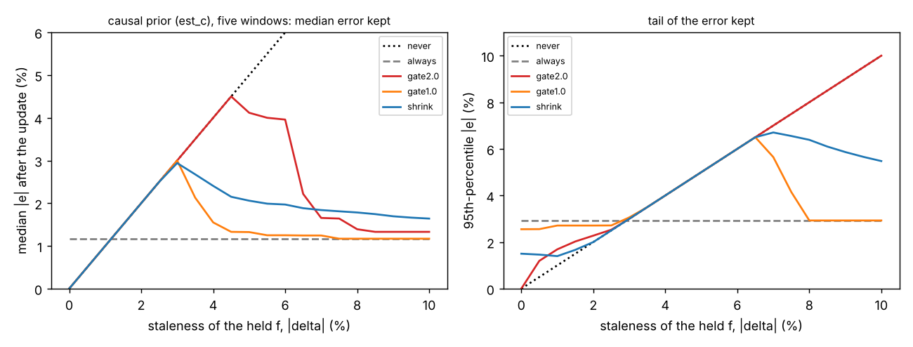

**Milestone 3v headline** (can a robot camera tell, from pooled self-calibrations, that the focal length it holds has gone stale?
milestone 3s's 43 TUM windows, the board calibration shifted by 0 to 10%, and milestone 3u's floored random-effects pool as a 2-sd
change test): **an honest bar is too wide to see small staleness.** With the causal prior the gate raises few false alarms (3% of
five-window blocks) but needs about **7&ndash;10%** staleness to fire four times in five (8.5% at five windows, 7% at eight), and
catches 5% staleness only **46%** of the time at three windows. Keeping the held value until the gate fires leaves a median error up
to **4.5%**, where simply adopting the five-window pool is 1.17% from the board. The gate earns its keep the other way round: when
the held value is right it refuses the outlier pools (95th-percentile error 1.69% against 2.93%). A floor from prior-steadied windows
alone did not fix 3u's conservative long pools. Three of eight predictions held; analysis of saved solves only. [Log](LOG.md).

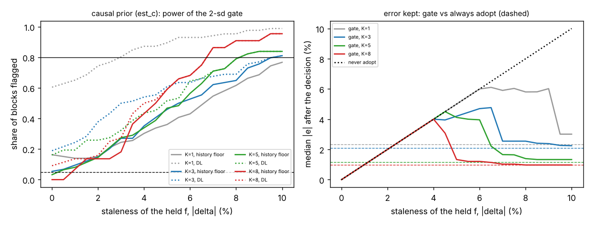

**Milestone 3u headline** (how should a robot camera put an error bar on two or three pooled self-calibrations, where the
block alone cannot estimate the between-window spread? milestone 3s's 43 TUM windows, a floor on &tau; learned from the camera's
*own earlier* windows): **floor &tau; at the scatter the camera has already seen.** With the causal prior, three-window random-effects pools go
from overconfident (rms z **2.67**, worst block **11.0** sd) to honest (**1.09**, worst **3.2**) with no change in accuracy (five windows
still 1.17% from the board); the history floor (about 3% of f) beats a fixed 1%-of-f floor at three windows (1.33), fixes the recursive
memory's pools too (2.36 &rarr; 0.99), and gives a single 1.2 s window a usable bar (rms z 10.1 &rarr; 1.84). It is a little
conservative from eight windows up (0.66). All eight predictions held; analysis of saved solves only. [Log](LOG.md).

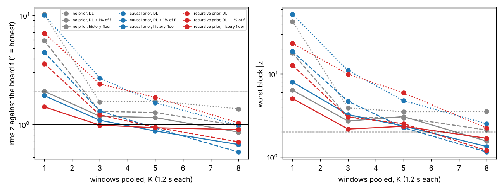

**Milestone 3t headline** (once a causal prior steadies each window, does pooling windows still give an honest error bar on
the focal length, and how many windows does it take? milestone 3s's 43 TUM windows, pooled in blocks of 1 to 8): **pooling and the
prior are complements.** Five pooled windows with the causal prior land a median **1.17%** from the board's focal length against
**2.20%** without it, and reach 2% at five windows instead of eight; the DerSimonian&ndash;Laird random-effects bar stays about as
honest (rms z 1.58 against 1.65), while inverse-variance pooling on the solver's sd is off by 15&times;. The predicted cost shows only in
three-window pools, where prior-steadied windows that agree with each other get &tau; = 0 and an 11-sd miss (rms z 2.67); Hartung&ndash;Knapp
does not rescue them. Seven of eight predictions held; analysis of saved solves only. [Log](LOG.md).

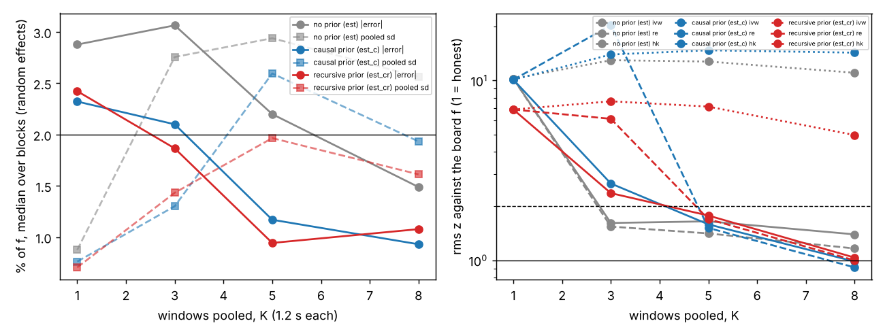

**Milestone 3s headline** (can a robot camera use only its *past* self-calibrations as a prior? 53 real TUM windows in
recording order, a soft prior on k<sub>1</sub> and the principal point from the camera's *earlier* windows only, starting after
five): **yes.** The pooled median focal error falls from **2.88% to 2.32%** (lower in 30 of 43 windows, paired Wilcoxon p = 0.0006),
the scatter by a quarter to a half, windows more than 10% wrong from 9 to 4, and the median focal length moves under 0.7%: about
two thirds of milestone 3r's leave-one-out gain, without looking ahead. Five earlier windows already help. Updating the memory
from the prior-steadied estimates shrinks the prior to a near-pin on k<sub>1</sub> within ten windows; here that cost nothing
(2.42%) and cut the 10%-wrong windows to 2, but it is a pin learned from the first five windows. All eight predictions held. [Log](LOG.md).

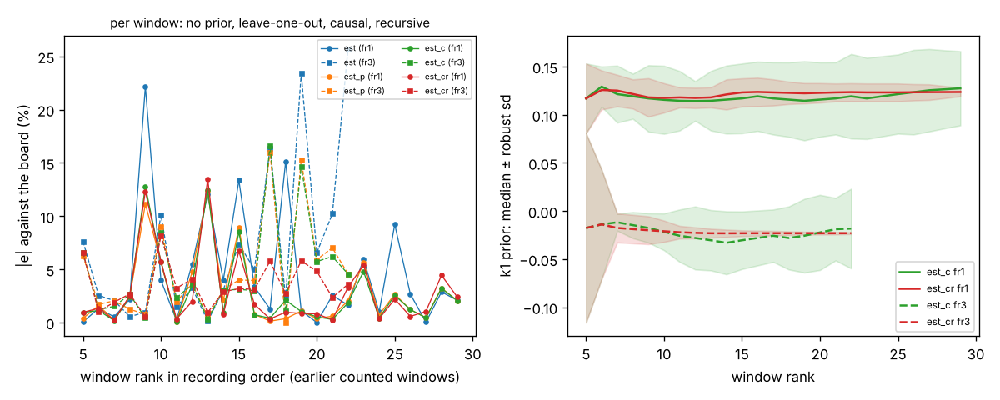

**Milestone 3r headline** (can a robot camera's memory of its own earlier self-calibrations steady the next one? 53 real TUM
windows, rolling-shutter model, a soft prior on k<sub>1</sub> and the principal point set to the median and spread of the same
camera's *other* windows, no target or reference value): **yes, for scatter.** The window-to-window focal scatter falls by a
quarter to a half (robust sd 2.1 &rarr; 1.6%, 6.0 &rarr; 3.3%, 6.0 &rarr; 4.1%), the pooled median focal error from **3.06% to
2.43%** (lower in 35 of 53 windows, paired Wilcoxon p = 0.002), windows more than 10% wrong from 9 to 4, and the median focal
length moves under 1%. The images barely notice (cost +0.05%). A prior from the camera's *other* recording session works as well
(median error 0.62&ndash;0.71&times;), and k<sub>1</sub> alone does all the work. It does not touch the Xtion's +2% bias. Five of
seven predictions held. [Log](LOG.md).

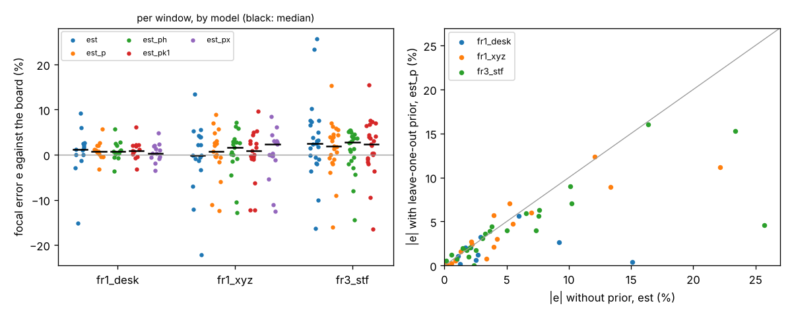

**Milestone 3q headline** (after the rolling-shutter term, is TUM's leftover focal error a bias or scatter? 53 real windows,
no new solves, scored against three calibrations of the same cameras): **scatter, not bias, on the Kinect.** The windows' median
focal length (524.1 px on fr1/desk, 517.9 on fr1/xyz) sits inside the 1.6% that the board, the dataset authors' published
calibration and a target-free anchor disagree by, while single windows scatter by a robust 2&ndash;6%. Where a window lands tracks
its own k<sub>1</sub> (Spearman +0.58 on the Kinect, +0.44 to +0.72 within each sequence) and its principal point (+0.42), much
more than its solver sd (+0.29), and a k<sub>1</sub> correction learned on one session helps the other in only one direction
(ratio 0.54 one way, 1.66 the other). The Xtion's median stays 1.3&ndash;2.5% high against every reference. Four of seven
predictions held. [Log](LOG.md).

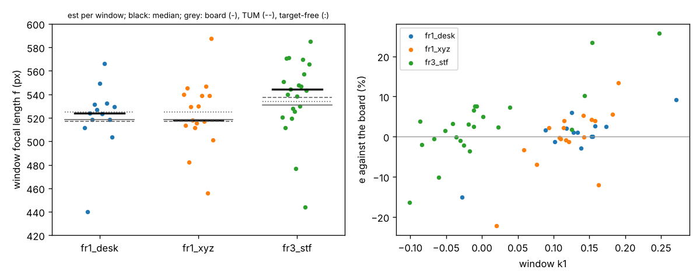

**Milestone 3p headline** (what is left of TUM's focal error after the rolling-shutter term: the camera's translation, or a
timing offset? the real TUM RGB-D video, 53 windows, with the motion-capture linear velocity entered as a known input and the
mocap&ndash;camera offset free): **neither moves the focal length, but the offset is real.** The true velocity fits the images
slightly better than none (lower cost in 26 of 30 Kinect windows) and better than another window's velocity (23 of 28), yet the
focal error does not change by a detectable amount (paired Wilcoxon p = 0.44; median change &minus;0.05 pp). The camera's image
stamps run a median **5.1 ms** behind the motion they show (positive in 46 of 53 windows, sign test p = 4e-8; 6.0 / 5.4 / 4.0 ms
by sequence, window-to-window spread 3&ndash;5 ms against a claimed 0.2&ndash;0.7 ms), and the velocity is not needed to find it
(0.55 ms difference), unlike milestone 3o's synthetic windows. Three of six predictions held. [Log](LOG.md).

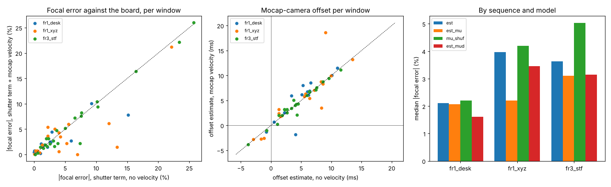

**Milestone 3o headline** (can the same 1.2 s window also estimate the gyro&ndash;camera time offset, the next unknown on TUM?
synthetic, milestone 3m's 30 smooth-rate windows, gyro 200 Hz and &minus;10 to +20 ms late, offset free from 0): **it removes the
offset's focal error, but the offset value is biased unless translation is modelled.** With the offset free, a 20 ms late gyro moves
f a median 0.05% instead of 0.81%, the readout stays at 33.0 ms (true 33.3), and nothing is lost when there is no offset. The offset
itself lands a median 3 ms off while the solver claims 0.46 ms: a post hoc check traces all of it to the camera's linear velocity,
which the model leaves out (no noise at all: still 3.0 ms; velocity removed: 0.0 ms; velocity solved for: 0.49 ms with an honest sd).
Four of six predictions held. [Log](LOG.md).

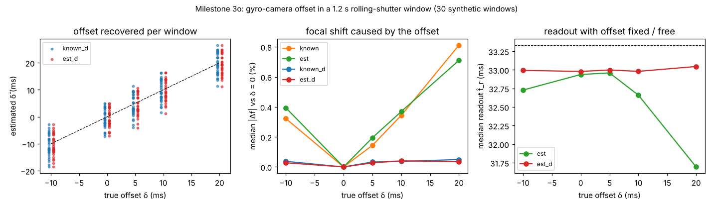

**Milestone 3n headline** (is a rolling shutter what TUM's short self-calibration windows were getting wrong? the real TUM RGB-D
video, each 1.2 s window re-solved with a rolling-shutter term driven by per-keyframe angular rates from the 100 Hz motion capture,
readout free): **yes, in part, on both cameras.** The window finds a readout of **27.6 ms** on the Kinect (31 windows, robust sd
4.0 ms) and **25.9 ms** on the Xtion (23 windows), positive (top to bottom) in all 54 windows, while rates taken from the wrong time
give about 0 ms and never fit as well (51 of 51). The median focal error against the board calibration falls from 2.87% to 1.88%
(fr1/desk), 5.00% to 3.96% (fr1/xyz) and 7.56% to **3.63%** (fr3, the slow Xtion sequence, which a mean-rate bound had said the
shutter could not explain). The Xtion's readout depends on how the mocap rate is differenced (19&ndash;36 ms), the Kinect's much
less (25&ndash;30 ms); a free linear velocity did not converge. Four of five predictions held. [Log](LOG.md).

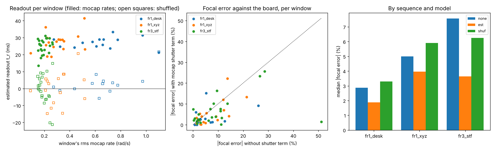

**Milestone 3m headline** (does that gyro fix survive a wrong gyro? the same windows with the gyro rotated 1&ndash;10&deg; off the
camera, scaled 2&ndash;5% or 2&ndash;20 ms late): **misalignment and timing are forgiving; a wrong readout is not.** Against the same
window with an exact gyro, a 3&deg; camera&ndash;IMU rotation moves f a median 0.15% and 10&deg; 0.42%; a 5 ms time offset 0.14%,
10 ms 0.35%, 20 ms 0.83%, all below the 1.1% the window's own noise leaves. A gyro scale 5% high with the readout held at its true
value moves f by 1.23%, negative in all 30 windows (2%: 0.50%); since the model sees only rate &times; readout, that is also the cost of a
readout taken 5% too long, and it is a bias, so pooling windows will not average it out. With the readout left free, the scale error
is absorbed to 1e-10, and the free readout also shrinks the misalignment's shift (10&deg;: 0.29%). So: estimate the readout in the
window, align the gyro to a few degrees, sync it within 10 ms. Four of six predictions held. [Log](LOG.md).

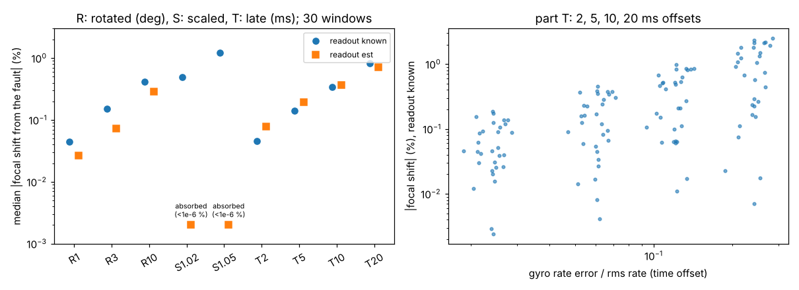

**Milestone 3l headline** (can a robot undo the rolling-shutter error with the gyro it already carries? milestone 3k's synthetic
windows re-solved with a rolling-shutter term driven by per-keyframe gyro rates): **mostly, and one 1.2 s window measures the
readout time itself.** With random hand-held rates of 0.3 rad/s per axis and a 1/30 s readout, the gyro term cuts the median focal
shift from 4.17% to 1.14% (0.27&times;, just short of the pre-registered 0.25&times;), and to 0.71% with a free linear velocity per
keyframe; noise-free, the full model recovers f to 1e-8, so what is left is pixel noise on a larger model, not bias. Left free, the
readout comes back at 33.4 ms (median error 3.6%, sd 0.23 ms) at no cost in f, and on global-shutter data it stays within
&plusmn;0.4 ms of zero in all 30 windows. A 1 or 5 &deg;/s gyro bias changes nothing. At 1 rad/s hand-held, where the plain solve
diverged in 9 of 30 windows, the gyro solve converges in all 30 (median 1.0%). One trap: a constant pitch rate makes the readout
and the focal length trade off (estimated readout 24 ms, 27% off), so a calibration manoeuvre should not be a steady tilt. Five of
six predictions held. [Log](LOG.md).

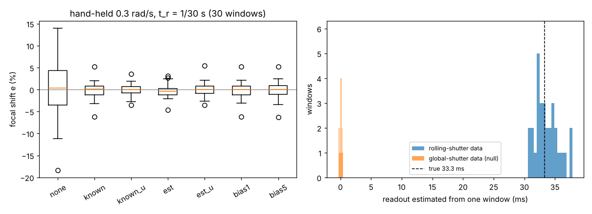

**Milestone 3k headline** (could a rolling shutter be what a 1.2 s natural-feature window's focal length compensates? synthetic
windows rendered through a rolling-shutter camera and solved with this project's global-shutter bundle adjustment): **it could, and
the window's mean rotation rate cannot rule it out.** With random hand-held rates of 0.3 rad/s per axis and a 1/30 s readout the
focal length shifts a median 4.2% (TUM's observed error is 5.25%); 1% at 0.1 rad/s. Pitch and yaw both move f by about 1.3&times;
the rotation during readout, amplified about 5&times; over a simple stretch model, with a sign set by each window's geometry
(&minus;9% to +11% across seeds at 1 rad/s pitch), so the mean rate does not predict the shift (R<sup>2</sup> 0.03) and a mean-rate
bound on the TUM windows (median 0.5%) is not a bound. The shift is 4&ndash;39 times the solver's own sd. Two of five predictions
held. Settling it needs TUM's 100 Hz motion capture and a rolling-shutter term in the model. [Log](LOG.md).

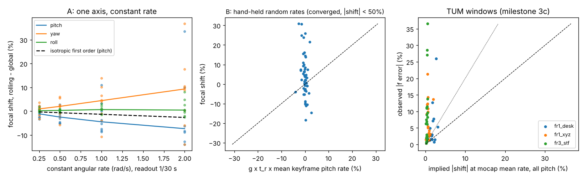

**Milestone 3j headline** (do the first-order verdicts of milestones 3g and 3i survive a real re-solve? each of the 57 TUM RGB-D
natural-feature windows re-solved by bundle adjustment with the board's distortion, principal point or both pinned): **yes, and
the distortion verdict is sharper.** Pinning the board's k<sub>1</sub>, k<sub>2</sub> doubles the median focal error (5.25% to
10.5%; fr1/xyz 18%) and leaves f above the board's in 52 of 53 windows; the principal point alone is mildly worse (5.87%; it helps
fr3/stf, 7.2% to 5.9%, and hurts both fr1 sequences); all four 10.7%. First order gets the size about right (median re-solved/predicted
step 0.91, 1.01, 0.87) but the direction wrong in a quarter of the distortion re-solves (sign agreement 74%; on board windows 99%).
Rule for a robot: in a short natural-feature window, do not import the board's distortion. Five of six predictions held.
[Log](LOG.md).

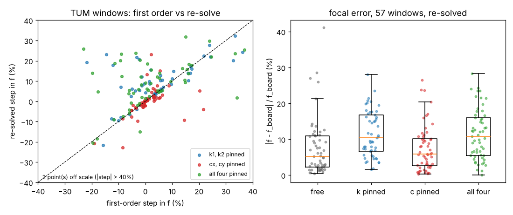

**Milestone 3i headline** (is the principal point what a short natural-feature window's focal length compensates? the
board's (c<sub>x</sub>, c<sub>y</sub>) pinned, first order on the 57 TUM RGB-D windows and re-solved on milestone 3h's 149 board windows):
**no.** On the TUM windows pinning the board's principal point raises the median focal error from 5.25% to 6.76% (with the
distortion pinned too, 7.17%), and the step it makes is barely related to the error it should correct (Spearman &minus;0.22).
The windows' principal points sit up to 33 px from the board's (fr1/xyz c<sub>y</sub>), but f hardly leans on them (correlation
&minus;0.1 to &minus;0.3). On clean board windows the same pin, re-solved, does help (0.55% to 0.37%), and the first-order step
matches the re-solve (ratio 1.02). With milestones 3f&ndash;3h this rules out, at first order, the board's static intrinsics as a fix; the rolling
shutter, the motion and track bias remain. Three of seven predictions held.

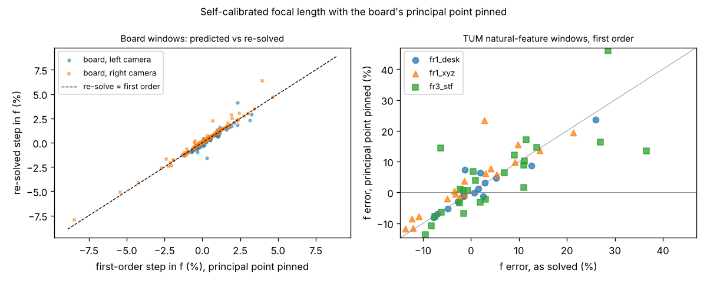

**Milestone 3h headline** (milestones 3f and 3g predicted to first order where a window's focal length moves when its
lens distortion is pinned; is that prediction what the re-solve gives? checked on the real OpenCV stereo images, where the
pinned bundle adjustment can be run, 149 windows of 4&ndash;8 views, 1043 pinned re-solves): **yes in direction, and in size
up to a few percent, but it overshoots large steps.** The re-solved step is 0.97 of the predicted one at the board's
distortion (sign agreed in 99% of windows), 0.85 at 2&ndash;5% of f and 0.74 at 5&ndash;10%; the narrowed error bar is real (re-solved
sd ratio 0.976 against 0.962 predicted). Shrinking milestone 3g's TUM steps by that overshoot (post hoc) still leaves the
board prior worse than none (median 7.1% against 5.25%; fr1/xyz +10%), and even on clean board windows pinning the
board's distortion moves f slightly away from Zhang's (0.55% to 0.65%). Four of five predictions held.

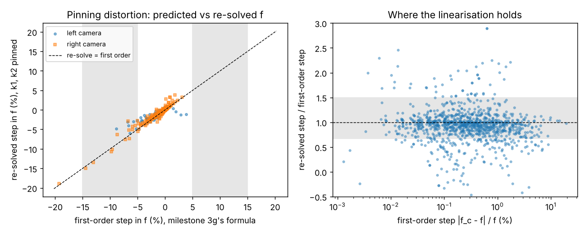

**Milestone 3g headline** (does pinning *both* distortion terms at a past board calibration fix natural-feature
self-calibration's focal error? first-order conditioning of the same 57 TUM RGB-D window solves on k<sub>1</sub> and
k<sub>2</sub> together, using the full covariances milestone 3b stored): **no; it is worse than pinning one term, which was
worse than pinning none.** The median focal error rises from 5.25% to 8.72% (fr1/xyz +12.9%), every sequence's f is pushed
up, and the conditional error bar shrinks by about 40%, so five pooled windows are confidently wrong (rms z 3.07 against
1.10). Milestone 3f's rule "pin the prior whole" does not survive; leave distortion free in short windows and pool. One of
five predictions held; the re-solve (milestone 3h) waits for the TUM host.

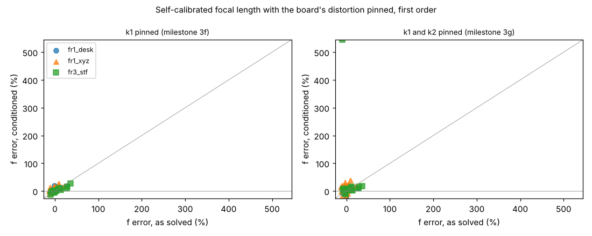

**Milestone 3f headline** (if a robot already knows its lens distortion from a past calibration, does pinning k<sub>1</sub> fix
natural-feature self-calibration's focal error? first-order conditioning of milestone 3c's 57 stored TUM RGB-D window solves):
**no; pin the whole distortion model or none of it.** A window's k<sub>1</sub> does track its focal error (Spearman +0.59),
but conditioning f on the board's k<sub>1</sub> with k<sub>2</sub> left free raises the median error from 5.25% to 7.01%, and to
+12.4% on fr1/xyz, because the windows and the board agree on the distortion curve over the inner image (within 1% out
to r = 0.4) and only split it differently between k<sub>1</sub> and k<sub>2</sub>. On the nearly undistorted fr3 camera it
helps (five pooled windows 2.36% to 1.43% off). Two of four predictions held; the re-solve with both terms pinned
waits for the TUM host.

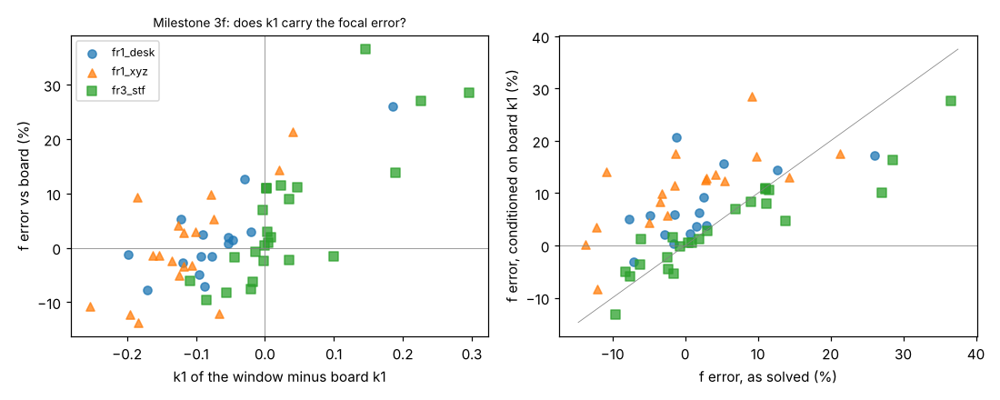

**Milestone 3e headline** (can a robot tell from its own solve which 1.2 s video windows are near-critical for focal
length, by how far the camera's optical axis swings? re-solves of milestone 3c's 57 TUM RGB-D windows): **no; the swing
is measurable but it does not predict the error.** The solved poses read the axis swing as well as motion capture does
(Spearman 0.98), but the swing is smallest on fr3/stf (4.7&deg;, a sequence that pools well), not on the biased fr1/xyz
(8.3&deg;), and against a window's focal error its Spearman is +0.08. A gate on it drops good fr3/stf windows and leaves
the error unchanged (5.30% against 5.25%). One of five pre-registered predictions held (H139); pooling by random effects
(milestone 3d) remains the rule, and distortion, not motion, is the next suspect.

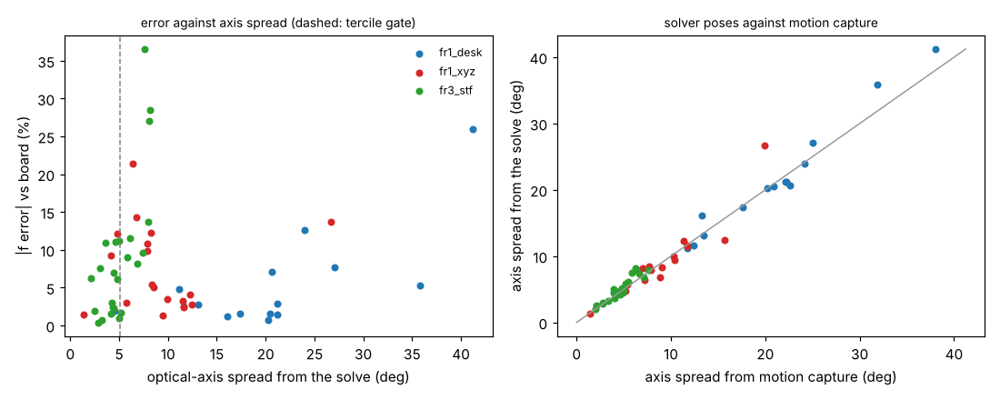

**Milestone 3d headline** (how many 1.2 s natural-feature windows must a robot pool to know f to 2%, and which pooled
error bar is honest? analysis of milestone 3c's 57 windows): **about eight windows, pooled by random effects.** Treating
windows as independent (inverse-variance) overstates precision (rms z 2.79 over five-window blocks, worse as more are
added); a DerSimonian&ndash;Laird random-effects pool stays honest (rms z 1.10 at five windows, 0.89 at eight). Five
windows (6 s) still leave f a median 2.2&ndash;2.5% off with a 3.3% sd; eight bring it to 1.4% with a 2.5% sd, except on
the near-critical fr1/xyz (2.8%). A gate on rotation does not pick out fr1/xyz. Two of five pre-registered predictions held.

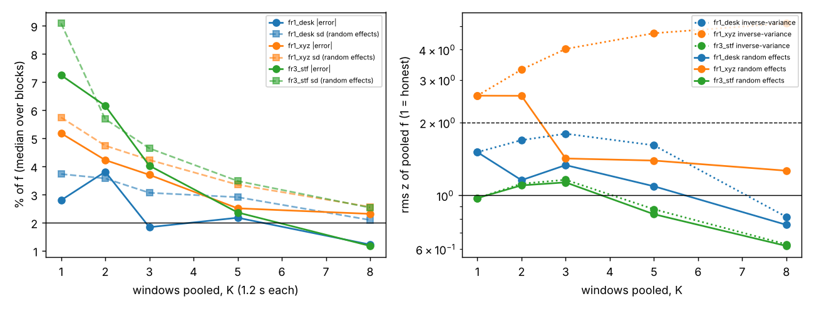

**Milestone 3c headline** (natural features again: can the robot get an *honest* error bar on f from one 1.2 s
window of video, where milestone 3b's solver sd was 4&ndash;12&times; too small? same 65 TUM RGB-D windows): **yes, by
re-solving with each keyframe left out, and the honest bar is wide.** A delete-one-keyframe jackknife (12 warm-started
re-solves per window) gives rms z 1.76 against the board calibration over 57 windows (solver 9.31) and 89% 2-sd
coverage (solver 18%), and its median sd matches the real scatter across windows in every sequence (0.9&ndash;1.6&times;).
A sandwich clustered by track does not fix it (rms z 6.6) and residuals barely correlate along tracks, so the missing
error enters per keyframe, not per feature. But the honest sd is a median 6.4% of f and only 9% of windows reach 2%, and
on the near-critical translation-only sequence (fr1/xyz) the jackknife is still too small (rms z 2.58). Two of six
pre-registered predictions held (H124, H126).

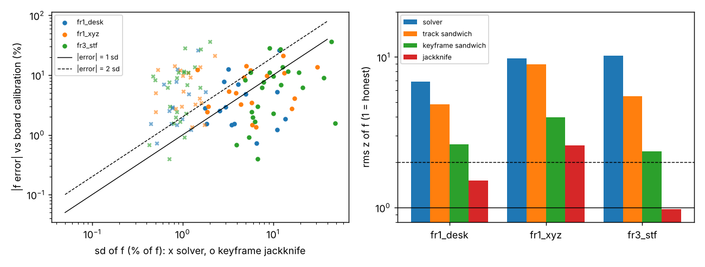

**Milestone 4u headline** (if the update test centres its "too far to judge" window on the camera's own current
calibration instead of the spec-sheet focal length, does a real change cost the same on either side? no new solves,
18 pairings of three pools on two cameras): **yes, and it stays safe.** Rule U withholds the decision when the old
7-view or the new 6-view focal length is more than 5% from the unit's own 13-view calibration; every pairing stays at
or under 1.05% false alarms (pooled 0.26%), 5.4% of unchanged-camera splits are withheld, and a 4% change is now withheld
19&ndash;22% of the time on both sides of both cameras, where the spec-sheet window withheld 11% to 71%. A &plusmn;4% change is caught
in 14.2% of splits against 11.4% (1.25&times;; the Xtion at +4%: 11.7% against 1.4%), but &plusmn;2% power is unchanged at 0.73&times;
the every-split-decided rate, so that loss is the far solves' spurious firing, not the window's placement. An out-of-sample anchor
gives the same figures. Five of six pre-registered predictions held (H122, the &plusmn;2% power, did not).

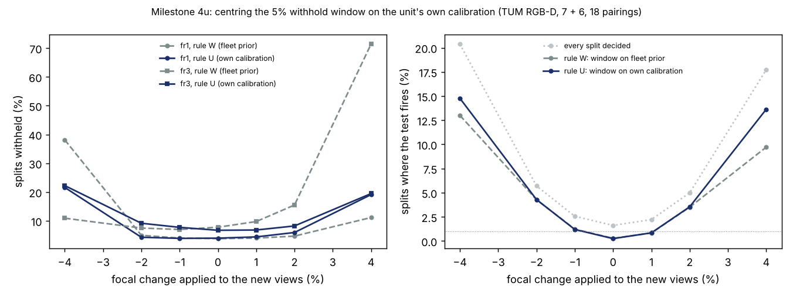

**Milestone 4t headline** (can the update test simply decline to decide when one of its small-set solves is far
from the camera's spec-sheet focal length, 527.1 px? no new solves, all 18 pairings of three pools on two cameras):
**yes for safety, at a cost in power.** Rule W withholds the decision when the old 7-view or the new 6-view focal
length is more than 5% from the fleet prior; with milestone 4r's per-view jitter in the twin, every pairing falls to
at most 1.11% false alarms (pooled 0.30%, from 1.61%; the Kinect's third pool from 7.47% to 0.32%), withholding
5.8% of unchanged-camera splits. W agrees with milestone 4s's oracle far-solve flag on 94&ndash;100% of splits but needs only
the robot's own two solves. It catches a &plusmn;2% focal change in 3.9% of splits against 5.3% when every split is
decided (0.73&times;), and on the side where a unit's f already sits away from the prior it withholds most 4% changes
(the Xtion at +4%: 71%). Three of five pre-registered predictions held (H113, H114, H116); the Kinect's AC pairing
missed the 1% bar at 1.11%.

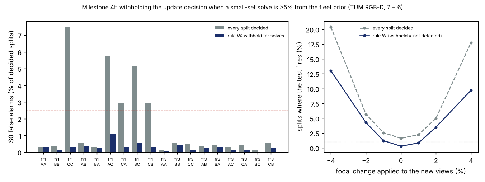

**Milestone 4s headline** (does milestone 4r's per-view focal jitter keep the update test safe on a third,
disjoint pool of 13 views per camera that played no part in suggesting it? 9,440 new solves): **on the Xtion yes,
on the Kinect no.** The Xtion's third pool stays at or below 0.53% false alarms in every pairing. The Kinect's
third pool, well tilted and with a small fitted jitter (0.77% of f), over-alarms at 2.9–7.5% whatever jitter the
twin is given (borrowing A's and B's mean, 1.31%, changes it by under 0.3 points; no jitter: 3.5–7.7%). Its
7-view solves hold 62 far solutions where pool A's hold one, an error a robust spread cannot see, so the
one-number fix fitted to that spread cannot fix it: splits holding a far solve carry 83–97% of its false alarms,
and without them the rate is 0.49% (a diagnostic added after scoring). Pooled over the ten pairings that hold the third pool:
2.60% false alarms, ±2% caught in 6.4% (0.72× the twin without jitter). The three 13-view calibrations of each
camera agree within 1.4 of the jittered twin's sd. Two of five pre-registered predictions held (H111, H112).

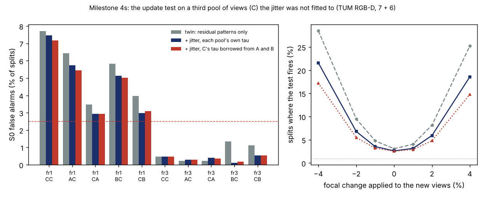

**Milestone 3b headline** (natural features: does self-calibration from SIFT tracks of ordinary video, no board in
view, still give an honest uncertainty? 65 windows of 1.2 s from three TUM RGB-D sequences, two cameras): **no.**
A single 12-keyframe window lands a median 2.8% (hand-held desk sweep) to 7.2% (sideways pass) from the board
calibration, and the solver's sd is 4–12× smaller than the real scatter of f across windows (rms z 9.3; 2-sd
coverage 11–27%), so the proposal's H5 fails, worse than the 2× milestone 3 found with board corners. Nor does the
sd grow on the near-critical, translation-only sequence (1.28× the desk's, against 2.8× the real scatter). What
works is the scatter itself: the median of 15–24 windows is within 1.5% of the board calibration on every sequence
(+0.7%, −1.4%, +1.5%; +0.2% against TUM's on the Xtion), with an across-window interval that covers it. All four
pre-registered predictions (H104–H107) were refuted.

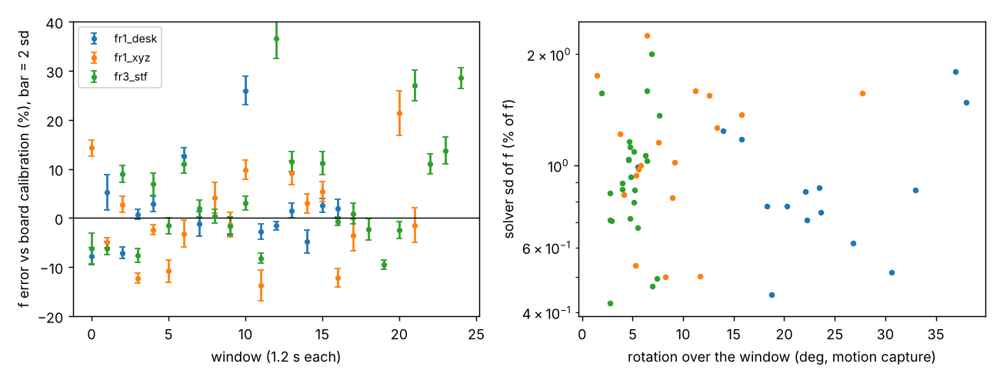

**Milestone 4r headline** (does a per-view error term make the twin's threshold safe? no new solve, milestone
4p's pools): **yes, at half the power.** Letting each view have its own effective focal length (sd &tau;, fitted per
pool from nothing but the scatter of that pool's own 6-view solves: 0.2–0.75% of f on the tilted pools, 1.8–1.9% on
the flat ones) brings every unit and pool pairing's false alarms under 0.6%, the flat Xtion pool from 4.4% to
0.58%, but the test then catches a 2% focal change in 4.1% of splits instead of 9.1%. Combined with milestone 4q's
gate, the robot tests in 15% of splits and catches 15.9% of 2% changes there at 0.3% false alarms. It also
withdraws an earlier reading: the Xtion's two 13-view calibrations differ by 1.6 of the twin's own sd, not 2.7 (that
figure used an iid sd). Three of four pre-registered predictions held (H100, H101, H103; H102, power, refuted); a
consistency check on the pools that suggested it, not a test on unseen data.

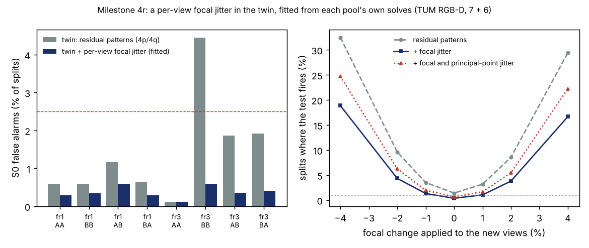

**Milestone 4q headline** (can the robot tell from the views alone when not to run the update test? no new
solve, milestone 4p's pools): **partly.** Running the test only when the unit's twin says the old and new
views can resolve a 2% focal change (twin sd of the difference at most 1% of f) raises the share of 2% changes
caught from 9.1% to 15.9% of scored splits (×1.75) and scores no split that holds a far solve; on the
Kinect's flat pool it abstains entirely instead of running a test with 2% power. It does not make the
Xtion's flat pool safe: false alarms there rise from 4.4% to 5.9% of scored splits, so milestone 4p's
explanation (far solves the linear twin cannot represent) is wrong, and the twin understates a per-view
error on that unit. One of four pre-registered predictions held (H98); the gate was checked on the pools
that suggested it, since the TUM host refused a third pool this session.

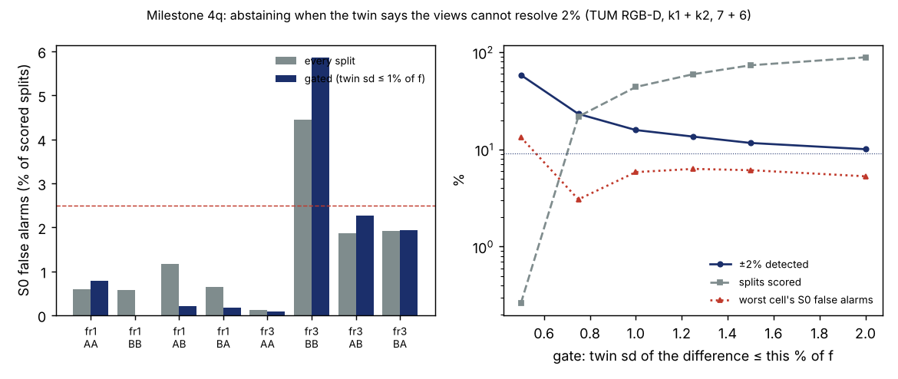

**Milestone 4p headline** (does the update test hold on views it has never seen? 13 fresh views per TUM
unit, 9,440 new solves): **its false alarms stay under the bar, but the in-sample figures were optimistic.**
With the old views from milestone 4j's 13 and the new views from a disjoint 13 of the same sequence (and the
reverse), the twin reference fires falsely on 0.9% (Kinect) and 1.9% (Xtion) of 7 + 6 splits, under the
programme's 2.5% bar but above the 0.6% and 0.1% measured in-sample, and catches a 2% focal change in 8.0%
of splits against 14.8% in-sample. The same selection rule found flatter boards the second time (median tilt
about half), and on that weaker pool alone the test loses most of its power on the Kinect (2.1%) and
over-alarms on the Xtion (4.4%): the test's safety depends on the views as well as on the threshold. Three of
four pre-registered predictions were refuted (H93–H95).

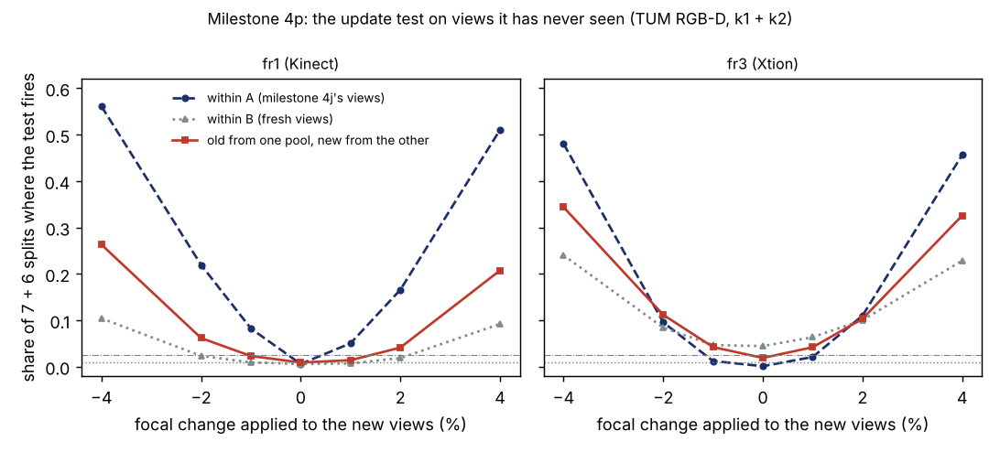

**Milestone 4o headline** (with the Kinect's lens fitted as k1 + k2, does the twin still choose good
updates, and do the gains add up? no new solve): **they multiply.** Fitting k2 and then testing the new
6-view set the unit's twin rates highest, with the old calibration held fixed, catches a 2% focal change in
17.9% of old sets on TUM's Kinect, against 6.2% for a blind pick with k1 alone (×2.86), at 0.59% false
alarms. The twin's predicted power, 1.34× too optimistic on the Kinect with k1, now matches the real rate
(0.995×), and testing only the quarter of 7 + 6 updates it rates highest catches 38.9% there. All six
pre-registered predictions (H86–H91) held. On the Xtion the twin still overstates its power 1.96×, so the
lens order explains the Kinect's gap but not every gap.

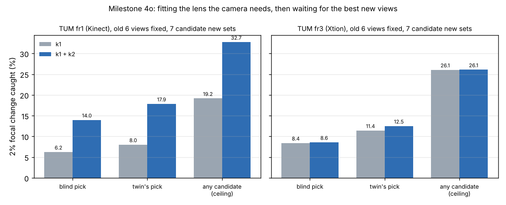

**Milestone 4n headline** (does fitting the Kinect's lens with k1 + k2 instead of k1 alone change the
update test? 9,440 new solves): **yes, it doubles the test's power on that camera.** A 2% focal change from
6 new views is caught in 19.3% of 7 + 6 splits on TUM's Kinect, against 9.8% with k1 alone, and a real
unit swap in 16–17% against 6–8%, at unchanged false alarms (0.59% against 0.76%). On the Xtion, whose
images arrive undistorted, the extra term changes nothing (power 10.3% against 10.3%, spread ×0.97). The
pre-registered expectation, a precision cost and lower power, was wrong: one of four predictions held (H84,
false alarms stay below 2.5%). The Kinect's target-free f stays 1.6% above TUM's, a bias of the free board
points, not of the lens order: flat-board Zhang on the same corners comes within 0.09% once k2 and k3 are fitted.

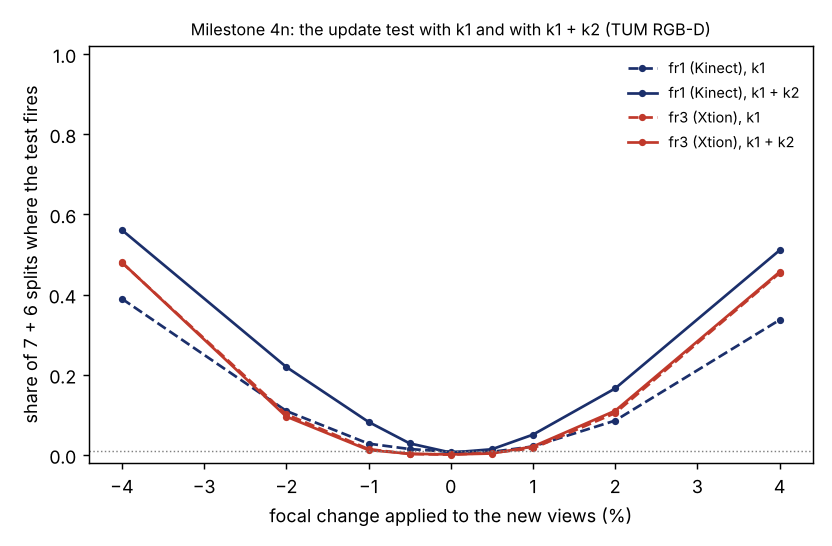

**Milestone 4m headline** (a robot holds one old calibration: does waiting for the new view set its twin
rates highest catch a 2% focal change more often? no new solve): **somewhat, and the twin knows by how
much.** With the old set fixed, the twin's pick among 7 candidate new sets catches ±2% in 9.7% of old sets
on the TUM cameras against 7.3% for a blind pick (×1.33), and among 28 candidates ×1.63; on OpenCV's
cameras ×1.17. False alarms stay at 0.06–1.40%. The twin's predicted gain matches the real one (within 0.11
on 7 of 8 unit-designs) though its level is 1.2–1.9× high, and choosing by its sd alone does as well. Most of
the ceiling is out of reach: some candidate catches the change in 19–55% of old sets. Three of five
pre-registered predictions held (H77, ×1.5 on TUM, and H78, ×1.2 on OpenCV, missed).

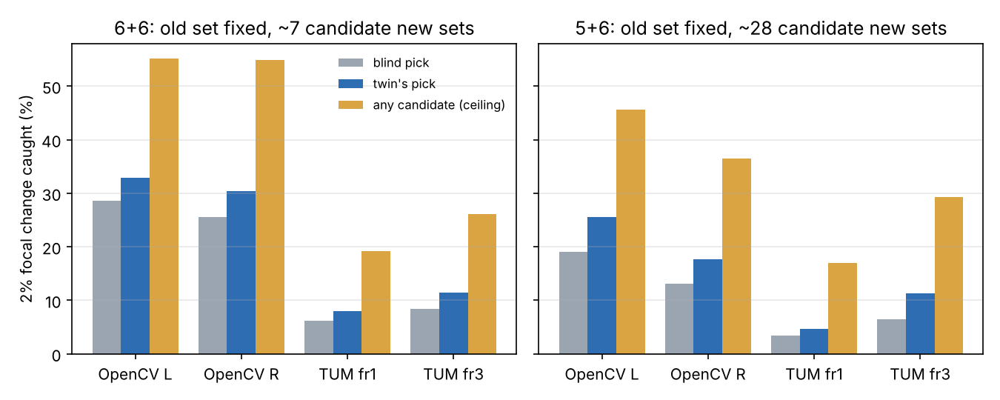

**Milestone 4l headline** (can the unit's own twin say in advance which updates can catch a 2% focal
change? no new solve): **yes, as a ranking, not as a promise.** For every split of old and new views the
linearised twin's draws give a predicted power; against the real detections it ranks the splits with
AUC 0.66–0.75 on four cameras. **Testing only the quarter of updates the twin rates highest doubles the
TUM cameras' power at ±2%, 10.0% to 21.5%, at 0–2.3% false alarms** (OpenCV's: 33% to 48–50%), and every
split holding one of milestone 4j's far solves lands in the quarter it rates lowest. The twin's predicted
sd of the focal difference ranks just as well, so no threshold draws are needed to choose. Its absolute
power is 1.2–1.9× too high, and at 4 new views the ranking fails (AUC 0.42 on the Kinect). Three of four
pre-registered predictions held (H73, AUC ≥ 0.70 on every unit, missed on OpenCV's cameras).

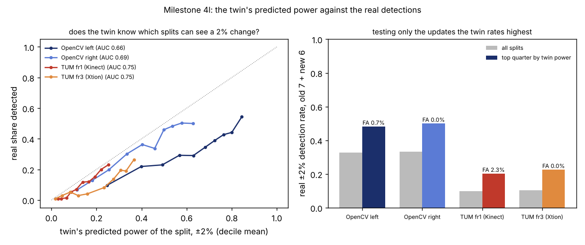

**Milestone 4k headline** (do the TUM cameras' far subset solves come from the cold start? 11,442
solves re-run from the fleet's spec focal length): **no. They are real minima, and dropping them makes
the test worse.** Started at TUM's nominal 527.1 px instead of 1.3× the Zhang estimate, every one of the 38
far 6-view solves milestone 4j found (including f = 9,289 px) comes back at the same focal length, and on
the Xtion those far solves fit their corners as well as the 13-view calibration does (rms 0.071 px against
0.075 px): the view set leaves f nearly free. On the Kinect the spec start is worse, not better: the full
13-view solve stops in a local minimum (f 508.9 px, rms 0.48 px against 526.5 px at 0.15 px), as do 5–6%
of the 6–7-view sets. **A basin check that discards solves more than 10% from the spec raises the robust
jackknife test's false alarms at 4 new views from 4.7% to 20%** (it strips the wide delete-one values the
test needs) on the Xtion, and the power at ±2% stays at 10–11%. All five pre-registered predictions refuted. For a
fleet: keep the lowest-cost of several starts, never clip the focal length to a window; the lost power on
these hand-held captures is information, not solver failure.

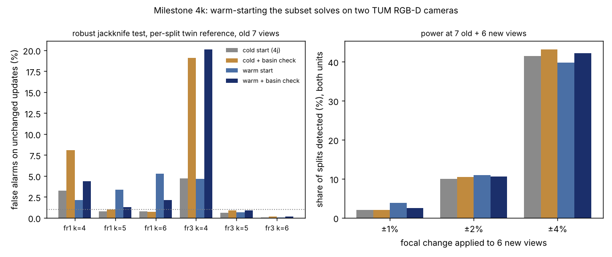

**Milestone 4j headline** (does the update test hold on other cameras? the first data beyond
OpenCV's stereo pair): **its false-alarm rate does at 5–6 new views; its power does not.** Two cameras from
the [TUM RGB-D benchmark](https://cvg.cit.tum.de/data/datasets/rgbd-dataset) (CC BY 4.0), a Kinect
(fr1) and an Xtion (fr3), each with its own checkerboard sequence: 13 views picked by a rule fixed before
any solve, 11,442 subset solves, and milestone 4i's twin reference with no change. Self-calibration lands
within 0.64% of TUM's own calibration on the Xtion (+1.85% on the Kinect, whose strong distortion the
one-term lens model cannot follow). **Against each split's twin threshold the robust jackknife test fires
on 0.06–0.80% of unchanged updates at 5 and 6 new views, but on 3.3% and 4.7% at 4**, where the delete-one
sets are 3-view and both the twin and the solver leave their linear regime. **A 2% focal change from 6
new views is caught in 10% of splits, not 33%**: these hand-held 640×480 captures fix f less precisely
(0.5–0.7% spread over 6-view sets, against 0.3–0.5%) and the cold-start solver falls into far minima on
some subsets. The real 1.4% focal difference between the two units is caught in 6–8% of splits, between
the test's ±1% and ±2% rates on scaled focal lengths. Four of five predictions refuted.

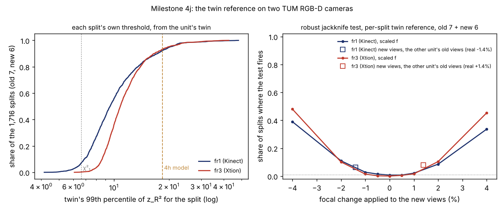

**Milestone 4i headline** (can a camera's own bundle adjustment supply the reference for its update
test? no new real solve): **yes, and it nearly doubles the honest power.** Linearising the unit's
13-view self-calibration gives, for every view subset, the first-order change in focal length per pixel
of corner error; on 9,600 nonlinear solves of synthetic corners that prediction matches the real solver
within 0.2% for 4–7 views. Drawing the unit's own residual patterns through it gives each split its own
threshold (median 10.9 / 12.5 at 7 + 6 views, against the independent-offset model's 18.45). **Against
it the robust jackknife test fires on 1.44% / 0.37% of unchanged updates and catches a 2% focal change
from 6 new views in 33.1% of splits** (milestone 4h: 18.6%), with nothing borrowed. The twin explains
most of the jackknife's small-set inflation from geometry alone; the right camera has an extra spread its
twin does not show, so it stays below the 0.5% bar (one of four predictions refuted). With this
reference the plain jackknife does as well as the robust one (34.7%), and one threshold per design
almost as well as one per split (30.8%).

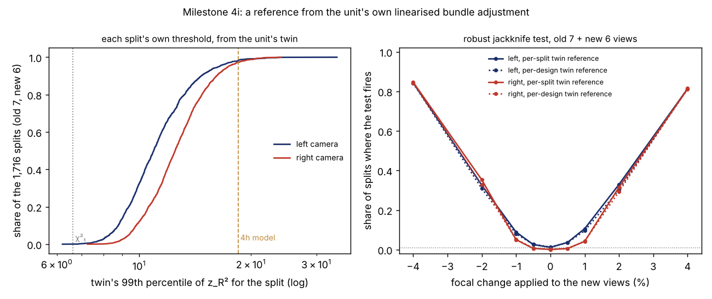

**Milestone 4h headline** (is χ²<sub>1</sub> the right reference for the robust jackknife update
test? no new solve): **no. Milestone 4g's 54% power came from two errors cancelling.** If each view
adds an independent offset to the focal length, the robust (MAD) jackknife's z² has a 99th percentile of
18.45 at 7 + 6 views, not χ²<sub>1</sub>'s 6.63, and χ²<sub>1</sub> would give 6.1% false alarms; on
these views it gave 2–3% only because the jackknife still overstates the real spread. **Against that
model reference, which a robot computes in a second for any set sizes and which borrows nothing, the
test stays at 0.45% / 0.20% false alarms but catches a 2% focal change from 6 new views in 18.6% of
splits** (the plain jackknife against its own model reference: 8.6%). The model also says
χ²<sub>1</sub> stays lenient for this test until large sets (3.8% false alarms at 10 + 10 views, 2.2% at
20 + 20). All three pre-registered predictions held.

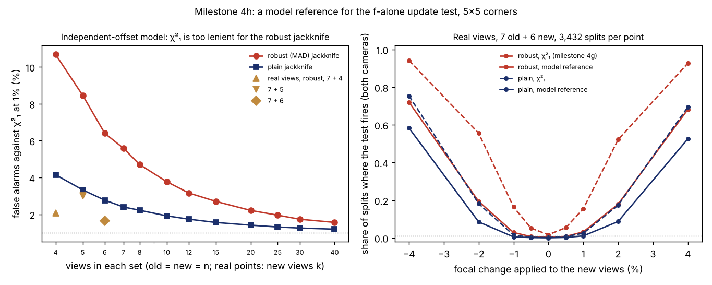

**Milestone 4g headline** (every disjoint split of the 13 views, 37,752 per camera, no new solve; can a
camera test its own focal length with nothing borrowed?): **a robust view jackknife (the MAD of the
delete-one focal lengths) against a plain χ²<sub>1</sub> catches a 2% focal change from 6 new views in
54% of splits at 2.3% false alarms**, evenly on both cameras, with no threshold taken from another
unit. The same scoring **corrects milestone 4d**: the sibling-threshold test's 61% came from a 60-split
sample and a 99th percentile of 180 statistics; on every split it is **43%** (left 56–61%, right
26–30%) at the same 2.4% false alarms. The robust jackknife is still not an honest error bar (twice
too wide on the right camera), and with 4 new views every variant catches a 2% change in 13% of splits
at most. One of four pre-registered predictions held (the power one); the robust test's left-camera
false alarms (3.4%) sit just above the 3% bar.

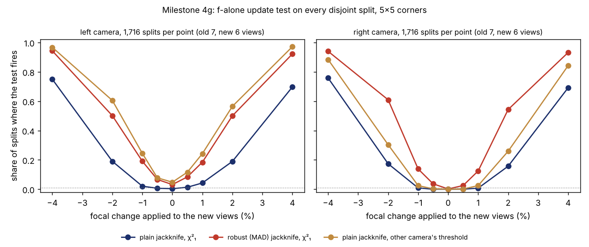

**Milestone 1 headline, on two real cameras** (OpenCV's stereo calibration photos, 13 views
each): withholding the checkerboard's geometry and solving for the 54 corners as free 3-D
points, bundle adjustment started 30% off lands **within 0.15% (left) and 0.24% (right) of
Zhang's target calibration** of the focal length, with a reported σ only **1.12× Zhang's**
(not the ≥2× we predicted). The free points also show that **the board is not flat**: the
reconstructed corners leave the best plane by 0.77% of a square rms (2.4% at worst), and the
two cameras, solved independently, reconstruct the same bend (correlation 0.90). Over 400
random view subsets the reported σ<sub>f</sub> is about **2× too small** (rms z 1.94, 95%
1.75–2.12, against an ideal 1), and Zhang's own σ is no better (2.16).

**Milestone 2 headline** (same views, 560 solves, all converged): the **view geometry predicts
the error** (Spearman ρ −0.46 and −0.58 between the spread of board orientations and the focal
error), and the reported σ tracks it too (ρ +0.39 / +0.45), but **σ stays about 2× too small**,
2.4× on near-critical subsets where the boards are close to parallel. There, **Zhang's own σ
is far worse** (rms z 5.8) and its focal length is further off than the target-free one. A
first accept gate (σ<sub>f</sub>/f ≤ 0.5%) rejected 92% of bad updates but accepted only 84%
of good ones, short of the 90/90 target.

**Milestone 3 headline** (same 560 subsets, plus 3,480 leave-one-view-out re-solves): the
2× overconfidence is **real, not an artefact of the checkerboard reference**: scored against
the target-free all-view solution with the nested variance, rms z is still 2.28. A
**leave-one-view-out jackknife σ is honest without any fitted factor** (rms z 0.70 / 0.65,
2σ coverage 97–99%, rms z 1.01 on near-critical subsets where the reported σ gives 2.34),
while the cluster-robust sandwich only helps on the left camera (1.76 / 1.59). But the
jackknife **ranks updates worse** (ROC AUC 0.75 against 0.91 for the reported σ) and is
very conservative at 4 views, so **an honest σ and a good gate are different statistics**.

**Milestone 5 headline** (lens terms and the bent board): OpenCV's **released-object
calibration** (Strobl and Hirzinger's bend-aware Zhang) **is the same problem as our
target-free bundle adjustment**: both return identical intrinsics, σ and board shape. Comparing
it with the flat-board fit isolates the board assumption, and **the flat, evenly spaced board
moves the principal point c<sub>y</sub> by 8.7 px (left) and 5.3 px (right)** (corrected in milestone 6:
most of that came from misplaced outer corners; with SB corners the shift is 1.2 / 1.4 px). Adding a second
radial term k<sub>2</sub> (clearly non-zero) **does not make σ honest** (nested rms z 3.01,
2.00 without five outliers, against 2.28), and the residuals stay correlated between
neighbouring corners (0.31 / 0.24), but only along one board axis.

**Milestone 6 headline** (the corner detector, 1,680 more solves): the one-axis residual
pattern **comes from the corner localiser used in milestones 1–5**. `cornerSubPix` with an
11×11 half-window (a 23 px box) **misplaces corners on the board's outer ring by up to 6.4 px**,
because the box runs off the pattern. All 26 gaps over 1 px between it and a 5×5 window are on that ring. With a 5×5 window or
OpenCV's `findChessboardCornersSB`, reprojection rms halves (0.26 → 0.11–0.14 px left) and
the column structure mostly goes away. **That correction shrinks milestone 5's c<sub>y</sub>
result**: the flat-board shift is 8.7 px with the old corners, 4.5 px with 5×5 and **1.2 px
(1.8σ) with SB corners** on the left camera (5.3 → 3.8 → 1.4 px right). The board's bend
survives, 25–45% shallower. The **detector choice alone moves Zhang's focal length by up to
7.2 px (1.3%)**, several times its reported σ. And **better corners make σ less honest, not
more**: σ halves but the error does not, so the nested rms z rises from 2.28 to 3.1–3.5. A
sandwich clustered by board column does not fix it (2.44 / 1.72).

**Milestone 4 headline** (the accept/reject decision, 908 solves on disjoint view sets): when
the old calibration comes from 7 views and the new one from 3–6 *other* views of the same,
unchanged camera, **the χ² update test with the solver's covariance fires on 72% of splits**
(nominal 1%). The covariance is 2.3–2.9× too small for f and c<sub>y</sub> and **4.6× for the right
camera's c<sub>x</sub>, a gap that does not shrink with more views**: each view set carries its own
systematic offset. Inflating the covariance by the factor measured on the *other* camera
brings false alarms to 6.5% (11% left, 2% right), but then the test **detects a 1% focal
change in only 10–12% of splits** with 5–6 views and **a real swap to the other camera unit
(0.67% in f, 17 px in c<sub>x</sub>) in 30–77%**. Even a factor fitted on the scored camera itself
(optimistic) leaves 4% as the smallest focal change detected most of the time. The rule
adopts a harmful update (f error 0.5% worse than keeping the old one) in 5.6% of decisions
with the raw covariance and 1.4% with the transferred factor. One of five pre-registered
hypotheses held.

**Milestone 4b headline** (8,580 more solves, two corner detectors): replacing the scalar
factor with a covariance each calibration computes from its own views, **a leave-one-view-out
jackknife makes the update test quiet with nothing borrowed from another camera**: 2.5% false
alarms on the old corners and 1.7% on `findChessboardCornersSB` corners (nominal 1%), against
58–74% for the solver's covariance and 36–38% for a sandwich clustered by view. The price is
power: with 6 new views the jackknife test **detects a 2% focal change in 7–12% of splits and a
4% change in 41–62%**. The corner detector matters as much as the covariance: with SB corners
the jackknife test **catches the real swap to the other camera unit in 75% of splits, against
30%** with the old corners. Harmful adoptions fall to 0.5–1.5% of decisions. All five
pre-registered predictions held.

**Milestone 4c headline** (no new solve; milestone 4b's 8,580 solves re-tested): **why the
jackknife test was deaf**. For the three-parameter statistic it is information: even a threshold
fitted on the scored camera itself (an oracle) detects a 2% focal change in only 5–10% of splits,
and a small-sample Hotelling reference is far too strict (0 false alarms, but it keeps only a fifth
of the 4% detections). For the focal length alone the χ² reference is mis-scaled about 3×: testing
f against the **99th percentile measured on the other camera** detects a **2% focal change in 28–41%
of splits and 4% in 78–85%** with 6 new views (0–5% false alarms), nearly what the oracle gets.
Four of five pre-registered predictions held; the f-only power figure was not pre-registered.

**Milestone 4d headline** (4,290 more solves; the update test on the 5×5-window corners milestone 6b
found unbiased): with corners the board's half-width end squares cannot pull, **the focal-length
spread between disjoint view sets falls from 0.86–1.02% to 0.59%**, and the f-alone jackknife test
with a sibling's threshold **detects a 2% focal change in 61% of splits (34–35% on the biased
corners; 43% once every split is scored, milestone 4g) and a 1% change in 18–28%** (4–12% before), with 6 new views. It catches the real unit
swap in 79%. But **the borrowed threshold stops travelling**: the left camera's false alarms reach
11% (the right's 0%), because the jackknife now overstates the spread 1.5× on one camera and 2.8×
on the other. Four of five pre-registered predictions held.

**Milestone 4e headline** (3,168 more solves; can a camera set its own update-test threshold?):
splitting the old calibration's 7 views into 4 + 3 in all 35 ways and scaling the halves'
focal-length spread by 1/n gives a test with nothing borrowed that is **quiet (0.6% / 0.0% false
alarms) but deaf (a 2% focal change caught in 0.8% of splits)**: the halves overstate the real
spread 2.9× and 5.2×. The reason, found after the fact: **f's spread does not shrink as 1/n below 5
views** (per view 3.3–5.2% at 3 views, 2.2% at 4, 1.0–1.7% at 5–7), so a per-unit threshold needs
halves of at least 5 views, about 10 views in the old set. Two of five pre-registered predictions
held, both only because the test stays silent.

**Milestone 4f headline** (every subset of 3–12 of the 13 views, 16,172 view sets; is the jackknife's
overstatement a small-set effect?): yes. **The leave-one-view-out jackknife overstates f's real
spread 7–8× at 4 views, 1.8–3.1× at 6 and 1.1–1.4× at 10**, falling at every step on both cameras.
Most of the small-set excess comes from a few delete-one solves near the critical set (the median-based
jackknife is 2.4–4.1× at 4 views). The **solver's own σ is 2–6× too small at every set size**. So below
6 views neither error bar is usable, while with about 10 logged views the plain jackknife is a mildly
conservative one. The right camera needs 10 views for 1.5×, and its views do not add independent offsets.
Two of four pre-registered predictions held.

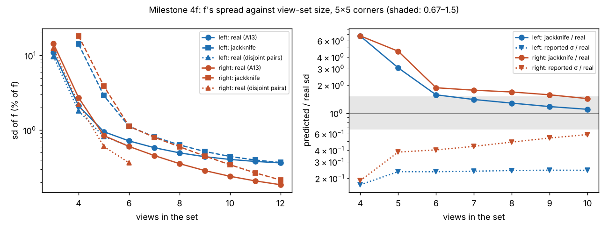

**Milestone 6b headline** (which corner localiser is right; 26 renders of the real views from a
known camera, 1,200 fits): **the printed board's end squares are only half as wide as the rest**
(they reach 0.49–0.53 of the corner spacing past the last corner, against 0.94–0.97 on the other
sides), and that alone explains the localiser puzzle. On renders with full squares all three
localisers find the corners to 0.04–0.06 px and the focal length to 0.04%. With half-width end
squares the **11×11 `cornerSubPix` window is pulled up to 9.6 px towards the board's edge and
biases Zhang's f by +0.4% to +1.5%** (real images: +0.64% / +0.91% against the 5×5 window), and
**`findChessboardCornersSB` is biased the other way, −0.3% to −0.4%** (real: −0.12% / −0.39%).
The **5×5 window is unaffected**, so its focal lengths (532.9 / 536.2 px) are the best estimates
here. One of five pre-registered predictions held; the cause was found after the first failed.

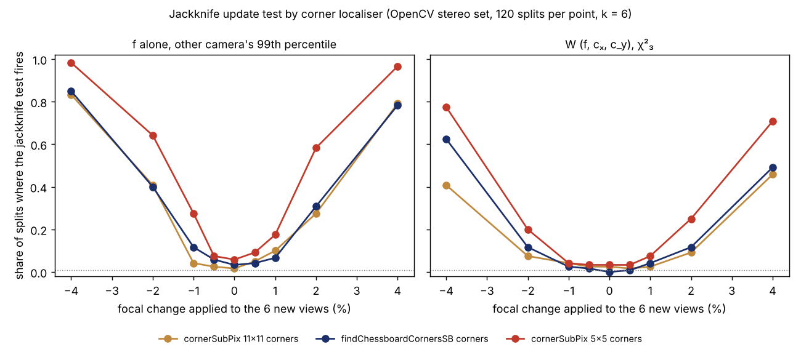


## Why

Robot, drone and machine cameras drift out of calibration from knocks, heat and refocusing.
Recalibrating with a board takes the machine out of service. Self-calibration from scene
features avoids that, but only if the robot can tell a good update from a bad one. This
programme measures that on real images. Lab tag: ARPG (Christoffer Heckman), whose
multi-sensor SLAM with online self-calibration and change detection (Nobre et al., 2017) is
the closest robotics work.

## Milestone 1: target-free BA against Zhang on a real stereo pair

**Data.** `data/left01..14.jpg`, `data/right01..14.jpg` (no index 10), 640×480, a 9×6
inner-corner checkerboard, from OpenCV's `samples/data` (Apache-2.0, fetched from
github.com/opencv/opencv, 4.x branch). Corners by `cv2.findChessboardCorners` and
`cornerSubPix`; all 26 images detect.

**Model** (both solvers): f<sub>x</sub> = f<sub>y</sub> = f, (c<sub>x</sub>, c<sub>y</sub>),
radial 1 + k<sub>1</sub>r<sup>2</sup> (k<sub>2</sub> as an ablation), no tangential terms.

**Reference.** Zhang calibration (`cv2.calibrateCameraExtended`) with the known board on all
13 views; σ from OpenCV.

**Target-free solver** (`src/selfcal.py`). The same pixels and correspondences, board
geometry withheld: 54 free 3-D points, 13 poses, 4 intrinsics. Start: f 30% off (both
directions tried), view `ref`'s corners pushed onto the plane z = 1 of its own camera (as if
the board faced it), PnP for every view. Then `scipy.optimize.least_squares` (trf, sparse
Jacobian). σ from the Gauss–Newton normal matrix, scaled by the residual variance, with the
7 similarity-gauge directions removed by pseudo-inverse.

**Results, all 13 views** (`experiments/m1_real/summary.json`):

| | left | right |
|---|---|---|
| Zhang f (σ), px | 535.62 (0.88) | 539.71 (1.07) |
| Target-free f (σ), px | 534.82 (0.98) | 538.43 (1.20) |
| Gap | −0.15% (−0.6 σ) | −0.24% (−0.8 σ) |
| σ ratio, target-free / Zhang | 1.12 | 1.12 |
| Reprojection rms per coordinate, Zhang / target-free, px | 0.30 / 0.26 | 0.34 / 0.29 |
| c<sub>y</sub> gap, px (σ) | +8.7 (5.3 σ) | +5.2 (2.9 σ) |
| Same f from a 0.7× start | 534.82 | 538.43 |
| f with k<sub>2</sub> added, Zhang / target-free | 536.27 / 535.72 | 541.07 / 538.15 |

**View subsets.** 20 random subsets of each size 3 to 12 per camera (400 solves, seeds fixed
in `run.py`), started 30% high. z = (f<sub>subset</sub> − f<sub>Zhang, all</sub>) / σ<sub>f, subset</sub>:

| Views | rms z, target-free | rms z, Zhang | median σ ratio | median \|Δf\|, target-free | median \|Δf\|, Zhang |
|---|---|---|---|---|---|
| 3 | 2.79 | 3.27 | 2.91 | 1.76% | 0.60% |
| 4 | 2.20 | 2.32 | 1.54 | 0.54% | 0.37% |
| 6 | 2.68 | 3.02 | 1.28 | 0.60% | 0.33% |
| 8 | 1.56 | 2.14 | 1.17 | 0.30% | 0.20% |
| 10 | 1.77 | 2.06 | 1.12 | 0.25% | 0.15% |
| 12 | 1.05 | 0.43 | 1.13 | 0.16% | 0.05% |

(All sizes in `summary.json`.) The worst target-free subset (3 views) was 20% off; from 4
views the worst was 4.4%, from 8 views under 1%.

**Board flatness** (`experiments/m1_real/planarity.json`). The target-free corners deviate
from their best-fit plane by 0.0077 (left) and 0.0077 (right) square widths rms, 0.024 at
most; the out-of-plane heights from the two independently solved cameras correlate at 0.903
(0.909 with k<sub>2</sub>). Grid spacing varies by 0.3%. A flat-board model cannot fit that
bend, which is the likely reason the target-free fit has 13–15% lower reprojection error (milestone 1 first
said about 40%, comparing OpenCV's per-point rms with our per-coordinate one; corrected in milestone 5) and
part of the c<sub>y</sub> disagreement (Strobl and Hirzinger, 2011, found the same for
printed targets).

**Hypotheses** (pre-registered in `LOG.md`):
- H1 (f within 2% of Zhang with all views): **held**, 0.15% and 0.24%.
- H2 (rms z ≤ 2 over subsets of 4–12 views): **held narrowly**, 1.94 (95% bootstrap
  1.75–2.12). The σ is still about twice too small, most at 3 to 7 views.
- H3 (target-free σ ≥ 2× Zhang's at 13 views): **refuted**, 1.12×. The ratio does fall with
  views (2.9× at 3).

## Milestone 2: view geometry, near-critical subsets and a first accept gate

Pre-registered in `LOG.md` before any run; results in `experiments/m2_spread/summary.json`.

**Solver.** `selfcal_fixed_analytic` in `src/selfcal.py`: view `ref`'s pose and corner 0's
depth are held fixed (the 7 similarity directions; a zero translation at the reference camera
leaves the scale free, so the depth pin is needed), the Jacobian is analytic (tested against
finite differences), and Levenberg–Marquardt replaces milestone 1's trust-region/LSMR solver.
All 560 solves converged on tolerance, in at most 177 evaluations (21–23 on all 13 views).
All-view f moved by 0.0004 px.

**Geometry.** Each view's board normal in the camera frame comes from the all-view Zhang
poses; a subset's *spread* is the largest angle between two of its normals (0° = all boards
parallel, where f is unidentifiable; Sturm and Maybank 1999). All 13 views span 65°. Besides
milestone 1's 400 random subsets (same seeds), the 20 smallest-spread subsets of each size 3–6
per camera (160 *near-critical* subsets, spread 7–36°).


| | random, 4 views | random, 8 views | near-critical, 4 views | near-critical, 6 views |
|---|---|---|---|---|
| median spread | 51° | 61° | 20° | 33° |
| median \|Δf\|, target-free | 0.54% | 0.30% | 1.09% | 0.82% |
| median \|Δf\|, Zhang | 0.37% | 0.20% | 1.50% | 1.08% |
| rms z, target-free | 2.21 | 1.56 | 2.08 | 2.45 |
| rms z, Zhang | 2.32 | 2.14 | 6.24 | 6.23 |

**Hypotheses:**
- H2 rerun (does milestone 1's rms z survive convergence?): **held**, 1.945 (95% 1.75–2.12)
  against 1.944; median f change 0.002 px.
- H6 (spread predicts error, ρ ≤ −0.3 on each camera): **held**, −0.46 and −0.58.
- H7 (σ stays honest on near-critical subsets, rms z ≤ 2): **refuted**, 2.41 (95% 2.09–2.81),
  20% beyond 3σ. Zhang's σ on the same subsets: rms z 5.83.
- H4, first test (gate σ<sub>f</sub>/f ≤ 0.5%: reject ≥ 90% of updates > 2% off, accept
  ≥ 90% of those ≤ 1% off): **refuted**, rejects 92% (56/61), accepts 84% (340/407). The five
  bad updates it let through were 2.0–2.9% off with σ/f just under the gate.

**Unplanned checks** (reported as such): with σ doubled the gate rejects every bad update but
accepts only 37% of good ones. An inflation factor κ fitted on one camera's random subsets does
not transfer cleanly: κ 2.21 from the left camera makes the right camera's rms z 0.74; κ 1.63
from the right leaves the left at 1.35 with 85% 2σ coverage. The median error/σ ratio is
1.0–1.8 in every σ bin, so the overconfidence is in the tails more than in the typical subset.

**What it means for a robot.** The solver's σ is informative (it ranks subsets by error about
as well as the geometry does) but not calibrated, and a fixed σ threshold cannot hit 90/90 on
this data. Near-parallel views are where a target calibration is most misleading about its own
error, which is an argument for self-calibrating BA plus an honest gate rather than for the
board.

## Milestone 3: is the overconfidence real, and does a robust σ fix it?

Pre-registered in `LOG.md` before any run (H8–H10, H4's second test); results in
`experiments/m3_robust/summary.json`. Same 560 subsets and reference views as milestone 2,
same solver (all 560 converged again, identical f).

**Estimators** (`src/selfcal.py`, no fitted constants). *Sandwich* (Huber–White):
var f = G/(G − 1) Σ<sub>g</sub> ((J<sub>g</sub>b)·r<sub>g</sub>)², b = (JᵀJ)⁻¹e<sub>f</sub>,
clustered by view, by corner, or unclustered (HC0). *Jackknife*: re-solve without each view
in turn (cold start), var f = (k − 1)/k Σ (f<sub>(i)</sub> − f̄)². 3,473 of 3,480
leave-one-out solves converged on tolerance. On all 13 views the jackknife σ is 2.59 px (left)
and 1.74 px (right), against the reported 0.98 and 1.20.

| rms z, random subsets of 4–12 views | left | right | near-critical, 4–6 views |
|---|---|---|---|
| reported σ (Gauss–Newton) | 2.21 | 1.63 | 2.34 |
| sandwich, by view | 1.76 | 1.59 | 3.60 |
| sandwich, by corner | 2.30 | 1.73 | 2.80 |
| sandwich, unclustered | 2.32 | 1.89 | 2.66 |
| **jackknife over views** | **0.70** | **0.65** | **1.01** |
| 2σ coverage, reported / jackknife | 68% / 97% | 78% / 99% | 58% / 96% |

**Hypotheses:**
- H8 (the overconfidence is not the reference's fault): **held**. Against the target-free
  all-view f with the nested variance σ<sub>sub</sub>² − σ<sub>all</sub>², rms z is 2.28 (95%
  1.93–2.73; 302 subsets, 58 with σ<sub>sub</sub> ≤ σ<sub>all</sub> dropped). With the
  jackknife σ the same test gives 0.85 (0.61–1.10).
- H9 (jackknife σ honest, rms z in [0.7, 1.4] on each camera): **refuted, narrowly and on the
  safe side**: 0.703 (left) and 0.651 (right, 95% 0.56–0.74), i.e. slightly conservative. The
  view-clustered sandwich fails at 4–6 views as predicted (2.23).
- H10 (jackknife σ ranks good against bad updates better than the reported σ): **refuted**.
  ROC AUC 0.75 against 0.91 (difference −0.15, 95% −0.25 to −0.07; 388 good, 22 bad
  updates of 4–12 views). The sandwich variants also rank worse (0.76–0.89).
- H4, second test (gate σ<sub>jack</sub>/f ≤ 0.5%): **refuted**. It rejects every bad
  update but accepts only 19% of good ones (0% on near-critical subsets). Thresholds fitted on
  one camera do not transfer for any σ: the best is the reported σ (fit left, score right:
  accept 76%, reject 79%; fit right, score left: 91% / 88%).

**Why the jackknife is conservative where it is.** The jackknife variance is biased upward
(Efron and Stein, 1981), and here the bias is large where the estimator is most non-linear:
at 4 views each leave-one-out solve has only 3 views, where milestone 1 saw errors up to 20%,
so σ<sub>jack</sub> is a median 15× the reported σ and rms z drops to 0.33. From 6 to 11
views the ratio is 2–5× and rms z 0.55–0.94. That inflation is also what costs it as a
ranking statistic: it measures how unstable the subset is to losing a view, which is noisy
with few views, more than how far it is from the truth.

**What it means for a robot.** The reported σ's 2× gap is real miscalibration, and
correlated per-image error (what the sandwich assumes) explains little of it on the right
camera. A jackknife over frames gives an error bar a robot can trust as a bound, at k extra
solves, but should not be the accept statistic on its own; the next gate should rank by the
reported σ (and view spread) and use the jackknife only to refuse updates whose honest error
bar is too wide.

## Milestone 5: does the bent board explain c<sub>y</sub>, and does k<sub>2</sub> explain the 2× σ?

Pre-registered in `LOG.md` before any run (H11–H13); results in
`experiments/m5_lens/summary.json`. Milestone 1 left two suspects: the bent board for the
8.7 / 5.2 px c<sub>y</sub> gap, and the k1-only lens for the overconfident σ.

**Bend-aware reference.** `zhang_ro` in `src/selfcal.py` wraps OpenCV's
`calibrateCameraROExtended` (released object; Strobl and Hirzinger, 2011): the board's 3-D
corners are refined with the camera, corner 0 and corner 8 held at their nominal positions.

**The released-object fit and target-free BA are the same estimator.** On both cameras and
both lens models they agree to 1e-6 px in f and c<sub>y</sub>, to 1e-8 in σ, and in the
reconstructed board (height correlation 1.000). With every corner free, the board contributes
only a metric scale, and scale carries no information about the intrinsics. That makes the
target-free numbers of milestones 1–3 also the numbers of a bend-aware target calibration of
these photos, and it isolates what the flat-board assumption does:

| all 13 views | left, k1 | left, k1+k2 | right, k1 | right, k1+k2 |
|---|---|---|---|---|
| c<sub>y</sub>, flat-board Zhang (σ), px | 234.1 (1.05) | 234.0 (1.07) | 247.2 (1.21) | 247.2 (1.19) |
| c<sub>y</sub>, released board = target-free (σ), px | 242.8 (1.26) | 244.2 (1.29) | 252.5 (1.34) | 252.4 (1.31) |
| c<sub>y</sub> shift from the flat assumption | −8.7 px (5.3σ) | −10.1 px (6.0σ) | −5.3 px (2.9σ) | −5.3 px (3.0σ) |
| f shift from the flat assumption | +0.79 px | +0.55 px | +1.28 px | +2.93 px |
| adjacent-corner residual correlation, flat / free board | 0.36 / 0.32 | 0.36 / 0.31 | 0.35 / 0.28 | 0.32 / 0.24 |

(Image centre: c<sub>y</sub> = 240. Neither fit is lens ground truth; the free-board one makes
fewer assumptions and fits better.) k<sub>2</sub> is 0.143 ± 0.018 (left) and 0.091 ± 0.007
(right): a real term the k1 model omits.

**Hypotheses:**
- H11 (with the released-object reference, the c<sub>y</sub> gap is under 2σ): **held, but
  trivially**: the gap is 4e-6σ because the two estimators coincide. The substantive result is
  the table's third row: the flat-board assumption alone moves c<sub>y</sub> by 5–10 px.
- H12 (k<sub>2</sub> is not the cause of the 2× overconfidence: nested rms z stays > 1.5 with
  k1 + k2 on milestone 2's 560 subsets): **held**. rms z 3.01 (95% 2.05–4.04; left 3.85,
  right 2.04; 296 subsets, 64 with σ<sub>sub</sub> ≤ σ<sub>all</sub> dropped), against 2.28
  with k1. The rise is fragile: two left-camera subsets of 4–5 views (z −28 and −23, where
  σ<sub>sub</sub> barely exceeds σ<sub>all</sub>) carry it. Without the five largest |z| it is
  2.00 (k1: 1.94); median |z| 1.31 (k1: 1.40). All 560 solves converged, at most 180 evaluations.
- H13 (residuals of adjacent corners stay correlated ≥ 0.1 with k1 + k2): **held**, 0.31
  and 0.24. The structure is one-directional: along the board's columns the correlation is
  0.44–0.56 (0.65–0.76 two corners apart), along its rows −0.02 to 0.09. A lens term acts
  radially in the image, not along one board axis, so the cause is likely in the board or the
  detector; this milestone does not establish which.

**Unscored.** Against the released-object reference itself, rms z over random 4–12-view
subsets is 1.66 (k1) and 1.79 (k2); k<sub>2</sub> shrinks σ<sub>f</sub> by a median 5% and
leaves the median focal error at 0.24%.

**What it means for a robot.** A flat-board target calibration of a printed board can be off
by 5–10 px in the principal point while reporting a 1 px σ, and a self-calibrating BA (or the
released-object option, which is the same thing) removes that bias for free. Adding lens terms
is not a fix for the overconfidence: the residuals are correlated along one board axis whatever
the lens model, which is the pattern a cluster-robust σ by board column, or the jackknife, has
to absorb.

## Milestone 6: where the column pattern comes from, and does a better detector fix σ?

Pre-registered in `LOG.md` before any run (H14–H17); results in
`experiments/m6_detector/summary.json` and `bend.json`. Milestones 1–5 located corners with
`findChessboardCorners`, then `cornerSubPix` with an 11×11 half-window, so the box is 23 px wide. Corners here
are 25–41 px apart. This milestone adds two localisers on the same images, matched to the
same corner order by nearest neighbour (one-to-one in all 26 images): `cornerSubPix` with a
5×5 half-window, and `findChessboardCornersSB` with `CALIB_CB_ACCURACY` (Duda and Frese,
2018). Then milestone 2's 560 subsets are re-solved per detector (k1 model; 1,679 of 1,680
converged), and the sandwich σ is clustered by (view, board column) and (view, board row).

**The old localiser misplaces outer corners.** Between the 11×11 and 5×5 windows the median
gap is 0.07 px in the grid's interior, but **26 corners differ by more than 1 px (up to
6.4 px), all of them on the outer ring**, where the 23 px box covers the end of the pattern
(figure, panel a). SB against 11×11: 52 corners over 1 px (up to 7.7 px), again all on the ring;
SB against 5×5: at most 1.7 px.

| all 13 views, target-free k1 | left, 11×11 | left, 5×5 | left, SB | right, 11×11 | right, 5×5 | right, SB |
|---|---|---|---|---|---|---|
| reprojection rms per coordinate, px | 0.259 | 0.114 | 0.144 | 0.291 | 0.153 | 0.170 |
| f (σ), px | 534.82 (0.98) | 534.34 (0.43) | 533.04 (0.54) | 538.43 (1.20) | 535.75 (0.62) | 534.18 (0.69) |
| flat-board Zhang f, px | 535.62 | 531.96 | 530.86 | 539.71 | 534.56 | 532.54 |
| c<sub>y</sub>, free board − flat board, px (σ) | 8.7 (8.3) | 4.5 (8.4) | **1.2 (1.8)** | 5.3 (4.3) | 3.8 (5.6) | **1.4 (2.0)** |
| board flatness, rms (square widths) | 0.0077 | 0.0042 | 0.0058 | 0.0077 | 0.0050 | 0.0056 |
| residual corr., neighbours along a column / a row | 0.56 / 0.06 | 0.30 / 0.28 | 0.32 / 0.23 | 0.44 / 0.09 | 0.39 / 0.34 | 0.56 / 0.29 |
| variance in per-(view, column) means (null 0.17) | 0.65 | 0.27 | 0.41 | 0.51 | 0.23 | 0.43 |

(Cy gaps in σ of the flat fit. The left/right correlation of the bend's heights stays 0.89–0.90 with every
detector, so the bend is real and seen by both cameras; it is shallower.)

**Hypotheses:**
- H14 (with SB corners the along-column correlation falls below 0.2): **refuted**, 0.32
  (left) and 0.56 (right). The *one-directional* pattern goes (along-row correlation rises
  to 0.23–0.34, and the per-column share falls from 0.65 / 0.51 to 0.41 / 0.43, 0.27 / 0.23
  with 5×5), but what is left is a smoother 2-D correlation that no localiser removes.
- H15 (column offsets mostly sideways, ≥ 70%): **held**, 91% (left) and 78% (right) of the
  per-(view, column) mean residual lies perpendicular to the column's line, with the old
  corners (57–67% with the new ones). A whole column shifted sideways is what misplaced
  end-of-column corners would do under a fitted model.
- H16 (sandwich clustered by (view, column) is honest, rms z in [0.7, 1.4]): **refuted**,
  2.44 (left) and 1.72 (right), no better than the reported σ (2.21 / 1.63); by (view, row)
  2.42 / 1.94. On synthetic data with pure per-column offsets it moves the right way but
  still covers only part of the gap (median σ 4.3 against a true 5.8 px and a reported 3.6),
  so even a correct cluster model with 9k clusters is too small here.
- H17 (with SB corners the nested rms z ≤ 1.5): **refuted, in the opposite direction**:
  3.12 (95% 2.88–3.37; median |z| 1.97) against 2.28 (median |z| 1.40) with the old corners;
  5×5 gives 3.45. Cleaner corners halve the residuals and so halve σ (median σ<sub>f</sub>
  1.44 → 0.73–0.87 px), but the focal error against each detector's own all-view fit only
  falls from 0.24% to 0.15–0.23%. (Fewer subsets drop out of the nested test with the new
  corners, 7–11 against 58, which is part of the change; the median |z| rises too.)

**What it means for a robot.** Three things. (1) With an 11×11 `cornerSubPix` window on a board whose
squares are under ~45 px, check the outer ring: on these images it is several pixels off, and a
free-board model reads that as a bent board and a shifted principal point. (2) The localiser
moves f by up to 1.3% between three standard OpenCV settings while every fit reports a σ
under 0.2%. That is a systematic error no σ from the residuals can see. (3) The σ's
overconfidence is not a corner-noise problem: the better the corners, the more the error
is dominated by something the residuals do not carry (the remaining smooth correlation,
lens or board terms the model omits, or the data's few views), so the honest error bar has
to come from outside the fit, as milestone 3's jackknife did.

## Milestone 6b: which corner localiser is right? Renders with a known camera

Pre-registered in `LOG.md` before any image was rendered (H33–H37); results in
`experiments/m6b_render/summary.json`. Milestone 6 found that the localiser alone moves the
focal length by about 1% and that no ground truth said which one was right. Here every real
view is rendered again from a known camera at its real pose, and each localiser is scored
against the exact projections.

**Renderer** (`src/render.py`). The true camera of each side is its all-view flat-board Zhang
fit (k1 + k2), and the 13 poses are that fit's poses. Each 640×480 pixel averages 4×4 rays,
each undistorted, intersected with the board plane and shaded (10×7 squares, a white margin, a
uniform background), then Gaussian blur, noise, 8-bit rounding and JPEG (quality 90). The
**matched setting** is calibrated so the renders' own statistics equal the real images'
(`measure.py`): edge σ from an erf fit across every inner edge, 0.948 / 0.957 px on the real
images and 0.949 / 0.960 on the renders; noise from a Laplacian in flat squares, 0.52 / 0.61
real and 0.54 / 0.63 rendered; grey levels from the squares (about 23 and 236). Also swept:
half and double blur, zero and double noise, 20 seeds each.

| Hypothesis | Prediction | Result |
|---|---|---|
| H33 | renders reproduce the real ring disagreement (> 1 px) | **refuted**: max 11×11–SB gap 0.19 / 0.36 px (real 7.7 / 5.6) |
| H34 | SB has the lowest corner error | **refuted**: all three 0.035–0.060 px rms; 11×11 lowest on the ring |
| H35 | SB's f within 0.2% of the truth, 11×11 worse | **refuted**: every localiser within 0.04% |
| H36 | target-free σ honest on renders (rms z ≤ 1.5) | **refuted**: 1.55 / 1.80, from a fixed 0.02–0.04% bias; the spread alone is 0.4–0.5σ |
| H37 | no column correlation on an ideal pattern (< 0.2) | **held**: −0.09 to +0.08 (real 0.32–0.56) |

**What the real board has that the renders did not** (unscored, found after H33 failed).
Magnified, the real corners where 11×11 and SB disagree most show the 11×11 corner 4–8 px off
the visible corner, towards the board's edge (second figure above), and every such corner is in
grid column 0 or 8. Measured outward along the grid lines (`outer.py`), the end squares of those
columns reach only **0.49–0.53 of the corner spacing** past the last corner (10–90%:
0.35–0.59); the other two sides reach 0.94–0.97, and full-square renders read 0.95–1.01. The
23 px window around such a corner takes in the edge between the cut-short square, the white
margin and whatever lies beyond. Rendered with half-width end squares (`ablate.py`, 5 seeds):

| Render (5 seeds) | 11×11 f error | 5×5 f error | SB f error | 11×11 ring corners > 1 px |
|---|---|---|---|---|
| full end squares, any surround | 0.00 / +0.03% | −0.01 / +0.04% | −0.02 / +0.03% | 0 |
| half-width, margin 0.5 square, grey beyond | +0.43 / +0.69% | −0.01 / +0.04% | −0.32 / −0.35% | 13 / 18 |
| half-width, margin 0.15, grey beyond | +0.75 / +1.01% | −0.01 / +0.04% | not detected / −0.43% | 13 / 18 |
| half-width, margin 0.15, dark beyond | +1.20 / +1.47% | −0.01 / +0.04% | not detected | 12 / 15 |
| **real images, f minus 5×5's f** | **+0.64 / +0.91%** | 0 | **−0.12 / −0.39%** | 22 / 30 (vs SB) |

(left / right camera.) So the localiser bias is a property of the printed board, not of the
image noise or blur: a window that reaches past a cut-short end square is pulled towards the
board's edge, and SB's model of the pattern is pulled the other way. The 5×5 window stays inside
the squares and is unbiased in every case, so **Zhang on 5×5 corners, 532.9 px (left) and
536.2 px (right), is the best focal length for this rig**; milestones 1–5 (11×11 corners) carry
a +0.6–0.9% bias, and milestones 4b–4c (SB corners) a −0.1 to −0.4% one. For practice: print
full end squares with a margin wider than the corner window, or size the window below the
shortest end square in the image.

Limits: the renders leave out the bend (milestones 5–6), the clipboard and clutter, vignetting
and the sensor's own noise; the ablation fixes the end-square reach at 0.5 where the real one
varies; the reach measurement and the ablation were not pre-registered. The truth camera is the
11×11 fit only to place the board; any camera near it would do.

## Milestone 4d: the update test on unbiased 5×5-window corners

Pre-registered in `LOG.md` (2026-11-13) before any solve. Code: `experiments/m4d_window/run.py`
(milestone 4b's 2,145 view sets per camera re-solved on `cornerSubPix` 5×5-window corners, same
solver, references and start; it first re-solves the all-view set on 11×11 and SB corners and
reproduced milestone 4b's stored solutions exactly) and `experiments/m4d_window/analyse.py`
(milestone 4c's statistics and references, unchanged, via `score()` in `m4c_reference/analyse.py`).
Milestone 6b showed the 5×5 window is the one localiser this board's half-width end squares do
not bias, and the bias depends on each view's pose, so it should add to the set-to-set offset.

**Hypotheses** (`experiments/m4d_window/summary.json`; 95% Wilson intervals; k ≥ 4 unless stated):

| | prediction | result | |
|---|---|---|---|
| H38 | J with χ²<sub>3</sub>: false alarms ≤ 3% pooled, ≤ 5% each camera | 1.7% (0.8–3.6); 2.2 / 1.1% | held |
| H39 | spread of f<sub>new</sub> − f<sub>old</sub> at k = 6 smaller than both other localisers | 0.59% vs 1.02% (11×11), 0.86% (SB) | held |
| H40 | f alone vs the other camera's 99th pct: ±2% at k = 6 in ≥ 40% | 61.3% (55–67) vs 34.2 / 35.4% | held |
| H41 | that threshold: false alarms ≤ 5% each camera | 11.1% left (7.3–16.5), 0.0% right | refuted |
| H42 | J with χ²<sub>3</sub> detects the unit swap in ≥ 50% | 79.4% (75–83) vs 30.3 / 74.7% | held |

**Power, 6 new views** (share of 120 splits; −/+ for focal changes):

| change | f vs E 11×11 | f vs E SB | f vs E 5×5 | f vs O 5×5 (oracle) | W χ² 5×5 |
|---|---|---|---|---|---|
| none (k ≥ 4, false alarm) | 1.4% | 2.5% | 5.6% | 1.1% | 1.7% |
| focal −1% / +1% | 4 / 10% | 12 / 7% | 28 / 18% | 26 / 24% | 4 / 8% |
| focal −2% / +2% | 41 / 28% | 40 / 31% | 64 / 58% | 66 / 62% | 20 / 25% |
| focal −4% / +4% | 83 / 79% | 85 / 78% | 98 / 97% | 96 / 93% | 78 / 71% |
| principal point +10 px | 2% | 3% | 6% | 0% | 27% |
| swap to the other unit | 4% | 2% | 4% | 3% | 87% |

**Reading.** Removing the localiser bias removes a large share of the per-view-set offset that
milestones 4–4c found: the f spread between disjoint sets drops by a third to two fifths and the
f-alone test's power for a 2% change nearly doubles, so 1% changes come within reach about a
quarter of the time. The jackknife covariance shrinks less than the real spread, and unequally
(the jackknife σ of the difference is 1.23% / 1.17% of f against a real spread of 0.67% /
0.51%), so the two cameras' tails now differ 3.5× (99th percentiles of z<sub>f</sub>² 3.56 and 1.03)
and the right camera's threshold makes the left camera alarm on 11% of unchanged splits. That
explanation was computed after H41 failed. The all-view target-free f on 5×5 corners, 534.3 /
535.8 px, sits +0.27% / −0.08% from Zhang on the same corners.

**What it means for a robot.** Find corners with a window smaller than the board's shortest end
square: it matters as much as the statistics. The focal-length test is then sharp enough to be
useful at 2%, but its threshold has to come from more than one sibling unit (or a per-unit tail
estimate) before its false-alarm rate can be trusted.

## Milestone 4c: the jackknife test's reference distribution

Pre-registered in `LOG.md` (2026-11-12) before any number was computed. Code:
`experiments/m4c_reference/analyse.py`, `satterthwaite_nu` and `hotelling_crit` in `src/selfcal.py`.
It re-uses milestone 4b's stored solves, splits and disturbances (k ≥ 4, 360 unchanged splits per
detector, 9,360 decisions) and changes only the threshold.

**Statistics and references.** W = dᵀ(J<sub>old</sub> + s²J<sub>new</sub>)⁻¹d on (f, c<sub>x</sub>, c<sub>y</sub>), and z<sub>f</sub>² on f
alone. References at 1%: **χ²** (11.34; 6.63 for f), as 4b; **F**, Hotelling's T² with
Welch–Satterthwaite degrees of freedom from the two jackknife f variances (median ν 6.2 / 5.9, so
a median threshold of 68 / 79); **E**, the other camera's 99th percentile on unchanged splits,
same detector; **O**, the same camera's own (an oracle, so ≈ 1% false alarms by construction).

**Hypotheses** (`experiments/m4c_reference/summary.json`; 95% Wilson intervals):

| | prediction | result | |
|---|---|---|---|
| H28 | F: false alarms ≤ 1%, both detectors | 0/360 on each (0–1.1%) | held |
| H29 | F keeps < ½ of χ²'s ±4% detections at k = 6 | 19% (11×11), 22% (SB) | held |
| H30 | E: false alarms ≤ 5% each camera, both detectors | 2.2 / 0.6% (11×11), 0.6 / 2.8% (SB) | held |
| H31 | O: ±2% at k = 6 detected in < 25% | 4.6% (11×11), 10.0% (SB) | held |
| H32 | f alone vs χ²<sub>1</sub> beats W vs χ²<sub>3</sub> at ±2%, ≤ 3% false alarms | 3.3 vs 8.3% (11×11), 7.9 vs 11.7% (SB) | refuted |

**Power, 6 new views** (share of 120 splits; −/+ for focal changes):

| change | W χ² 11×11 | f vs E 11×11 | W χ² SB | f vs E SB | f vs O SB (oracle) |
|---|---|---|---|---|---|
| none (k ≥ 4, false alarm) | 2.5% | 1.4% | 1.7% | 2.5% | 1.1% |
| focal −1% / +1% | 4 / 3% | 4 / 10% | 3 / 4% | 12 / 7% | 11 / 7% |
| focal −2% / +2% | 8 / 9% | 41 / 28% | 12 / 12% | 40 / 31% | 38 / 33% |
| focal −4% / +4% | 41 / 46% | 83 / 79% | 63 / 49% | 85 / 78% | 89 / 83% |
| principal point +10 px | 6% | 2% | 12% | 3% | 2% |
| swap to the other unit | 37% | 4% | 86% | 2% | 3% |

**Reading.** The 2% focal change was hidden by two different things. In the three-parameter
statistic it is buried: no threshold, not even one fitted on the scored camera, lifts it above
10%. On f alone it is visible, but the jackknife overstates f's variance by about 3× on these
splits (the 99th percentile of z<sub>f</sub>² is 1.7–4.2, not 6.6), so a χ² threshold throws the
signal away. A tail threshold measured on a sibling unit recovers it, at a false-alarm cost that
did not always match the oracle (5.0% on the SB left camera, whose own threshold is 4.2 against
the right's 1.9). The f-only test is blind to the unit swap, which lives in c<sub>x</sub>; an
exploratory union with W (not pre-registered) keeps both, at 3–4% false alarms. A
Hotelling-type small-sample correction is the textbook fix and the wrong one here: it assumes
the jackknife is unbiased, and it is conservative already.

**What it means for a robot.** Run two tests on an update: the focal length alone against a
threshold measured on a sibling unit of the same camera model, and the three-parameter test for
principal-point moves. With 6 new views of this rig that catches a 2% focal change about a third
of the time and a 4% change four times in five; a 1% change remains below what the views can tell.

## Milestone 4b: a covariance from the calibration's own views, on two detectors

Pre-registered in `LOG.md` (2026-11-12) before any solve. Code: `experiments/m4b_viewcov/`,
`cov_cr_view` and `jackknife_cov` in `src/selfcal.py`.

**Set-up.** Milestone 4's splits, disturbances and rule, run on two corner detectors:
`cornerSubPix` with an 11×11 window (milestones 1–5) and `findChessboardCornersSB`
(milestone 6). Four covariances for Σ<sub>old</sub> + Σ<sub>new</sub>: **R** the solver's reported
covariance; **T** R times the *other* camera's nested rms z for that detector (2.67 / 1.89 for 11×11
corners, as milestone 3; 3.47 / 2.74 for SB); **V** the 3×3 sandwich clustered by view with
the G/(G − 1) factor; **J** the 3×3 leave-one-view-out jackknife, each delete-one set
re-solved cold. J needs 4 or more new views, so all hypotheses are scored on k ≥ 4 (360
decisions per detector and covariance). 2,145 distinct view sets per camera and detector, 8,580
solves, 4 not converged (all 3-view sets).

**Hypotheses** (`experiments/m4b_viewcov/summary.json`; 95% Wilson intervals; k ≥ 4):

| | prediction | result | |
|---|---|---|---|
| H23 | R, SB corners: false alarms ≥ 50% | 57.8% (53–63); 11×11 corners 74.2% | held |
| H24 | V: false alarms > 5%, both detectors | 37.8% (11×11), 36.1% (SB) | held |
| H25 | J: ≤ 3% pooled, ≤ 5% each camera, both detectors | 2.5% (1.3–4.7; 2.8 / 2.2%), 1.7% (0.8–3.6; 0.6 / 2.8%) | held |
| H26 | J detects the unit swap less often than T, both detectors | J 30.3% vs T 41.7% (11×11); 74.7% vs 93.1% (SB) | held |
| H27 | J: harmful adoptions ≤ 2%, both detectors | 0.47% (11×11), 1.54% (SB) | held |

**Power, 6 new views** (unscored; share of 120 splits where the test fires):

| change | R 11×11 | J 11×11 | R SB | T SB | J SB |
|---|---|---|---|---|---|
| none (false alarm) | 76% | 3% | 53% | 1% | 0% |
| focal +1% / −1% | 78 / 88% | 3 / 4% | 71 / 73% | 2 / 6% | 4 / 3% |
| focal +2% / −2% | 96 / 98% | 9 / 7% | 94 / 97% | 16 / 27% | 12 / 12% |
| focal +4% / −4% | 100 / 100% | 46 / 41% | 99 / 100% | 79 / 88% | 49 / 62% |
| principal point +10 px | 70% | 6% | 98% | 6% | 12% |
| swap to the other unit | 100% | 37% | 100% | 99% | 86% |

**Reading.** The jackknife's per-parameter rms z on unchanged cameras is 0.46–0.84, so it
overstates the spread on average, yet it still fires on 1.7–2.5% at a nominal 1%: the
set-to-set offsets have heavier tails than a χ² assumes. With the gate also on the jackknife
σ<sub>f</sub> (unscored), harmful adoptions fall to 0.04–0.13%, but the rule then adopts in only
about 1% of decisions. SB corners help every covariance: the transferred factor no longer
over-alarms on the left camera (1.1% against 11.7%), and the swap, which shows mostly in the
principal point, becomes visible to the jackknife.

**What it means for a robot.** A camera can judge its own update without a factor calibrated
elsewhere: re-solve with each view left out and use the spread. That gives an honest test with
4–6 views, but an honest test on this rig says a focal change under about 4% is not
distinguishable from the difference between two sets of views. Use the best corner localiser
available before tuning the statistics; with SB corners, a borrowed factor from a sibling unit
of the same camera model (T) is the most sensitive quiet test here, at the cost of trusting that
the sibling's error matches.

## Milestone 4: the accept/reject test, old and new calibrations from disjoint views

Pre-registered in `LOG.md` (2026-11-12) before any run. Code: `experiments/m4_accept/`,
`update_test`, `decide`, `disturb_obs` and `disturb_solution` in `src/selfcal.py`.

**Set-up.** A deployed camera's old calibration comes from images other than the new ones,
so each camera's 13 views are split: an *old* set of 7 views and a *new* set of k ∈ {3, 4,
5, 6} views from the other 6, 60 splits per k and camera (seeds fixed; 908 distinct view
sets, all converged). Model: f, c<sub>x</sub>, c<sub>y</sub>, k<sub>1</sub>, the milestone-2 solver.
Changes applied to the new set: none (S0); a focal change of ±0.5, 1, 2, 4% about the image
centre (S1); a principal-point shift of 2, 5, 10 px (S2); and a real one, the new views
taken from the *other* camera of the pair (S3: a different unit of the same model, all-view
f 0.67% and c<sub>x</sub> 17 px apart). S1 and S2 are exact transforms of the pinhole-plus-k<sub>1</sub>
model, so the disturbed solution is the transformed undisturbed one; a test re-solves the
disturbed corners and matches to 1e-4 px. Truth: the camera's all-view solution, transformed.

**The rule.** χ² = Δᵀ(κ²(Σ<sub>old</sub> + Σ<sub>new</sub>))⁻¹Δ over (f, c<sub>x</sub>, c<sub>y</sub>). Above
11.34 (χ²<sub>3</sub>, 1%) a change is detected; detected and σ<sub>f,new</sub>/f ≤ 0.5%: adopt the new
calibration; detected and imprecise: flag for a target recalibration; otherwise keep the old
one. κ = 1, or κ = the other camera's milestone-3 nested rms z (1.89 for left, 2.67 for right).

**Hypotheses** (`experiments/m4_accept/summary.json`; 95% Wilson intervals):

| | prediction | result | |
|---|---|---|---|
| H18 | S0, κ = 1: false alarms > 5% | 72.5% (68–76); left 68%, right 77% | held |
| H19 | S0, transferred κ: ≤ 3% pooled, ≤ 5% each | 6.5% (4.6–9.0); left 10.8%, right 2.1% | refuted |
| H20 | S3 detected ≥ 90%, k ≥ 4, both directions | 77% (new views left), 30% (new views right) | refuted |
| H21 | 1% focal change detected ≥ 80%, k ≥ 5 | 11.7% (−1%), 10.0% (+1%) | refuted |
| H22 | harmful adoption ≤ 2% overall | 3.5% (3.2–3.9); κ = 1: 5.6%, transferred: 1.4% | refuted |

**Why the test cannot be both quiet and sensitive** (unscored diagnostics on S0). The rms
z-scores of (f, c<sub>x</sub>, c<sub>y</sub>) between old and new are 2.45 / 2.35 / 2.94 (left) and
2.33 / **4.56** / 2.51 (right). The right camera's c<sub>x</sub> z stays at 4.3–4.8 from 3 to 6 new
views, so it is not noise that more views average away but an offset each view set carries.
The median principal-point error of a new set is 15 px with 3 views and 6.3 px with 6
(old set of 7: about 5 px), against a reported σ near 1.3 px. The factor that makes S0 fire
on exactly 1% (fitted in sample, so optimistic) is 2.69 / 4.80 for the 3-parameter test and
2.24 / 2.69 for f alone. At that factor the f-only test detects a 2% focal change with 6 new
views in 32–38% (left) and 0–2% (right) of splits, and a 4% change in 90–97% and 52–72%; the
3-parameter test detects the unit swap in at most 28%. The raw-covariance rule flags 37% of
all decisions for a target recalibration; with the transferred factor, 7%.

**What it means for a robot.** With 3–6 views of a checkerboard-grade scene, the update
test is limited by systematic error that differs between view sets, not by the noise the
covariance describes. A raw χ² test cries wolf on most unchanged cameras; inflated enough to
be quiet, it misses focal changes under about 4% and misses a swapped camera unit more often
than not. A fleet that wants to catch 1% changes in the field needs either many more views
per update or an error model built from repeated captures of the same camera (the empirical
null used above), not the solver's covariance. Keeping the old calibration is the safe
default: with the transferred factor the rule made a harmful adoption in 1.4% of decisions.

## Reproduce

```
pip install numpy scipy opencv-python-headless matplotlib pytest
for each wheel: <venv>/bin/python experiments/m3zh_versions/probe.py --work /tmp/m3zh   # milestone 3zh, one venv per opencv-python-headless release
python3 experiments/m3zh_versions/analyse.py --work /tmp/m3zh   # OpenCV 5.1.0 + kornia 0.9.2 + torch; ~100 s; summary.json, results.txt, versions.png
python3 experiments/m3zi_check/analyse.py     # milestone 3zi, src/undistcheck.py against OpenCV 5.1.0 on 3zf's calibs.json, ~55 s; summary.json, results.txt
python3 experiments/m3zg_loop/analyse.py      # milestone 3zg, the ported undistortPoints loop on 3zf's calibs.json, ~6 s; summary.json, results.txt, loop.png
python3 experiments/m3zf_ros/fetch.py --work /tmp/m3zf   # milestone 3zf, 198 ROS camera_info files via git at pinned commits; calibs.json (committed)
python3 experiments/m3zf_ros/analyse.py      # seconds; summary.json, results.txt, fleet.png
python3 experiments/m3ze_fleet/fetch.py      # milestone 3ze, 55 SLAM/VIO configs from raw.githubusercontent.com; calibs.json (committed)
python3 experiments/m3ze_fleet/analyse.py    # seconds; summary.json, results.txt, fleet.png
python3 experiments/m3t_poolprior/analyse.py   # milestone 3t, analysis of saved solves, <1 s; summary.json, poolprior.png
python3 experiments/m3w_update/analyse.py    # milestone 3w, analysis of saved solves, <1 s; summary.json, update.png
python3 experiments/m3x_loso/analyse.py      # milestone 3x, leave-one-sequence-out, <1 s; summary.json, loso.png
sh experiments/m3b_natural/fetch.sh tum   # 1.3 GB of TUM RGB-D video (CC BY 4.0)
OMP_NUM_THREADS=1 python3 experiments/m3b_natural/run.py tum 4  # ~45 min on 4 cores; results.json
python3 experiments/m3b_natural/analyse.py # summary.json, natural.png
OMP_NUM_THREADS=1 python3 experiments/m3c_jackknife/run.py tum 4  # ~50 min on 4 cores, resumable; results.json
python3 experiments/m3c_jackknife/analyse.py # summary.json, jackknife.png
python3 experiments/m3d_pool/pool.py         # seconds; summary.json, pool.png
OMP_NUM_THREADS=1 python3 experiments/m3e_axis/run.py <tum dir> 4   # ~10 min; results.json
python3 experiments/m3e_axis/analyse.py      # seconds; summary.json, axis.png
python3 experiments/m3f_condk1/analyse.py    # seconds, no video needed; summary.json, condk1.png
python3 experiments/m3g_condk12/analyse.py   # seconds, no video needed; summary.json, condk12.png
OMP_NUM_THREADS=1 python3 experiments/m3h_linear/run.py   # ~2 min on 4 cores, board images in data/; results.json
python3 experiments/m3h_linear/analyse.py    # seconds; summary.json, linear.png
python3 experiments/m3i_principal/tum.py      # seconds, no video needed; tum_summary.json
OMP_NUM_THREADS=1 python3 experiments/m3i_principal/run.py   # ~2 min on 4 cores; results.json
python3 experiments/m3i_principal/analyse.py  # seconds; board_summary.json, principal.png
OMP_NUM_THREADS=1 python3 experiments/m3l_gyro/run.py 4   # under 20 min on 4 cores, no video; results.json
python3 experiments/m3l_gyro/analyse.py        # seconds; summary.json, gyro.png
python3 experiments/m3l_gyro/explore.py        # ~5 min; post hoc noise-off check, explore.json
OMP_NUM_THREADS=1 python3 experiments/m3m_gyrofault/run.py 4   # ~6 min on 4 cores, no video; results.json
python3 experiments/m3m_gyrofault/analyse.py   # seconds; summary.json, gyrofault.png
OMP_NUM_THREADS=1 python3 experiments/m3n_tumrs/run.py tum 4   # ~2 h on 4 cores, needs the fetch above, resumable; results.json
python3 experiments/m3n_tumrs/analyse.py   # seconds; summary.json, tumrs.png
OMP_NUM_THREADS=1 python3 experiments/m3o_offset/run.py 4   # under 10 min on 4 cores, synthetic; results.json
python3 experiments/m3o_offset/analyse.py   # seconds; summary.json, offset.png
OMP_NUM_THREADS=1 python3 experiments/m3o_offset/diag.py 12 4   # post hoc, about 2 min; diag.json
OMP_NUM_THREADS=1 python3 experiments/m3p_tumvel/run.py tum 4   # ~1 h on 4 cores, needs the fetch above, resumable; results.json
python3 experiments/m3p_tumvel/analyse.py   # seconds; summary.json, tumvel.png
python3 experiments/m1_real/run.py        # ~40 min on 4 cores; results.json
python3 experiments/m1_real/analyse.py    # summary.json, selfcal_vs_zhang.png
python3 experiments/m1_real/planarity.py  # ~3 min; planarity.json
python3 experiments/m2_spread/run.py      # ~10 min on 4 cores; results.json
python3 experiments/m2_spread/analyse.py  # summary.json, spread_vs_error.png
OMP_NUM_THREADS=1 python3 experiments/m3_robust/run.py   # ~9 min on 4 cores; results.json
python3 experiments/m3_robust/analyse.py  # summary.json, rms_z_by_sigma.png
OMP_NUM_THREADS=1 python3 experiments/m5_lens/run.py     # ~4 min on 4 cores; results.json
python3 experiments/m5_lens/analyse.py    # summary.json, cy_and_k2.png
OMP_NUM_THREADS=1 python3 experiments/m6_detector/run.py # ~15 min on 4 cores; results.json
python3 experiments/m6_detector/analyse.py # summary.json, detector.png
python3 experiments/m6_detector/bend.py    # ~1 min; bend.json
OMP_NUM_THREADS=1 python3 experiments/m4_accept/run.py   # ~3 min on 4 cores; results.json
python3 experiments/m4_accept/analyse.py   # summary.json, power.png
OMP_NUM_THREADS=1 python3 experiments/m4b_viewcov/run.py  # ~25 min on 4 cores; results.json.gz
python3 experiments/m4b_viewcov/analyse.py  # summary.json, power.png
python3 experiments/m4c_reference/analyse.py  # seconds, no new solve; summary.json, power.png
OMP_NUM_THREADS=1 python3 experiments/m4d_window/run.py   # ~40 min on 4 cores, resumable; results.json.gz
python3 experiments/m4d_window/analyse.py      # seconds; summary.json, power.png
OMP_NUM_THREADS=1 python3 experiments/m4f_setsize/run.py  # ~30 min on 4 cores after 4d and 4e, resumable; results.json.gz
python3 experiments/m4f_setsize/analyse.py     # seconds; summary.json, ratio.png
python3 experiments/m4g_allsplits/analyse.py   # seconds, no new solve; summary.json, power.png
python3 experiments/m4h_modelref/analyse.py    # ~30 s, no new solve; summary.json, reference.png
python3 experiments/m4i_geomref/analyse.py     # ~4 min, no new real solve; summary.json, reference.png
OMP_NUM_THREADS=1 python3 experiments/m4i_geomref/check.py  # ~25 min on 4 cores; check.json (H59, the linearisation)
sh experiments/m4j_tum/fetch.sh /tmp/tum                    # milestone 4j: TUM RGB-D fr1 and fr3 sequences (~1.6 GB)
python3 experiments/m4j_tum/prepare.py fr1 /tmp/tum/rgbd_dataset_freiburg1_rgb_calibration    # corners_fr1.json
python3 experiments/m4j_tum/prepare.py fr3 /tmp/tum/rgbd_dataset_freiburg3_calibration_rgb_depth  # corners_fr3.json
OMP_NUM_THREADS=1 python3 experiments/m4j_tum/run.py        # ~2 h on 4 cores; results.json.gz (stored)
python3 experiments/m4j_tum/analyse.py                      # ~5 min; summary.json, reference.png
OMP_NUM_THREADS=1 python3 experiments/m4j_tum/check.py      # ~8 min; check.json (H64)
OMP_NUM_THREADS=1 python3 experiments/m4k_warm/run.py       # milestone 4k: ~85 min on 4 cores; results.json.gz (stored)
python3 experiments/m4k_warm/analyse.py                     # ~10 min; summary.json, arms/*/summary.json, power.png
python3 experiments/m4k_warm/compare.py                     # seconds; compare.json (warm against cold, per subset)
python3 experiments/m4l_predict/analyse.py --rig opencv     # milestone 4l: ~5 min; rig_opencv.npz/.json (npz not stored)
python3 experiments/m4l_predict/analyse.py --rig tum        # ~5 min; rig_tum.npz/.json
python3 experiments/m4l_predict/score.py                    # seconds; summary.json, power.png (H73-H76)
python3 experiments/m4m_wait/analyse.py --rig opencv        # milestone 4m: ~15 min; rig_opencv.npz/.json (npz not stored)
python3 experiments/m4m_wait/analyse.py --rig tum           # ~15 min; rig_tum.npz/.json
python3 experiments/m4m_wait/score.py                       # seconds; summary.json, wait.png (H77-H81)
OMP_NUM_THREADS=1 python3 experiments/m4n_k2/run.py         # milestone 4n: ~2 h on 4 cores; results.json.gz (k1 + k2)
python3 experiments/m4n_k2/analyse.py                      # ~4 min; summary.json, k2.png (H82-H85)
python3 experiments/m4o_k2wait/analyse.py                  # milestone 4o: ~3 min; rig_k1/k2.npz (k1 and k1 + k2 twins)
python3 experiments/m4o_k2wait/score.py                    # under a minute; summary.json, k2wait.png (H86-H91)
python3 experiments/m4p_fresh/prepare.py fr1 <dir>/rgbd_dataset_freiburg1_rgb_calibration   # milestone 4p: fresh 13 views (fetch: m4j_tum/fetch.sh)
python3 experiments/m4p_fresh/prepare.py fr3 <dir>/rgbd_dataset_freiburg3_calibration_rgb_depth
OMP_NUM_THREADS=1 python3 experiments/m4p_fresh/run.py      # ~40 min on 4 cores; results.json.gz (k1 + k2, fr1b / fr3b)
python3 experiments/m4p_fresh/analyse.py                   # ~5 min; summary.json, fresh.png (H92-H95)
OMP_NUM_THREADS=1 python3 experiments/m4q_gate/analyse.py  # ~6 min, no new solve; summary.json, gate.png (H96-H99)
OMP_NUM_THREADS=1 python3 experiments/m4r_jitter/analyse.py  # ~2 min on 4 cores, no new solve; summary.json, jitter.png (H100-H103)
python3 experiments/m4s_third/prepare.py fr1 <dir>/rgbd_dataset_freiburg1_rgb_calibration   # milestone 4s: third 13 views
python3 experiments/m4s_third/prepare.py fr3 <dir>/rgbd_dataset_freiburg3_calibration_rgb_depth
OMP_NUM_THREADS=1 python3 experiments/m4s_third/run.py      # ~2 h on 4 cores; results.json.gz (k1 + k2, fr1c / fr3c)
OMP_NUM_THREADS=1 python3 experiments/m4s_third/analyse.py  # ~10 min on 3 cores; summary.json, third.png (H108-H112)
OMP_NUM_THREADS=1 python3 experiments/m4t_withhold/analyse.py  # ~6 min on 4 cores; summary.json, withhold.png (H113-H117)
OMP_NUM_THREADS=1 python3 experiments/m4u_owncal/analyse.py   # ~6 min on 4 cores; summary.json, owncal.png (H118-H123)
python3 experiments/m6b_render/measure.py      # seconds; measure.json (real-image blur, noise, levels)
OMP_NUM_THREADS=1 python3 experiments/m6b_render/run.py     # ~10 min on 4 cores; calib.json, results.json.gz
OMP_NUM_THREADS=1 python3 experiments/m6b_render/ablate.py  # ~8 min on 4 cores; ablate.json
python3 experiments/m6b_render/outer.py        # ~3 min; outer.json
python3 experiments/m6b_render/analyse.py      # summary.json, render.png
python3 experiments/m6b_render/crops.py        # seconds; ring_crops.png
python3 -m pytest tests
python3 paper/check_numbers.py             # seconds; the draft's numbers against the stored results
python3 paper/check_short.py               # seconds; every number in the letter version is copied from the draft
```

## Limitations

- One stereo rig, one board, one tutorial image set with strongly tilted views; the two
  cameras share every board pose, so they are not independent scenes.
- The corners are correspondences without mismatches and with checkerboard-grade (~0.1 to
  0.3 px) localisation. Natural features are milestone 3b.
- Zhang's all-view fit is a reference, not a lens ground truth, and its own flat-board
  assumption is wrong at the 1% level found above. The subset z-scores overlap the reference
  views (at 12 of 13 views almost entirely), which deflates z at large sizes.
- Milestone 1's solver stopped on its 1,000-evaluation cap in every solve. Milestone 2's
  gauge-fixed LM solver converges on all of them and reproduces milestone 1's numbers (rms z
  1.945 against 1.944), so the milestone 1 results stand.
- View spread uses the all-view Zhang poses, i.e. the board's geometry; a robot would read it
  from its own pose estimates. Near-critical here means near-parallel board planes only: the
  set has no rotation-only motion.
- Milestone 3 scores the robust σs on 22 bad updates, so the AUCs carry wide intervals; the
  jackknife needs k extra solves (median 2.7 s per subset here, all solves included).
- Milestones 1–5 used corners from an 11×11 `cornerSubPix` window, which misplaces outer
  corners by up to 6–8 px here (milestone 6). Their relative comparisons (subsets against
  the all-view fit, σ estimators against each other) used the same corners throughout, but their
  absolute intrinsics, the c<sub>y</sub> gap and the bend's depth are detector-dependent.
  Milestone 6b supplies the missing ground truth from renders: on this board, whose end
  squares are half width, the 5×5 window is unbiased and the other two are not (11×11 f
  about +0.6–0.9%, SB −0.1 to −0.4%). That rests on renders, not on a second, measured camera.
- Milestone 4 splits 13 views, so the 60 splits per k and camera reuse views heavily and
  are not independent; the Wilson intervals treat them as independent and are too narrow.
  It uses the milestone 1–5 corners (11×11 `cornerSubPix`); the focal and shift changes are
  exact model transforms, not physically disturbed lenses, and the swap is the only real change.
  The precision gate uses the reported σ, as in milestone 2.
- Milestone 4b inherits milestone 4's split reuse (intervals too narrow) and its synthetic
  focal and shift changes. Its jackknife needs k + 7 extra solves per decision and is undefined
  with 3 new views.
- `cite_check.py` could not reach the DOI registries; citations are unchecked (see
  `PROPOSAL.md`).

## Next steps

After milestone 3zh: the undamped loop is what ROS Noetic/Humble-era OpenCV (4.2, 4.5.4) runs under every criterion, and what ORB-SLAM2/3,
ROS `image_geometry` and Kornia call; damping exists from 4.13.0 behind the EPS flag. Next: a note upstream (OpenCV: damp the default, or
damp whatever the flags; Kornia: a fold guard and damping) with the corpus as a reproducer, linking issue #27916; a Newton or additive-loop
drop-in that converges on all 177 non-folding calibrations; the share of a real front end's features in the outer ring.

After milestone 3zg: the stall is OpenCV's undamped fixed-point loop (damping is gated behind the EPS flag), unstable where the 2-D map's
spectral radius at the answer reaches 1 (a corner of 35 of 169 Duckiebots). Next: report it upstream with the port and the corpus as a
reproducer (a damped default, or damping whatever the flags); check the 4.x loop line by line; the paper's Recommendation 9 rewritten (pass a
COUNT|EPS criterion; check the fold radius whatever the term count); the share of a real front end's features in the outer ring, on Duckietown
logs if reachable.

After milestone 3zf: deployed wide-lens calibrations (169 Duckiebots) do not fold, but OpenCV's default `undistortPoints` misses their
corners by a median 10.2 px; a COUNT|EPS criterion with 200 iterations closes them to 0.01 px; the folds found are three-term models (KITTI
raw camera 3, a Duckiedrone). Next: how much of a real front end's feature set the default criterion moves (corners are the worst case),
on the Duckietown logs if reachable; why COUNT-only iteration stalls where COUNT|EPS converges (OpenCV's source); the paper's
Recommendation 9 rewritten (pass a criterion; check the fold radius whatever the term count); KITTI's own calibration file.

After milestone 3ze: none of 14 distinct calibrations shipped with five open-source SLAM/VIO systems folds inside its image (OpenCV's corner
round trip within 0.13 px on all; up to 38 px on the project's folding Kinect fit). Next: the paper's Recommendation 9 narrowed to "check your
own two-term fits" with the corner round trip as the tool-native test; a wider corpus (ROS `camera_info` files, dataset calibration
releases, OpenCV's rational model); the three-term board refit and feature radii when the TUM host answers.

After milestone 3zd: at the image edge (250&ndash;400 px, truth TUM) holding the distortion is safe only when the held model does not
fold inside the image; the Kinect's two-term references fold at 381 and 403 px and cost 14&ndash;17 px at the edge, where adopting the
windows' distortion leaves 5.5 px. Done (2026-11-23 paper step): Section 4 and Recommendation 9 of the paper carry 3zc and 3zd, and
`src/foldcheck.py` computes the fold radius. Next: a three-term (k<sub>3</sub>) board refit of the fr1 frames to settle
which fr1 model is right at the corner, and the feature radii the windows cover, both when the TUM host answers; a real lens change
when one is reachable; typesetting the letter in the IEEE class.

After milestone 3zc: correcting the windows' D<sub>200</sub> bias, by another camera's bias or the unit's own commissioning history,
does not make a distortion gate usable (fires in 23&ndash;24 of 31 blocks when the held distortion is right; a 2-sd detector still costs
0.67 px against 0.48), so the advice is to hold the distortion and use any distortion check as an alarm for a target recalibration. Next:
Section 4 and Recommendation 9 of the paper updated with 3zc (no distortion gate; per-quantity gate multipliers); the feature radii the
windows cover, when the TUM host answers; the image edge against a reference that does not fold there; a real lens change when one is
reachable; typesetting the letter in the IEEE class.

After the 2026-11-23 paper step: Section 4, the abstract, Recommendation 9, the limits and Section 10 of the draft now carry
milestones 3y&ndash;3zb (38 new number checks, 415 of 415 pass), and the letter gained four sentences and a recommendation
(about 6.5 pages by its rule of thumb). Next: a bias-corrected D<sub>200</sub> before any distortion gate; the feature radii the
windows cover, when the TUM host answers; the image edge against a reference that does not fold there; a real lens change when
one is reachable; typesetting the letter in the IEEE class.

After milestone 3zb: a wrong held distortion (another real calibration, or k<sub>1</sub>, k<sub>2</sub> off by up to 50%) costs at most
1.5 px inside 250 px, under the 2.1 px of adopting the windows' f and distortion together, so update f and keep the held distortion. Next: Section 4 of the paper updated with
3y&ndash;3zb (score by P(r); update f, hold the distortion, robust to a held distortion off by 50%; the folded fr1 board); a bias-corrected
D<sub>200</sub> before any distortion gate; the image edge, where distortion is large, once a reference that does not fold there is
available; the feature radii the windows cover, when the TUM host answers; a real lens change when one is reachable.

After milestone 3za: scored by where rays land, adopting f alone onto a held distortion (gate(0.5)) stays minimax; adopting the windows'
distortion too is within about 1 px and flips by sequence. Next: Section 4 of the paper updated with 3y&ndash;3za (score by P(r);
update f, hold the distortion; the folded fr1 board); a stale *distortion* as well as a stale f (the case where a joint update could
pay); the feature radii the windows cover, when the TUM host answers; a real lens change when one is reachable.

After milestone 3z: the Kinect windows' distortion bias cancels against f at the median (P within 1 px of the board to 250 px), the Xtion's
is a focal-length error, and the solver's bar is nine times too narrow at every radius. Next: Section 4 of the paper updated with 3y and 3z
(score by P(r), not k<sub>1</sub>; the folded fr1 board); an update rule scored on P(r) at the radii a robot uses; the feature radii the
windows cover, when the TUM host answers; a real lens change when one is reachable.

After milestone 3y: the update rule transfers to c<sub>y</sub>; the distortion at 200 px is biased 0.6&ndash;1.7 px low in every
sequence and the Xtion's c<sub>x</sub> is unsettled, so those are held. Next: find where the distortion bias comes from (a radius
sweep of D(r), and the feature radii the windows actually cover, since few tracked points near the corners would leave k<sub>2</sub>
free to bend the curve); Section 4 of the paper updated with 3y; storing each window's full intrinsics covariance when the TUM host
answers, so the bar is the solver's and not scatter alone; a real lens change when one is reachable.

After the 2026-11-21 paper step: Section 4, the abstract, Recommendation 8, the limits and Section 10 of the draft now
carry milestones 3u&ndash;3x (37 new number checks), and the letter gained three sentences and a recommendation
(about 6.4 pages by its rule of thumb). Next: the same update decision on k<sub>1</sub> and the principal point; a real
lens change when one is reachable; typesetting the letter in the IEEE class.

After milestone 3x: "adopt unless within 0.5 sd" at five windows survives leave-one-sequence-out against the board reference, and
the symmetric 2-sd gate loses everywhere; the margin per recording is thin and the choice depends on the reference. Next: Section 4
of the paper updated with 3u&ndash;3x (the error bar turned into a decision, and its out-of-sample check); the same update decision on
k<sub>1</sub> and the principal point; a real lens change when one is reachable.

After milestone 3w: with the floored pool, "adopt unless within 0.5 sd" is the minimax update rule at five or more windows and the
empirical-Bayes blend below that; both were chosen in-sample. Next: score the two rules out of sample (fit the rule on one camera,
test on the other, or on the board recordings of milestone 4); the same decision on k<sub>1</sub> and the principal point; a real lens
change when one is reachable; and Section 4 of the paper updated with 3u&ndash;3w, which turn the error bar into a decision.

After milestone 3v: the honest floored pool cannot see a stale focal length below about 7% with a symmetric 2-sd test, and
holding a stale value costs more than adopting the pool. Next: an asymmetric rule (adopt the pool by default, refuse it only when it
is implausible against the camera's own history) scored the same way; the same staleness test on k<sub>1</sub> and the principal
point; a real lens change (the board recordings of milestone 4 at a second focus, or a refocused TUM-like recording) when one is
reachable; and, when the TUM host answers, the bad-start test of the recursive memory.

After milestone 3u: a &tau; floor from the camera's own earlier scatter makes three-window pools and single windows honest at no
accuracy cost. Next (when the TUM host answers): the bad-start test of the recursive memory, now with the floored pool as the
acceptance bar; a floor learned from the camera's own prior-steadied windows only (here it mixes in pre-prior `est` values, so it
starts large); the floored pool as milestone 4's accept/reject statistic; and Section 4 of the draft updated with 3u.

After milestone 3t: with the causal prior, five pooled windows reach about 1.2% with an honest random-effects bar; three-window
pools are not safe (&tau; = 0 blocks). Next: re-solve on the images when the TUM host answers: the bad-start test of the
recursive memory (seed it with the worst five windows, or another camera's) and a floor on its width; a pooling rule that does not
trust &tau; = 0 from few windows (a &tau; floor learned from the camera's history, or the causal prior's own width as a lower bound);
the Xtion's bias by a second board calibration; and the causal prior on milestone 4's accept/reject gate.

After milestone 3s: a causal prior from the camera's earlier windows alone cuts the pooled focal error from 2.88% to 2.32%
(p = 0.0006) and keeps two thirds of milestone 3r's leave-one-out gain; five earlier windows are enough to help; a recursive
memory collapses to a near-pin on k<sub>1</sub> within ten windows, harmless here. Next: a bad-start test of the recursive
memory (seed it with the worst five windows, or another camera's), and a floor on its width; whether the prior makes the pooled sd
honest (re-run milestone 3d's pooling with it); the Xtion's +2.8% bias by a second board calibration; and the causal prior on
milestone 4's accept/reject gate.

After milestone 3q: on the Kinect the leftover error is window-to-window scatter along the f&ndash;k<sub>1</sub>&ndash;principal-point
ridge, inside the references' own 1.6% disagreement; the Xtion keeps a 1.3&ndash;2.5% high median. Next: a prior on k<sub>1</sub> and
the principal point drawn from the camera's earlier windows (not a fixed board value, which milestones 3f&ndash;3j showed hurts) to
see whether it narrows the scatter; a second board calibration of the Xtion to tell whether its high median is the window or the
reference; longer windows (2&ndash;4 s).

After milestone 3p: on TUM the mocap velocity fits but does not move f, and the mocap&ndash;image offset is about +5 ms on both
cameras whether or not the velocity is modelled; freeing it moves f about 0.5% either way. The 1.9&ndash;4.0% left after the shutter
term is not shutter timing. Next: test the per-window geometry (milestones 3b&ndash;3j's view-angle spread) as the predictor of what
remains on TUM, with the shutter term in; check the board reference by a second calibration; and a longer window (2&ndash;4 s) to see
whether the offset's 3&ndash;5 ms scatter shrinks as the solver's sd says it should.

After milestone 3o: a free gyro&ndash;camera offset in the window removes a late gyro's focal shift (0.81% &rarr; 0.05% at 20 ms) at no
cost, but without a linear-velocity term the offset absorbs the translation's rolling-shutter smear and lands about 3 ms off with a
tenfold overconfident sd; with a free velocity it is good to 0.5 ms. Next: on TUM (host refused this session), the offset free with
the readout, reported as a nuisance parameter; make the free-velocity model converge there (it converged on all synthetic windows
here), since only then is the offset a timing calibration; a prior on u from the mocap translation as a cheaper alternative.

After milestone 3n: on real TUM video the shutter term with mocap rates finds a ~26&ndash;28 ms readout on both cameras and removes
a third to a half of the median focal error; 1.9&ndash;4.0% remains, still far above the solver's sd. Next: estimate the
mocap&ndash;camera time offset in the window (the Xtion's readout moves with the rate's smoothing, which an offset or high-frequency
motion would explain); get the free-velocity model to converge (more iterations or a better start); re-run the jackknife and pooling
of milestones 3c&ndash;3d with the term in, to see whether the sd becomes honest; then the track-bias re-track and longer windows.

After milestone 3m: the gyro fix tolerates a few degrees of camera&ndash;IMU rotation and up to 10 ms of time offset, but a
readout (or gyro scale) held fixed and 5% wrong biases f by 1.2% in one direction, so the readout should be estimated. Next: the TUM
test as specified below, readout free; a readout too short (s &lt; 1) and why the scale bias has one sign; estimating the time
offset in the window (it is identifiable in principle from a smooth path); vibration within a frame; an outlier-laden SIFT front end.

After milestone 3l: with a gyro, a rolling-shutter term in the window solve removes most of the shift (4.17% to 1.14%; 0.71%
with a free linear velocity) and one hand-held window estimates the readout to 3.6% without a false shutter on global-shutter
data. So the TUM test is now specified: when the TUM host answers, take each keyframe's angular velocity from the 100 Hz motion
capture (rotated into the camera frame with TUM's mocap-to-camera calibration), solve the 57 windows with the readout free, and ask
whether the readout comes back near a constant across windows and sequences and whether f's error falls. A readout near zero says
the Kinect's error is not a shutter; a consistent nonzero one says it is, and gives the number no datasheet here supplied. Before
that, synthetic: a wrong shutter model (vibration within a frame, a gyro time offset) and an outlier-laden SIFT front end.

After milestone 3k: a rolling shutter is not ruled out (random 0.3 rad/s hand-held rates move a synthetic window's f a median
4.2% at a 1/30 s readout), and the window's mean rate is the wrong predictor. When the TUM host answers: read each keyframe's
angular velocity from the 100 Hz motion capture, find a source for the Kinect's and Xtion's readout times, and add a
rolling-shutter term (known per-frame rate, readout free or fixed) to the window model; then the track-bias re-track and longer
windows. fr3/stf, the slowest sequence with the largest error, is the case a rolling-shutter explanation has to survive.

After milestone 3j: the re-solve on the TUM video confirms 3g and 3i (board distortion pinned: 10.5% median error; principal
point: 5.87%; free: 5.25%). The TUM video now downloads, so the remaining candidates for what a window's f compensates can be
tested on it directly: a rolling-shutter term in the window model (which TUM camera has one needs a source first), track bias
in the SIFT front end (re-track with a different detector and compare f), and longer windows.

After milestone 3i: the principal point is ruled out too (pinned at the board's value it raises the TUM median error to
6.76%, while helping clean board windows), so the next candidates sit outside the pinhole-plus-radial model: a rolling-shutter
term (which of the TUM cameras has a rolling shutter needs a source before it is modelled), and track bias in the natural-feature front end. The re-solve on the TUM video (now milestone 3j) waits for the host.

After milestone 3h: the first-order conditioning is a fair guide to the pinned re-solve (it overshoots by about a quarter
at 5&ndash;10% steps), and shrinking 3g's steps by that still leaves fr1/xyz +10%, so the re-solve on the TUM video (now
milestone 3i) is a confirmation rather than the open question; the open question is what f compensates in a short
natural-feature window, with a principal-point prior and a rolling-shutter term the next candidates.

After milestone 3g: pinning both k<sub>1</sub> and k<sub>2</sub> is worse at first order (median 8.72%, fr1/xyz +12.9%), so
the re-solve (now milestone 3h, needs the TUM video) asks whether the linearisation misleads or the windows and the board
really disagree; a principal-point or rolling-shutter term in the window model is the next candidate for what f compensates.

After milestone 3f: pinning k<sub>1</sub> alone at the prior calibration makes the Kinect's windows worse (+12.4% on fr1/xyz),
so the next step (3g) re-solves every window with k<sub>1</sub> and k<sub>2</sub> both pinned, and with the distortion curve pinned,
once the TUM host answers; storing the full intrinsics covariance per window would let the two-term conditioning be
checked without a re-solve.

After milestone 3e: the optical-axis swing read from the solve does not predict a window's focal error (Spearman +0.08),
so the next step fixes k1 and k2 at the camera's previous calibration and asks whether fr1/xyz's shared offset goes,
pre-registered; longer windows remain open.

After milestone 3d: pooling by random effects keeps the bar honest and reaches a 2.5% sd in about eight windows;
the next steps are a near-criticality signal read from the solve (viewing-direction spread), and longer windows.

After milestone 3c: the keyframe jackknife gives each natural-feature window an honest but wide sd (median 6.4% of f), so the
next steps are (a) pooling windows by it, pre-registered against milestone 3b's plain median (an inverse-variance mean was
&minus;4.5% off on the translation-only fr1/xyz, read after scoring), (b) a motion check from the solved poses or an IMU that
withholds near-critical windows, where the jackknife is still too small (rms z 2.58), and (c) longer windows, to see how fast
the honest sd falls with keyframes.

After milestone 4p: build the reference from the new set's own geometry (done in milestone 4q as a gate on
the twin's sd: power ×1.75, far solves gone, but the Xtion's flat pool still over-alarms at 5.9%) and check it
on a third disjoint pool of each TUM sequence (the TUM host refused the proxy in 4m and 4q). After milestone
4q: add a per-view error term to the twin (a random per-view offset of the board pose or of f, sized from the
Xtion's 2.7-sd gap between its two 13-view calibrations) and see whether it brings the flat pool's false
alarms under 2.5% while keeping the gate's power, pre-registered. (Done in milestone 4r with a per-view focal offset sized from each pool's own 6-view scatter instead:
every cell under 0.6%, power 0.45×.) After milestone 4r: find the shape of the per-view error that costs less power
(the f + principal-point variant kept 0.65× at 1.8% worst-cell false alarms; a per-view board pose or homography
term is next), fit τ on one pool and apply it to the other, and test all of it on a third pool or another sequence. (Third pool done
in milestone 4s: the Xtion stays safe, the Kinect's third pool over-alarms at up to 7.5% whatever τ, borrowed or its own.) After
milestone 4s: model the far small-set solves in the twin's threshold (a mixture fitted to the pool's own far-solve rate, or withholding
sets whose solve is far from the size's median) and pre-register it on all three pools of both units; a new session or sequence is
still the test of anything fitted to these six pools. (Withholding done in milestone 4t: every cell at most 1.11% false alarms, 5.8% withheld,
&plusmn;2% power 0.73&times;.) After milestone 4t: centre the withhold window on the unit's current calibration instead of the fleet
prior, so a real change on either side keeps the same power, and pre-register it with the jitter on a new session. (Own-calibration window done in milestone 4u: symmetric, every cell at most 1.05%, &plusmn;4% power 1.25&times; W's, &plusmn;2% unchanged at 0.73&times;.) After milestone 4u: pre-register a 6&ndash;8% own-calibration window (post hoc on these pools: as safe, 89&ndash;93% of the ungated &plusmn;4% firing) and test U with the jitter on a new session or unit. After milestone 6: rerun the milestone 3 jackknife and the milestone 2 gate on SB corners
(does the jackknife stay honest when σ is this much smaller?); find the smooth 2-D residual
field that survives every localiser (tangential or thin-prism lens terms, or a per-view
board deformation); and synthetic renders with a known camera to say which localiser is
right (done in milestone 6b: the 5×5 window; the board's half-width end squares bias the other two). After
milestone 6b: redo the milestone 4c threshold test (done in milestone 4d: power nearly doubles, the borrowed threshold fails on one camera) and milestone 3's jackknife on 5×5 corners; after 4d, pool the f-alone threshold over several sibling units or estimate each unit's tail, and
render the bend and the clipboard into the twin to see how much of the 2× σ gap they explain. Milestone 3b: natural features (SIFT) on an openly licensed multi-view set with a target
calibration of the same camera (H5). After milestone 4b (done: SB corners and a jackknife Σ): calibrate the test's threshold to the
jackknife's heavier tails (done in milestone 4c: an F reference is too strict; a sibling unit's 99th percentile on f alone works);
pool the update over several capture sessions to buy back power; find what drives the right camera's
c<sub>x</sub> offset (which views pull it); and a capture with a physically changed lens (zoom or
refocus) for a real focal change. After milestone 4c: score the f-alone test with a borrowed threshold
and the union with W as pre-registered hypotheses on fresh splits or a second rig, and pool
thresholds over several sibling units rather than one. After milestone 4g (done: every split scored;
a robust MAD jackknife against χ²<sub>1</sub> needs nothing borrowed): pre-register that test on a
second unit's views, and try other robust jackknife scales (a trimmed or delete-d jackknife) that might
also make the error bar itself honest on the right camera. After milestone 4h (done: a model reference
borrows nothing and is quiet, but catches a 2% change in 19% at 6 views): render or capture a unit with
10–20 views per set to see whether the robust test against χ²<sub>1</sub> drifts up towards the model's
3.8–2.2%, and fit a reference that models the near-critical small-set behaviour milestone 4f found
rather than plain independent offsets (done in milestone 4i: a linearised twin of the unit's own solve;
33% at 6 views, 0.4–1.4% false alarms). After milestone 4i: add a per-view offset term to the twin, fitted
to the unit's own jackknife, so the right camera's extra spread is modelled; pre-register the twin
reference on a second unit (done in milestone 4j on two TUM RGB-D cameras: quiet at 5–6 new views,
3–5% false alarms at 4, 10% power at ±2%). After milestone 4j: warm-start the subset solves from the
unit's own full solve (or reject far minima with a basin check) and re-score both TUM units, pre-registered;
fit k1 + k2 on the Kinect; add TUM's third RGB unit (fr2); and use only k ≥ 5 new views for the
twin-referenced test. After milestone 4k (done: the far solves are real minima, a warm start reproduces
them and a basin check raises false alarms): stop treating near-degenerate subsets as solver failures and
use the twin's gain norm (how strongly the views pin f) to choose or weight the old and new sets before
testing, pre-registered; a full spec start (principal point, k1 and poses from a previous solve) to see
whether any start beats the cold one on the Kinect.

## References

Zhang (2000), *IEEE TPAMI* 22(11); Karpenko, Jacobs, Baek and Levoy (2011), *Digital video stabilization and rolling shutter correction using gyroscopes*, Stanford CS tech report CSTR 2011-03 (gyro-driven shutter correction, readout estimated from video); Hedborg, Forss&eacute;n, Felsberg and Ringaby (2012), *Rolling shutter bundle adjustment*, CVPR; Oth, Furgale, Kneip and Siegwart (2013), *Rolling shutter camera calibration*, CVPR (readout estimated with a target) (milestone 3l; these three were not looked up from this session); Kerl, St&uuml;ckler and Cremers (2015), *Dense continuous-time tracking and mapping with rolling shutter RGB-D cameras*, ICCV, [doi:10.1109/ICCV.2015.261](https://doi.org/10.1109/ICCV.2015.261) (models the rolling shutter of Kinect-class RGB-D cameras; milestone 3n); Sturm et al. (2012), IROS, the TUM RGB-D benchmark, [doi:10.1109/IROS.2012.6385773](https://doi.org/10.1109/IROS.2012.6385773) (milestone 4j's data, CC BY 4.0); Duda and Frese (2018), BMVC, accurate detection and localization of checkerboard corners (`findChessboardCornersSB`); Efron and Stein (1981), *Ann. Statist.* 9(3), the jackknife estimate of variance; White (1980), *Econometrica* 48(4), the sandwich covariance; Sturm and Maybank (1999), CVPR; DerSimonian and Laird (1986), *Meta-analysis in clinical trials*, Controlled Clinical Trials 7(3), [doi:10.1016/0197-2456(86)90046-2](https://doi.org/10.1016/0197-2456(86)90046-2) (random-effects pooling, milestones 3d and 3t); IntHout, Ioannidis and Borm (2014), BMC Med. Res. Methodol. 14:25, [doi:10.1186/1471-2288-14-25](https://doi.org/10.1186/1471-2288-14-25) (the Hartung&ndash;Knapp&ndash;Sidik&ndash;Jonkman variance, milestone 3t); R&ouml;ver, Knapp and Friede (2015), BMC Med. Res. Methodol. 15:99, [doi:10.1186/s12874-015-0091-1](https://doi.org/10.1186/s12874-015-0091-1) (its modification with q floored at 1, milestone 3t); Triggs et al. (2000), bundle adjustment: a modern
synthesis; Strobl and Hirzinger (2011), ICCV workshops; Nobre, Kasper and Heckman (2017),
ICRA; the full list with notes is in [`PROPOSAL.md`](PROPOSAL.md). Earlier synthetic work in
this repository: [`sensing-bafocal`](../sensing-bafocal/README.md),
[`sensing-calibviews`](../sensing-calibviews/README.md) (Zhang on random subsets of the same
left images).

Written with AI assistance (Claude Code). No affiliation with any lab named here is implied.
