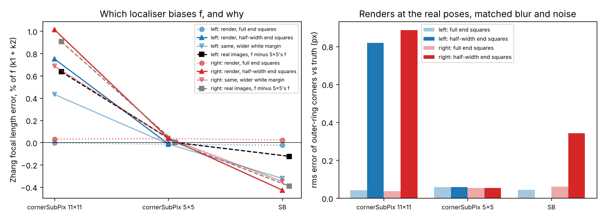
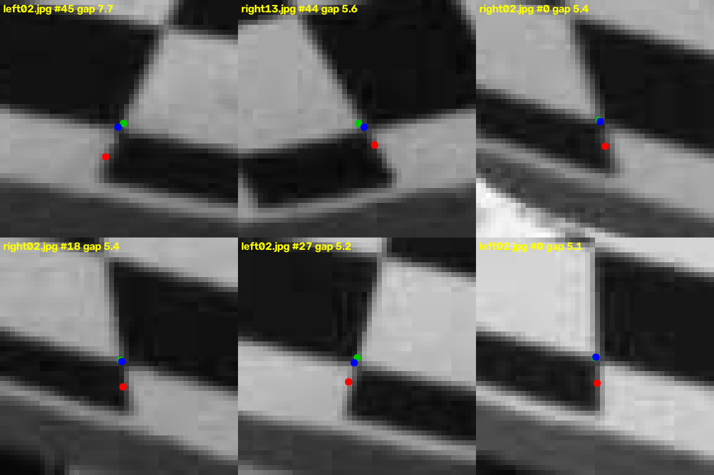
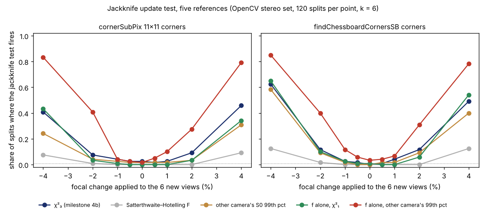
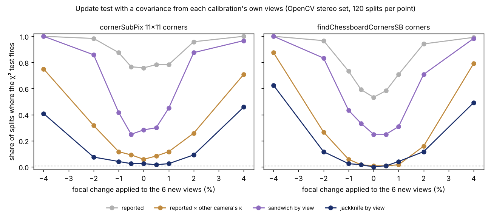
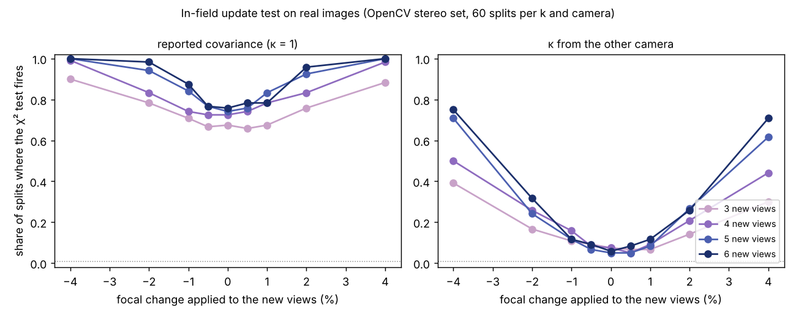
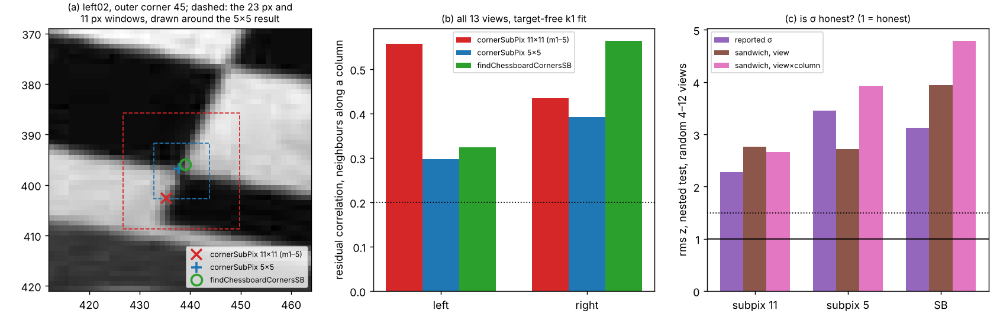
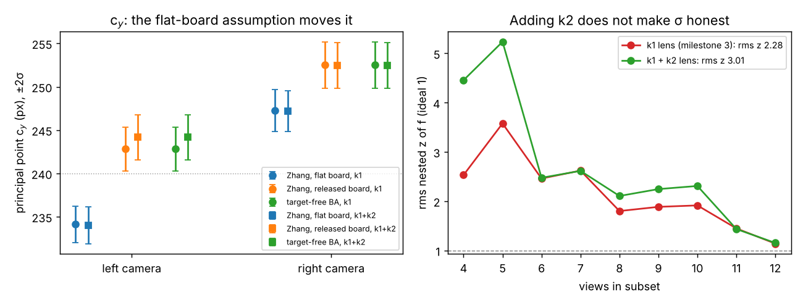
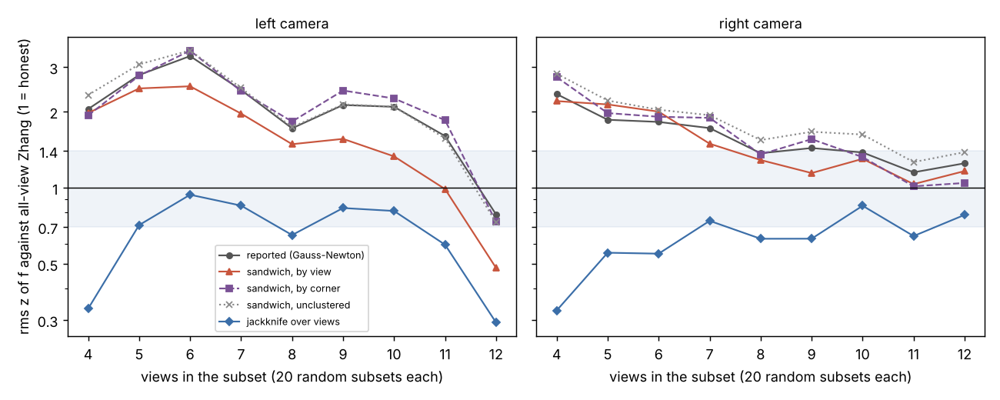
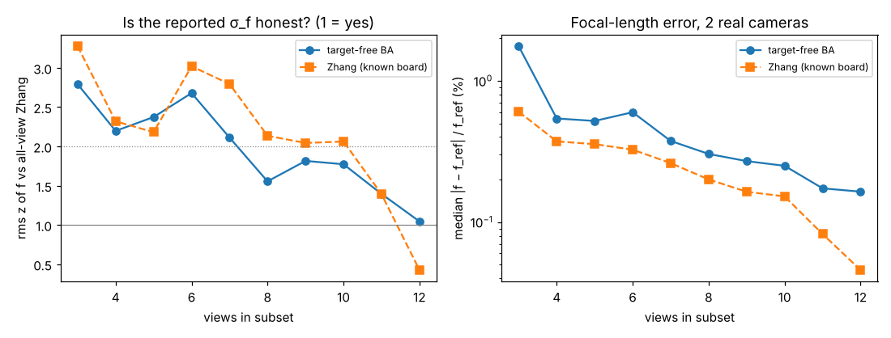
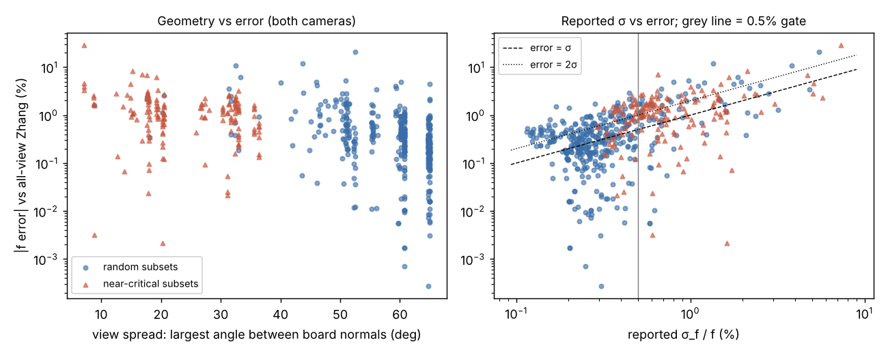

# sensing-selfcal: can a robot camera calibrate itself without a checkerboard, and does it know when it is wrong?

**Live page:** https://marisstella.app/research/sensing-selfcal/

A research programme (proposal: [`PROPOSAL.md`](PROPOSAL.md); log: [`LOG.md`](LOG.md)) on
**target-free camera self-calibration**: recovering a camera's focal length, principal
point and lens distortion by bundle adjustment from the features it tracks, without a
calibration target, and testing whether the solver's own uncertainty is honest enough for a
field robot to accept or reject the update.

**Milestone 1 headline, on two real cameras** (OpenCV's stereo calibration photos, 13 views
each): withholding the checkerboard's geometry and solving for the 54 corners as free 3-D
points, bundle adjustment started 30% off lands **within 0.15% (left) and 0.24% (right) of
Zhang's target calibration** of the focal length, with a reported σ only **1.12× Zhang's**
(not the ≥2× we predicted). The free points also show that **the board is not flat**: the
reconstructed corners leave the best plane by 0.77% of a square rms (2.4% at worst), and the
two cameras, solved independently, reconstruct the same bend (correlation 0.90). Over 400
random view subsets the reported σ<sub>f</sub> is about **2× too small** (rms z 1.94, 95%
1.75–2.12, against an ideal 1), and Zhang's own σ is no better (2.16).

**Milestone 2 headline** (same views, 560 solves, all converged): the **view geometry predicts
the error** (Spearman ρ −0.46 and −0.58 between the spread of board orientations and the focal
error), and the reported σ tracks it too (ρ +0.39 / +0.45), but **σ stays about 2× too small**,
2.4× on near-critical subsets where the boards are close to parallel. There, **Zhang's own σ
is far worse** (rms z 5.8) and its focal length is further off than the target-free one. A
first accept gate (σ<sub>f</sub>/f ≤ 0.5%) rejected 92% of bad updates but accepted only 84%
of good ones, short of the 90/90 target.

**Milestone 3 headline** (same 560 subsets, plus 3,480 leave-one-view-out re-solves): the
2× overconfidence is **real, not an artefact of the checkerboard reference**: scored against
the target-free all-view solution with the nested variance, rms z is still 2.28. A
**leave-one-view-out jackknife σ is honest without any fitted factor** (rms z 0.70 / 0.65,
2σ coverage 97–99%, rms z 1.01 on near-critical subsets where the reported σ gives 2.34),
while the cluster-robust sandwich only helps on the left camera (1.76 / 1.59). But the
jackknife **ranks updates worse** (ROC AUC 0.75 against 0.91 for the reported σ) and is
very conservative at 4 views, so **an honest σ and a good gate are different statistics**.

**Milestone 5 headline** (lens terms and the bent board): OpenCV's **released-object
calibration** (Strobl and Hirzinger's bend-aware Zhang) **is the same problem as our
target-free bundle adjustment**: both return identical intrinsics, σ and board shape. Comparing
it with the flat-board fit isolates the board assumption, and **the flat, evenly spaced board
moves the principal point c<sub>y</sub> by 8.7 px (left) and 5.3 px (right)** (corrected in milestone 6:
most of that came from misplaced outer corners; with SB corners the shift is 1.2 / 1.4 px). Adding a second
radial term k<sub>2</sub> (clearly non-zero) **does not make σ honest** (nested rms z 3.01,
2.00 without five outliers, against 2.28), and the residuals stay correlated between
neighbouring corners (0.31 / 0.24), but only along one board axis.

**Milestone 6 headline** (the corner detector, 1,680 more solves): the one-axis residual
pattern **comes from the corner localiser used in milestones 1–5**. `cornerSubPix` with an
11×11 half-window (a 23 px box) **misplaces corners on the board's outer ring by up to 6.4 px**,
because the box runs off the pattern. All 26 gaps over 1 px between it and a 5×5 window are on that ring. With a 5×5 window or
OpenCV's `findChessboardCornersSB`, reprojection rms halves (0.26 → 0.11–0.14 px left) and
the column structure mostly goes away. **That correction shrinks milestone 5's c<sub>y</sub>
result**: the flat-board shift is 8.7 px with the old corners, 4.5 px with 5×5 and **1.2 px
(1.8σ) with SB corners** on the left camera (5.3 → 3.8 → 1.4 px right). The board's bend
survives, 25–45% shallower. The **detector choice alone moves Zhang's focal length by up to
7.2 px (1.3%)**, several times its reported σ. And **better corners make σ less honest, not
more**: σ halves but the error does not, so the nested rms z rises from 2.28 to 3.1–3.5. A
sandwich clustered by board column does not fix it (2.44 / 1.72).

**Milestone 4 headline** (the accept/reject decision, 908 solves on disjoint view sets): when
the old calibration comes from 7 views and the new one from 3–6 *other* views of the same,
unchanged camera, **the χ² update test with the solver's covariance fires on 72% of splits**
(nominal 1%). The covariance is 2.3–2.9× too small for f and c<sub>y</sub> and **4.6× for the right
camera's c<sub>x</sub>, a gap that does not shrink with more views**: each view set carries its own
systematic offset. Inflating the covariance by the factor measured on the *other* camera
brings false alarms to 6.5% (11% left, 2% right), but then the test **detects a 1% focal
change in only 10–12% of splits** with 5–6 views and **a real swap to the other camera unit
(0.67% in f, 17 px in c<sub>x</sub>) in 30–77%**. Even a factor fitted on the scored camera itself
(optimistic) leaves 4% as the smallest focal change detected most of the time. The rule
adopts a harmful update (f error 0.5% worse than keeping the old one) in 5.6% of decisions
with the raw covariance and 1.4% with the transferred factor. One of five pre-registered
hypotheses held.

**Milestone 4b headline** (8,580 more solves, two corner detectors): replacing the scalar
factor with a covariance each calibration computes from its own views, **a leave-one-view-out
jackknife makes the update test quiet with nothing borrowed from another camera**: 2.5% false
alarms on the old corners and 1.7% on `findChessboardCornersSB` corners (nominal 1%), against
58–74% for the solver's covariance and 36–38% for a sandwich clustered by view. The price is
power: with 6 new views the jackknife test **detects a 2% focal change in 7–12% of splits and a
4% change in 41–62%**. The corner detector matters as much as the covariance: with SB corners
the jackknife test **catches the real swap to the other camera unit in 75% of splits, against
30%** with the old corners. Harmful adoptions fall to 0.5–1.5% of decisions. All five
pre-registered predictions held.

**Milestone 4c headline** (no new solve; milestone 4b's 8,580 solves re-tested): **why the
jackknife test was deaf**. For the three-parameter statistic it is information: even a threshold
fitted on the scored camera itself (an oracle) detects a 2% focal change in only 5–10% of splits,
and a small-sample Hotelling reference is far too strict (0 false alarms, but it keeps only a fifth
of the 4% detections). For the focal length alone the χ² reference is mis-scaled about 3×: testing
f against the **99th percentile measured on the other camera** detects a **2% focal change in 28–41%
of splits and 4% in 78–85%** with 6 new views (0–5% false alarms), nearly what the oracle gets.
Four of five pre-registered predictions held; the f-only power figure was not pre-registered.

**Milestone 6b headline** (which corner localiser is right; 26 renders of the real views from a
known camera, 1,200 fits): **the printed board's end squares are only half as wide as the rest**
(they reach 0.49–0.53 of the corner spacing past the last corner, against 0.94–0.97 on the other
sides), and that alone explains the localiser puzzle. On renders with full squares all three
localisers find the corners to 0.04–0.06 px and the focal length to 0.04%. With half-width end
squares the **11×11 `cornerSubPix` window is pulled up to 9.6 px towards the board's edge and
biases Zhang's f by +0.4% to +1.5%** (real images: +0.64% / +0.91% against the 5×5 window), and
**`findChessboardCornersSB` is biased the other way, −0.3% to −0.4%** (real: −0.12% / −0.39%).
The **5×5 window is unaffected**, so its focal lengths (532.9 / 536.2 px) are the best estimates
here. One of five pre-registered predictions held; the cause was found after the first failed.



















## Why

Robot, drone and machine cameras drift out of calibration from knocks, heat and refocusing.
Recalibrating with a board takes the machine out of service. Self-calibration from scene
features avoids that, but only if the robot can tell a good update from a bad one. This
programme measures that on real images. Lab tag: ARPG (Christoffer Heckman), whose
multi-sensor SLAM with online self-calibration and change detection (Nobre et al., 2017) is
the closest robotics work.

## Milestone 1: target-free BA against Zhang on a real stereo pair

**Data.** `data/left01..14.jpg`, `data/right01..14.jpg` (no index 10), 640×480, a 9×6
inner-corner checkerboard, from OpenCV's `samples/data` (Apache-2.0, fetched from
github.com/opencv/opencv, 4.x branch). Corners by `cv2.findChessboardCorners` and
`cornerSubPix`; all 26 images detect.

**Model** (both solvers): f<sub>x</sub> = f<sub>y</sub> = f, (c<sub>x</sub>, c<sub>y</sub>),
radial 1 + k<sub>1</sub>r<sup>2</sup> (k<sub>2</sub> as an ablation), no tangential terms.

**Reference.** Zhang calibration (`cv2.calibrateCameraExtended`) with the known board on all
13 views; σ from OpenCV.

**Target-free solver** (`src/selfcal.py`). The same pixels and correspondences, board
geometry withheld: 54 free 3-D points, 13 poses, 4 intrinsics. Start: f 30% off (both
directions tried), view `ref`'s corners pushed onto the plane z = 1 of its own camera (as if
the board faced it), PnP for every view. Then `scipy.optimize.least_squares` (trf, sparse
Jacobian). σ from the Gauss–Newton normal matrix, scaled by the residual variance, with the
7 similarity-gauge directions removed by pseudo-inverse.

**Results, all 13 views** (`experiments/m1_real/summary.json`):

| | left | right |
|---|---|---|
| Zhang f (σ), px | 535.62 (0.88) | 539.71 (1.07) |
| Target-free f (σ), px | 534.82 (0.98) | 538.43 (1.20) |
| Gap | −0.15% (−0.6 σ) | −0.24% (−0.8 σ) |
| σ ratio, target-free / Zhang | 1.12 | 1.12 |
| Reprojection rms per coordinate, Zhang / target-free, px | 0.30 / 0.26 | 0.34 / 0.29 |
| c<sub>y</sub> gap, px (σ) | +8.7 (5.3 σ) | +5.2 (2.9 σ) |
| Same f from a 0.7× start | 534.82 | 538.43 |
| f with k<sub>2</sub> added, Zhang / target-free | 536.27 / 535.72 | 541.07 / 538.15 |

**View subsets.** 20 random subsets of each size 3 to 12 per camera (400 solves, seeds fixed
in `run.py`), started 30% high. z = (f<sub>subset</sub> − f<sub>Zhang, all</sub>) / σ<sub>f, subset</sub>:

| Views | rms z, target-free | rms z, Zhang | median σ ratio | median \|Δf\|, target-free | median \|Δf\|, Zhang |
|---|---|---|---|---|---|
| 3 | 2.79 | 3.27 | 2.91 | 1.76% | 0.60% |
| 4 | 2.20 | 2.32 | 1.54 | 0.54% | 0.37% |
| 6 | 2.68 | 3.02 | 1.28 | 0.60% | 0.33% |
| 8 | 1.56 | 2.14 | 1.17 | 0.30% | 0.20% |
| 10 | 1.77 | 2.06 | 1.12 | 0.25% | 0.15% |
| 12 | 1.05 | 0.43 | 1.13 | 0.16% | 0.05% |

(All sizes in `summary.json`.) The worst target-free subset (3 views) was 20% off; from 4
views the worst was 4.4%, from 8 views under 1%.

**Board flatness** (`experiments/m1_real/planarity.json`). The target-free corners deviate
from their best-fit plane by 0.0077 (left) and 0.0077 (right) square widths rms, 0.024 at
most; the out-of-plane heights from the two independently solved cameras correlate at 0.903
(0.909 with k<sub>2</sub>). Grid spacing varies by 0.3%. A flat-board model cannot fit that
bend, which is the likely reason the target-free fit has 13–15% lower reprojection error (milestone 1 first
said about 40%, comparing OpenCV's per-point rms with our per-coordinate one; corrected in milestone 5) and
part of the c<sub>y</sub> disagreement (Strobl and Hirzinger, 2011, found the same for
printed targets).

**Hypotheses** (pre-registered in `LOG.md`):
- H1 (f within 2% of Zhang with all views): **held**, 0.15% and 0.24%.
- H2 (rms z ≤ 2 over subsets of 4–12 views): **held narrowly**, 1.94 (95% bootstrap
  1.75–2.12). The σ is still about twice too small, most at 3 to 7 views.
- H3 (target-free σ ≥ 2× Zhang's at 13 views): **refuted**, 1.12×. The ratio does fall with
  views (2.9× at 3).

## Milestone 2: view geometry, near-critical subsets and a first accept gate

Pre-registered in `LOG.md` before any run; results in `experiments/m2_spread/summary.json`.

**Solver.** `selfcal_fixed_analytic` in `src/selfcal.py`: view `ref`'s pose and corner 0's
depth are held fixed (the 7 similarity directions; a zero translation at the reference camera
leaves the scale free, so the depth pin is needed), the Jacobian is analytic (tested against
finite differences), and Levenberg–Marquardt replaces milestone 1's trust-region/LSMR solver.
All 560 solves converged on tolerance, in at most 177 evaluations (21–23 on all 13 views).
All-view f moved by 0.0004 px.

**Geometry.** Each view's board normal in the camera frame comes from the all-view Zhang
poses; a subset's *spread* is the largest angle between two of its normals (0° = all boards
parallel, where f is unidentifiable; Sturm and Maybank 1999). All 13 views span 65°. Besides
milestone 1's 400 random subsets (same seeds), the 20 smallest-spread subsets of each size 3–6
per camera (160 *near-critical* subsets, spread 7–36°).



| | random, 4 views | random, 8 views | near-critical, 4 views | near-critical, 6 views |
|---|---|---|---|---|
| median spread | 51° | 61° | 20° | 33° |
| median \|Δf\|, target-free | 0.54% | 0.30% | 1.09% | 0.82% |
| median \|Δf\|, Zhang | 0.37% | 0.20% | 1.50% | 1.08% |
| rms z, target-free | 2.21 | 1.56 | 2.08 | 2.45 |
| rms z, Zhang | 2.32 | 2.14 | 6.24 | 6.23 |

**Hypotheses:**
- H2 rerun (does milestone 1's rms z survive convergence?): **held**, 1.945 (95% 1.75–2.12)
  against 1.944; median f change 0.002 px.
- H6 (spread predicts error, ρ ≤ −0.3 on each camera): **held**, −0.46 and −0.58.
- H7 (σ stays honest on near-critical subsets, rms z ≤ 2): **refuted**, 2.41 (95% 2.09–2.81),
  20% beyond 3σ. Zhang's σ on the same subsets: rms z 5.83.
- H4, first test (gate σ<sub>f</sub>/f ≤ 0.5%: reject ≥ 90% of updates > 2% off, accept
  ≥ 90% of those ≤ 1% off): **refuted**, rejects 92% (56/61), accepts 84% (340/407). The five
  bad updates it let through were 2.0–2.9% off with σ/f just under the gate.

**Unplanned checks** (reported as such): with σ doubled the gate rejects every bad update but
accepts only 37% of good ones. An inflation factor κ fitted on one camera's random subsets does
not transfer cleanly: κ 2.21 from the left camera makes the right camera's rms z 0.74; κ 1.63
from the right leaves the left at 1.35 with 85% 2σ coverage. The median error/σ ratio is
1.0–1.8 in every σ bin, so the overconfidence is in the tails more than in the typical subset.

**What it means for a robot.** The solver's σ is informative (it ranks subsets by error about
as well as the geometry does) but not calibrated, and a fixed σ threshold cannot hit 90/90 on
this data. Near-parallel views are where a target calibration is most misleading about its own
error, which is an argument for self-calibrating BA plus an honest gate rather than for the
board.

## Milestone 3: is the overconfidence real, and does a robust σ fix it?

Pre-registered in `LOG.md` before any run (H8–H10, H4's second test); results in
`experiments/m3_robust/summary.json`. Same 560 subsets and reference views as milestone 2,
same solver (all 560 converged again, identical f).

**Estimators** (`src/selfcal.py`, no fitted constants). *Sandwich* (Huber–White):
var f = G/(G − 1) Σ<sub>g</sub> ((J<sub>g</sub>b)·r<sub>g</sub>)², b = (JᵀJ)⁻¹e<sub>f</sub>,
clustered by view, by corner, or unclustered (HC0). *Jackknife*: re-solve without each view
in turn (cold start), var f = (k − 1)/k Σ (f<sub>(i)</sub> − f̄)². 3,473 of 3,480
leave-one-out solves converged on tolerance. On all 13 views the jackknife σ is 2.59 px (left)
and 1.74 px (right), against the reported 0.98 and 1.20.

| rms z, random subsets of 4–12 views | left | right | near-critical, 4–6 views |
|---|---|---|---|
| reported σ (Gauss–Newton) | 2.21 | 1.63 | 2.34 |
| sandwich, by view | 1.76 | 1.59 | 3.60 |
| sandwich, by corner | 2.30 | 1.73 | 2.80 |
| sandwich, unclustered | 2.32 | 1.89 | 2.66 |
| **jackknife over views** | **0.70** | **0.65** | **1.01** |
| 2σ coverage, reported / jackknife | 68% / 97% | 78% / 99% | 58% / 96% |

**Hypotheses:**
- H8 (the overconfidence is not the reference's fault): **held**. Against the target-free
  all-view f with the nested variance σ<sub>sub</sub>² − σ<sub>all</sub>², rms z is 2.28 (95%
  1.93–2.73; 302 subsets, 58 with σ<sub>sub</sub> ≤ σ<sub>all</sub> dropped). With the
  jackknife σ the same test gives 0.85 (0.61–1.10).
- H9 (jackknife σ honest, rms z in [0.7, 1.4] on each camera): **refuted, narrowly and on the
  safe side**: 0.703 (left) and 0.651 (right, 95% 0.56–0.74), i.e. slightly conservative. The
  view-clustered sandwich fails at 4–6 views as predicted (2.23).
- H10 (jackknife σ ranks good against bad updates better than the reported σ): **refuted**.
  ROC AUC 0.75 against 0.91 (difference −0.15, 95% −0.25 to −0.07; 388 good, 22 bad
  updates of 4–12 views). The sandwich variants also rank worse (0.76–0.89).
- H4, second test (gate σ<sub>jack</sub>/f ≤ 0.5%): **refuted**. It rejects every bad
  update but accepts only 19% of good ones (0% on near-critical subsets). Thresholds fitted on
  one camera do not transfer for any σ: the best is the reported σ (fit left, score right:
  accept 76%, reject 79%; fit right, score left: 91% / 88%).

**Why the jackknife is conservative where it is.** The jackknife variance is biased upward
(Efron and Stein, 1981), and here the bias is large where the estimator is most non-linear:
at 4 views each leave-one-out solve has only 3 views, where milestone 1 saw errors up to 20%,
so σ<sub>jack</sub> is a median 15× the reported σ and rms z drops to 0.33. From 6 to 11
views the ratio is 2–5× and rms z 0.55–0.94. That inflation is also what costs it as a
ranking statistic: it measures how unstable the subset is to losing a view, which is noisy
with few views, more than how far it is from the truth.

**What it means for a robot.** The reported σ's 2× gap is real miscalibration, and
correlated per-image error (what the sandwich assumes) explains little of it on the right
camera. A jackknife over frames gives an error bar a robot can trust as a bound, at k extra
solves, but should not be the accept statistic on its own; the next gate should rank by the
reported σ (and view spread) and use the jackknife only to refuse updates whose honest error
bar is too wide.

## Milestone 5: does the bent board explain c<sub>y</sub>, and does k<sub>2</sub> explain the 2× σ?

Pre-registered in `LOG.md` before any run (H11–H13); results in
`experiments/m5_lens/summary.json`. Milestone 1 left two suspects: the bent board for the
8.7 / 5.2 px c<sub>y</sub> gap, and the k1-only lens for the overconfident σ.

**Bend-aware reference.** `zhang_ro` in `src/selfcal.py` wraps OpenCV's
`calibrateCameraROExtended` (released object; Strobl and Hirzinger, 2011): the board's 3-D
corners are refined with the camera, corner 0 and corner 8 held at their nominal positions.

**The released-object fit and target-free BA are the same estimator.** On both cameras and
both lens models they agree to 1e-6 px in f and c<sub>y</sub>, to 1e-8 in σ, and in the
reconstructed board (height correlation 1.000). With every corner free, the board contributes
only a metric scale, and scale carries no information about the intrinsics. That makes the
target-free numbers of milestones 1–3 also the numbers of a bend-aware target calibration of
these photos, and it isolates what the flat-board assumption does:

| all 13 views | left, k1 | left, k1+k2 | right, k1 | right, k1+k2 |
|---|---|---|---|---|
| c<sub>y</sub>, flat-board Zhang (σ), px | 234.1 (1.05) | 234.0 (1.07) | 247.2 (1.21) | 247.2 (1.19) |
| c<sub>y</sub>, released board = target-free (σ), px | 242.8 (1.26) | 244.2 (1.29) | 252.5 (1.34) | 252.4 (1.31) |
| c<sub>y</sub> shift from the flat assumption | −8.7 px (5.3σ) | −10.1 px (6.0σ) | −5.3 px (2.9σ) | −5.3 px (3.0σ) |
| f shift from the flat assumption | +0.79 px | +0.55 px | +1.28 px | +2.93 px |
| adjacent-corner residual correlation, flat / free board | 0.36 / 0.32 | 0.36 / 0.31 | 0.35 / 0.28 | 0.32 / 0.24 |

(Image centre: c<sub>y</sub> = 240. Neither fit is lens ground truth; the free-board one makes
fewer assumptions and fits better.) k<sub>2</sub> is 0.143 ± 0.018 (left) and 0.091 ± 0.007
(right): a real term the k1 model omits.

**Hypotheses:**
- H11 (with the released-object reference, the c<sub>y</sub> gap is under 2σ): **held, but
  trivially**: the gap is 4e-6σ because the two estimators coincide. The substantive result is
  the table's third row: the flat-board assumption alone moves c<sub>y</sub> by 5–10 px.
- H12 (k<sub>2</sub> is not the cause of the 2× overconfidence: nested rms z stays > 1.5 with
  k1 + k2 on milestone 2's 560 subsets): **held**. rms z 3.01 (95% 2.05–4.04; left 3.85,
  right 2.04; 296 subsets, 64 with σ<sub>sub</sub> ≤ σ<sub>all</sub> dropped), against 2.28
  with k1. The rise is fragile: two left-camera subsets of 4–5 views (z −28 and −23, where
  σ<sub>sub</sub> barely exceeds σ<sub>all</sub>) carry it. Without the five largest |z| it is
  2.00 (k1: 1.94); median |z| 1.31 (k1: 1.40). All 560 solves converged, at most 180 evaluations.
- H13 (residuals of adjacent corners stay correlated ≥ 0.1 with k1 + k2): **held**, 0.31
  and 0.24. The structure is one-directional: along the board's columns the correlation is
  0.44–0.56 (0.65–0.76 two corners apart), along its rows −0.02 to 0.09. A lens term acts
  radially in the image, not along one board axis, so the cause is likely in the board or the
  detector; this milestone does not establish which.

**Unscored.** Against the released-object reference itself, rms z over random 4–12-view
subsets is 1.66 (k1) and 1.79 (k2); k<sub>2</sub> shrinks σ<sub>f</sub> by a median 5% and
leaves the median focal error at 0.24%.

**What it means for a robot.** A flat-board target calibration of a printed board can be off
by 5–10 px in the principal point while reporting a 1 px σ, and a self-calibrating BA (or the
released-object option, which is the same thing) removes that bias for free. Adding lens terms
is not a fix for the overconfidence: the residuals are correlated along one board axis whatever
the lens model, which is the pattern a cluster-robust σ by board column, or the jackknife, has
to absorb.

## Milestone 6: where the column pattern comes from, and does a better detector fix σ?

Pre-registered in `LOG.md` before any run (H14–H17); results in
`experiments/m6_detector/summary.json` and `bend.json`. Milestones 1–5 located corners with
`findChessboardCorners`, then `cornerSubPix` with an 11×11 half-window, so the box is 23 px wide. Corners here
are 25–41 px apart. This milestone adds two localisers on the same images, matched to the
same corner order by nearest neighbour (one-to-one in all 26 images): `cornerSubPix` with a
5×5 half-window, and `findChessboardCornersSB` with `CALIB_CB_ACCURACY` (Duda and Frese,
2018). Then milestone 2's 560 subsets are re-solved per detector (k1 model; 1,679 of 1,680
converged), and the sandwich σ is clustered by (view, board column) and (view, board row).

**The old localiser misplaces outer corners.** Between the 11×11 and 5×5 windows the median
gap is 0.07 px in the grid's interior, but **26 corners differ by more than 1 px (up to
6.4 px), all of them on the outer ring**, where the 23 px box covers the end of the pattern
(figure, panel a). SB against 11×11: 52 corners over 1 px (up to 7.7 px), again all on the ring;
SB against 5×5: at most 1.7 px.

| all 13 views, target-free k1 | left, 11×11 | left, 5×5 | left, SB | right, 11×11 | right, 5×5 | right, SB |
|---|---|---|---|---|---|---|
| reprojection rms per coordinate, px | 0.259 | 0.114 | 0.144 | 0.291 | 0.153 | 0.170 |
| f (σ), px | 534.82 (0.98) | 534.34 (0.43) | 533.04 (0.54) | 538.43 (1.20) | 535.75 (0.62) | 534.18 (0.69) |
| flat-board Zhang f, px | 535.62 | 531.96 | 530.86 | 539.71 | 534.56 | 532.54 |
| c<sub>y</sub>, free board − flat board, px (σ) | 8.7 (8.3) | 4.5 (8.4) | **1.2 (1.8)** | 5.3 (4.3) | 3.8 (5.6) | **1.4 (2.0)** |
| board flatness, rms (square widths) | 0.0077 | 0.0042 | 0.0058 | 0.0077 | 0.0050 | 0.0056 |
| residual corr., neighbours along a column / a row | 0.56 / 0.06 | 0.30 / 0.28 | 0.32 / 0.23 | 0.44 / 0.09 | 0.39 / 0.34 | 0.56 / 0.29 |
| variance in per-(view, column) means (null 0.17) | 0.65 | 0.27 | 0.41 | 0.51 | 0.23 | 0.43 |

(Cy gaps in σ of the flat fit. The left/right correlation of the bend's heights stays 0.89–0.90 with every
detector, so the bend is real and seen by both cameras; it is shallower.)

**Hypotheses:**
- H14 (with SB corners the along-column correlation falls below 0.2): **refuted**, 0.32
  (left) and 0.56 (right). The *one-directional* pattern goes (along-row correlation rises
  to 0.23–0.34, and the per-column share falls from 0.65 / 0.51 to 0.41 / 0.43, 0.27 / 0.23
  with 5×5), but what is left is a smoother 2-D correlation that no localiser removes.
- H15 (column offsets mostly sideways, ≥ 70%): **held**, 91% (left) and 78% (right) of the
  per-(view, column) mean residual lies perpendicular to the column's line, with the old
  corners (57–67% with the new ones). A whole column shifted sideways is what misplaced
  end-of-column corners would do under a fitted model.
- H16 (sandwich clustered by (view, column) is honest, rms z in [0.7, 1.4]): **refuted**,
  2.44 (left) and 1.72 (right), no better than the reported σ (2.21 / 1.63); by (view, row)
  2.42 / 1.94. On synthetic data with pure per-column offsets it moves the right way but
  still covers only part of the gap (median σ 4.3 against a true 5.8 px and a reported 3.6),
  so even a correct cluster model with 9k clusters is too small here.
- H17 (with SB corners the nested rms z ≤ 1.5): **refuted, in the opposite direction**:
  3.12 (95% 2.88–3.37; median |z| 1.97) against 2.28 (median |z| 1.40) with the old corners;
  5×5 gives 3.45. Cleaner corners halve the residuals and so halve σ (median σ<sub>f</sub>
  1.44 → 0.73–0.87 px), but the focal error against each detector's own all-view fit only
  falls from 0.24% to 0.15–0.23%. (Fewer subsets drop out of the nested test with the new
  corners, 7–11 against 58, which is part of the change; the median |z| rises too.)

**What it means for a robot.** Three things. (1) With an 11×11 `cornerSubPix` window on a board whose
squares are under ~45 px, check the outer ring: on these images it is several pixels off, and a
free-board model reads that as a bent board and a shifted principal point. (2) The localiser
moves f by up to 1.3% between three standard OpenCV settings while every fit reports a σ
under 0.2%. That is a systematic error no σ from the residuals can see. (3) The σ's
overconfidence is not a corner-noise problem: the better the corners, the more the error
is dominated by something the residuals do not carry (the remaining smooth correlation,
lens or board terms the model omits, or the data's few views), so the honest error bar has
to come from outside the fit, as milestone 3's jackknife did.

## Milestone 6b: which corner localiser is right? Renders with a known camera

Pre-registered in `LOG.md` before any image was rendered (H33–H37); results in
`experiments/m6b_render/summary.json`. Milestone 6 found that the localiser alone moves the
focal length by about 1% and that no ground truth said which one was right. Here every real
view is rendered again from a known camera at its real pose, and each localiser is scored
against the exact projections.

**Renderer** (`src/render.py`). The true camera of each side is its all-view flat-board Zhang
fit (k1 + k2), and the 13 poses are that fit's poses. Each 640×480 pixel averages 4×4 rays,
each undistorted, intersected with the board plane and shaded (10×7 squares, a white margin, a
uniform background), then Gaussian blur, noise, 8-bit rounding and JPEG (quality 90). The
**matched setting** is calibrated so the renders' own statistics equal the real images'
(`measure.py`): edge σ from an erf fit across every inner edge, 0.948 / 0.957 px on the real
images and 0.949 / 0.960 on the renders; noise from a Laplacian in flat squares, 0.52 / 0.61
real and 0.54 / 0.63 rendered; grey levels from the squares (about 23 and 236). Also swept:
half and double blur, zero and double noise, 20 seeds each.

| Hypothesis | Prediction | Result |
|---|---|---|
| H33 | renders reproduce the real ring disagreement (> 1 px) | **refuted**: max 11×11–SB gap 0.19 / 0.36 px (real 7.7 / 5.6) |
| H34 | SB has the lowest corner error | **refuted**: all three 0.035–0.060 px rms; 11×11 lowest on the ring |
| H35 | SB's f within 0.2% of the truth, 11×11 worse | **refuted**: every localiser within 0.04% |
| H36 | target-free σ honest on renders (rms z ≤ 1.5) | **refuted**: 1.55 / 1.80, from a fixed 0.02–0.04% bias; the spread alone is 0.4–0.5σ |
| H37 | no column correlation on an ideal pattern (< 0.2) | **held**: −0.09 to +0.08 (real 0.32–0.56) |

**What the real board has that the renders did not** (unscored, found after H33 failed).
Magnified, the real corners where 11×11 and SB disagree most show the 11×11 corner 4–8 px off
the visible corner, towards the board's edge (second figure above), and every such corner is in
grid column 0 or 8. Measured outward along the grid lines (`outer.py`), the end squares of those
columns reach only **0.49–0.53 of the corner spacing** past the last corner (10–90%:
0.35–0.59); the other two sides reach 0.94–0.97, and full-square renders read 0.95–1.01. The
23 px window around such a corner takes in the edge between the cut-short square, the white
margin and whatever lies beyond. Rendered with half-width end squares (`ablate.py`, 5 seeds):

| Render (5 seeds) | 11×11 f error | 5×5 f error | SB f error | 11×11 ring corners > 1 px |
|---|---|---|---|---|
| full end squares, any surround | 0.00 / +0.03% | −0.01 / +0.04% | −0.02 / +0.03% | 0 |
| half-width, margin 0.5 square, grey beyond | +0.43 / +0.69% | −0.01 / +0.04% | −0.32 / −0.35% | 13 / 18 |
| half-width, margin 0.15, grey beyond | +0.75 / +1.01% | −0.01 / +0.04% | not detected / −0.43% | 13 / 18 |
| half-width, margin 0.15, dark beyond | +1.20 / +1.47% | −0.01 / +0.04% | not detected | 12 / 15 |
| **real images, f minus 5×5's f** | **+0.64 / +0.91%** | 0 | **−0.12 / −0.39%** | 22 / 30 (vs SB) |

(left / right camera.) So the localiser bias is a property of the printed board, not of the
image noise or blur: a window that reaches past a cut-short end square is pulled towards the
board's edge, and SB's model of the pattern is pulled the other way. The 5×5 window stays inside
the squares and is unbiased in every case, so **Zhang on 5×5 corners, 532.9 px (left) and
536.2 px (right), is the best focal length for this rig**; milestones 1–5 (11×11 corners) carry
a +0.6–0.9% bias, and milestones 4b–4c (SB corners) a −0.1 to −0.4% one. For practice: print
full end squares with a margin wider than the corner window, or size the window below the
shortest end square in the image.

Limits: the renders leave out the bend (milestones 5–6), the clipboard and clutter, vignetting
and the sensor's own noise; the ablation fixes the end-square reach at 0.5 where the real one
varies; the reach measurement and the ablation were not pre-registered. The truth camera is the
11×11 fit only to place the board; any camera near it would do.

## Milestone 4c: the jackknife test's reference distribution

Pre-registered in `LOG.md` (2026-11-12) before any number was computed. Code:
`experiments/m4c_reference/analyse.py`, `satterthwaite_nu` and `hotelling_crit` in `src/selfcal.py`.
It re-uses milestone 4b's stored solves, splits and disturbances (k ≥ 4, 360 unchanged splits per
detector, 9,360 decisions) and changes only the threshold.

**Statistics and references.** W = dᵀ(J<sub>old</sub> + s²J<sub>new</sub>)⁻¹d on (f, c<sub>x</sub>, c<sub>y</sub>), and z<sub>f</sub>² on f
alone. References at 1%: **χ²** (11.34; 6.63 for f), as 4b; **F**, Hotelling's T² with
Welch–Satterthwaite degrees of freedom from the two jackknife f variances (median ν 6.2 / 5.9, so
a median threshold of 68 / 79); **E**, the other camera's 99th percentile on unchanged splits,
same detector; **O**, the same camera's own (an oracle, so ≈ 1% false alarms by construction).

**Hypotheses** (`experiments/m4c_reference/summary.json`; 95% Wilson intervals):

| | prediction | result | |
|---|---|---|---|
| H28 | F: false alarms ≤ 1%, both detectors | 0/360 on each (0–1.1%) | held |
| H29 | F keeps < ½ of χ²'s ±4% detections at k = 6 | 19% (11×11), 22% (SB) | held |
| H30 | E: false alarms ≤ 5% each camera, both detectors | 2.2 / 0.6% (11×11), 0.6 / 2.8% (SB) | held |
| H31 | O: ±2% at k = 6 detected in < 25% | 4.6% (11×11), 10.0% (SB) | held |
| H32 | f alone vs χ²<sub>1</sub> beats W vs χ²<sub>3</sub> at ±2%, ≤ 3% false alarms | 3.3 vs 8.3% (11×11), 7.9 vs 11.7% (SB) | refuted |

**Power, 6 new views** (share of 120 splits; −/+ for focal changes):

| change | W χ² 11×11 | f vs E 11×11 | W χ² SB | f vs E SB | f vs O SB (oracle) |
|---|---|---|---|---|---|
| none (k ≥ 4, false alarm) | 2.5% | 1.4% | 1.7% | 2.5% | 1.1% |
| focal −1% / +1% | 4 / 3% | 4 / 10% | 3 / 4% | 12 / 7% | 11 / 7% |
| focal −2% / +2% | 8 / 9% | 41 / 28% | 12 / 12% | 40 / 31% | 38 / 33% |
| focal −4% / +4% | 41 / 46% | 83 / 79% | 63 / 49% | 85 / 78% | 89 / 83% |
| principal point +10 px | 6% | 2% | 12% | 3% | 2% |
| swap to the other unit | 37% | 4% | 86% | 2% | 3% |

**Reading.** The 2% focal change was hidden by two different things. In the three-parameter
statistic it is buried: no threshold, not even one fitted on the scored camera, lifts it above
10%. On f alone it is visible, but the jackknife overstates f's variance by about 3× on these
splits (the 99th percentile of z<sub>f</sub>² is 1.7–4.2, not 6.6), so a χ² threshold throws the
signal away. A tail threshold measured on a sibling unit recovers it, at a false-alarm cost that
did not always match the oracle (5.0% on the SB left camera, whose own threshold is 4.2 against
the right's 1.9). The f-only test is blind to the unit swap, which lives in c<sub>x</sub>; an
exploratory union with W (not pre-registered) keeps both, at 3–4% false alarms. A
Hotelling-type small-sample correction is the textbook fix and the wrong one here: it assumes
the jackknife is unbiased, and it is conservative already.

**What it means for a robot.** Run two tests on an update: the focal length alone against a
threshold measured on a sibling unit of the same camera model, and the three-parameter test for
principal-point moves. With 6 new views of this rig that catches a 2% focal change about a third
of the time and a 4% change four times in five; a 1% change remains below what the views can tell.

## Milestone 4b: a covariance from the calibration's own views, on two detectors

Pre-registered in `LOG.md` (2026-11-12) before any solve. Code: `experiments/m4b_viewcov/`,
`cov_cr_view` and `jackknife_cov` in `src/selfcal.py`.

**Set-up.** Milestone 4's splits, disturbances and rule, run on two corner detectors:
`cornerSubPix` with an 11×11 window (milestones 1–5) and `findChessboardCornersSB`
(milestone 6). Four covariances for Σ<sub>old</sub> + Σ<sub>new</sub>: **R** the solver's reported
covariance; **T** R times the *other* camera's nested rms z for that detector (2.67 / 1.89 for 11×11
corners, as milestone 3; 3.47 / 2.74 for SB); **V** the 3×3 sandwich clustered by view with
the G/(G − 1) factor; **J** the 3×3 leave-one-view-out jackknife, each delete-one set
re-solved cold. J needs 4 or more new views, so all hypotheses are scored on k ≥ 4 (360
decisions per detector and covariance). 2,145 distinct view sets per camera and detector, 8,580
solves, 4 not converged (all 3-view sets).

**Hypotheses** (`experiments/m4b_viewcov/summary.json`; 95% Wilson intervals; k ≥ 4):

| | prediction | result | |
|---|---|---|---|
| H23 | R, SB corners: false alarms ≥ 50% | 57.8% (53–63); 11×11 corners 74.2% | held |
| H24 | V: false alarms > 5%, both detectors | 37.8% (11×11), 36.1% (SB) | held |
| H25 | J: ≤ 3% pooled, ≤ 5% each camera, both detectors | 2.5% (1.3–4.7; 2.8 / 2.2%), 1.7% (0.8–3.6; 0.6 / 2.8%) | held |
| H26 | J detects the unit swap less often than T, both detectors | J 30.3% vs T 41.7% (11×11); 74.7% vs 93.1% (SB) | held |
| H27 | J: harmful adoptions ≤ 2%, both detectors | 0.47% (11×11), 1.54% (SB) | held |

**Power, 6 new views** (unscored; share of 120 splits where the test fires):

| change | R 11×11 | J 11×11 | R SB | T SB | J SB |
|---|---|---|---|---|---|
| none (false alarm) | 76% | 3% | 53% | 1% | 0% |
| focal +1% / −1% | 78 / 88% | 3 / 4% | 71 / 73% | 2 / 6% | 4 / 3% |
| focal +2% / −2% | 96 / 98% | 9 / 7% | 94 / 97% | 16 / 27% | 12 / 12% |
| focal +4% / −4% | 100 / 100% | 46 / 41% | 99 / 100% | 79 / 88% | 49 / 62% |
| principal point +10 px | 70% | 6% | 98% | 6% | 12% |
| swap to the other unit | 100% | 37% | 100% | 99% | 86% |

**Reading.** The jackknife's per-parameter rms z on unchanged cameras is 0.46–0.84, so it
overstates the spread on average, yet it still fires on 1.7–2.5% at a nominal 1%: the
set-to-set offsets have heavier tails than a χ² assumes. With the gate also on the jackknife
σ<sub>f</sub> (unscored), harmful adoptions fall to 0.04–0.13%, but the rule then adopts in only
about 1% of decisions. SB corners help every covariance: the transferred factor no longer
over-alarms on the left camera (1.1% against 11.7%), and the swap, which shows mostly in the
principal point, becomes visible to the jackknife.

**What it means for a robot.** A camera can judge its own update without a factor calibrated
elsewhere: re-solve with each view left out and use the spread. That gives an honest test with
4–6 views, but an honest test on this rig says a focal change under about 4% is not
distinguishable from the difference between two sets of views. Use the best corner localiser
available before tuning the statistics; with SB corners, a borrowed factor from a sibling unit
of the same camera model (T) is the most sensitive quiet test here, at the cost of trusting that
the sibling's error matches.

## Milestone 4: the accept/reject test, old and new calibrations from disjoint views

Pre-registered in `LOG.md` (2026-11-12) before any run. Code: `experiments/m4_accept/`,
`update_test`, `decide`, `disturb_obs` and `disturb_solution` in `src/selfcal.py`.

**Set-up.** A deployed camera's old calibration comes from images other than the new ones,
so each camera's 13 views are split: an *old* set of 7 views and a *new* set of k ∈ {3, 4,
5, 6} views from the other 6, 60 splits per k and camera (seeds fixed; 908 distinct view
sets, all converged). Model: f, c<sub>x</sub>, c<sub>y</sub>, k<sub>1</sub>, the milestone-2 solver.
Changes applied to the new set: none (S0); a focal change of ±0.5, 1, 2, 4% about the image
centre (S1); a principal-point shift of 2, 5, 10 px (S2); and a real one, the new views
taken from the *other* camera of the pair (S3: a different unit of the same model, all-view
f 0.67% and c<sub>x</sub> 17 px apart). S1 and S2 are exact transforms of the pinhole-plus-k<sub>1</sub>
model, so the disturbed solution is the transformed undisturbed one; a test re-solves the
disturbed corners and matches to 1e-4 px. Truth: the camera's all-view solution, transformed.

**The rule.** χ² = Δᵀ(κ²(Σ<sub>old</sub> + Σ<sub>new</sub>))⁻¹Δ over (f, c<sub>x</sub>, c<sub>y</sub>). Above
11.34 (χ²<sub>3</sub>, 1%) a change is detected; detected and σ<sub>f,new</sub>/f ≤ 0.5%: adopt the new
calibration; detected and imprecise: flag for a target recalibration; otherwise keep the old
one. κ = 1, or κ = the other camera's milestone-3 nested rms z (1.89 for left, 2.67 for right).

**Hypotheses** (`experiments/m4_accept/summary.json`; 95% Wilson intervals):

| | prediction | result | |
|---|---|---|---|
| H18 | S0, κ = 1: false alarms > 5% | 72.5% (68–76); left 68%, right 77% | held |
| H19 | S0, transferred κ: ≤ 3% pooled, ≤ 5% each | 6.5% (4.6–9.0); left 10.8%, right 2.1% | refuted |
| H20 | S3 detected ≥ 90%, k ≥ 4, both directions | 77% (new views left), 30% (new views right) | refuted |
| H21 | 1% focal change detected ≥ 80%, k ≥ 5 | 11.7% (−1%), 10.0% (+1%) | refuted |
| H22 | harmful adoption ≤ 2% overall | 3.5% (3.2–3.9); κ = 1: 5.6%, transferred: 1.4% | refuted |

**Why the test cannot be both quiet and sensitive** (unscored diagnostics on S0). The rms
z-scores of (f, c<sub>x</sub>, c<sub>y</sub>) between old and new are 2.45 / 2.35 / 2.94 (left) and
2.33 / **4.56** / 2.51 (right). The right camera's c<sub>x</sub> z stays at 4.3–4.8 from 3 to 6 new
views, so it is not noise that more views average away but an offset each view set carries.
The median principal-point error of a new set is 15 px with 3 views and 6.3 px with 6
(old set of 7: about 5 px), against a reported σ near 1.3 px. The factor that makes S0 fire
on exactly 1% (fitted in sample, so optimistic) is 2.69 / 4.80 for the 3-parameter test and
2.24 / 2.69 for f alone. At that factor the f-only test detects a 2% focal change with 6 new
views in 32–38% (left) and 0–2% (right) of splits, and a 4% change in 90–97% and 52–72%; the
3-parameter test detects the unit swap in at most 28%. The raw-covariance rule flags 37% of
all decisions for a target recalibration; with the transferred factor, 7%.

**What it means for a robot.** With 3–6 views of a checkerboard-grade scene, the update
test is limited by systematic error that differs between view sets, not by the noise the
covariance describes. A raw χ² test cries wolf on most unchanged cameras; inflated enough to
be quiet, it misses focal changes under about 4% and misses a swapped camera unit more often
than not. A fleet that wants to catch 1% changes in the field needs either many more views
per update or an error model built from repeated captures of the same camera (the empirical
null used above), not the solver's covariance. Keeping the old calibration is the safe
default: with the transferred factor the rule made a harmful adoption in 1.4% of decisions.

## Reproduce

```
pip install numpy scipy opencv-python-headless matplotlib pytest
python3 experiments/m1_real/run.py        # ~40 min on 4 cores; results.json
python3 experiments/m1_real/analyse.py    # summary.json, selfcal_vs_zhang.png
python3 experiments/m1_real/planarity.py  # ~3 min; planarity.json
python3 experiments/m2_spread/run.py      # ~10 min on 4 cores; results.json
python3 experiments/m2_spread/analyse.py  # summary.json, spread_vs_error.png
OMP_NUM_THREADS=1 python3 experiments/m3_robust/run.py   # ~9 min on 4 cores; results.json
python3 experiments/m3_robust/analyse.py  # summary.json, rms_z_by_sigma.png
OMP_NUM_THREADS=1 python3 experiments/m5_lens/run.py     # ~4 min on 4 cores; results.json
python3 experiments/m5_lens/analyse.py    # summary.json, cy_and_k2.png
OMP_NUM_THREADS=1 python3 experiments/m6_detector/run.py # ~15 min on 4 cores; results.json
python3 experiments/m6_detector/analyse.py # summary.json, detector.png
python3 experiments/m6_detector/bend.py    # ~1 min; bend.json
OMP_NUM_THREADS=1 python3 experiments/m4_accept/run.py   # ~3 min on 4 cores; results.json
python3 experiments/m4_accept/analyse.py   # summary.json, power.png
OMP_NUM_THREADS=1 python3 experiments/m4b_viewcov/run.py  # ~25 min on 4 cores; results.json.gz
python3 experiments/m4b_viewcov/analyse.py  # summary.json, power.png
python3 experiments/m4c_reference/analyse.py  # seconds, no new solve; summary.json, power.png
python3 experiments/m6b_render/measure.py      # seconds; measure.json (real-image blur, noise, levels)
OMP_NUM_THREADS=1 python3 experiments/m6b_render/run.py     # ~10 min on 4 cores; calib.json, results.json.gz
OMP_NUM_THREADS=1 python3 experiments/m6b_render/ablate.py  # ~8 min on 4 cores; ablate.json
python3 experiments/m6b_render/outer.py        # ~3 min; outer.json
python3 experiments/m6b_render/analyse.py      # summary.json, render.png
python3 experiments/m6b_render/crops.py        # seconds; ring_crops.png
python3 -m pytest tests
```

## Limitations

- One stereo rig, one board, one tutorial image set with strongly tilted views; the two
  cameras share every board pose, so they are not independent scenes.
- The corners are correspondences without mismatches and with checkerboard-grade (~0.1 to
  0.3 px) localisation. Natural features are milestone 3b.
- Zhang's all-view fit is a reference, not a lens ground truth, and its own flat-board
  assumption is wrong at the 1% level found above. The subset z-scores overlap the reference
  views (at 12 of 13 views almost entirely), which deflates z at large sizes.
- Milestone 1's solver stopped on its 1,000-evaluation cap in every solve. Milestone 2's
  gauge-fixed LM solver converges on all of them and reproduces milestone 1's numbers (rms z
  1.945 against 1.944), so the milestone 1 results stand.
- View spread uses the all-view Zhang poses, i.e. the board's geometry; a robot would read it
  from its own pose estimates. Near-critical here means near-parallel board planes only: the
  set has no rotation-only motion.
- Milestone 3 scores the robust σs on 22 bad updates, so the AUCs carry wide intervals; the
  jackknife needs k extra solves (median 2.7 s per subset here, all solves included).
- Milestones 1–5 used corners from an 11×11 `cornerSubPix` window, which misplaces outer
  corners by up to 6–8 px here (milestone 6). Their relative comparisons (subsets against
  the all-view fit, σ estimators against each other) used the same corners throughout, but their
  absolute intrinsics, the c<sub>y</sub> gap and the bend's depth are detector-dependent.
  Milestone 6b supplies the missing ground truth from renders: on this board, whose end
  squares are half width, the 5×5 window is unbiased and the other two are not (11×11 f
  about +0.6–0.9%, SB −0.1 to −0.4%). That rests on renders, not on a second, measured camera.
- Milestone 4 splits 13 views, so the 60 splits per k and camera reuse views heavily and
  are not independent; the Wilson intervals treat them as independent and are too narrow.
  It uses the milestone 1–5 corners (11×11 `cornerSubPix`); the focal and shift changes are
  exact model transforms, not physically disturbed lenses, and the swap is the only real change.
  The precision gate uses the reported σ, as in milestone 2.
- Milestone 4b inherits milestone 4's split reuse (intervals too narrow) and its synthetic
  focal and shift changes. Its jackknife needs k + 7 extra solves per decision and is undefined
  with 3 new views.
- `cite_check.py` could not reach the DOI registries; citations are unchecked (see
  `PROPOSAL.md`).

## Next steps

After milestone 6: rerun the milestone 3 jackknife and the milestone 2 gate on SB corners
(does the jackknife stay honest when σ is this much smaller?); find the smooth 2-D residual
field that survives every localiser (tangential or thin-prism lens terms, or a per-view
board deformation); and synthetic renders with a known camera to say which localiser is
right (done in milestone 6b: the 5×5 window; the board's half-width end squares bias the other two). After
milestone 6b: redo the milestone 4c threshold test and milestone 3's jackknife on 5×5 corners, and
render the bend and the clipboard into the twin to see how much of the 2× σ gap they explain. Milestone 3b: natural features (SIFT) on an openly licensed multi-view set with a target
calibration of the same camera (H5). After milestone 4b (done: SB corners and a jackknife Σ): calibrate the test's threshold to the
jackknife's heavier tails (done in milestone 4c: an F reference is too strict; a sibling unit's 99th percentile on f alone works);
pool the update over several capture sessions to buy back power; find what drives the right camera's
c<sub>x</sub> offset (which views pull it); and a capture with a physically changed lens (zoom or
refocus) for a real focal change. After milestone 4c: score the f-alone test with a borrowed threshold
and the union with W as pre-registered hypotheses on fresh splits or a second rig, and pool
thresholds over several sibling units rather than one.

## References

Zhang (2000), *IEEE TPAMI* 22(11); Duda and Frese (2018), BMVC, accurate detection and localization of checkerboard corners (`findChessboardCornersSB`); Efron and Stein (1981), *Ann. Statist.* 9(3), the jackknife estimate of variance; White (1980), *Econometrica* 48(4), the sandwich covariance; Sturm and Maybank (1999), CVPR; Triggs et al. (2000), bundle adjustment: a modern
synthesis; Strobl and Hirzinger (2011), ICCV workshops; Nobre, Kasper and Heckman (2017),
ICRA; the full list with notes is in [`PROPOSAL.md`](PROPOSAL.md). Earlier synthetic work in
this repository: [`sensing-bafocal`](../sensing-bafocal/README.md),
[`sensing-calibviews`](../sensing-calibviews/README.md) (Zhang on random subsets of the same
left images).

Written with AI assistance (Claude Code). No affiliation with any lab named here is implied.
