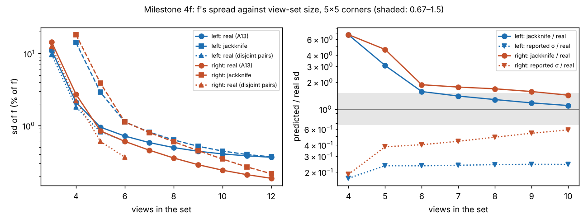
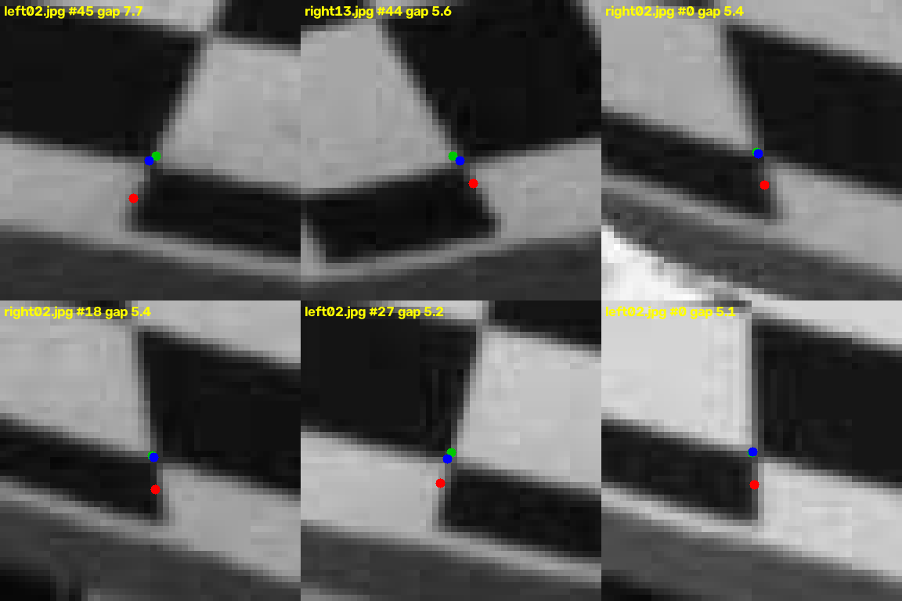
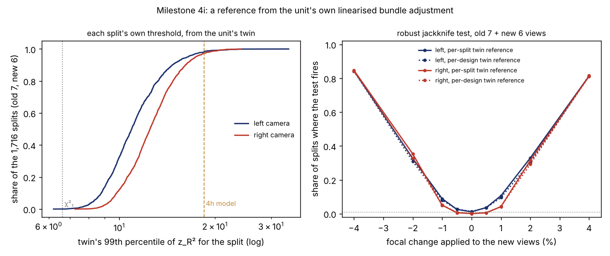

# Can a field camera trust its own self-calibration? An update test with measured false alarms on real images

*Letter-length version of [`draft.md`](draft.md), cut on 2026-11-19 for the 8-page limit of the target venue,
IEEE Robotics and Automation Letters (an aim, not a claim of acceptance). `draft.md` stays the extended
version: it holds every milestone, the natural-feature results in full and the list of what a submission
still needs. No number appears here that is not in `draft.md`, whose numbers `check_numbers.py` checks against
the stored results; `python3 paper/check_short.py` checks that every number here is copied from `draft.md`
and estimates the length. Citations are the keys of [`references.bib`](references.bib).*

## Abstract

A robot that re-estimates its camera intrinsics from the features it tracks, with no calibration target,
must decide whether to adopt each new estimate, and that decision rests on the solver's uncertainty. We
measure how honest that uncertainty is on real images of four real cameras, with the checkerboard's geometry
withheld from the solver and used only as a reference. Target-free bundle adjustment recovers the focal
length within 0.15% and 0.24% of Zhang's calibration, but its reported σf is about twice too
small, and a χ² update test built on it fires on 72.5% of splits of an unchanged camera (nominal 1%). A
leave-one-view-out jackknife brings false alarms to 1.7–2.5% with nothing fitted from outside. A rendered
twin of the capture traces the remaining set-to-set offset to the board itself: half-width end squares pull
OpenCV's default 11×11 `cornerSubPix` window up to 9.6 px off the corner and bias Zhang's focal length by
+0.6–0.9%. On unbiased corners, scored on every one of the 1,716 disjoint splits per camera, testing the
focal length alone against a reference drawn from a linearisation of the unit's own solve catches a 2% focal
change from 6 new views in 33% of splits at 0.4–1.4% false alarms; a plain χ²1 reference looks
better (54%) only because two errors cancel. On two further cameras from the TUM RGB-D benchmark the false-alarm
rate transfers at 5–6 new views and the power does not (10%). Power is a property of the unit's views, and the
same twin that sets the threshold can rank which updates are worth testing.

## I. Introduction

Cameras on field robots, construction and agricultural machines drift out of calibration from knocks, heat
and refocusing. Recalibrating with a target takes the machine out of service, so online self-calibration
from tracked features is attractive [keivan2014constant, nobre2017drift]. The theory of recovering
intrinsics without a target is old [maybank1992theory, triggs1998planar, pollefeys1999selfcal]. The open
question is whether the robot can tell a good update from a bad one with the statistics it has on board.
Calibration toolboxes report a covariance [furgale2013kalibr, richardson2013aprilcal, peng2019wizard], and
photogrammetry has a long tradition of statistical tests on self-calibrating adjustment [forstner2016pcv],
yet we found no study that scores a target-free solver's covariance against a target calibration *of the same
real camera from the same images* and then measures an accept/reject test's false-alarm rate and power on
real disjoint view sets.

We do that on small, fully open data sets and report what broke along the way. Contributions:

1. **A calibration of the calibration on real images:** target-free bundle adjustment against Zhang's method
   [zhang2000flexible] on two cameras, with z-scores over 360 view subsets, nested self-consistency, view-level
   covariances, and every subset of 3 to 12 views solved (Sections III–IV).
2. **A corner-localiser bias diagnosed with a digital twin of the capture:** renders of the 13 real board
   poses through a known camera, with blur, noise and JPEG matched to the real images (Section V).
3. **An update test with measured false alarms and power** on every disjoint split, with three reference
   distributions, the last drawn from the unit's own linearised solve, checked on two further cameras and on
   views the test never saw (Sections VI–VII).
4. **Recommendations a perception engineer can apply** (Section IX).

## II. Setting and data

**Images.** OpenCV's `samples/data` stereo set, `left01–14.jpg` and `right01–14.jpg` (index 10 absent),
640×480, a 9×6-inner-corner checkerboard. Two real cameras, 13 views each; they see the same board poses, so
they are not independent scenes. For transfer (Section VII) we use the checkerboard sequences of two further
units of the TUM RGB-D benchmark [sturm2012tumrgbd], a Kinect (fr1) and an Xtion (fr3), with 13 views per unit
picked by a rule fixed before any solve.

**Target-free solver.** The detected corners are correspondences; the 54 board points become free 3-D
unknowns (no planarity, no spacing). Initial focal length 30% wrong, two-view initialisation from the
homography, PnP for the other views, then Levenberg–Marquardt bundle adjustment over poses, points and
(f, cx, cy, k1), gauge fixed by one view's pose and one point's depth. The
reported covariance is the gauge-fixed Gauss–Newton inverse scaled by the residual variance [triggs2000ba].

**Reference and localisers.** Zhang calibration (`cv2.calibrateCamera`, fx = fy,
k1, k2) on all 13 views. Corners come from `cornerSubPix` with an 11×11 half-window
(the common tutorial setting, used unless stated), a 5×5 half-window, or `findChessboardCornersSB`
[duda2018checkerboard].

## III. Does target-free BA match a target calibration?

On all 13 views the target-free focal length is 534.82 px (left) and 538.43 px (right), against Zhang's
535.62 and 539.71: gaps of −0.15% and −0.24%, under 1σ. The price of no target is small at 13 views: the
target-free σf is 1.12× Zhang's. The free points expose something the target model hides: the
board is not flat. The reconstructed corners leave their best plane by 0.77% of a square rms, and the two
cameras, solved independently, reconstruct the same bend (correlation 0.90). OpenCV's released-object
calibration [strobl2011imperfect] returns the same intrinsics, σ and board shape as our solver: with the
board points free, the target contributes only metric scale.

## IV. Is the reported uncertainty honest?

Over 360 random subsets of 4–12 views, z = (fsubset − fZhang, all)/σf has
rms 1.94 (95% bootstrap 1.75–2.12); Zhang's own σ against the same reference gives 2.16. Against the
target-free all-view solution with the nested variance, rms z is still 2.28, so the 2× is not an artefact of
the reference. View geometry predicts the error (Spearman ρ between the spread of board orientations and
|Δf|/f: −0.46 left, −0.58 right), and on near-critical subsets (near-parallel boards [sturm1999plane]) rms z
rises to 2.41 while Zhang's σ is far worse (rms z 5.83).

Of three alternatives on the same subsets, a sandwich clustered by view [white1980hc] gives rms z 1.76 / 1.59,
and a leave-one-view-out jackknife [efron1981jackknife] gives 0.70 / 0.65 with 2σ coverage 97% / 99%. The
jackknife is honest and conservative, but it ranks updates worse: ROC AUC for good (≤ 1% error) against bad
(> 2%) updates is 0.75 against 0.91 for the reported σ. An honest σ and a good ranking statistic are different
statistics. Neither a second radial term nor clustering by board column fixes the 2×; the residuals were
correlated along one board axis (0.44–0.56 between neighbours along a column), which pointed at the corners
rather than the lens (Section V).

**How both error bars depend on the number of views (Fig. 1).** On unbiased 5×5 corners we solved every
subset of 3 to 12 of the 13 views on both cameras (16,172 view sets) and compared each σ with the real
set-to-set spread of f. The jackknife overstates the real spread 7.8× (left) and 8.2× (right) at 4 views
against disjoint pairs, and against the all-view reference its overstatement falls at every step from 4 to 10
views (left 6.7 to 1.1, right 6.7 to 1.4). Most of the small-set excess comes from a few delete-one solves
that land near the critical set: the median of the per-set jackknife variances overstates only 2.4× and 4.1×
at 4 views. The solver's own σ is 4–6× too small on the left camera at every size from 4 to 10 views, worse
than with 11×11 corners: better corners make σ less honest. Below 6 views neither σ is usable as an error bar;
from about 10 views the plain jackknife is a mildly conservative one.

*Fig. 1. Left: sd of f against the number of views in the set, real (around the all-view solution, and between
disjoint pairs) and as the jackknife predicts it. Right: predicted over real sd for the jackknife and the
reported σ. 5×5 corners, both cameras.*

## V. Which corners are right? A rendered twin of the capture

The localiser alone moves Zhang's focal length by 4.8 px (left) and 7.2 px (right), 0.9–1.3%, while every fit
reports σ ≤ 1.2 px, and the 11×11 window and SB disagree by more than 1 px on 22 (left) and 30 (right) corners,
every one on the grid's outer ring (Fig. 2). To say which is right we rendered the 13 real views through a known
camera (each side's all-view Zhang fit with k1 + k2) at the real poses, supersampled 4×4,
with blur and noise fitted so the renders' edge width and noise equal the real images' (edge σ 0.949 / 0.960 px
against 0.948 / 0.957 real), then JPEG.

On a board with full-width squares the renders do not reproduce the ring disagreement (largest 11×11–SB gap
0.19 / 0.36 px), and every localiser's Zhang f is within 0.04% of the truth. The cause was in the print:
measured outward along the grid lines, the real board's end squares in grid columns 0 and 8 reach only
0.49–0.53 of the corner spacing past the last corner, against 0.94–0.97 on the other sides. Re-rendered with
half-width end squares, the 11×11 window misplaces 12–18 ring corners per 13-view set by more than 1 px (up to
9.6 px) and biases f by +0.43% to +1.47% depending on the margin and surround (real images, 11×11 minus 5×5:
+0.64% / +0.91%); SB is biased the other way, −0.32% to −0.43% (real: −0.12% / −0.39%); the 5×5 window stays
within 0.04% of the truth. Our best estimates of the focal lengths are therefore Zhang on 5×5 corners, 532.9 px
(left) and 536.2 px (right).

*Fig. 2. The six real ring corners where the localisers disagree most, magnified 8×. Red: 11×11 `cornerSubPix`;
green: `findChessboardCornersSB`; blue: 5×5 `cornerSubPix`. The short end square pulls the 11×11 window off
the corner.*

## VI. An accept/reject test on disjoint view sets

**Protocol.** A split draws an *old* set of 7 views and a disjoint *new* set of k views from the 13. Unchanged
camera; an exact focal change of ±0.5, ±1, ±2, ±4% applied to the new views' solution; a principal-point
shift; and one real change, the new views taken from the other camera (0.67% in f and 17 px in cx).
The statistic is W = dT(Σold + Σnew)−1d over
(f, cx, cy), or zf² for f alone; a test fires above the reference's 99th
percentile. The splits reuse 13 views, so the intervals treat dependent splits as independent and are too
narrow.

**Covariances.** With the reported covariance, W against χ²3 at 1% fires on 72.5% of unchanged
splits (95% 68–76%). The covariance is 2.3–2.9× too small for f and cy, and the gap does not shrink
with more views: each view set carries its own offset. A sandwich clustered by view still fires on 36–38% (4–7
clusters are too few), while the jackknife covariance J fires on 2.5% (11×11 corners) and 1.7% (SB corners)
with nothing borrowed. For three parameters, though, 4–6 views of this rig carry too little information: even
an oracle threshold on W detects a 2% focal change in only 5–10% of splits. The rest of the paper tests f
alone, and keeps W for principal-point moves.

**Unbiased corners.** Re-solving every view set on 5×5 corners lowers the sd of (fnew −
fold)/f for an unchanged camera at k = 6 from 1.02% (11×11) and 0.86% (SB) to 0.59%, and W with J
catches the real unit swap in 79.4% of splits at k ≥ 4, against 30.3% on 11×11 corners. Because every subset
is now solved, every disjoint split can be scored, not a sample: 1,716 per camera with 7 old and 6 new views.

**Three references for zf².** Table I sets them side by side. *Borrowing a sibling's threshold*
(the other camera's 99th percentile on unchanged splits) looked strong on a sample of 60 splits (61.3% of ±2%
changes caught at k = 6) but on every split catches 43.3%, with 4.4% false alarms on the left camera: the two
cameras' 99th percentiles, re-estimated on every split, are 4.62 and 2.02, not 3.56 and 1.03. *A robust
jackknife* R (1.4826 × the MAD of the delete-one focal lengths) against χ²1 catches 53.8% at 2.3%
false alarms. That is not the power of a 1% test. A MAD of 6 or 7 delete-one values is itself noisy, so
zR² has a heavier tail than χ²1. If each view adds an independent offset to f, z² is
scale-free and its distribution depends only on the two set sizes, so a robot can compute its reference by
Monte Carlo with nothing borrowed: its 99th percentile is 18.45 at 7 + 6 views, not 6.63, and against
χ²1 that model fires on 6.1% of unchanged updates. On the real views R against χ²1 fired
less only because R still overstates the real spread at these sizes. The two errors cancel here, and nothing
guarantees they cancel on another unit. Against the model reference the robust test is safe (0.45% / 0.20%
false alarms) but catches 18.6%.

**A reference that knows the geometry.** Most of that gap is the model, not the information. The
independent-offset model ignores that the delete-one solves of a small set sit near the critical configuration
and swing far, which inflates the jackknife in a way that depends on which views are in the set. The unit's own
13-view solve already describes that geometry. For any view subset S, its first-order change in f under a pixel
perturbation ε is gS·ε, with gS = JS(JSTJS)−1ef
from the subset problem's Jacobian at the 13-view solution (f is gauge-invariant, so the subset's gauge does
not matter). One matrix product then draws every set's f and delete-one f's, and so z², for each (old, new)
split; we feed it the unit's own 13 residual patterns, reassigned to views at random with random signs. On 9,600
cold-start nonlinear solves of synthetic corners from this twin, the linear prediction's spread matches the
solver's to within 0.2% for 4 to 7 views. The twin reproduces most of the real jackknife's overstatement from
geometry alone (R's predicted-to-real ratio 0.75 / 0.76 at 7 + 6, against 0.88 / 0.48 measured), and its 99th
percentile of zR² is 10.93 / 12.49 at 7 + 6 (median over splits), not 18.45 (Fig. 3, left).

*Table I. f alone, 5×5 corners, every split, 7 old + 6 new views. False alarms pooled over k = 4–6, left / right.*

| test | ±2% detected (pooled) | false alarms |
|---|---|---|
| J, sibling's threshold | 43.3% | 4.4% / 0.3% |
| robust J, χ²1 | 53.8% | 3.4% / 1.2% |
| robust J, independent-offset model | 18.6% | 0.45% / 0.20% |
| robust J, twin per split | 33.1% | 1.44% / 0.37% |
| J, twin per split | 34.7% | 1.59% / 0.35% |
| robust J, twin per design | 30.8% | 1.60% / 0.66% |

Against the twin (pre-registered), the robust test catches a 2% change in 33.1% of splits and a 4% change in
81.2–84.7% (Fig. 3, right). With a reference that knows the geometry the MAD no longer buys power (the plain
jackknife does as well), and one threshold per design does almost as well as one per split: what the twin
contributes is the right tail for the design. The right camera stays below nominal because its jackknife
overstates the real spread about 1.6× more than its twin predicts.

*Fig. 3. Left: each split's 99th percentile of zR² from the unit's twin, against χ²1 and
the independent-offset model. Right: share of the 1,716 splits where the robust test fires, against the focal
change applied to the new views, with per-split and per-design twin references.*

## VII. Does the test transfer?

**Two more units (pre-registered).** We ran the same code, unchanged, on the Kinect and the Xtion of the TUM
benchmark. The Xtion's 13-view f is within 0.64% of TUM's; the Kinect's is 1.85% high, because its lens needs
more than k1. Against each split's twin threshold the robust test fires on 0.80% / 0.76% (fr1) and
0.62% / 0.06% (fr3) of unchanged updates at 5 / 6 new views, but on 3.27% and 4.73% at 4, where every
delete-one set has 3 views and the linearisation breaks. A 2% change from 6 views is caught in 10.0% of splits:
these units fix f less precisely (robust spread over 6-view sets 0.73% / 0.51% of f, against 0.51% / 0.30% on
OpenCV's cameras). A real change behaves like a scaled one of the same size: the units' focal lengths differ by
1.40%, and the old-from-the-other-unit test fires on 6.3% / 7.9% of splits, between its ±1% (2.0%) and ±2%
(10.0%) rates. Four of five predictions failed, in a useful direction: the false-alarm rate transfers at 5–6
new views, the power does not. Re-running all 11,442 TUM subset solves from the fleet's spec focal length showed
that the far solves are true minima, not solver failures; a basin check that drops any solve more than 10% from
the spec raised the false alarms at 4 new views to 4.36% and 20.09% (fr1 / fr3).

**Fitting the lens the camera has.** Re-solving with k1 + k2 and re-scoring with a
k1 + k2 twin raised the pooled ±2% detection from 10.0% to 14.8%, all of it on the Kinect,
with its false alarms at 0.59%. We had predicted the opposite, a precision cost: the unmodelled distortion was
not inert, and each view set absorbed a different share of it into f.

**Choosing when to test.** The twin that gives each split its threshold also gives its power. Scored against
the real detections at ±2% and 7 + 6 views, this predicted power ranks the splits with AUC 0.659, 0.693, 0.749
and 0.748 (OpenCV left and right, TUM fr1 and fr3). Testing only the quarter of splits it rates highest lifts
the TUM cameras' detection from 10.0% to 21.5%, and every split holding one of the far solves falls in the
quarter it rates lowest. The level is not right (the twin's mean power is 1.19–1.89× the real rate), so a unit
can use its twin to choose when to test, not to promise a detection rate. With the old set held fixed, as a
robot's is, and the twin picking among candidate new sets, the k1 + k2 twin's pick catches
±2% in 15.2% of old sets on the TUM units against 11.3% blind (×1.35); on the Kinect, 6.2% blind with
k1 becomes 17.9% chosen with k1 + k2, at 0.59% false alarms.

**On views the test has never seen (pre-registered).** A second, disjoint pool of 13 views per TUM unit, picked
by the same rule, with the old set from one pool and the new set from the other: false alarms stay under 2.5%
(0.91% on the Kinect, 1.90% on the Xtion) but not at nominal (1.40% pooled), and ±2% is caught in 7.96% of splits
against 14.76% in-sample. The second pool is flatter and its 6-view solves scatter twice as much (1.23% of f
against 0.59% and 0.50%). A per-view focal jitter in the twin, fitted per pool to the pool's own solves, keeps
every pairing at or below 0.58% false alarms but halves the power (4.07% against 9.08%), and a third pool on the
Kinect still over-alarms (2.60% pooled over ten pairings) because its 7-view solves hold 62 far solutions. The
in-sample false-alarm rates are therefore lower bounds, and the test's safety depends on the geometry of the
new views as well as on the threshold.

## VIII. From board corners to natural features

Every result above uses a board's corners. On hand-held TUM video with SIFT tracks [lowe2004sift] (three
sequences, two cameras, 57 counted windows of 12 keyframes over 1.2 s), the solver's σ is far less honest: rms z
against the board calibration is 9.31, and the scatter of f across windows is 4.20, 8.38 and 11.74 times the
median σ. The view-level remedy carries over: a delete-one-keyframe jackknife brings rms z from 9.31 to 1.76,
and pooling windows by DerSimonian–Laird random effects [dersimonian1986meta] keeps it honest (rms z 1.10 over
five-window blocks), whereas treating windows as independent overstates precision (2.79). The extended version
traces most of the remaining per-window error to the cameras' rolling shutter, after Karpenko et al.
[karpenko2011gyro], Hedborg et al. [hedborg2012rsba] and Oth et al. [oth2013rscalib]: with motion-capture
rates and a free readout in the window solve, the median focal error falls by a third to a half on both
cameras, and a soft prior on k1 from the camera's own earlier windows, followed by five-window
random-effects pooling, reaches 1.17% from 6 s of video. With the pool's between-window spread floored at the camera's own past
scatter, the bar is honest (three-window rms z 1.09) but too wide for a symmetric 2-sd change test to catch a
stale focal length below 8.5% at five windows. Scored by worst regret over a simulated staleness of up to 10%,
the rule that serves a robot is asymmetric: adopt the five-window pool unless it lies within half its sd of the
held value (worst regret 0.42 points, always adopting 1.17, the 2-sd gate 3.33), and it is the rule chosen in
every fold that leaves one sequence out. The same rule carries over to cy but not to cx or
the distortion, which the windows put 0.6&ndash;1.7 px low at 200 px from the centre in every sequence. Scored by
where rays land over 50&ndash;250 px, adopting f alone onto a held distortion stays minimax (worst regret 0.48 px,
against 0.63 for adopting the windows' distortion too), and a held distortion off by 50% still leaves less error
(1.51 px) than adopting the windows' f and distortion together (2.09 px). That holds out to the image corner only
where the held model does: the Kinect's two-term target fits fold back at 381 and 403 px, inside the image, and
leave 17.3 px at the edge, where adopting the windows' distortion leaves 5.5; the fold radius, computed from the held
coefficients, tells the two cases apart. A distortion gate is not worth having even with the windows' bias removed:
a half-sd bar still fires in 23 of 31 blocks.

## IX. Recommendations

1. **Gate on a view-level jackknife, not the solver's covariance.** The reported covariance and a view-clustered
   sandwich give 36–74% false alarms on an unchanged camera; the jackknife 1.7–2.5%.
2. **Test the focal length on its own, against a reference drawn from the unit's own linearised solve.** The
   gains of every view subset come from Jacobians of solves the robot already ran; draws of the unit's own
   residual patterns give each design's 99th percentile of z² (about 11–13 at 7 + 6 views with the robust
   jackknife). That test keeps false alarms at 0.4–1.4% with nothing borrowed. Against χ²1 the robust
   test is an approximately 2–6% test, not a 1% one.
3. **Check the corners before the statistics.** On a board with cut-short end squares, size the sub-pixel window
   below the shortest end square (here 5×5) or print full end squares with a margin of at least one window. The
   tutorial 11×11 window on this board is worth more focal-length error (+0.6–0.9%) than the self-calibration
   itself (0.15–0.24%).
4. **Do not borrow one sibling's threshold.** A 99th percentile from 180 statistics moved the borrowed test from
   61% power and 11% false alarms on a sample to 43% and 4.4% on every split.
5. **Collect at least 6 new views before testing, and about 10 before trusting a jackknife σ.** With 4 new views
   the twin reference over-alarms (3.3–4.7% on the TUM cameras). Never clip f to a window around the spec: far
   solves of near-degenerate sets are true minima.
6. **Let the twin choose when to test,** and read its power as a ranking only; it overstates the real rate
   1.2–1.9×.
7. **On natural features, take the error bar from the scatter of many short solves** (a keyframe jackknife, then
   random-effects pooling), not from one solve's covariance.
8. **Update a held focal length asymmetrically.** From five pooled windows, replace it unless the pool lies
   within half its sd; never gate the update on a symmetric 2-sd change test.
9. **Self-calibrate f and cy; hold cx and the distortion from a target calibration,** and
   score updates by where rays land, not by k1. Do not gate the distortion; before holding it, check that
   it does not fold inside the image corner, and recalibrate with a third radial term if it does.

## X. Limitations

One stereo rig, one board and one tutorial image set for Sections III–VI; two more units (TUM RGB-D) for the
update test, each one hand-held sequence of about 50 s. With 13 views per camera the splits reuse views and the
intervals are too narrow, and a 99th percentile from 180 statistics rests on about two of them. Scoring every
split removes the sampling of splits, not the reuse of views; fresh pools show the in-sample false alarms
understate the fresh-view rate (1.40% against 0.35%), but all pools of a unit come from one session. The focal
and principal-point changes are exact model transforms; the swaps between units are the only real changes. The
renders leave out the bend, the clipboard and background clutter, vignetting and the sensor's own noise.
Several findings (the half-width cause, the f-alone power figures) were found after a pre-registered prediction
failed and are labelled so in the log.

## XI. Conclusion

A self-calibrating camera's own covariance is too small to gate an update on, by about 2× on board corners and
4–12× on natural features. A view-level jackknife makes the gate safe; a reference drawn from the unit's own
linearised solve makes it as sensitive as the views allow; and on the board we used, the corner localiser, not
the solver, decided whether a 1–2% change could be seen at all. Code, images and every stored solve are open
(MIT; the images are OpenCV's, Apache-2.0).

*Written with AI assistance (Claude Code). No affiliation with any lab named here is implied.*
