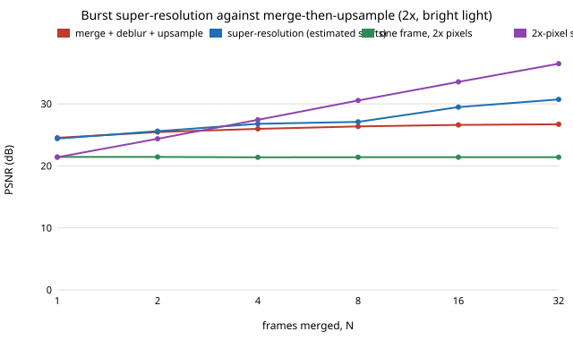

# sensing-superres: can a burst of hand-shaken low-resolution frames recover detail that merging and upsampling cannot?

Does a burst from a small, low-pixel-count sensor, shifted by hand shake, contain sub-pixel information that a merge-then-upsample pipeline throws away? On synthetic scenes with Poisson shot noise and 3 e⁻ read noise, a 2× grid, and shifts spread over two pixels: **in bright light, a regularised least-squares reconstruction on the finer grid reaches 29.5 dB at 16 frames and 30.7 dB at 32, against 24.0 dB for registering, averaging and bilinear-upsampling the same frames and 26.6 dB for registering, averaging and deconvolving them. About 2.6 dB of the gain is deblurring the pixel box, which needs no shifts; the other 2.9 dB at 16 frames (4.0 at 32) is sub-pixel information that only the shifts supply. In dim light (30 e⁻ per unit radiance) that second part nearly vanishes (−0.3 to +0.3 dB over deblurring at 16 and 32 frames, 2× to 4×). Shift errors cost it fast: 0.2 LR pixel of registration error removes two thirds of the sub-pixel gain, and about 0.27 px erases it. Against a sensor with 2× the linear resolution and the same total light, the burst wins at 2 frames and loses from about 4 frames on (26.8 against 27.4 dB), ties at 3× with 16 frames (28.9 against 28.8) and beats it at 4×.** Produced with AI assistance (Claude). Track 15 (`PROJECTS.md`), taking the "sub-pixel super-resolution merge" step listed in the next steps of [`sensing-burst`](../sensing-burst/README.md), a question that track's goal names (super-resolution) and that no project there asked. It builds on none of the CU Boulder groups in `prompt.md`. Everything here is synthetic: no raw files, no real sensor, and no claim about any particular phone.

**Live page:** https://duncan-haywood.github.io/oss-monorepo/research/sensing-superres/

**Builds on.** `sensing-burst` (the Poisson-Gaussian sensor and the Fourier cross-correlation shift estimator, copied so this project stays self-contained) and the multi-frame super-resolution literature: Tsai and Huang (1984), "Multiframe image restoration and registration", *Advances in Computer Vision and Image Processing* 1:317–339; Irani and Peleg (1991), "Improving resolution by image registration", *CVGIP: Graphical Models and Image Processing* 53(3):231–239; Farsiu, Robinson, Elad and Milanfar (2004), "Fast and robust multiframe super resolution", *IEEE T-IP* 13(10):1327–1344; and Wronski et al. (2019), "Handheld multi-frame super-resolution", *ACM TOG* 38(4), which uses hand-shake offsets and a kernel-regression merge on real raw bursts. The reconstruction here is a plain Tikhonov (gradient-penalty) least-squares fit solved by conjugate gradients, written for this experiment; it is not Farsiu's robust L1 method or Wronski's kernel merge, and none of those is reproduced. Noise model: Foi et al. (2008), *IEEE T-IP* 17:1737–1754.

## Method
- **Scene and sensor.** A 32×32 low-resolution (LR) frame is the box average of a canvas with 12 canvas pixels per LR pixel (each LR pixel integrates its whole area, with no anti-alias filter, as on a phone sensor). The canvas is a `sensing-burst` style texture with rectangles and discs, plus one 10×10 LR-pixel patch of grating with period 2.4 LR px, which is above the LR Nyquist rate. The scene is treated as periodic when shifted. The target is the unshifted canvas box-averaged onto the high-resolution (HR) grid, `f` HR pixels per LR pixel.
- **Burst.** Frame 0 is unshifted; each later frame is shifted by an integer number of canvas pixels, uniform over 0 to 2 LR px in each axis. Each frame records `Poisson(s·x)` electrons plus Gaussian read noise (3 e⁻), `s` = 300 e⁻ per unit radiance per LR pixel unless stated.
- **Shifts.** Estimated from the noisy frames by windowed Fourier cross-correlation against frame 0 (`estimate_shift`), then rounded to the nearest HR pixel, so up to half an HR pixel of true offset is unmodelled. The estimator's own RMS error is in the last column of E1.
- **Reconstruction (`sr_est`, `sr_oracle`).** Minimise (1/N)Σ‖A_k h − y_k‖² + λ‖∇h‖² over an HR image `h`, where A_k shifts by the frame's HR-pixel offset and box-averages `f×f`. Conjugate gradients, 80 iterations, started from the merge-and-upsample image. `sr_oracle` uses the true shifts (rounded to HR pixels), `sr_est` the estimated ones. λ ∈ {1e-4, 1e-3, 3e-3, 1e-2, 3e-2} is chosen for each row on two separate tuning scenes.
- **Baselines.** `single`: bilinear upsample of frame 0. `merge_up`: Fourier-register all frames to frame 0, average, bilinear upsample. `deblur_up`: the same average passed through the same least-squares solver with zero offset, i.e. regularised deconvolution of the pixel box and upsampling with no sub-pixel information; it takes the best λ on the test scenes themselves, which favours it. `hr1`: one frame of a sensor with `f×` the linear resolution and the same chip area and exposure time, so `s/f²` electrons per HR pixel and the same read noise. `hrN`: the mean of N such frames, registered perfectly (it needs no registration, so it is a generous bound).
- **Metric.** PSNR in radiance against the HR target, peak 1.0, over the interior, mean of 10 scenes.

## Reproduce
```bash
pip install numpy matplotlib pytest
cd research/sensing-superres
PYTHONPATH=src python -m pytest -q tests     # 10 tests
python experiments/run.py                    # writes experiments/results.txt (~3 min)
python experiments/figure.py                 # writes experiments/superres_vs_n.svg
```

## Results (from `experiments/results.txt`)
- **Bright light, f = 2 (E1).** PSNR in dB at N = 1, 2, 4, 8, 16, 32: super-resolution (estimated shifts) 24.4, 25.6, 26.8, 27.1, 29.5, 30.7; deblur_up 24.5, 25.5, 26.0, 26.4, 26.6, 26.7; merge_up 23.6, 23.8, 23.9, 24.0, 24.0, 24.0; one bilinear frame 23.5. The merge-and-upsample line is flat because averaging removes noise but not the pixel box or the aliasing; deblur_up saturates near 26.7 dB for the same reason, while the shifted reconstruction keeps climbing.
- **How much is sub-pixel information.** Super-resolution minus deblur_up is −0.1, 0.2, 0.8, 0.7, 2.9 and 4.0 dB at N = 1 to 32. With one frame there is nothing to gain and the two coincide; the gain turns on once there are enough distinct sub-pixel phases to fill the 2× grid (4 per axis pair) and noise averaging allows a small λ.
- **Estimated against true shifts.** Using estimated shifts costs 0.1 dB at 16 frames and 0.4 dB at 32 (29.49 against 29.61; 30.72 against 31.09). The estimator's RMS error is 0.09–0.13 LR px.
- **Shift error is the cliff (E2).** Adding Gaussian error to the true shifts (N = 16): 29.6, 29.4, 29.1, 27.5, 26.1, 22.9 dB at σ = 0, 0.05, 0.1, 0.2, 0.3, 0.5 LR px. Super-resolution falls below deblur_up (26.6 dB) at about σ = 0.27 px (linear interpolation) and below merge_up (24.0 dB) at about 0.43 px. Rounding to the HR grid is already a 0.25 LR px quantisation, which is part of why even σ = 0 sits below the noise-free ceiling.
- **Light (E3).** At 30 e⁻ per unit radiance the shifted reconstruction is within 0.3 dB of deblur_up in every cell (f = 2, 16 frames: 23.65 against 23.91; 32 frames: 24.98 against 24.80). Averaging 16–32 frames still helps (all methods beat one frame), but the sub-pixel detail sits below the noise. At 300 e⁻ the gain over deblur_up is 2.7–2.9 dB at 16 frames and 3.2–4.0 at 32, for f = 2, 3, 4 (f = 4: 28.46 against 25.72 at 16 frames).
- **Against a higher-resolution sensor (E1, E3).** One HR frame (hr1) is the worst option in bright light for f = 2 (21.4 dB, against 23.5 for a single bilinear LR frame) because each HR pixel gets a quarter of the light. A burst of 2 frames already beats it. Against an N-frame HR burst (hrN), f = 2 loses from N = 4 on (26.8 against 27.4 dB at 4; 29.5 against 33.6 at 16); f = 3 ties at 16 frames (28.89 against 28.82) and loses at 32 (29.81 against 31.87); f = 4 wins at both (28.46 against 25.24; 29.01 against 28.21). In dim light the HR burst is far behind (hr1 −4.5 to 6.6 dB), and the shifted reconstruction wins everywhere, mostly by averaging noise, not by recovering detail.



## Tests
Forward and adjoint operators satisfy ⟨Ah, y⟩ = ⟨h, Aᵀy⟩; the forward operator reproduces a rendered LR frame at HR-pixel shifts; six noise-free shifted frames recover the HR image to above 40 dB while one bilinear frame stays below 35 dB; bilinear upsampling preserves constants; the shift estimator returns the right sign and size on a known half-pixel shift; the capture model is unbiased in radiance; and the spectral-energy and block-average helpers behave on toy inputs.

## Limitations
- Synthetic scenes, a chosen noise model, ten scenes per cell and no confidence intervals; differences under about 0.3 dB should not be ranked. The text on dim-light results relies on cells that differ by 0.1–0.3 dB.
- The scenes are mostly smooth: only 3.2% of the target's spectral energy (f = 2) lies beyond the LR Nyquist rate, from one grating patch and the edges. A scene full of fine texture would gain more from shifts; a smoother one less.
- The forward model in the solver is the model that generated the data, apart from rounding shifts to the HR grid (an inverse crime). There is no lens blur, no Bayer mosaic or demosaicing, no fill-factor loss, no rolling shutter, no full-well clip and no subject motion. Real phone bursts add all of those, and Wronski et al. (2019) show how much they matter.
- Translation only: no rotation of the camera, no depth parallax, and the shifts are drawn uniformly rather than from a hand-shake spectrum.
- The comparison with an HR sensor is generous to the HR side (perfect registration free of cost, equal read noise per pixel, no fill-factor or well-capacity penalty for small pixels) and ignores that an HR burst could also be super-resolved or denoised better than a plain mean.
- The regulariser is a simple gradient penalty tuned on two scenes. Edge-preserving regularisation, a robust loss, or Wronski's kernel regression would very likely do better, and none was tried.
- Fourier cross-correlation on aliased frames is biased; a gradient-based sub-pixel registration might do better.

## Next steps
Replace the translation-only shifts with a small affine or optical-flow model and a hand-shake trace, add a Bayer mosaic and demosaicing, and try an edge-preserving regulariser; then test on openly licensed raw bursts (owner step: choose a dataset and confirm its licence). Combining the ghost-rejection merges of `sensing-ghost`/`sensing-ghostalign` with this reconstruction would be the next step toward a full pipeline.

## Owner steps
Capture real raw bursts of a fine-detail target (a resolution chart) with a handheld phone and with a sensor of known higher resolution, to calibrate the blur and noise models and to check the shift-error cliff against measured registration error. No purchase was made or recommended.

## Outside dependencies (vitamins)
Open-source Python packages only (numpy, matplotlib; pytest for tests). No hardware, no datasets.
